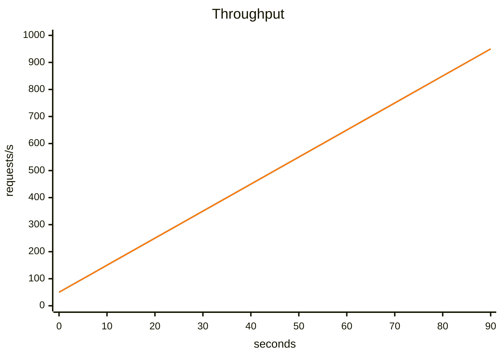
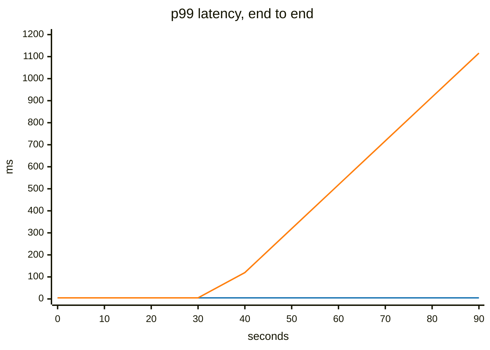

# Compare: fixture

_A: run `fixture-run` · B: run `fixture-run`_

| | A | B |
| --- | --- | --- |
| Design | fixture | fixture |
| Verdict | held | broke at 0:40 (450 rps offered) |
| Most served | 950 rps at 1:30 | 950 rps at 1:30 |
| Worst 10-second p99 | 5.0 ms | 1.12 s |
| Worst error rate | 0% | 0% |
| Diagnoses | none fired | Connection pool exhausted (api → db) from 0:40; Queueing knee (api pool to db) from 0:40 |
| Predictions held | 4 of 4 | 3 of 4 |
| Peak offered | 1,000 rps | 1,000 rps |
| Scale, seed | 1, 1 | 1, 1 |
| Host | 8 CPUs, 0.0 GiB, Docker  | 8 CPUs, 0.0 GiB, Docker  |
| Data | fresh copy | fresh copy |

Sources as in each run's report: served from k6_http_reqs_total{expected_response="true"} (k6: successful responses), p99 from k6_http_req_duration_seconds (k6 histogram, end to end), errors from k6_http_reqs_total{expected_response="false"} ÷ k6_http_reqs_total (k6).

**Before reading the difference:**

- Both are single runs. The same design varies from run to run on one machine, so a small difference may be noise: `loadl run --repeat 3` on each design measures how much on this host.

## Verdicts

**A.** Held the whole profile: up to 1,000 rps offered, 950 rps served at best, worst 10-second p99 5.0 ms, at most 0% errors.

**B.** Broke 0:40 into the load, at 450 rps offered: p99 reached 120 ms (5.0 ms at low load). Most saturated then: api → db pool 10 of 10 connections in use. Around then: latency +20 ms on connections into db for 10s at 0:30.

## Charts

Grey: offered (A). Blue: served, A. Orange: served, B (k6_http_reqs_total{expected_response="true"} (k6: successful responses)). Windows without data are drawn at 0.

Blue: A. Orange: B (k6_http_req_duration_seconds (k6 histogram, end to end)). Windows without data are drawn at 0.

Per-window numbers, side by side

| t | offered A | offered B | served A | served B | p99 A | p99 B | errors A | errors B |
| --- | --- | --- | --- | --- | --- | --- | --- | --- |
| 0:00 | 50 | 50 | 50 | 50 | 5.0 ms | 5.0 ms | 0% | 0% |
| 0:10 | 150 | 150 | 150 | 150 | 5.0 ms | 5.0 ms | 0% | 0% |
| 0:20 | 250 | 250 | 250 | 250 | 5.0 ms | 5.0 ms | 0% | 0% |
| 0:30 | 350 | 350 | 350 | 350 | 5.0 ms | 5.0 ms | 0% | 0% |
| 0:40 | 450 | 450 | 450 | 450 | 5.0 ms | 120 ms | 0% | 0% |
| 0:50 | 550 | 550 | 550 | 550 | 5.0 ms | 319 ms | 0% | 0% |
| 1:00 | 650 | 650 | 650 | 650 | 5.0 ms | 518 ms | 0% | 0% |
| 1:10 | 750 | 750 | 750 | 750 | 5.0 ms | 718 ms | 0% | 0% |
| 1:20 | 850 | 850 | 850 | 850 | 5.0 ms | 917 ms | 0% | 0% |
| 1:30 | 950 | 950 | 950 | 950 | 5.0 ms | 1.12 s | 0% | 0% |

## Diagnosis

### A

No diagnosis rule fired.

### B

- **Connection pool exhausted (api → db), from 0:40.** From 0:40, every connection in api's pool to db was in use and requests waited for one, while db still had CPU to spare. Requests were queueing for a connection, not for the database.
- **Queueing knee (api pool to db), from 0:40.** From 0:40, p99 stayed above 15 ms (5.0 ms at low load) with api pool to db at 100%. Near saturation requests wait behind each other, so latency grows non-linearly, not in proportion to load.

## Predictions

| Prediction | A | B |
| --- | --- | --- |
| `p99_ms < 50 until load_rps >= 500` | held, worst 5.0 ms | broken, worst 120 ms (broke at 0:40) |
| `error_rate < 1%` | held, worst 0% | held, worst 0% |
| `db.cpu < 90% after 50s` | held, worst 48% | held, worst 48% |
| `rps >= 400 after 60s` | held, worst 650 rps | held, worst 650 rps |

## Design changes

Both runs used the same design file.

