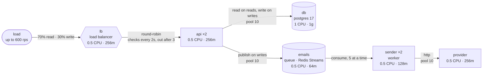

# The backed-up queue

Level 3 · about 45 minutes · teaches job queues and workers, consumer lag, Little's law for workers, and what a buffer can and can't absorb

## The story

You run checkout for a shop. Each order is saved to Postgres, and its confirmation email goes on a queue, so checkout doesn't wait for the email provider. Two sender workers take the emails off the queue and hand each one to the provider, which takes about 150 ms to accept one.



This morning the sale opens. Traffic goes from 150 requests a second to 600 over two minutes, and three in ten requests are orders. Product managers have one rule: checkout must never fail, and customers should get their email within a minute.

## The question

Before you run anything, write down your guesses. Don't work them out: a gut answer is fine, and where the run differs from it is what you'll learn from.

1. Does checkout fail during the sale? If so, from what load?
2. How late are the confirmation emails at the peak?
3. If the queue had sixteen times the memory, what would change?

Loads depend on your machine: slower cores break the same design at a lower load, so a guess can miss even when the reasoning behind it is right.

`loadl predict design.yaml` asks questions like these and writes your answers into the `expect` block at the bottom of `design.yaml`, or write them there yourself. The report scores each one against what the run measured. The line already there is an example; the grammar is in the [design file reference](../../skills/loadlore-designer/references/schema.md).

## Run it

```sh
loadl run scenarios/backed-up-queue/design.yaml
loadl report latest --print | less
```

The run takes about 6 minutes. It needs 8 CPUs and 8 GB available to Docker: the design and Loadlore's own containers add up to 7.4 CPUs. On a smaller machine, add `--scale` with the largest value that fits; `loadl run` warns you when the host is too small and suggests one. The numbers here come from a MacBook Air M4 on mains power.

Watch the run's output: each progress line shows the jobs waiting in the queue.

Stuck? `loadl hint backed-up-queue` reveals one hint at a time.

## What to try next

When you know why it broke, change one thing and run it again. Write an `expect` line for what you think will happen, then compare the two runs:

```sh
loadl compare <first-run> latest -o compare.md
```

Some directions: the workers' replicas, how many jobs each runs at once and their pools, and the queue itself. Before each run, work out how many emails a second the workers can send, and how many arrive at the peak.

`solutions/` has a worked answer with its report, and `variants/bigger-queue` is a fix that fits a different problem. They give the game away, so try your own first.
