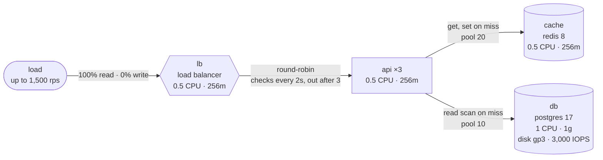

# The cache restart

Level 2 · about 40 minutes · teaches cold caches, the thundering herd and request coalescing

## The story

You run the product pages of a shop with 200 products, and, as in most shops, a handful of them get most of the traffic. Each page shows the product's review summary. Computing it is slow, a count over the whole reviews table, so the api keeps the result in Redis for ten minutes: it looks the product up there, and only on a miss asks Postgres and stores the answer.

It works. Once the cache is warm, nearly every lookup hits, and the database sits at a few percent CPU while the page serves 1,500 requests a second. Each of the three api replicas keeps a pool of 10 connections to it, 30 in all, plenty for the occasional miss.



The load starts gently, at 10 requests a second, so the cache fills while traffic is low, then ramps to 1,500 over two minutes and holds there. At 3:01, Redis restarts, as a deploy or a node replacement would restart it. It keeps nothing on disk, so it comes back empty.

## The question

Before you run anything, write down your guesses. Don't work them out: a gut answer is fine, and where the run differs from it is what you'll learn from.

1. What do users see in the seconds after Redis comes back, and how long until the errors stop?
2. How many times does the database run the review summary for the most popular product in the first second after the restart?
3. The cache was just as empty at the start of the run. Why might that have been fine, and the restart not?
4. If the api had half as many database connections, would it be better or worse?

`loadl predict design.yaml` asks questions like these and writes your answers into the `expect` block at the bottom of `design.yaml`, or write them there yourself. The report scores each one against what the run measured. The line already there is an example; the grammar is in the [design file reference](../../skills/loadlore-designer/references/schema.md).

## Run it

```sh
loadl run scenarios/cache-restart/design.yaml
loadl report latest --print | less
```

The run takes about 7 minutes, plus about a minute the first time to seed the 140,000-row reviews table. It needs 8 CPUs and 8 GB available to Docker, Loadlore's own containers included; on a smaller machine, add `--scale` with the largest value that fits. `loadl run` warns you when the host is too small and suggests one.

The database's query time depends on your machine's core speed, so on a slower machine the herd is worse, and on a much faster one the starting design may recover by itself. Plug a laptop in, turn off Low Power Mode, and compare your runs with each other.

Stuck? `loadl hint cache-restart` reveals one hint at a time.

## What to try next

When you know why it didn't recover, change one thing and run it again. The restart will hurt whatever you do; the question is whether, and how fast, it ends. Write an `expect` line for what you think will happen, then compare the two runs:

```sh
loadl compare <first-run> latest -o compare.md
```

Some directions: how the api fills the cache on a miss, its pools, the database's capacity, or keeping the cache from coming back empty. For each, work out how many times the database runs the same query for the same product in the first second.

`solutions/` has a worked answer with its report. It gives the game away, so try your own first. `variants/smaller-pool` is the other fix you might reach for, a smaller database pool; its README says how it goes, so read that after you've tried it.
