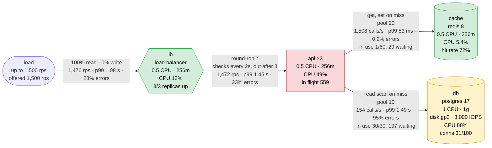
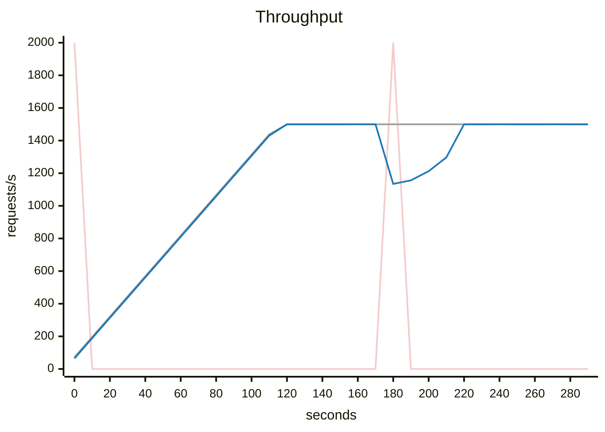
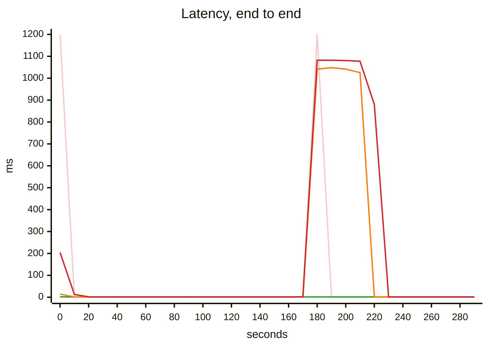
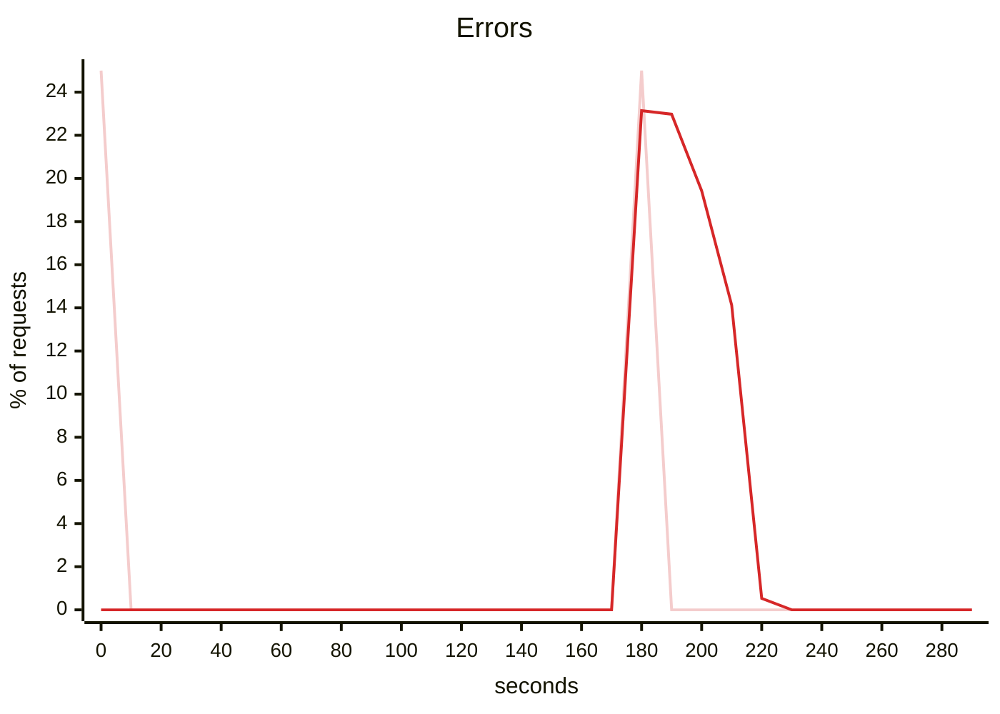
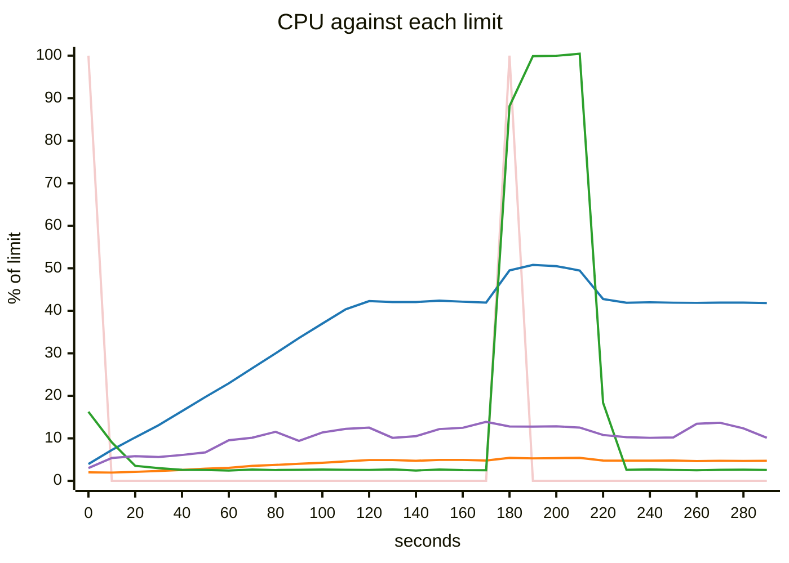

# cache-restart-coalesce: run report

_run `cache-restart-coalesce-20261118-102012` · completed · 18 Nov 2026 10:20 UTC · scale 1 · seed 1_

## Verdict

**Broke.** Broke 3:00 into the load, at 1,500 rps offered: p99 reached 1.08 s (13 ms at low load), 23% of requests failed and only 1,134 rps succeeded. Of api's failed requests, 57% failed because calls to db ran past their timeout. Most saturated then: api → db pool 30 of 30 connections in use, waiting on db (CPU 88%, CPU-throttled 55.4 s, 48 ms per call with a connection, 10 ms at low load). Around then: restart cache at 3:01. It recovered at 3:50, 0:50 after the break, and stayed healthy to the end.

Caveat: at 2:00 the load generator hit its CPU limit and was stalled in 2.0% of its scheduling periods (container_cpu_cfs_throttled_periods_total ÷ container_cpu_cfs_periods_total (cAdvisor)); work caught in a stall waits for the next 100 ms period, which can show up in p99.

<sub>Sources: offered load: the load profile in plan.json (offered arrival rate); served: k6_http_reqs_total{expected_response="true"} (k6: successful responses); p99: k6_http_req_duration_seconds (k6 histogram, end to end); errors: k6_http_reqs_total{expected_response="false"} ÷ k6_http_reqs_total (k6); saturation: loadlore_pool_connections{state="in_use"} and loadlore_pool_max_connections. Windows are 10 seconds; what counts as broken is under [Thresholds](#thresholds).</sub>

## Diagram at 3:00

Measured in the 10-second window from 3:00 to 3:10 (the break). Nodes are colored by their most saturated resource, CPU against its limit or a connection pool's connections in use: red at 90% or more, amber from 70%, green below.



<sub>Sources: offered from the load profile in plan.json (offered arrival rate); load edge from k6_http_reqs_total (k6: all responses) and k6_http_req_duration_seconds (k6 histogram, end to end); CPU from container_cpu_usage_seconds_total (cAdvisor) ÷ the container's CPU limit; calls/s from loadlore_calls_total (the caller's outbound call attempts) and their p99 from loadlore_call_duration_seconds (the caller's histogram, pool wait included); pools from loadlore_pool_connections{state="in_use"} and loadlore_pool_max_connections and loadlore_pool_pending (callers waiting for a connection); lb traffic from haproxy_backend_http_requests_total (HAProxy), replicas up from haproxy_backend_active_servers (HAProxy), and the lb edge's p99 from loadlore_request_duration_seconds (the service's own histogram); conns from pg_stat_activity_count and pg_settings_max_connections (postgres_exporter); hit rate from redis_keyspace_hits_total and redis_keyspace_misses_total (redis_exporter).</sub>

## Charts

One point per 10-second window, at the window's start; x is seconds from the start of the load.



<sub>Grey: offered load (the load profile in plan.json (offered arrival rate)). Blue: successful responses (k6_http_reqs_total{expected_response="true"} (k6: successful responses)). Pink spikes mark 0:00 stall; 3:01 cache kill; 3:01 cache die (exit code 0); 3:01 cache start; 3:01 cache restart; 3:01 restart cache; 3:00 break.</sub>



<sub>Green: p50. Orange: p95. Red: p99 (k6_http_req_duration_seconds (k6 histogram, end to end)). Pink spikes mark 0:00 stall; 3:01 cache kill; 3:01 cache die (exit code 0); 3:01 cache start; 3:01 cache restart; 3:01 restart cache; 3:00 break.</sub>



<sub>Failed requests as a share of all responses (k6_http_reqs_total{expected_response="false"} ÷ k6_http_reqs_total (k6)), timeouts included. Pink spikes mark 0:00 stall; 3:01 cache kill; 3:01 cache die (exit code 0); 3:01 cache start; 3:01 cache restart; 3:01 restart cache; 3:00 break.</sub>

| Service | Failed requests | Share of its failures | Cause | From calls to | First seen | What it means |
| --- | --- | --- | --- | --- | --- | --- |
| api | 8,013 | 67% | `timeout` | db | 3:00 | calls to db ran past their timeout |
| api | 3,985 | 33% | `pool_timeout` | db | 3:00 | they timed out waiting for a pool connection to db |
| api | 4 | <0.1% | `conn_reset` | cache | 3:00 | connections to cache were reset or closed mid-call |

<sub>Why requests failed, over the whole run (loadlore_request_errors_total and loadlore_call_errors_total, by cause). A request that failed after retries counts once, by its last attempt's cause.</sub>



<sub>Blue: api. Orange: cache. Green: db. Purple: lb (container_cpu_usage_seconds_total (cAdvisor) ÷ the container's CPU limit, mean over the window). Pink spikes mark 0:00 stall; 3:01 cache kill; 3:01 cache die (exit code 0); 3:01 cache start; 3:01 cache restart; 3:01 restart cache; 3:00 break.</sub>

## Diagnosis

### 1. Connection storm (api → db), from 3:00

At 3:00, api's pools opened 824 connections to db within 10 seconds, at 1,500 rps offered, and p99 reached 1.08 s (13 ms at low load). The pools open connections only when callers need them, so when a short slowdown leaves requests waiting, every replica opens more at once. Each new Postgres connection starts a server process and authenticates, which takes db's CPU from queries just when it is short of it.

Evidence:

- 824 new connections to db from 3:00 to 3:10: from 9 open to 30 of 30 <sub>(loadlore_pool_connect_seconds (new connections the pools opened, and how long each took))</sub>
- p99 1.08 s at 3:10, against 13 ms at low load <sub>(k6_http_req_duration_seconds (k6 histogram, end to end))</sub>
- each new connection took 96 ms to open at 3:00, against 3.0 ms for the ones opened before <sub>(loadlore_pool_connect_seconds (new connections the pools opened, and how long each took))</sub>
- up to 197 requests waiting for a connection at 3:00 <sub>(loadlore_pool_pending (callers waiting for a connection))</sub>
- db CPU at 88% of its limit at 3:00 <sub>(container_cpu_usage_seconds_total (cAdvisor) ÷ the container's CPU limit)</sub>
- db was CPU-throttled for 55.4 s (summed over its threads) in the window from 3:00, while its average CPU was 88% of its limit: bursts of work hit the 1-CPU limit and waited for the next period <sub>(container_cpu_cfs_throttled_seconds_total (cAdvisor))</sub>
- api's calls to db took 48 ms each once they had a connection at 3:00, against 10 ms at low load <sub>(loadlore_call_duration_seconds minus loadlore_pool_wait_seconds, per call (time with a connection))</sub>

**Try next:** Open the connections before the load arrives: give the pool a minimum (pools: { db: { size: 10, min: 10 } }) and re-run to compare a warm pool with this cold one. PgBouncer in front of db also keeps server connections open.

### 2. Cold cache (cache, api → db), from 3:00

At 3:00, cache's hit rate fell to 72% from 100%, 28% of lookups missing, and api's reads from db reached 154 rps, against none before. The keys the cache used to answer now miss together, so their reads all go to the database at once: a thundering herd.

Evidence:

- cache hit rate 72% at 3:00, against 100% before <sub>(redis_keyspace_hits_total and redis_keyspace_misses_total (redis_exporter))</sub>
- 154 rps from api to db at 3:00, against none before <sub>(loadlore_calls_total to the database (the caller's own counts))</sub>
- db CPU at 88% of its limit at 3:00 <sub>(container_cpu_usage_seconds_total (cAdvisor) ÷ the container's CPU limit)</sub>
- cache kill at 3:01 <sub>(events.jsonl)</sub>

**Try next:** Keep a cold cache from sending every miss to db at once: coalesce concurrent misses for the same key (single-flight), so one read fills it for everyone, or warm cache before it takes traffic.

### 3. Queueing knee (db CPU), from 3:00

From 3:00, p99 stayed above 38 ms (13 ms at low load) with db CPU at 88%. Near saturation requests wait behind each other, so latency grows non-linearly, not in proportion to load.

Evidence:

- median end-to-end p99 by db CPU: below 50%: 1.6 ms (26 windows); 80–90%: 1.08 s (1 window); 90% and up: 1.08 s (3 windows) <sub>(k6_http_req_duration_seconds (k6 histogram, end to end); container_cpu_usage_seconds_total (cAdvisor) ÷ the container's CPU limit)</sub>
- 3:00 to 3:30: p99 1.08 s, 1.08 s, 1.08 s with db CPU 88%, 100%, 100% <sub>(k6_http_req_duration_seconds (k6 histogram, end to end); container_cpu_usage_seconds_total (cAdvisor) ÷ the container's CPU limit)</sub>
- api → db pool 30 of 30 connections in use at 3:00: a symptom, since connections stayed in use longer while db was slow to answer <sub>(loadlore_pool_connections{state="in_use"} and loadlore_pool_max_connections)</sub>
- db CPU at 88% of its limit at 3:00 <sub>(container_cpu_usage_seconds_total (cAdvisor) ÷ the container's CPU limit)</sub>
- api's calls to db took 48 ms each once they had a connection at 3:00, against 10 ms at low load <sub>(loadlore_call_duration_seconds minus loadlore_pool_wait_seconds, per call (time with a connection))</sub>
- db was CPU-throttled for 55.4 s (summed over its threads) in the window from 3:00, while its average CPU was 88% of its limit: bursts of work hit the 1-CPU limit and waited for the next period <sub>(container_cpu_cfs_throttled_seconds_total (cAdvisor))</sub>
- Little's law on api at 3:00: 1,472 rps × 183 ms mean time in the service = 269 in flight; measured 250 <sub>(loadlore_requests_inflight (summed over replicas); rate and mean from loadlore_request_duration_seconds (the service's own histogram))</sub>

**Try next:** Add capacity or cut per-request work on db, then re-run the ramp.

<sub>Rules version 23. Rules are deterministic and offline; their thresholds are listed below.</sub>

## Predictions

1 of 1 scored prediction held.

| Prediction | Result | Worst value | Checked over | Notes |
| --- | --- | --- | --- | --- |
| `error_rate < 1% after 3m40s` | **held** | 0.5% | from 3:40 to the end | source: k6_http_reqs_total{expected_response="false"} ÷ k6_http_reqs_total (k6) |

## Timeline

| Time | Event |
| --- | --- |
| 0:00 | stall: only 90% of the offered rate was served for 10 s, then recovered; too short to count as a break; no diagnosis covers it |
| 3:01 | container: cache kill |
| 3:01 | container: cache die (exit code 0) |
| 3:01 | container: cache start |
| 3:01 | container: cache restart |
| 3:01 | fault started: restart cache |

<sub>From events.jsonl: the fault timeline and Docker container events. Stalls are from the per-window numbers below, judged by the thresholds; each names the diagnoses that cover it, counting one that ends as the stall starts.</sub>

## Assumptions

### From the design

The design lists no assumptions.

### Chosen by Loadlore

| Field | Value | Why |
| --- | --- | --- |
| services.cache.config.maxmemory | 192m | 75% of the container's 256m memory limit, as managed Redis usually does; the rest is for fragmentation and client buffers. Set maxmemory: 0 for stock Redis (no cap) |
| services.cache.config.maxmemory-policy | allkeys-lru | evict the least recently used keys when the cache is full, as managed Redis usually does |
| workload.timeout_ms | 10s | the default; k6 gives up on a request after this long and counts it as failed |
| workload.slo.p99_ms | 500 ms | the default; a break on p99 alone needs p99 at or above this as well as 10x the low-load p99, so latency users would still accept isn't called a break |
| network.profile | same-zone: 0.3 ms round trip | the default: every service in one availability zone. AWS says a round trip between two instances in the same zone is generally sub-millisecond with enhanced networking, and publishes no exact figure, so the 0.3 ms round trip Loadlore adds between any two containers is its own estimate, inside that bound. Applied between any two of the stack's containers, the load generator and the entry point included, as half the round trip on each side's outgoing packets; Loadlore's own tooling isn't slowed. Not scaled with --scale. Source: AWS Architecture Blog, Improving performance and reducing cost using Availability Zone Affinity: https://aws.amazon.com/blogs/architecture/improving-performance-and-reducing-cost-using-availability-zone-affinity/ |
| resources.cpu_period_ms | 100 ms for api, cache, db, lb | Docker's default. A container that uses its CPU share early in a period stalls until the next one, which can show up in p99 when a service has a fraction of a CPU |
| services.db.disk | gp3: 1 ms per read, 1 ms per write, 3000 IOPS, 125 MiB/s | a gp3 volume at its baseline: 3,000 IOPS and 125 MiB/s, included in its price, and up to 80,000 IOPS provisioned. AWS publishes no exact latency, only single-digit milliseconds, so the 1 ms Loadlore adds to every read, write and fsync is its own estimate: the low end of that range, so the disk is flattered rather than handicapped. Reads and writes are capped separately, so a mixed load can reach up to twice the IOPS. Provisioned throughput isn't modelled. Source: AWS, Amazon EBS General Purpose SSD volumes: https://docs.aws.amazon.com/ebs/latest/userguide/general-purpose.html |
| services.lb timeouts | connect 5s, server 60s | HAProxy's own timeouts, with its defaults otherwise. A request already sent to a replica that dies waits for the server timeout (or the load generator's); health checks only stop new requests going there |
| services.api.pools.db.min | 0 | the default, as pgxpool's: each replica opens connections only when callers need them, so a pool fills as load rises, and a burst opens many at once |
| services.api.pools.db.hold | call | the default, as pgxpool's: a request takes a connection for each call and hands it back straight away |

### How the run was planned

- load generator: 4000 VUs started before the load, the scenario's measured prealloc_vus 4000 at --scale 1, more than 1500 rps × the SLO's 500 ms
- Loadlore's own containers get fixed budgets: load generator 1.5 CPU (peak 1500 rps), Prometheus 0.1, cAdvisor 0.1, exporters 0.1 each. No fault acts on a connection, so every connection is direct and there is no Toxiproxy

## Thresholds

- **Broke:** 2 windows in a row with at least 1.0% of requests failing or successful responses below 90% of the offered rate, or 3 windows in a row with any of those or p99 at least 10x the low-load p99 (the median p99 of windows offered at most 25% of the peak, before errors or a shortfall in 2 windows in a row) and at least the SLO, 500 ms (workload.slo.p99_ms): 500 ms in this run. A shorter episode is shown as a stall in the timeline, not a break.
- **Doubtful:** a break on p99 alone, when the load generator was stalled at its CPU limit in 1.0% or more of its scheduling periods in one of the break's windows and the entry service's own p99 (loadlore_request_duration_seconds (the service's own histogram)) was below the limit in one of them. The verdict stays what it was.
- **Inconclusive:** before the break (or anywhere, if nothing broke), the load generator dropped more than 1.0% of a window's arrivals (more than 5.0% in a window where the system itself failed 1.0% or more of requests; up to that it's a caveat that gives the share), or the load generator used 90% or more of its CPU budget, or was stalled at its CPU limit in 5.0% or more of its scheduling periods (from 1.0% it's noted as a caveat). The first 10 s of load are a warm-up and don't count: the load generator starts its VUs and connections open then. A cause is named only with evidence: on a Linux host, the hypervisor giving 2.0% or more of CPU time to other virtual machines (steal), or other programs using 10% or more of the host's CPUs (at least 0.5); inside a VM on this machine, only as a possibility. A fault that couldn't be injected, or an autoscaler decision that couldn't be carried out, also makes a run inconclusive: it measured a different design.
- **Connection pool exhausted:** for two windows in a row, a pool at 95% or more of its size with callers waiting, while the target wasn't busy (busy: its CPU at 80% or more, or its time per call with a connection at least 3x the low-load value and 1 ms above it; CPU throttling alone doesn't count) and the caller's CPU stayed below 90%.
- **Queueing knee:** for 3 windows in a row, p99 at least 3x the low-load p99 and 10 ms above it, with a CPU or pool at 70% or more. When that is a pool whose target was busy in any of those windows, or a service's CPU whose requests spent 50% or more of their time in calls to a busy target, the knee is the target's.
- **Connection storm:** up to the break, a service's pools to a Postgres opening at least 50% of their combined size, and 10 or more connections, in one window, while p99 in that window or the next was at least 10x the low-load p99 and 10 ms above it. New connections are counted by loadlore_pool_connect_seconds (new connections the pools opened, and how long each took), or for runs from before it, from the rise in open connections.
- **Retry storm:** for two windows in a row, a caller that retries sending 1.5x or more of its low-load calls per request to a target, with retries 20% or more of them, while the target failed 1.0% or more of its calls or its p99 was 3x its low-load value.
- **Cold cache:** a cache's share of lookups that miss rising to 5x its level before or more, and to 5.0% of lookups at least, while its callers' reads of the database behind it reach 2x their rate before (counted as at least 1 a second, for a cache warm enough to send none).
- **Working set doesn't fit:** for two windows in a row, a Postgres answering less than 90% of block reads from shared_buffers and reading 100 blocks a second or more from outside them, while p99 was 3x the low-load p99 or more. When Postgres times its reads (track_io_timing, on with a disk block), each block read must also take 3x its low-load time or more, and 1 ms more.
- **Replication lag:** for two windows in a row, a read replica 1 s or more behind its primary, or 5.0% or more of the reads after a write it served missing the write.
- **Consumer lag:** for two windows in a row, a queue's oldest unfinished job had waited 5 s or more, or the queue held more jobs than its workers run at once and grew, with jobs published 5.0% or more faster than they were finished. Named a full queue once its memory reached 90% of its maxmemory or it refused jobs.
- **Autoscale lag:** the run broke while an autoscaled service's replicas were at 90% or more of their CPU limit: below its max, the autoscaler hadn't caught up; at its max (autoscale ceiling), it had nothing left to add.
- **Hot rows:** for two windows in a row, 2 or more of a Postgres's backends waiting on locks on average, while a caller's writes to it took 3x their low-load time or more (and 2 ms more). Reads of the same rows may slow too, and the summary says when the database's CPU per request reached 3x its low-load value: the contention burning CPU. A queueing knee on that database's CPU at the same time then points at the rows. Windows with a disk_slow fault on the database don't count.
- **Hot shard:** for two windows in a row, a caller sending calls to shards by key, one shard taking 1.5x the calls of the next busiest shard or more while it was busy (CPU 80% or more, or its calls 3x their low-load time and 1 ms more) and another shard's CPU under 50%. A queueing knee on that shard at the same time then points at its popular keys.
- **CPU bursts at the limit:** a stall no other rule covers and no fault made, in which a component was CPU-throttled for 3 s or more in a window (summed over its threads) while its average CPU stayed under 90% of its limit: bursts of work used up a CFS period's quota early and waited for the next period.
- **Host disk stalls:** for 2 seconds or more, a Postgres read no blocks and committed at most 10% of its median over the 10 s before (50 a second or more), while 5 or more queries waited on disk reads or WAL flushes and its exporter answered; on a modelled disk it had also been reading 20 blocks a second or more (median), which its caps can't stop for seconds; not under a disk_slow fault on it. Near the break it makes the run inconclusive; anywhere else it's a caveat, and its windows are flagged and left out of exports.

## Environment

- loadl dev, profile 5m0s, scale 1, seed 1
- Host: 8 CPUs, 9.7 GiB memory, Ubuntu 24.04.4 LTS (aarch64, kernel 6.8.0-117-generic), cgroup v2
- Docker 29.5.2, Compose 5.1.1
- Host speed index 1010 (hash 960, memory 1066, syscalls 1006): one CPU's work against the reference machine's 1000 (MacBook Air M4 (4 performance and 6 efficiency cores), Colima VM with 8 vCPUs). CPU limits are fractions of this host's cores, so a lower index means the design breaks at a lower load
- Cool-down: none needed; the first benchmark (1010) was within 5.0% of the run it's compared with (990)
- Host CPU: Docker runs in a VM on this machine, so other programs' use of the CPU can't be seen
- Data: a fresh copy of the cached seeded dataset
- Load generator summary (k6): 360,579 requests, 0 dropped arrivals, 3.3% failed

<details><summary>Containers and images</summary>

| Container | Image |
| --- | --- |
| loadlore-cache-restart-coalesce-20261118-102012-api-0-1 | loadlore/synthetic:dev |
| loadlore-cache-restart-coalesce-20261118-102012-api-1-1 | loadlore/synthetic:dev |
| loadlore-cache-restart-coalesce-20261118-102012-api-2-1 | loadlore/synthetic:dev |
| loadlore-cache-restart-coalesce-20261118-102012-cache-1 | redis:8.2 |
| loadlore-cache-restart-coalesce-20261118-102012-db-1 | postgres:17.11 |
| loadlore-cache-restart-coalesce-20261118-102012-lb-1 | haproxy:3.2.26 |
| loadlore-cache-restart-coalesce-20261118-102012-lore-cadvisor-1 | ghcr.io/google/cadvisor:v0.60.6 |
| loadlore-cache-restart-coalesce-20261118-102012-lore-k6-1 | grafana/k6:2.3.0 |
| loadlore-cache-restart-coalesce-20261118-102012-lore-pgexp-db-1 | quay.io/prometheuscommunity/postgres-exporter:v0.20.1 |
| loadlore-cache-restart-coalesce-20261118-102012-lore-prometheus-1 | prom/prometheus:v3.16.0 |
| loadlore-cache-restart-coalesce-20261118-102012-lore-redisexp-cache-1 | oliver006/redis_exporter:v1.97.0 |

</details>

## Per-window data

<details><summary>30 windows of 10 seconds</summary>

| t | offered | served | dropped | errors | p50 | p99 | api CPU | cache CPU | cache hit rate | db CPU | db conns | lb CPU | lb up | api→cache pool | wait | api→db pool | wait | k6 CPU | k6 stalled |
| --- | --- | --- | --- | --- | --- | --- | --- | --- | --- | --- | --- | --- | --- | --- | --- | --- | --- | --- | --- |
| 0:00 | 72 | 65 | 0 | 0% | 1.7 ms | 204 ms | 3.9% | 2.0% | 81% | 16% | 10 | 3.0% | 3 | 1/60 | – | 1/30 | 0.1 ms | 6.9% | 4.1% |
| 0:10 | 196 | 189 | 0 | 0% | 1.7 ms | 13 ms | 7.3% | 2.0% | 97% | 9.1% | 11 | 5.4% | 3 | 0/60 | – | 1/30 | 0.0 ms | 4.9% | 1.0% |
| 0:20 | 320 | 313 | 0 | 0% | 1.5 ms | 1.8 ms | 10% | 2.1% | 100% | 3.5% | 10 | 5.8% | 3 | 1/60 | – | 0/30 | 0.0 ms | 4.3% | 0% |
| 0:30 | 445 | 438 | 0 | 0% | 1.3 ms | 1.5 ms | 13% | 2.3% | 100% | 3.0% | 11 | 5.6% | 3 | 1/60 | – | 0/30 | – | 4.2% | 0% |
| 0:40 | 569 | 562 | 0 | 0% | 1.3 ms | 1.9 ms | 16% | 2.6% | 100% | 2.6% | 10 | 6.1% | 3 | 1/60 | – | 0/30 | – | 6.9% | 1.0% |
| 0:50 | 693 | 686 | 0 | 0% | 1.3 ms | 1.5 ms | 20% | 2.9% | 100% | 2.6% | 10 | 6.7% | 3 | 1/60 | – | 0/30 | – | 5.5% | 0% |
| 1:00 | 817 | 810 | 0 | 0% | 1.3 ms | 1.5 ms | 23% | 3.1% | 100% | 2.4% | 10 | 9.6% | 3 | 1/60 | – | 0/30 | – | 6.1% | 0% |
| 1:10 | 941 | 934 | 0 | 0% | 1.3 ms | 1.6 ms | 26% | 3.5% | 100% | 2.7% | 10 | 10% | 3 | 2/60 | – | 0/30 | – | 9.2% | 1.0% |
| 1:20 | 1,065 | 1,058 | 0 | 0% | 1.3 ms | 1.5 ms | 30% | 3.8% | 100% | 2.5% | 10 | 12% | 3 | 1/60 | – | 0/30 | – | 9.3% | 1.0% |
| 1:30 | 1,190 | 1,183 | 0 | 0% | 1.3 ms | 1.6 ms | 34% | 4.0% | 100% | 2.6% | 10 | 9.4% | 3 | 2/60 | – | 0/30 | – | 8.7% | 0% |
| 1:40 | 1,314 | 1,307 | 0 | 0% | 1.3 ms | 1.7 ms | 37% | 4.2% | 100% | 2.7% | 10 | 11% | 3 | 2/60 | – | 0/30 | – | 11% | 1.0% |
| 1:50 | 1,438 | 1,431 | 0 | 0% | 1.3 ms | 1.6 ms | 40% | 4.6% | 100% | 2.6% | 10 | 12% | 3 | 2/60 | – | 0/30 | – | 9.5% | 0% |
| 2:00 | 1,500 | 1,500 | 0 | 0% | 1.3 ms | 1.9 ms | 42% | 4.9% | 100% | 2.6% | 10 | 13% | 3 | 1/60 | – | 0/30 | – | 11% | 2.0% |
| 2:10 | 1,500 | 1,500 | 0 | 0% | 1.3 ms | 1.5 ms | 42% | 4.9% | 100% | 2.7% | 10 | 10% | 3 | 2/60 | – | 0/30 | – | 9.1% | 0% |
| 2:20 | 1,500 | 1,500 | 0 | 0% | 1.3 ms | 1.7 ms | 42% | 4.7% | 100% | 2.4% | 10 | 11% | 3 | 1/60 | – | 0/30 | – | 11% | 1.0% |
| 2:30 | 1,500 | 1,500 | 0 | 0% | 1.3 ms | 1.8 ms | 42% | 4.9% | 100% | 2.7% | 10 | 12% | 3 | 1/60 | – | 0/30 | – | 11% | 1.9% |
| 2:40 | 1,500 | 1,500 | 0 | 0% | 1.3 ms | 1.8 ms | 42% | 4.9% | 100% | 2.5% | 10 | 12% | 3 | 2/60 | – | 0/30 | – | 9.1% | 0.1% |
| 2:50 | 1,500 | 1,500 | 0 | 0% | 1.3 ms | 1.9 ms | 42% | 4.8% | 100% | 2.5% | 10 | 14% | 3 | 2/60 +1 | – | 0/30 | – | 11% | 1.0% |
| 3:00 | 1,500 | 1,134 | 0 | 23% | 1.3 ms | 1.08 s | 49% | 5.4% | 72% | 88% | 31 | 13% | 3 | 1/60 +29 | 34 ms | 30/30 +197 | 926 ms | 10% | 0% |
| 3:10 | 1,500 | 1,156 | 0 | 23% | 1.3 ms | 1.08 s | 51% | 5.3% | 77% | 100% | 24 | 13% | 3 | 1/60 | – | 24/30 +168 | 950 ms | 13% | 1.0% |
| 3:20 | 1,500 | 1,212 | 0 | 19% | 1.3 ms | 1.08 s | 51% | 5.4% | 81% | 100% | 24 | 13% | 3 | 1/60 | – | 23/30 +159 | 936 ms | 13% | 2.0% |
| 3:30 | 1,500 | 1,297 | 0 | 14% | 1.3 ms | 1.08 s | 49% | 5.4% | 86% | 100% | 25 | 13% | 3 | 2/60 | – | 26/30 +119 | 884 ms | 10% | 0% |
| 3:40 | 1,500 | 1,500 | 0 | 0.5% | 1.3 ms | 880 ms | 43% | 4.8% | 99% | 18% | 29 | 11% | 3 | 1/60 | – | 25/30 +59 | 520 ms | 11% | 1.0% |
| 3:50 | 1,500 | 1,500 | 0 | 0% | 1.3 ms | 1.5 ms | 42% | 4.7% | 100% | 2.6% | 29 | 10% | 3 | 2/60 | – | 0/30 | – | 11% | 1.0% |
| 4:00 | 1,500 | 1,500 | 0 | 0% | 1.3 ms | 1.5 ms | 42% | 4.7% | 100% | 2.7% | 29 | 10% | 3 | 2/60 | – | 0/30 | – | 10.0% | 0% |
| 4:10 | 1,500 | 1,500 | 0 | 0% | 1.3 ms | 1.5 ms | 42% | 4.8% | 100% | 2.6% | 29 | 10% | 3 | 2/60 | – | 0/30 | – | 10% | 2.0% |
| 4:20 | 1,500 | 1,500 | 0 | 0% | 1.3 ms | 1.5 ms | 42% | 4.6% | 100% | 2.5% | 29 | 13% | 3 | 1/60 | – | 0/30 | – | 11% | 1.0% |
| 4:30 | 1,500 | 1,500 | 0 | 0% | 1.3 ms | 1.5 ms | 42% | 4.7% | 100% | 2.6% | 29 | 14% | 3 | 2/60 | – | 0/30 | – | 9.2% | 0% |
| 4:40 | 1,500 | 1,500 | 0 | 0% | 1.3 ms | 1.6 ms | 42% | 4.7% | 100% | 2.6% | 29 | 12% | 3 | 1/60 | – | 0/30 | – | 11% | 1.0% |
| 4:50 | 1,500 | 1,500 | 0 | 0% | 1.3 ms | 1.5 ms | 42% | 4.7% | 100% | 2.6% | 29 | 10% | 3 | 3/60 | – | 0/30 | – | 9.2% | 0% |

Columns: offered is the load profile in plan.json (offered arrival rate); served is k6_http_reqs_total{expected_response="true"} (k6: successful responses); dropped is k6_dropped_iterations_total (k6: arrivals it couldn't start); errors are k6_http_reqs_total{expected_response="false"} ÷ k6_http_reqs_total (k6); p50 and p99 are from k6_http_req_duration_seconds (k6 histogram, end to end); CPU is container_cpu_usage_seconds_total (cAdvisor) ÷ the container's CPU limit, mean over the window; conns are pg_stat_activity_count and pg_settings_max_connections (postgres_exporter); hit rate is from redis_keyspace_hits_total and redis_keyspace_misses_total (redis_exporter); up is haproxy_backend_active_servers (HAProxy); pools are loadlore_pool_connections{state="in_use"} and loadlore_pool_max_connections (peak in use/size, +peak waiting), wait is the mean from loadlore_pool_wait_seconds (time to get a connection); k6 CPU is against its budget.

</details>

## Design file

The exact `design.yaml` this run used:

```yaml
version: 1
name: cache-restart-coalesce

# Solution: request coalescing on the cache lookup. When requests in one
# api replica miss the same product at the same time, the first computes
# the review summary and fills the cache, and the others wait for its
# answer, so the database runs the query about once per product per
# replica instead of once per request.

services:
  lb:
    kind: lb
    target: api
    health_check: { interval_ms: 2000, fall: 3, rise: 2 }

  api:
    image: loadlore/synthetic
    replicas: 3
    resources: { cpu: 0.5, memory: 256m }
    behavior:
      cpu_ms: 0.3
      calls:
        - target: cache
          op: get
          coalesce: true
          on_miss:
            - { target: db, op: read, query: scan }
            - { target: cache, op: set, ttl_s: 600 }
      resilience:
        timeout_ms: 1000
    pools:
      cache: 20
      db: 10   # 3 replicas x 10 = 30 connections

  cache:
    kind: redis
    resources: { cpu: 0.5, memory: 256m }

  db:
    kind: postgres
    version: "17"
    resources: { cpu: 1, memory: 1g }
    config: { max_connections: 100, shared_buffers: 256MB }
    dataset: { rows: 140000, row_bytes: 512 }
    disk: { profile: gp3 }

workload:
  entry: lb
  profile:
    - ramp: { from: 10, to: 1500, over: 2m }
    - hold: { rps: 1500, for: 3m }
  mix: { read: 1.0 }
  keys: { distribution: zipf, skew: 1.1, count: 200 }

# Redis restarts at 3:01, as a deploy or a node replacement would restart
# it. It keeps nothing on disk, so it comes back empty.
scenario:
  - { at: 3m1s, inject: restart, target: cache }

expect:
  - error_rate < 1% after 3m40s
```
