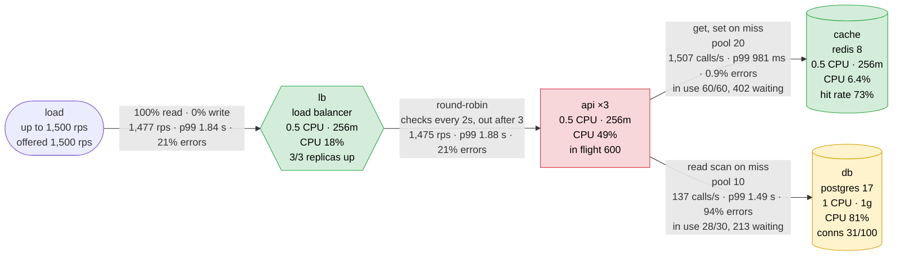
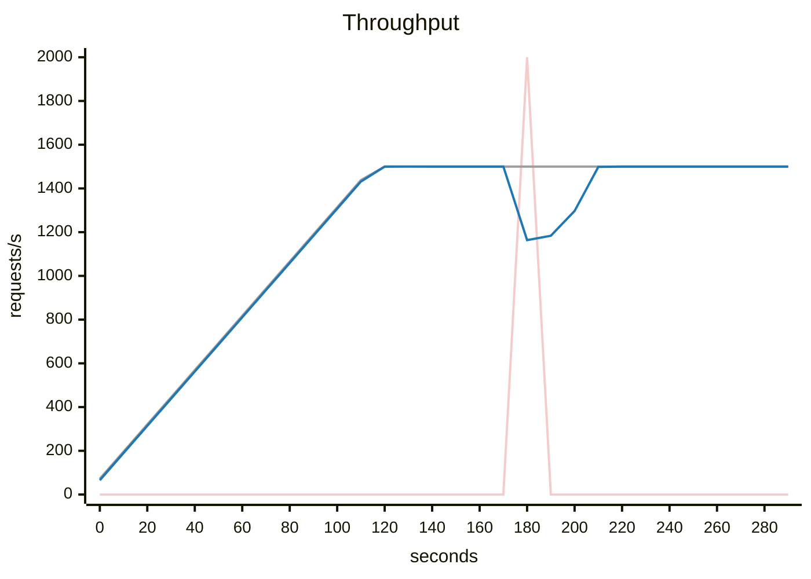
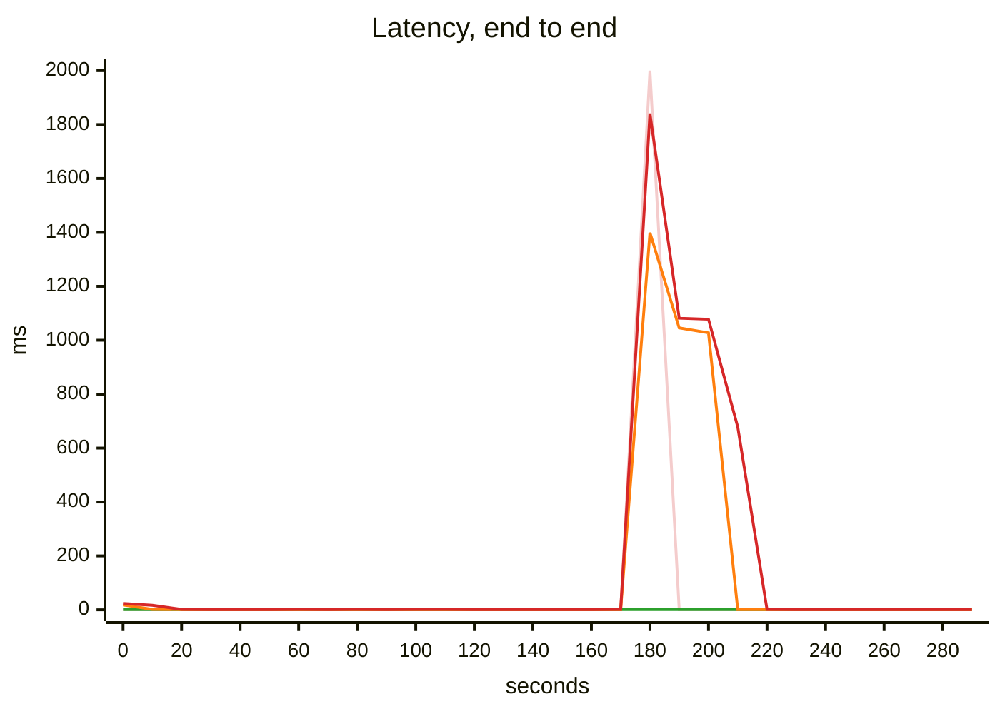
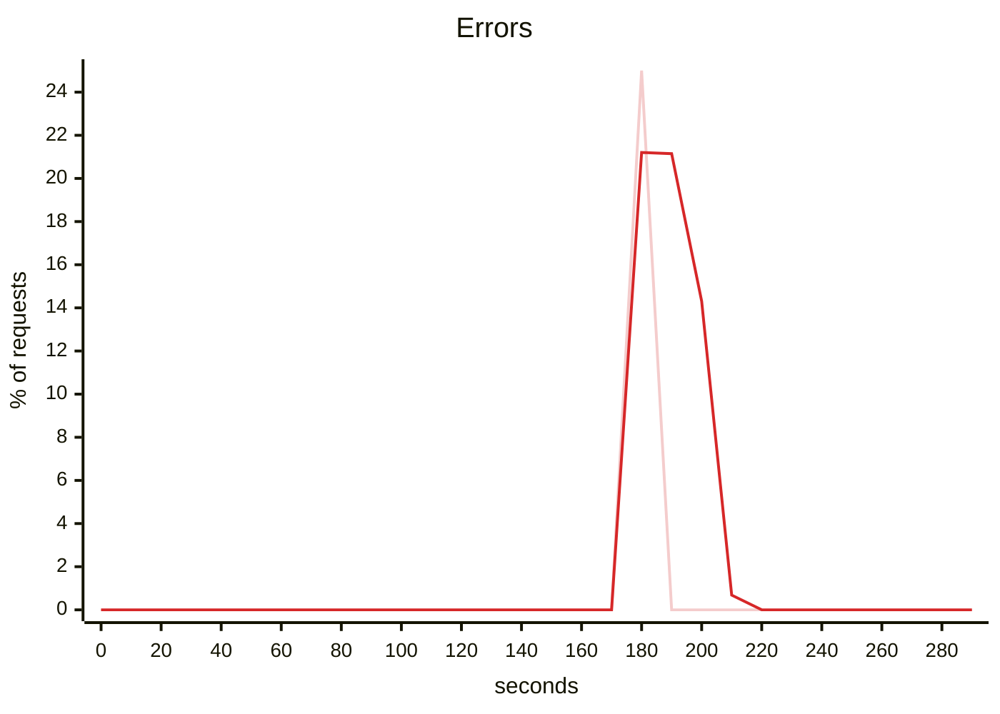
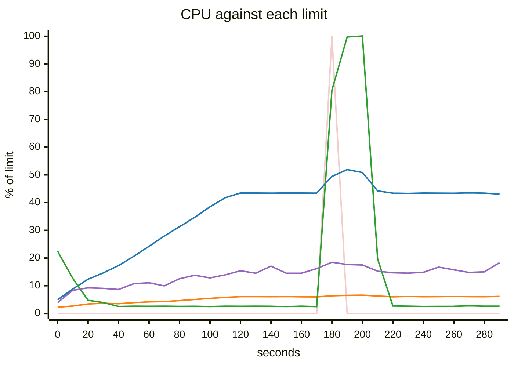

# cache-restart-coalesce: run report

_run `cache-restart-coalesce-20261112-103640` · completed · 12 Nov 2026 10:36 UTC · scale 1 · seed 1_

## Verdict

**Broke.** Broke 3:00 into the load, at 1,500 rps offered: p99 reached 1.84 s (17 ms at low load), 21% of requests failed and only 1,164 rps succeeded. Of api's failed requests, 54% failed because calls to db ran past their timeout. Most saturated then: api → cache pool 60 of 60 connections in use, waiting on cache (CPU 6.4%, 5.0 ms per call with a connection, 0.1 ms at low load). Around then: restart cache at 3:01. It recovered at 3:40, 0:40 after the break, and stayed healthy to the end.

Caveat: at 2:40 the load generator hit its CPU limit and was stalled in 1.0% of its scheduling periods (container_cpu_cfs_throttled_periods_total ÷ container_cpu_cfs_periods_total (cAdvisor)); work caught in a stall waits for the next 100 ms period, which can show up in p99.

<sub>Sources: offered load: the load profile in plan.json (offered arrival rate); served: k6_http_reqs_total{expected_response="true"} (k6: successful responses); p99: k6_http_req_duration_seconds (k6 histogram, end to end); errors: k6_http_reqs_total{expected_response="false"} ÷ k6_http_reqs_total (k6); saturation: loadlore_pool_connections{state="in_use"} and loadlore_pool_max_connections. Windows are 10 seconds; what counts as broken is under [Thresholds](#thresholds).</sub>

## Diagram at 3:00

Measured in the 10-second window from 3:00 to 3:10 (the break). Nodes are colored by their most saturated resource, CPU against its limit or a connection pool's connections in use: red at 90% or more, amber from 70%, green below.



<sub>Sources: offered from the load profile in plan.json (offered arrival rate); load edge from k6_http_reqs_total (k6: all responses) and k6_http_req_duration_seconds (k6 histogram, end to end); CPU from container_cpu_usage_seconds_total (cAdvisor) ÷ the container's CPU limit; calls/s from loadlore_calls_total (the caller's outbound call attempts) and their p99 from loadlore_call_duration_seconds (the caller's histogram, pool wait included); pools from loadlore_pool_connections{state="in_use"} and loadlore_pool_max_connections and loadlore_pool_pending (callers waiting for a connection); lb traffic from haproxy_backend_http_requests_total (HAProxy), replicas up from haproxy_backend_active_servers (HAProxy), and the lb edge's p99 from loadlore_request_duration_seconds (the service's own histogram); conns from pg_stat_activity_count and pg_settings_max_connections (postgres_exporter); hit rate from redis_keyspace_hits_total and redis_keyspace_misses_total (redis_exporter).</sub>

## Charts

One point per 10-second window, at the window's start; x is seconds from the start of the load.



<sub>Grey: offered load (the load profile in plan.json (offered arrival rate)). Blue: successful responses (k6_http_reqs_total{expected_response="true"} (k6: successful responses)). Pink spikes mark 3:01 cache kill; 3:01 cache die (exit code 0); 3:01 restart cache; 3:01 cache start; 3:01 cache restart; 3:00 break.</sub>



<sub>Green: p50. Orange: p95. Red: p99 (k6_http_req_duration_seconds (k6 histogram, end to end)). Pink spikes mark 3:01 cache kill; 3:01 cache die (exit code 0); 3:01 restart cache; 3:01 cache start; 3:01 cache restart; 3:00 break.</sub>



<sub>Failed requests as a share of all responses (k6_http_reqs_total{expected_response="false"} ÷ k6_http_reqs_total (k6)), timeouts included. Pink spikes mark 3:01 cache kill; 3:01 cache die (exit code 0); 3:01 restart cache; 3:01 cache start; 3:01 cache restart; 3:00 break.</sub>

| Service | Failed requests | Share of its failures | Cause | From calls to | First seen | What it means |
| --- | --- | --- | --- | --- | --- | --- |
| api | 5,637 | 66% | `timeout` | db | 3:00 | calls to db ran past their timeout |
| api | 2,914 | 34% | `pool_timeout` | db | 3:00 | they timed out waiting for a pool connection to db |
| api | 23 | 0.3% | `conn_reset` | cache | 3:00 | connections to cache were reset or closed mid-call |

<sub>Why requests failed, over the whole run (loadlore_request_errors_total and loadlore_call_errors_total, by cause). A request that failed after retries counts once, by its last attempt's cause.</sub>



<sub>Blue: api. Orange: cache. Green: db. Purple: lb (container_cpu_usage_seconds_total (cAdvisor) ÷ the container's CPU limit, mean over the window). Pink spikes mark 3:01 cache kill; 3:01 cache die (exit code 0); 3:01 restart cache; 3:01 cache start; 3:01 cache restart; 3:00 break.</sub>

## Diagnosis

### 1. Connection storm (api → db), from 3:00

At 3:00, api's pools opened 697 connections to db within 10 seconds, at 1,500 rps offered, and p99 reached 1.84 s (17 ms at low load). The pools open connections only when callers need them, so when a short slowdown leaves requests waiting, every replica opens more at once. Each new Postgres connection starts a server process and authenticates, which takes db's CPU from queries just when it is short of it.

Evidence:

- 697 new connections to db from 3:00 to 3:10: from 6 open to 28 of 30 <sub>(loadlore_pool_connect_seconds (new connections the pools opened, and how long each took))</sub>
- p99 1.84 s at 3:00, against 17 ms at low load <sub>(k6_http_req_duration_seconds (k6 histogram, end to end))</sub>
- each new connection took 97 ms to open at 3:00, against 3.6 ms for the ones opened before <sub>(loadlore_pool_connect_seconds (new connections the pools opened, and how long each took))</sub>
- up to 213 requests waiting for a connection at 3:00 <sub>(loadlore_pool_pending (callers waiting for a connection))</sub>
- db CPU at 81% of its limit at 3:00 <sub>(container_cpu_usage_seconds_total (cAdvisor) ÷ the container's CPU limit)</sub>
- db was CPU-throttled for 48.6 s (summed over its threads) in the window from 3:00, while its average CPU was 81% of its limit: bursts of work hit the 1-CPU limit and waited for the next period <sub>(container_cpu_cfs_throttled_seconds_total (cAdvisor))</sub>
- api's calls to db took 55 ms each once they had a connection at 3:00, against 15 ms at low load <sub>(loadlore_call_duration_seconds minus loadlore_pool_wait_seconds, per call (time with a connection))</sub>

**Try next:** Open the connections before the load arrives: give the pool a minimum (pools: { db: { size: 10, min: 10 } }) and re-run to compare a warm pool with this cold one. PgBouncer in front of db also keeps server connections open.

### 2. Cold cache (cache, api → db), from 3:00

At 3:00, cache's hit rate fell to 73% from 100%, 27% of lookups missing, and api's reads from db reached 137 rps, against none before. The keys the cache used to answer now miss together, so their reads all go to the database at once: a thundering herd.

Evidence:

- cache hit rate 73% at 3:00, against 100% before <sub>(redis_keyspace_hits_total and redis_keyspace_misses_total (redis_exporter))</sub>
- 137 rps from api to db at 3:00, against none before <sub>(loadlore_calls_total to the database (the caller's own counts))</sub>
- db CPU at 81% of its limit at 3:00 <sub>(container_cpu_usage_seconds_total (cAdvisor) ÷ the container's CPU limit)</sub>
- cache kill at 3:01 <sub>(events.jsonl)</sub>

**Try next:** Keep a cold cache from sending every miss to db at once: coalesce concurrent misses for the same key (single-flight), so one read fills it for everyone, or warm cache before it takes traffic.

### 3. Queueing knee (cache, slower without running out of CPU), from 3:00

From 3:00, p99 stayed above 51 ms (17 ms at low load): cache answered more slowly while its CPU stayed at most 6.6% of its limit, so callers held their connections longer and queued for them. The slowdown wasn't its CPU.

Evidence:

- 3:00 to 3:30: p99 1.84 s, 1.08 s, 1.08 s <sub>(k6_http_req_duration_seconds (k6 histogram, end to end))</sub>
- api → cache pool 60 of 60 connections in use at 3:00: a symptom, since connections stayed in use longer while cache was slow to answer <sub>(loadlore_pool_connections{state="in_use"} and loadlore_pool_max_connections)</sub>
- api's calls to cache took 5.0 ms each once they had a connection at 3:00, against 0.1 ms at low load <sub>(loadlore_call_duration_seconds minus loadlore_pool_wait_seconds, per call (time with a connection))</sub>
- cache CPU at most 6.6% of its limit from 3:00 to 3:30 <sub>(container_cpu_usage_seconds_total (cAdvisor) ÷ the container's CPU limit)</sub>

**Try next:** Find what cache waited on besides CPU, such as disk writes or locks, in its own logs and metrics, then re-run the ramp.

<sub>Rules version 8. Rules are deterministic and offline; their thresholds are listed below.</sub>

## Predictions

1 of 1 scored prediction held.

| Prediction | Result | Worst value | Checked over | Notes |
| --- | --- | --- | --- | --- |
| `error_rate < 1% after 3m40s` | **held** | 0% | from 3:40 to the end | source: k6_http_reqs_total{expected_response="false"} ÷ k6_http_reqs_total (k6) |

## Timeline

| Time | Event |
| --- | --- |
| 3:01 | container: cache kill |
| 3:01 | container: cache die (exit code 0) |
| 3:01 | fault started: restart cache |
| 3:01 | container: cache start |
| 3:01 | container: cache restart |

<sub>From events.jsonl: the fault timeline and Docker container events.</sub>

## Assumptions

### From the design

The design lists no assumptions.

### Chosen by Loadlore

| Field | Value | Why |
| --- | --- | --- |
| services.cache.config.maxmemory | 192m | 75% of the container's 256m memory limit, as managed Redis usually does; the rest is for fragmentation and client buffers. Set maxmemory: 0 for stock Redis (no cap) |
| services.cache.config.maxmemory-policy | allkeys-lru | evict the least recently used keys when the cache is full, as managed Redis usually does |
| workload.timeout_ms | 10s | the default; k6 gives up on a request after this long and counts it as failed |
| workload.slo.p99_ms | 500 ms | the default; a break on p99 alone needs p99 at or above this as well as 10x the low-load p99, so latency users would still accept isn't called a break |
| resources.cpu_period_ms | 100 ms for api, cache, db, lb | Docker's default. A container that uses its CPU share early in a period stalls until the next one, which can show up in p99 when a service has a fraction of a CPU |
| services.lb timeouts | connect 5s, server 60s | HAProxy's own timeouts, with its defaults otherwise. A request already sent to a replica that dies waits for the server timeout (or the load generator's); health checks only stop new requests going there |
| services.api.pools.db.min | 0 | the default, as pgxpool's: each replica opens connections only when callers need them, so a pool fills as load rises, and a burst opens many at once |
| services.api.pools.db.hold | call | the default, as pgxpool's: a request takes a connection for each call and hands it back straight away |

### How the run was planned

- load generator: 3723 VUs started before the load, the scenario's measured prealloc_vus 3723 at --scale 1, more than 1500 rps × the SLO's 500 ms
- Loadlore's own containers get fixed budgets: load generator 1.5 CPU (peak 1500 rps), Toxiproxy 1 CPU (about 6000 proxied calls/s at peak), Prometheus 0.1, cAdvisor 0.1, exporters 0.1 each

## Thresholds

- **Broke:** 2 windows in a row with at least 1.0% of requests failing or successful responses below 90% of the offered rate, or 3 windows in a row with any of those or p99 at least 10x the low-load p99 (the median p99 of windows offered at most 25% of the peak, before errors or a shortfall in 2 windows in a row) and at least the SLO, 500 ms (workload.slo.p99_ms): 500 ms in this run. A shorter episode is shown as a stall in the timeline, not a break.
- **Doubtful:** a break on p99 alone, when the load generator was stalled at its CPU limit in 1.0% or more of its scheduling periods in one of the break's windows and the entry service's own p99 (loadlore_request_duration_seconds (the service's own histogram)) was below the limit in one of them. The verdict stays what it was.
- **Inconclusive:** before the break (or anywhere, if nothing broke), the load generator dropped more than 1.0% of a window's arrivals (more than 5.0% in a window where the system itself failed 1.0% or more of requests; up to that it's a caveat that gives the share), or the load generator or Toxiproxy used 90% or more of its CPU budget, or was stalled at its CPU limit in 5.0% or more of its scheduling periods (from 1.0% it's noted as a caveat). The first 10 s of load are a warm-up and don't count: the load generator starts its VUs and connections open then. A cause is named only with evidence: on a Linux host, the hypervisor giving 2.0% or more of CPU time to other virtual machines (steal), or other programs using 10% or more of the host's CPUs (at least 0.5); inside a VM on this machine, only as a possibility.
- **Connection pool exhausted:** for two windows in a row, a pool at 95% or more of its size with callers waiting, while the target wasn't busy (busy: its CPU at 80% or more, or its time per call with a connection at least 3x the low-load value and 1 ms above it; CPU throttling alone doesn't count) and the caller's CPU stayed below 90%.
- **Queueing knee:** for 3 windows in a row, p99 at least 3x the low-load p99 and 10 ms above it, with a CPU or pool at 70% or more. When that is a pool whose target was busy in any of those windows, or a service's CPU whose requests spent 50% or more of their time in calls to a busy target, the knee is the target's.
- **Connection storm:** up to the break, a service's pools to a Postgres opening at least 50% of their combined size, and 10 or more connections, in one window, while p99 in that window or the next was at least 10x the low-load p99 and 10 ms above it. New connections are counted by loadlore_pool_connect_seconds (new connections the pools opened, and how long each took), or for runs from before it, from the rise in open connections.
- **Retry storm:** for two windows in a row, a caller that retries sending 1.5x or more of its low-load calls per request to a target, with retries 20% or more of them, while the target failed 1.0% or more of its calls or its p99 was 3x its low-load value.
- **Cold cache:** a cache's share of lookups that miss rising to 5x its level before or more, and to 5.0% of lookups at least, while its callers' reads of the database behind it reach 2x their rate before (counted as at least 1 a second, for a cache warm enough to send none).
- **Working set doesn't fit:** for two windows in a row, a Postgres answering less than 90% of block reads from shared_buffers and reading 100 blocks a second or more from outside them, while p99 was 3x the low-load p99 or more.
- **Hot rows:** for two windows in a row, 1 or more of a Postgres's backends waiting on locks on average, while a caller's writes to it took 3x their low-load time or more (and 2 ms more), its reads stayed within 1.5x of theirs and the database's CPU was below 80%. Windows with a disk_slow fault on the database don't count.

## Environment

- loadl dev, profile 5m0s, scale 1, seed 1
- Host: 8 CPUs, 9.7 GiB memory, Ubuntu 24.04.4 LTS (aarch64, kernel 6.8.0-117-generic), cgroup v2
- Docker 29.5.2, Compose 5.1.1
- Host speed index 1005 (hash 956, memory 1067, syscalls 994): one CPU's work against the reference machine's 1000 (MacBook Air M4 (4 performance and 6 efficiency cores), Colima VM with 8 vCPUs). CPU limits are fractions of this host's cores, so a lower index means the design breaks at a lower load
- Cool-down: none needed; the first benchmark (1005) was within 5.0% of the run it's compared with (1016)
- Host CPU: Docker runs in a VM on this machine, so other programs' use of the CPU can't be seen
- Data: a fresh copy of the cached seeded dataset
- Load generator summary (k6): 360,577 requests, 0 dropped arrivals, 2.4% failed

<details><summary>Containers and images</summary>

| Container | Image |
| --- | --- |
| loadlore-cache-restart-coalesce-20261112-103640-api-0-1 | loadlore/synthetic:dev |
| loadlore-cache-restart-coalesce-20261112-103640-api-1-1 | loadlore/synthetic:dev |
| loadlore-cache-restart-coalesce-20261112-103640-api-2-1 | loadlore/synthetic:dev |
| loadlore-cache-restart-coalesce-20261112-103640-cache-1 | redis:8.2 |
| loadlore-cache-restart-coalesce-20261112-103640-db-1 | postgres:17.11 |
| loadlore-cache-restart-coalesce-20261112-103640-lb-1 | haproxy:3.2.26 |
| loadlore-cache-restart-coalesce-20261112-103640-lore-cadvisor-1 | ghcr.io/google/cadvisor:v0.60.6 |
| loadlore-cache-restart-coalesce-20261112-103640-lore-k6-1 | grafana/k6:2.3.0 |
| loadlore-cache-restart-coalesce-20261112-103640-lore-pgexp-db-1 | quay.io/prometheuscommunity/postgres-exporter:v0.20.1 |
| loadlore-cache-restart-coalesce-20261112-103640-lore-prometheus-1 | prom/prometheus:v3.16.0 |
| loadlore-cache-restart-coalesce-20261112-103640-lore-redisexp-cache-1 | oliver006/redis_exporter:v1.97.0 |
| loadlore-cache-restart-coalesce-20261112-103640-lore-toxiproxy-1 | ghcr.io/shopify/toxiproxy:2.13.0 |

</details>

## Per-window data

<details><summary>30 windows of 10 seconds</summary>

| t | offered | served | dropped | errors | p50 | p99 | api CPU | cache CPU | cache hit rate | db CPU | db conns | lb CPU | lb up | api→cache pool | wait | api→db pool | wait | k6 CPU | Toxiproxy CPU | k6 / Toxiproxy stalled |
| --- | --- | --- | --- | --- | --- | --- | --- | --- | --- | --- | --- | --- | --- | --- | --- | --- | --- | --- | --- | --- |
| 0:00 | 72 | 65 | 0 | 0% | 1.0 ms | 23 ms | 4.9% | 2.2% | 81% | 22% | 5 | 3.9% | 3 | 0/60 | – | 1/30 | 0.0 ms | 7.2% | 4.3% | 4.0% / 0% |
| 0:10 | 196 | 190 | 0 | 0% | 0.9 ms | 17 ms | 8.9% | 2.7% | 97% | 13% | 7 | 8.4% | 3 | 0/60 | – | 1/30 | 0.0 ms | 5.0% | 10% | 0% / 0% |
| 0:20 | 320 | 314 | 0 | 0% | 0.8 ms | 1.8 ms | 12% | 3.4% | 100% | 4.8% | 7 | 9.3% | 3 | 0/60 | – | 0/30 | 0.0 ms | 6.0% | 10% | 0% / 0% |
| 0:30 | 445 | 438 | 0 | 0% | 0.7 ms | 1.1 ms | 15% | 3.7% | 100% | 3.9% | 7 | 9.0% | 3 | 1/60 | – | 0/30 | – | 5.9% | 8.1% | 0% / 0% |
| 0:40 | 569 | 562 | 0 | 0% | 0.6 ms | 1.2 ms | 17% | 3.5% | 100% | 2.5% | 7 | 8.7% | 3 | 1/60 | – | 0/30 | – | 8.4% | 8.6% | 1.0% / 0% |
| 0:50 | 693 | 687 | 0 | 0% | 0.6 ms | 1.0 ms | 21% | 3.9% | 100% | 2.6% | 7 | 11% | 3 | 1/60 | – | 0/30 | – | 6.8% | 10% | 0% / 0% |
| 1:00 | 817 | 811 | 0 | 0% | 0.6 ms | 1.5 ms | 24% | 4.2% | 100% | 2.6% | 7 | 11% | 3 | 1/60 | – | 0/30 | – | 9.2% | 11% | 1.0% / 0% |
| 1:10 | 941 | 935 | 0 | 0% | 0.6 ms | 1.1 ms | 28% | 4.3% | 100% | 2.6% | 7 | 9.9% | 3 | 1/60 | – | 0/30 | – | 7.9% | 12% | 0% / 0% |
| 1:20 | 1,065 | 1,059 | 0 | 0% | 0.6 ms | 1.7 ms | 31% | 4.6% | 100% | 2.6% | 7 | 13% | 3 | 1/60 | – | 0/30 | – | 10% | 13% | 1.0% / 0% |
| 1:30 | 1,190 | 1,183 | 0 | 0% | 0.6 ms | 0.9 ms | 35% | 5.0% | 100% | 2.6% | 7 | 14% | 3 | 1/60 | – | 0/30 | – | 10% | 15% | 0.8% / 0% |
| 1:40 | 1,314 | 1,307 | 0 | 0% | 0.6 ms | 1.5 ms | 38% | 5.5% | 100% | 2.5% | 7 | 13% | 3 | 2/60 | – | 0/30 | – | 10% | 16% | 0.2% / 0% |
| 1:50 | 1,438 | 1,431 | 0 | 0% | 0.6 ms | 1.4 ms | 42% | 5.8% | 100% | 2.6% | 7 | 14% | 3 | 1/60 | – | 0/30 | – | 12% | 18% | 1.0% / 0% |
| 2:00 | 1,500 | 1,500 | 0 | 0% | 0.6 ms | 1.1 ms | 43% | 6.1% | 100% | 2.6% | 7 | 15% | 3 | 2/60 +1 | – | 0/30 | – | 12% | 19% | 0.8% / 0% |
| 2:10 | 1,500 | 1,500 | 0 | 0% | 0.6 ms | 0.9 ms | 43% | 6.1% | 100% | 2.6% | 7 | 15% | 3 | 0/60 | – | 0/30 | – | 12% | 19% | 0.2% / 0% |
| 2:20 | 1,500 | 1,500 | 0 | 0% | 0.6 ms | 1.1 ms | 43% | 6.0% | 100% | 2.6% | 7 | 17% | 3 | 1/60 | – | 0/30 | – | 13% | 20% | 1.0% / 0% |
| 2:30 | 1,500 | 1,500 | 0 | 0% | 0.6 ms | 0.9 ms | 43% | 6.1% | 100% | 2.5% | 7 | 15% | 3 | 2/60 | – | 0/30 | – | 11% | 19% | 0% / 0% |
| 2:40 | 1,500 | 1,500 | 0 | 0% | 0.6 ms | 1.2 ms | 43% | 6.0% | 100% | 2.6% | 7 | 15% | 3 | 2/60 | – | 0/30 | – | 13% | 19% | 1.0% / 0% |
| 2:50 | 1,500 | 1,500 | 0 | 0% | 0.6 ms | 1.3 ms | 43% | 6.0% | 100% | 2.5% | 7 | 16% | 3 | 1/60 | – | 0/30 | – | 13% | 20% | 1.0% / 0% |
| 3:00 | 1,500 | 1,164 | 0 | 21% | 0.7 ms | 1.84 s | 49% | 6.4% | 73% | 81% | 31 | 18% | 3 | 60/60 +402 | 240 ms | 28/30 +213 | 920 ms | 12% | 27% | 0% / 0% |
| 3:10 | 1,500 | 1,184 | 0 | 21% | 0.6 ms | 1.08 s | 52% | 6.5% | 79% | 100% | 22 | 18% | 3 | 1/60 | – | 23/30 +159 | 946 ms | 14% | 28% | 1.0% / 0% |
| 3:20 | 1,500 | 1,297 | 0 | 14% | 0.6 ms | 1.08 s | 51% | 6.6% | 86% | 100% | 25 | 17% | 3 | 1/60 | – | 27/30 +135 | 897 ms | 12% | 27% | 0% / 0% |
| 3:30 | 1,500 | 1,498 | 0 | 0.7% | 0.6 ms | 678 ms | 44% | 6.3% | 99% | 20% | 29 | 15% | 3 | 2/60 | – | 25/30 +63 | 555 ms | 13% | 21% | 1.0% / 0% |
| 3:40 | 1,500 | 1,500 | 0 | 0% | 0.6 ms | 1.5 ms | 43% | 6.0% | 100% | 2.7% | 28 | 15% | 3 | 1/60 | – | 0/30 | – | 13% | 20% | 1.0% / 0% |
| 3:50 | 1,500 | 1,500 | 0 | 0% | 0.6 ms | 0.8 ms | 43% | 6.1% | 100% | 2.6% | 28 | 15% | 3 | 1/60 | – | 0/30 | – | 11% | 20% | 0% / 0% |
| 4:00 | 1,500 | 1,500 | 0 | 0% | 0.6 ms | 1.0 ms | 43% | 6.0% | 100% | 2.5% | 28 | 15% | 3 | 1/60 | – | 0/30 | – | 13% | 20% | 1.0% / 0% |
| 4:10 | 1,500 | 1,500 | 0 | 0% | 0.6 ms | 0.9 ms | 43% | 6.1% | 100% | 2.6% | 28 | 17% | 3 | 1/60 | – | 0/30 | – | 11% | 20% | 0% / 0% |
| 4:20 | 1,500 | 1,500 | 0 | 0% | 0.6 ms | 1.1 ms | 43% | 6.1% | 100% | 2.6% | 28 | 16% | 3 | 1/60 | – | 0/30 | – | 13% | 20% | 1.0% / 0% |
| 4:30 | 1,500 | 1,500 | 0 | 0% | 0.6 ms | 1.0 ms | 43% | 6.1% | 100% | 2.7% | 28 | 15% | 3 | 1/60 | – | 0/30 | – | 13% | 20% | 1.0% / 0% |
| 4:40 | 1,500 | 1,500 | 0 | 0% | 0.6 ms | 0.9 ms | 43% | 6.0% | 100% | 2.6% | 28 | 15% | 3 | 1/60 | – | 0/30 | – | 11% | 20% | 0% / 0% |
| 4:50 | 1,500 | 1,500 | 0 | 0% | 0.6 ms | 1.0 ms | 43% | 6.2% | 100% | 2.6% | 28 | 18% | 3 | 1/60 | – | 0/30 | – | 13% | 19% | 1.1% / 0% |

Columns: offered is the load profile in plan.json (offered arrival rate); served is k6_http_reqs_total{expected_response="true"} (k6: successful responses); dropped is k6_dropped_iterations_total (k6: arrivals it couldn't start); errors are k6_http_reqs_total{expected_response="false"} ÷ k6_http_reqs_total (k6); p50 and p99 are from k6_http_req_duration_seconds (k6 histogram, end to end); CPU is container_cpu_usage_seconds_total (cAdvisor) ÷ the container's CPU limit, mean over the window; conns are pg_stat_activity_count and pg_settings_max_connections (postgres_exporter); hit rate is from redis_keyspace_hits_total and redis_keyspace_misses_total (redis_exporter); up is haproxy_backend_active_servers (HAProxy); pools are loadlore_pool_connections{state="in_use"} and loadlore_pool_max_connections (peak in use/size, +peak waiting), wait is the mean from loadlore_pool_wait_seconds (time to get a connection); k6 and Toxiproxy CPU are against their budgets.

</details>

## Design file

The exact `design.yaml` this run used:

```yaml
version: 1
name: cache-restart-coalesce

# Solution: request coalescing on the cache lookup. When requests in one
# api replica miss the same product at the same time, the first computes
# the review summary and fills the cache, and the others wait for its
# answer, so the database runs the query about once per product per
# replica instead of once per request.

services:
  lb:
    kind: lb
    target: api
    health_check: { interval_ms: 2000, fall: 3, rise: 2 }

  api:
    image: loadlore/synthetic
    replicas: 3
    resources: { cpu: 0.5, memory: 256m }
    behavior:
      cpu_ms: 0.3
      calls:
        - target: cache
          op: get
          coalesce: true
          on_miss:
            - { target: db, op: read, query: scan }
            - { target: cache, op: set, ttl_s: 600 }
      resilience:
        timeout_ms: 1000
    pools:
      cache: 20
      db: 10   # 3 replicas x 10 = 30 connections

  cache:
    kind: redis
    resources: { cpu: 0.5, memory: 256m }

  db:
    kind: postgres
    version: "17"
    resources: { cpu: 1, memory: 1g }
    config: { max_connections: 100, shared_buffers: 256MB }
    dataset: { rows: 140000, row_bytes: 512 }

workload:
  entry: lb
  profile:
    - ramp: { from: 10, to: 1500, over: 2m }
    - hold: { rps: 1500, for: 3m }
  mix: { read: 1.0 }
  keys: { distribution: zipf, skew: 1.1, count: 200 }

# Redis restarts at 3:01, as a deploy or a node replacement would restart
# it. It keeps nothing on disk, so it comes back empty.
scenario:
  - { at: 3m1s, inject: restart, target: cache }

expect:
  - error_rate < 1% after 3m40s
```
