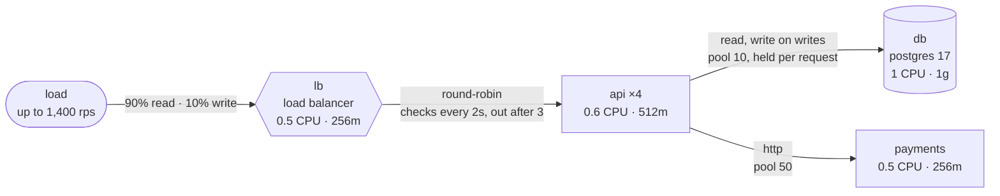

# The connection pool trap

Level 1 · about 45 minutes · teaches connection pools per replica, max_connections and PgBouncer

## The story

You run the checkout service. Every request reads the customer's cart from Postgres, then asks the payment provider to authorize the card, and one request in ten also writes the order. Like many Rails and Django apps, the api's framework checks out a database connection when a request first needs one and keeps it until the response is sent. Each of the four api replicas has a pool of 10 connections, 40 in all, well under Postgres's `max_connections` of 100.

A sale is coming. You're going to ramp the load from 100 to 1,400 requests per second over five minutes, then hold it for two.



The payment provider is outside your system and answers in about 80 ms; the design models that as network latency on the way to it, in the `scenario` block. The database is small, but each request asks very little of it: one primary-key read, and a write on one request in ten.

## The question

Before you run anything, write down your guesses. Don't work them out: a gut answer is fine, and where the run differs from it is what you'll learn from.

1. At what load does it break, and how far into the ramp?
2. Which component gives out first? How busy is the database when it does?
3. If you made the pools three times bigger, what would happen?

Loads depend on your machine: slower cores break the same design at a lower load, so a guess can miss even when the reasoning behind it is right.

`loadl predict design.yaml` asks questions like these and writes your answers into the `expect` block at the bottom of `design.yaml`, or write them there yourself. The report scores each one against what the run measured. The two lines already there are examples; the grammar is in the [design file reference](../../skills/loadlore-designer/references/schema.md).

## Run it

```sh
loadl run scenarios/connection-pool-trap/design.yaml
loadl report latest --print | less
```

The run takes about 8 minutes, plus about half a minute the first time to seed the million-row table.

It needs 8 CPUs and 8 GB available to Docker, Loadlore's own containers included. On a smaller machine, add `--scale` with the largest value that fits; `loadl run` warns you when the host is too small and suggests one. CPU limits are fractions of your machine's cores, so a slower machine can break at a different load; on a laptop, plug it in and turn off Low Power Mode. `loadl run` prints a host speed index and warns when it's much lower than the reference machine's.

Stuck? `loadl hint connection-pool-trap` reveals one hint at a time.

## What to try next

When you know why it broke, change one thing and run it again. Write a new `expect` line for where you think it will break this time, then compare the two runs:

```sh
loadl compare <first-run> latest -o compare.md
```

Some directions: the pool sizes, the number of replicas, what each request does while it holds a connection, or something between the api and the database. Watch `max_connections` as you go.

`solutions/` has two worked answers with their reports. They give the game away, so try your own first.
