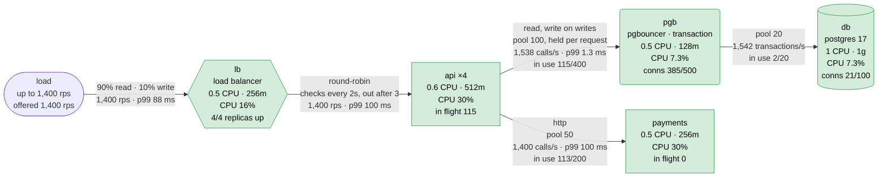
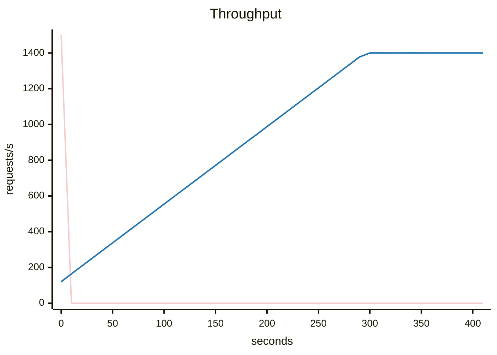
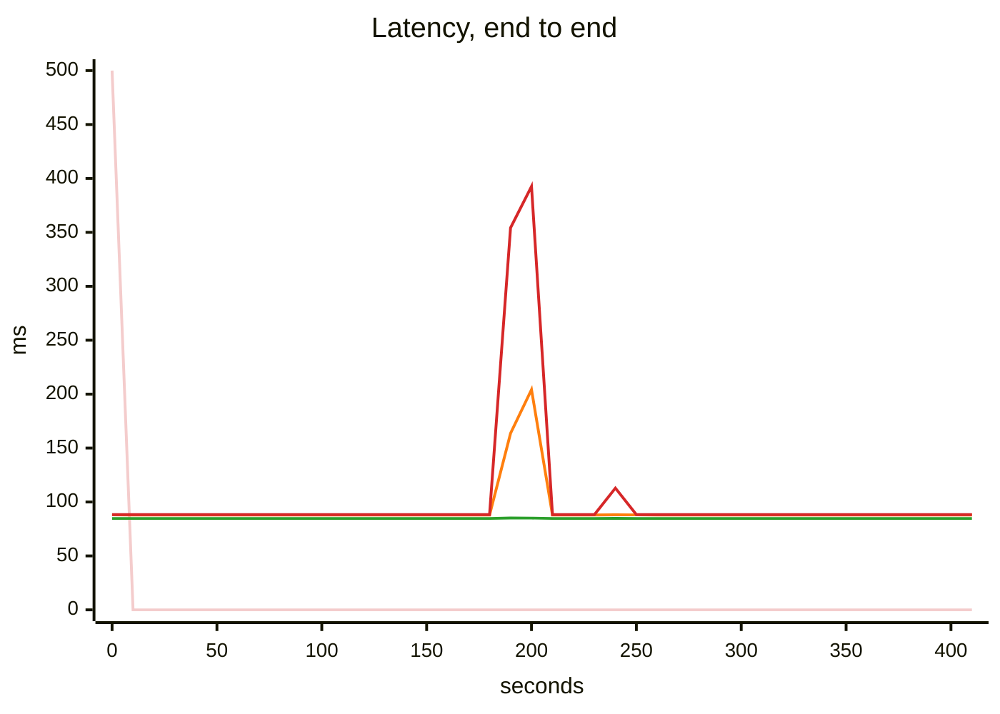
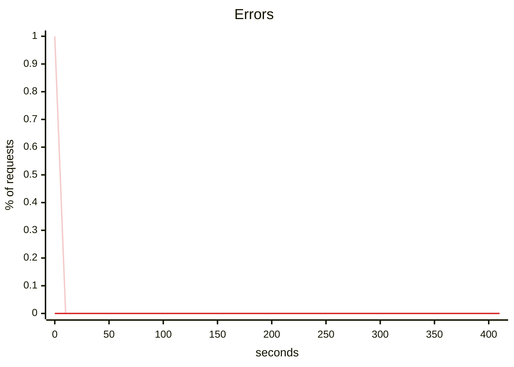
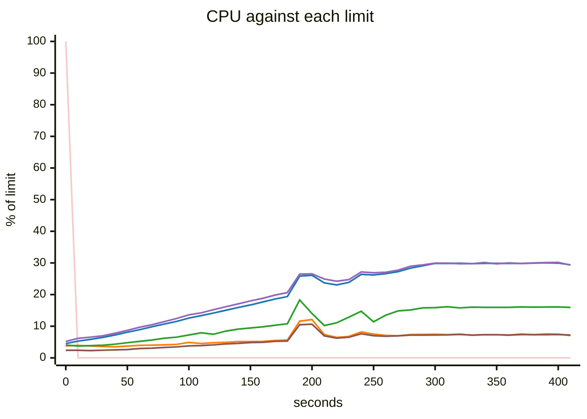

# connection-pool-trap-pgbouncer: run report

_run `connection-pool-trap-pgbouncer-20261117-221905` · completed · 17 Nov 2026 22:19 UTC · scale 1 · seed 1_

## Verdict

**Held.** Held the whole profile: up to 1,400 rps offered, 1,400 rps served at best, worst 10-second p99 393 ms, at most 0% errors.

Caveat: at 3:20 the load generator hit its CPU limit and was stalled in 2.0% of its scheduling periods (container_cpu_cfs_throttled_periods_total ÷ container_cpu_cfs_periods_total (cAdvisor)); work caught in a stall waits for the next 100 ms period, which can show up in p99.

<sub>Sources: offered load: the load profile in plan.json (offered arrival rate); served: k6_http_reqs_total{expected_response="true"} (k6: successful responses); p99: k6_http_req_duration_seconds (k6 histogram, end to end); errors: k6_http_reqs_total{expected_response="false"} ÷ k6_http_reqs_total (k6). Windows are 10 seconds; what counts as broken is under [Thresholds](#thresholds).</sub>

## Diagram at 5:40

Measured in the 10-second window from 5:40 to 5:50 (the busiest window: the most successful responses). Nodes are colored by their most saturated resource, CPU against its limit or a connection pool's connections in use: red at 90% or more, amber from 70%, green below.



<sub>Sources: offered from the load profile in plan.json (offered arrival rate); load edge from k6_http_reqs_total (k6: all responses) and k6_http_req_duration_seconds (k6 histogram, end to end); CPU from container_cpu_usage_seconds_total (cAdvisor) ÷ the container's CPU limit; calls/s from loadlore_calls_total (the caller's outbound call attempts) and their p99 from loadlore_call_duration_seconds (the caller's histogram, pool wait included); pools from loadlore_pool_connections{state="in_use"} and loadlore_pool_max_connections and loadlore_pool_pending (callers waiting for a connection); lb traffic from haproxy_backend_http_requests_total (HAProxy), replicas up from haproxy_backend_active_servers (HAProxy), and the lb edge's p99 from loadlore_request_duration_seconds (the service's own histogram); conns from pg_stat_activity_count and pg_settings_max_connections (postgres_exporter); PgBouncer's client conns from pgbouncer_pools_client_{active,waiting}_connections and pgbouncer_config_max_client_connections, its server pools from pgbouncer_pools_server_active_connections against pgbouncer_databases_pool_size plus reserve_pool (PgBouncer's server connections) and pgbouncer_pools_client_waiting_connections (clients waiting in PgBouncer for a server connection), and transactions/s on its edges from pgbouncer_stats_totals_sql_transactions_pooled_total.</sub>

## Charts

One point per 10-second window, at the window's start; x is seconds from the start of the load.



<sub>Grey: offered load (the load profile in plan.json (offered arrival rate)). Blue: successful responses (k6_http_reqs_total{expected_response="true"} (k6: successful responses)). Pink spikes mark 0:00 latency +80 ms on connections into payments.</sub>



<sub>Green: p50. Orange: p95. Red: p99 (k6_http_req_duration_seconds (k6 histogram, end to end)). Pink spikes mark 0:00 latency +80 ms on connections into payments.</sub>



<sub>Failed requests as a share of all responses (k6_http_reqs_total{expected_response="false"} ÷ k6_http_reqs_total (k6)), timeouts included. Pink spikes mark 0:00 latency +80 ms on connections into payments.</sub>



<sub>Blue: api. Orange: db. Green: lb. Purple: payments. Brown: pgb (container_cpu_usage_seconds_total (cAdvisor) ÷ the container's CPU limit, mean over the window). Pink spikes mark 0:00 latency +80 ms on connections into payments.</sub>

## Diagnosis

No diagnosis rule fired. Rules checked: connection pool exhausted, queueing knee (rules version 21; thresholds below).

## Predictions

1 of 2 scored predictions held.

| Prediction | Result | Worst value | Checked over | Notes |
| --- | --- | --- | --- | --- |
| `p99_ms < 300 until load_rps >= 1000` | **broken** at 3:10 | 393 ms | 0:00 to 3:30, when load_rps >= 1,000 rps first held | source: k6_http_req_duration_seconds (k6 histogram, end to end) |
| `error_rate < 1% throughout` | **held** | 0% | the whole run | source: k6_http_reqs_total{expected_response="false"} ÷ k6_http_reqs_total (k6) |

A broken prediction isn't a wrong answer: it shows where your picture of the system and the run differ, and that gap is what to look into. Loads and request rates depend on this machine: slower cores break the same design at a lower load, so a load guess can miss even when the reasoning behind it was right.

## Timeline

| Time | Event |
| --- | --- |
| 0:00 | fault started: latency +80 ms on connections into payments |
| 7:00 | fault ended: latency +80 ms on connections into payments |

<sub>From events.jsonl: the fault timeline and Docker container events.</sub>

## Assumptions

### From the design

The design lists no assumptions.

### Chosen by Loadlore

| Field | Value | Why |
| --- | --- | --- |
| workload.timeout_ms | 10s | the default; k6 gives up on a request after this long and counts it as failed |
| workload.slo.p99_ms | 500 ms | the default; a break on p99 alone needs p99 at or above this as well as 10x the low-load p99, so latency users would still accept isn't called a break |
| network.profile | same-zone: 0.3 ms round trip | the default: every service in one availability zone. AWS says a round trip between two instances in the same zone is generally sub-millisecond with enhanced networking, and publishes no exact figure, so the 0.3 ms round trip Loadlore adds between any two containers is its own estimate, inside that bound. Applied between any two of the stack's containers, the load generator and the entry point included, as half the round trip on each side's outgoing packets; Loadlore's own tooling isn't slowed. Not scaled with --scale. Source: AWS Architecture Blog, Improving performance and reducing cost using Availability Zone Affinity: https://aws.amazon.com/blogs/architecture/improving-performance-and-reducing-cost-using-availability-zone-affinity/ |
| resources.cpu_period_ms | 100 ms for api, db, lb, payments, pgb | Docker's default. A container that uses its CPU share early in a period stalls until the next one, which can show up in p99 when a service has a fraction of a CPU |
| services.db.disk | laptop: the Docker host's | no disk block: a read that misses db's memory goes to the Docker host's disk, which on a laptop mostly answers from the host's own memory, fast and uncapped, and a commit's fsync returns in a fraction of a millisecond. Add disk: { profile: gp3 } for a cloud volume's waits and caps |
| services.lb timeouts | connect 5s, server 60s | HAProxy's own timeouts, with its defaults otherwise. A request already sent to a replica that dies waits for the server timeout (or the load generator's); health checks only stop new requests going there |
| services.pgb.pool_mode | transaction | a server connection serves one client's transaction, then the next client's (transaction); for the whole client connection (session); or for one statement (statement). Loadlore's default is transaction, PgBouncer's is session |
| services.pgb.default_pool_size | 20 | server connections to db for the database and user; clients beyond them wait in PgBouncer for one |
| services.pgb.config.max_client_conn | 500 | set in the design: clients beyond it are refused |
| services.pgb.config.server_login_retry | 15s | PgBouncer's own default: after a failed connection to db, PgBouncer waits this long before trying again, so it can recover from a restart of db later than a direct client would |
| services.api.pools.pgb.min | 0 | the default, as pgxpool's: each replica opens connections only when callers need them, so a pool fills as load rises, and a burst opens many at once |
| services.api.pools.pgb.hold | request | set in the design: a request keeps the connection from its first call to pgb until it responds, through any slower calls in between, as Rails and Django check out a connection per request |

### How the run was planned

- Loadlore's own containers get fixed budgets: load generator 1.5 CPU (peak 1400 rps), Toxiproxy 1 CPU (about 1400 calls/s at peak on the 1 connection it proxies for faults), Prometheus 0.1, cAdvisor 0.1, exporters 0.1 each

## Thresholds

- **Broke:** 2 windows in a row with at least 1.0% of requests failing or successful responses below 90% of the offered rate, or 3 windows in a row with any of those or p99 at least 10x the low-load p99 (the median p99 of windows offered at most 25% of the peak, before errors or a shortfall in 2 windows in a row) and at least the SLO, 500 ms (workload.slo.p99_ms): 883 ms in this run. A shorter episode is shown as a stall in the timeline, not a break.
- **Doubtful:** a break on p99 alone, when the load generator was stalled at its CPU limit in 1.0% or more of its scheduling periods in one of the break's windows and the entry service's own p99 (loadlore_request_duration_seconds (the service's own histogram)) was below the limit in one of them. The verdict stays what it was.
- **Inconclusive:** before the break (or anywhere, if nothing broke), the load generator dropped more than 1.0% of a window's arrivals (more than 5.0% in a window where the system itself failed 1.0% or more of requests; up to that it's a caveat that gives the share), or the load generator or Toxiproxy used 90% or more of its CPU budget, or was stalled at its CPU limit in 5.0% or more of its scheduling periods (from 1.0% it's noted as a caveat). The first 10 s of load are a warm-up and don't count: the load generator starts its VUs and connections open then. A cause is named only with evidence: on a Linux host, the hypervisor giving 2.0% or more of CPU time to other virtual machines (steal), or other programs using 10% or more of the host's CPUs (at least 0.5); inside a VM on this machine, only as a possibility. A fault that couldn't be injected, or an autoscaler decision that couldn't be carried out, also makes a run inconclusive: it measured a different design.
- **Toxiproxy stalls:** no new connection accepted on one of Toxiproxy's edges for 1 s or more, where it had accepted 10 a second or more over the 5 s before, then 10 or more accepted within 100 ms with a median spacing under 0.5 ms: connections queued behind one upstream dial, which a real network doesn't do. Up to the end of the break's first window it makes the run inconclusive; after a break the system didn't recover from, it's a doubt on the recovery, and `loadl scenario check` doesn't judge claims that rest on not recovering; in a run that held, or recovered, it's a caveat: a stall only adds failure.
- **Connection pool exhausted:** for two windows in a row, a pool at 95% or more of its size with callers waiting, while the target wasn't busy (busy: its CPU at 80% or more, or its time per call with a connection at least 3x the low-load value and 1 ms above it; CPU throttling alone doesn't count) and the caller's CPU stayed below 90%.
- **Queueing knee:** for 3 windows in a row, p99 at least 3x the low-load p99 and 10 ms above it, with a CPU or pool at 70% or more. When that is a pool whose target was busy in any of those windows, or a service's CPU whose requests spent 50% or more of their time in calls to a busy target, the knee is the target's.
- **Connection storm:** up to the break, a service's pools to a Postgres opening at least 50% of their combined size, and 10 or more connections, in one window, while p99 in that window or the next was at least 10x the low-load p99 and 10 ms above it. New connections are counted by loadlore_pool_connect_seconds (new connections the pools opened, and how long each took), or for runs from before it, from the rise in open connections.
- **Retry storm:** for two windows in a row, a caller that retries sending 1.5x or more of its low-load calls per request to a target, with retries 20% or more of them, while the target failed 1.0% or more of its calls or its p99 was 3x its low-load value.
- **Cold cache:** a cache's share of lookups that miss rising to 5x its level before or more, and to 5.0% of lookups at least, while its callers' reads of the database behind it reach 2x their rate before (counted as at least 1 a second, for a cache warm enough to send none).
- **Working set doesn't fit:** for two windows in a row, a Postgres answering less than 90% of block reads from shared_buffers and reading 100 blocks a second or more from outside them, while p99 was 3x the low-load p99 or more. When Postgres times its reads (track_io_timing, on with a disk block), each block read must also take 3x its low-load time or more, and 1 ms more.
- **Replication lag:** for two windows in a row, a read replica 1 s or more behind its primary, or 5.0% or more of the reads after a write it served missing the write.
- **Consumer lag:** for two windows in a row, a queue's oldest unfinished job had waited 5 s or more, or the queue held more jobs than its workers run at once and grew, with jobs published 5.0% or more faster than they were finished. Named a full queue once its memory reached 90% of its maxmemory or it refused jobs.
- **Autoscale lag:** the run broke while an autoscaled service's replicas were at 90% or more of their CPU limit: below its max, the autoscaler hadn't caught up; at its max (autoscale ceiling), it had nothing left to add.
- **Hot rows:** for two windows in a row, 2 or more of a Postgres's backends waiting on locks on average, while a caller's writes to it took 3x their low-load time or more (and 2 ms more). Reads of the same rows may slow too, and the summary says when the database's CPU per request reached 3x its low-load value: the contention burning CPU. A queueing knee on that database's CPU at the same time then points at the rows. Windows with a disk_slow fault on the database don't count.
- **Hot shard:** for two windows in a row, a caller sending calls to shards by key, one shard taking 1.5x the calls of the next busiest shard or more while it was busy (CPU 80% or more, or its calls 3x their low-load time and 1 ms more) and another shard's CPU under 50%. A queueing knee on that shard at the same time then points at its popular keys.

## Environment

- loadl dev, profile 7m0s, scale 1, seed 1
- Host: 8 CPUs, 9.7 GiB memory, Ubuntu 24.04.4 LTS (aarch64, kernel 6.8.0-117-generic), cgroup v2
- Docker 29.5.2, Compose 5.1.1
- Host speed index 1015 (hash 1013, memory 1025, syscalls 1008): one CPU's work against the reference machine's 1000 (MacBook Air M4 (4 performance and 6 efficiency cores), Colima VM with 8 vCPUs). CPU limits are fractions of this host's cores, so a lower index means the design breaks at a lower load
- Cool-down: none needed; the first benchmark (1015) was within 5.0% of the run it's compared with (964)
- Host CPU: Docker runs in a VM on this machine, so other programs' use of the CPU can't be seen
- Data: a fresh copy of the cached seeded dataset
- Load generator summary (k6): 392,994 requests, 0 dropped arrivals, 0% failed

<details><summary>Containers and images</summary>

| Container | Image |
| --- | --- |
| loadlore-connection-pool-trap-pgbouncer-20261117-221905-api-0-1 | loadlore/synthetic:dev |
| loadlore-connection-pool-trap-pgbouncer-20261117-221905-api-1-1 | loadlore/synthetic:dev |
| loadlore-connection-pool-trap-pgbouncer-20261117-221905-api-2-1 | loadlore/synthetic:dev |
| loadlore-connection-pool-trap-pgbouncer-20261117-221905-api-3-1 | loadlore/synthetic:dev |
| loadlore-connection-pool-trap-pgbouncer-20261117-221905-db-1 | postgres:17.11 |
| loadlore-connection-pool-trap-pgbouncer-20261117-221905-lb-1 | haproxy:3.2.26 |
| loadlore-connection-pool-trap-pgbouncer-20261117-221905-lore-cadvisor-1 | ghcr.io/google/cadvisor:v0.60.6 |
| loadlore-connection-pool-trap-pgbouncer-20261117-221905-lore-k6-1 | grafana/k6:2.3.0 |
| loadlore-connection-pool-trap-pgbouncer-20261117-221905-lore-pgbexp-pgb-1 | prometheuscommunity/pgbouncer-exporter:v0.12.1 |
| loadlore-connection-pool-trap-pgbouncer-20261117-221905-lore-pgexp-db-1 | quay.io/prometheuscommunity/postgres-exporter:v0.20.1 |
| loadlore-connection-pool-trap-pgbouncer-20261117-221905-lore-prometheus-1 | prom/prometheus:v3.16.0 |
| loadlore-connection-pool-trap-pgbouncer-20261117-221905-lore-toxiproxy-1 | ghcr.io/shopify/toxiproxy:2.13.0 |
| loadlore-connection-pool-trap-pgbouncer-20261117-221905-payments-0-1 | loadlore/synthetic:dev |
| loadlore-connection-pool-trap-pgbouncer-20261117-221905-pgb-1 | edoburu/pgbouncer:v1.26.1-p0 |

</details>

## Per-window data

<details><summary>42 windows of 10 seconds</summary>

| t | offered | served | dropped | errors | p50 | p99 | api CPU | db CPU | db conns | lb CPU | lb up | payments CPU | pgb CPU | pgb conns | api→payments pool | wait | api→pgb pool | wait | pgb→db pool | wait | k6 CPU | Toxiproxy CPU | k6 / Toxiproxy stalled |
| --- | --- | --- | --- | --- | --- | --- | --- | --- | --- | --- | --- | --- | --- | --- | --- | --- | --- | --- | --- | --- | --- | --- | --- |
| 0:00 | 122 | 119 | 0 | 0% | 85 ms | 88 ms | 4.5% | 3.8% | 5 | 4.0% | 4 | 5.2% | 2.4% | 16 | 12/200 | 0.0 ms | 12/400 | 0.0 ms | 0/20 | 0.0 ms | 4.0% | 2.3% | 1.0% / 0% |
| 0:10 | 165 | 164 | 0 | 0% | 85 ms | 88 ms | 5.3% | 3.9% | 5 | 3.8% | 4 | 6.2% | 2.4% | 20 | 14/200 | 0.0 ms | 14/400 | 0.0 ms | 1/20 | 0.0 ms | 3.0% | 3.1% | 0% / 0% |
| 0:20 | 208 | 208 | 0 | 0% | 85 ms | 88 ms | 5.9% | 3.7% | 6 | 3.9% | 4 | 6.6% | 2.3% | 24 | 18/200 | 0.0 ms | 18/400 | 0.0 ms | 1/20 | 0.0 ms | 3.0% | 3.3% | 0% / 0% |
| 0:30 | 252 | 251 | 0 | 0% | 85 ms | 88 ms | 6.5% | 3.6% | 6 | 4.0% | 4 | 7.0% | 2.4% | 27 | 20/200 | 0.0 ms | 21/400 | 0.0 ms | 1/20 | 0.0 ms | 2.9% | 3.6% | 0% / 0% |
| 0:40 | 295 | 294 | 0 | 0% | 85 ms | 88 ms | 7.2% | 3.5% | 6 | 4.3% | 4 | 7.8% | 2.5% | 30 | 25/200 | 0.0 ms | 25/400 | 0.0 ms | 0/20 | 0.0 ms | 3.4% | 3.9% | 0% / 0% |
| 0:50 | 338 | 337 | 0 | 0% | 85 ms | 88 ms | 8.1% | 3.7% | 6 | 4.8% | 4 | 8.7% | 2.6% | 35 | 28/200 | 0.0 ms | 30/400 | 0.0 ms | 1/20 | 0.0 ms | 3.8% | 4.4% | 0% / 0% |
| 1:00 | 382 | 381 | 0 | 0% | 85 ms | 88 ms | 8.9% | 4.0% | 6 | 5.2% | 4 | 9.7% | 3.0% | 36 | 32/200 | 0.0 ms | 33/400 | 0.0 ms | 0/20 | 0.0 ms | 4.1% | 4.9% | 0% / 0% |
| 1:10 | 425 | 424 | 0 | 0% | 85 ms | 88 ms | 9.8% | 4.0% | 6 | 5.7% | 4 | 10% | 3.1% | 40 | 36/200 | 0.0 ms | 36/400 | 0.0 ms | 1/20 | 0.0 ms | 4.5% | 5.4% | 0% / 0% |
| 1:20 | 468 | 467 | 0 | 0% | 85 ms | 88 ms | 11% | 4.1% | 6 | 6.2% | 4 | 11% | 3.3% | 44 | 40/200 | 0.0 ms | 40/400 | 0.0 ms | 1/20 | 0.0 ms | 4.7% | 5.8% | 0% / 0% |
| 1:30 | 512 | 511 | 0 | 0% | 85 ms | 88 ms | 12% | 4.3% | 6 | 6.6% | 4 | 12% | 3.5% | 48 | 43/200 | 0.0 ms | 44/400 | 0.0 ms | 1/20 | 0.0 ms | 4.9% | 6.2% | 0% / 0% |
| 1:40 | 555 | 554 | 0 | 0% | 85 ms | 88 ms | 13% | 4.9% | 6 | 7.2% | 4 | 14% | 3.8% | 52 | 47/200 | 0.0 ms | 47/400 | 0.0 ms | 1/20 | 0.0 ms | 5.8% | 6.8% | 0% / 0% |
| 1:50 | 598 | 598 | 0 | 0% | 85 ms | 88 ms | 13% | 4.5% | 6 | 7.9% | 4 | 14% | 3.9% | 56 | 50/200 | 0.0 ms | 50/400 | 0.0 ms | 1/20 | 0.0 ms | 5.5% | 7.1% | 0% / 0% |
| 2:00 | 642 | 641 | 0 | 0% | 85 ms | 88 ms | 14% | 4.8% | 6 | 7.5% | 4 | 15% | 4.1% | 60 | 53/200 | 0.0 ms | 55/400 | 0.0 ms | 1/20 | 0.0 ms | 5.9% | 7.5% | 0% / 0% |
| 2:10 | 685 | 684 | 0 | 0% | 85 ms | 88 ms | 15% | 4.9% | 6 | 8.5% | 4 | 16% | 4.4% | 64 | 57/200 | 0.0 ms | 57/400 | 0.0 ms | 1/20 | 0.0 ms | 6.9% | 8.0% | 0% / 0% |
| 2:20 | 728 | 728 | 0 | 0% | 85 ms | 88 ms | 16% | 5.2% | 7 | 9.1% | 4 | 17% | 4.6% | 66 | 60/200 | 0.0 ms | 61/400 | 0.0 ms | 2/20 | 0.0 ms | 6.8% | 8.2% | 0% / 0% |
| 2:30 | 772 | 771 | 0 | 0% | 85 ms | 88 ms | 17% | 5.2% | 7 | 9.4% | 4 | 18% | 4.9% | 69 | 64/200 | 0.0 ms | 64/400 | 0.0 ms | 1/20 | 0.0 ms | 7.4% | 8.5% | 0% / 0% |
| 2:40 | 815 | 814 | 0 | 0% | 85 ms | 88 ms | 18% | 5.2% | 7 | 9.8% | 4 | 19% | 4.9% | 73 | 67/200 | 0.0 ms | 68/400 | 0.0 ms | 1/20 | 0.0 ms | 7.5% | 8.8% | 0% / 0% |
| 2:50 | 858 | 857 | 0 | 0% | 85 ms | 88 ms | 19% | 5.5% | 7 | 10% | 4 | 20% | 5.2% | 76 | 71/200 | 0.0 ms | 72/400 | 0.0 ms | 2/20 | 0.0 ms | 7.9% | 9.2% | 0% / 0% |
| 3:00 | 902 | 901 | 0 | 0% | 85 ms | 88 ms | 19% | 5.6% | 7 | 11% | 4 | 21% | 5.3% | 81 | 75/200 | 0.0 ms | 76/400 | 0.0 ms | 1/20 | 0.0 ms | 7.9% | 9.5% | 0% / 0% |
| 3:10 | 945 | 944 | 0 | 0% | 85 ms | 354 ms | 26% | 12% | 8 | 18% | 4 | 26% | 10% | 95 | 78/200 | 0.8 ms | 80/400 | 2.3 ms | 1/20 | 0.2 ms | 12% | 13% | 0% / 0% |
| 3:20 | 988 | 988 | 0 | 0% | 85 ms | 393 ms | 26% | 12% | 21 | 14% | 4 | 27% | 11% | 385 | 139/200 +79 | 2.6 ms | 220/400 +50 | 3.5 ms | 5/20 | 4.4 ms | 14% | 12% | 2.0% / 0% |
| 3:30 | 1,032 | 1,031 | 0 | 0% | 85 ms | 88 ms | 24% | 7.4% | 21 | 10% | 4 | 25% | 7.0% | 385 | 85/200 | 0.0 ms | 87/400 | 0.0 ms | 1/20 | 0.0 ms | 10% | 12% | 0% / 0% |
| 3:40 | 1,075 | 1,074 | 0 | 0% | 85 ms | 88 ms | 23% | 6.5% | 21 | 11% | 4 | 24% | 6.2% | 385 | 88/200 | 0.0 ms | 88/400 | 0.0 ms | 2/20 | 0.0 ms | 8.5% | 11% | 0% / 0% |
| 3:50 | 1,118 | 1,117 | 0 | 0% | 85 ms | 88 ms | 24% | 6.8% | 21 | 13% | 4 | 25% | 6.5% | 385 | 92/200 | 0.0 ms | 93/400 | 0.0 ms | 2/20 | 0.0 ms | 8.9% | 11% | 0% / 0% |
| 4:00 | 1,162 | 1,161 | 0 | 0% | 85 ms | 113 ms | 26% | 8.2% | 21 | 15% | 4 | 27% | 7.6% | 385 | 96/200 | 0.0 ms | 98/400 | 0.0 ms | 2/20 | 0.1 ms | 11% | 12% | 0% / 0% |
| 4:10 | 1,205 | 1,204 | 0 | 0% | 85 ms | 88 ms | 26% | 7.5% | 21 | 11% | 4 | 27% | 7.0% | 385 | 99/200 | 0.0 ms | 101/400 | 0.0 ms | 2/20 | 0.0 ms | 10% | 12% | 0% / 0% |
| 4:20 | 1,248 | 1,247 | 0 | 0% | 85 ms | 88 ms | 27% | 7.1% | 21 | 14% | 4 | 27% | 6.8% | 385 | 102/200 | 0.0 ms | 103/400 | 0.0 ms | 2/20 | 0.0 ms | 9.7% | 12% | 0% / 0% |
| 4:30 | 1,292 | 1,291 | 0 | 0% | 85 ms | 88 ms | 27% | 7.0% | 21 | 15% | 4 | 28% | 7.0% | 385 | 106/200 | 0.0 ms | 107/400 | 0.0 ms | 2/20 | 0.0 ms | 9.3% | 12% | 0% / 0% |
| 4:40 | 1,335 | 1,334 | 0 | 0% | 85 ms | 88 ms | 28% | 7.4% | 21 | 15% | 4 | 29% | 7.2% | 385 | 109/200 | 0.0 ms | 112/400 | 0.0 ms | 2/20 | 0.0 ms | 9.9% | 12% | 0% / 0% |
| 4:50 | 1,378 | 1,377 | 0 | 0% | 85 ms | 88 ms | 29% | 7.4% | 21 | 16% | 4 | 29% | 7.2% | 385 | 112/200 | 0.0 ms | 114/400 | 0.0 ms | 2/20 | 0.0 ms | 9.4% | 13% | 0% / 0% |
| 5:00 | 1,400 | 1,400 | 0 | 0% | 85 ms | 88 ms | 30% | 7.5% | 21 | 16% | 4 | 30% | 7.2% | 385 | 113/200 | 0.0 ms | 115/400 | 0.0 ms | 1/20 | 0.0 ms | 9.7% | 13% | 0% / 0% |
| 5:10 | 1,400 | 1,400 | 0 | 0% | 85 ms | 88 ms | 30% | 7.3% | 21 | 16% | 4 | 30% | 7.3% | 385 | 114/200 | 0.0 ms | 116/400 | 0.0 ms | 1/20 | 0.0 ms | 9.2% | 13% | 0% / 0% |
| 5:20 | 1,400 | 1,400 | 0 | 0% | 85 ms | 88 ms | 30% | 7.4% | 21 | 16% | 4 | 30% | 7.5% | 385 | 113/200 | 0.0 ms | 115/400 | 0.0 ms | 1/20 | 0.0 ms | 9.5% | 13% | 0% / 0% |
| 5:30 | 1,400 | 1,400 | 0 | 0% | 85 ms | 88 ms | 30% | 7.2% | 21 | 16% | 4 | 30% | 7.2% | 385 | 114/200 | 0.0 ms | 115/400 | 0.0 ms | 1/20 | 0.0 ms | 9.5% | 13% | 0% / 0% |
| 5:40 | 1,400 | 1,400 | 0 | 0% | 85 ms | 88 ms | 30% | 7.3% | 21 | 16% | 4 | 30% | 7.3% | 385 | 113/200 | 0.0 ms | 115/400 | 0.0 ms | 2/20 | 0.0 ms | 9.5% | 13% | 0% / 0% |
| 5:50 | 1,400 | 1,400 | 0 | 0% | 85 ms | 88 ms | 30% | 7.3% | 21 | 16% | 4 | 30% | 7.3% | 385 | 113/200 | 0.0 ms | 114/400 | 0.0 ms | 2/20 | 0.0 ms | 9.4% | 13% | 0% / 0% |
| 6:00 | 1,400 | 1,400 | 0 | 0% | 85 ms | 88 ms | 30% | 7.2% | 21 | 16% | 4 | 30% | 7.2% | 385 | 114/200 | 0.0 ms | 116/400 +1 | 0.0 ms | 1/20 | 0.0 ms | 9.2% | 13% | 0% / 0% |
| 6:10 | 1,400 | 1,400 | 0 | 0% | 85 ms | 88 ms | 30% | 7.5% | 21 | 16% | 4 | 30% | 7.4% | 385 | 114/200 | 0.0 ms | 114/400 | 0.0 ms | 1/20 | 0.0 ms | 9.7% | 13% | 0% / 0% |
| 6:20 | 1,400 | 1,400 | 0 | 0% | 85 ms | 88 ms | 30% | 7.3% | 21 | 16% | 4 | 30% | 7.3% | 385 | 113/200 | 0.0 ms | 115/400 | 0.0 ms | 2/20 | 0.0 ms | 9.2% | 13% | 0% / 0% |
| 6:30 | 1,400 | 1,400 | 0 | 0% | 85 ms | 88 ms | 30% | 7.6% | 21 | 16% | 4 | 30% | 7.3% | 385 | 114/200 | 0.0 ms | 115/400 | 0.0 ms | 3/20 | 0.0 ms | 9.6% | 13% | 0% / 0% |
| 6:40 | 1,400 | 1,400 | 0 | 0% | 85 ms | 88 ms | 30% | 7.5% | 21 | 16% | 4 | 30% | 7.4% | 385 | 114/200 | 0.0 ms | 115/400 | 0.0 ms | 2/20 | 0.0 ms | 9.9% | 13% | 0% / 0% |
| 6:50 | 1,400 | 1,400 | 0 | 0% | 85 ms | 88 ms | 29% | 7.1% | 21 | 16% | 4 | 29% | 7.2% | 385 | 114/200 | 0.0 ms | 115/400 | 0.0 ms | 1/20 | 0.0 ms | 8.7% | 12% | 0% / 0% |

Columns: offered is the load profile in plan.json (offered arrival rate); served is k6_http_reqs_total{expected_response="true"} (k6: successful responses); dropped is k6_dropped_iterations_total (k6: arrivals it couldn't start); errors are k6_http_reqs_total{expected_response="false"} ÷ k6_http_reqs_total (k6); p50 and p99 are from k6_http_req_duration_seconds (k6 histogram, end to end); CPU is container_cpu_usage_seconds_total (cAdvisor) ÷ the container's CPU limit, mean over the window; conns are pg_stat_activity_count and pg_settings_max_connections (postgres_exporter); a PgBouncer's are its clients, from pgbouncer_pools_client_{active,waiting}_connections and pgbouncer_config_max_client_connections; hit rate is from redis_keyspace_hits_total and redis_keyspace_misses_total (redis_exporter); up is haproxy_backend_active_servers (HAProxy); pools are loadlore_pool_connections{state="in_use"} and loadlore_pool_max_connections (peak in use/size, +peak waiting), wait is the mean from loadlore_pool_wait_seconds (time to get a connection); a PgBouncer's are its server connections, from pgbouncer_pools_server_active_connections against pgbouncer_databases_pool_size plus reserve_pool (PgBouncer's server connections), and its wait pgbouncer_stats_totals_client_wait_seconds_total ÷ server_assignments_total (PgBouncer); k6 and Toxiproxy CPU are against their budgets.

</details>

## Design file

The exact `design.yaml` this run used:

```yaml
version: 1
name: connection-pool-trap-pgbouncer

# The starting design with PgBouncer between api and db, in transaction mode.
#
# A checkout service: every request reads the cart from Postgres, then asks
# the payment provider to authorize the card, and one in ten also writes
# the order. Like Rails and Django, the api's framework checks out a
# database connection when a request first needs one and keeps it until the
# response.

services:
  lb:
    kind: lb
    target: api
    health_check: { interval_ms: 2000, fall: 3, rise: 2 }

  api:
    image: loadlore/synthetic
    replicas: 4
    resources: { cpu: 0.6, memory: 512m }
    behavior:
      cpu_ms: 0.3
      calls:
        - { target: pgb, op: read }                         # the cart
        - { target: payments, op: http }                    # authorize the card
        - { target: pgb, op: write, when: write }           # the order
    pools:
      pgb: { size: 100, hold: request }  # client connections to PgBouncer: 4 x 100 = 400
      payments: 50

  pgb:
    kind: pgbouncer
    target: db
    pool_mode: transaction        # a server connection per transaction, not per client
    default_pool_size: 20         # what db sees: 20 connections
    resources: { cpu: 0.5, memory: 128m }
    config: { max_client_conn: 500 }

  payments:
    image: loadlore/synthetic
    resources: { cpu: 0.5, memory: 256m }
    behavior:
      cpu_ms: 0.05

  db:
    kind: postgres
    version: "17"
    resources: { cpu: 1, memory: 1g }
    config: { max_connections: 100, shared_buffers: 256MB }
    dataset: { rows: 1000000, row_bytes: 512 }

workload:
  entry: lb
  profile:
    - ramp: { from: 100, to: 1400, over: 5m }
    - hold: { rps: 1400, for: 2m }
  mix: { read: 0.9, write: 0.1 }
  keys: { distribution: zipf, skew: 1.1, count: 1000000 }

# The payment provider is outside your system and answers in about 80 ms,
# modeled as network latency on the way to it for the whole run.
scenario:
  - { at: 0s, inject: latency, target: payments, add_ms: 80 }

# Your predictions, scored in the report. Replace these with your own
# before you run it.
expect:
  - p99_ms < 300 until load_rps >= 1000
  - error_rate < 1% throughout
```
