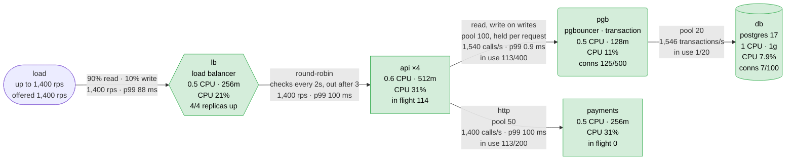
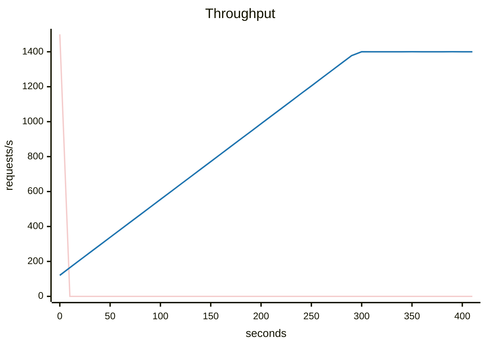
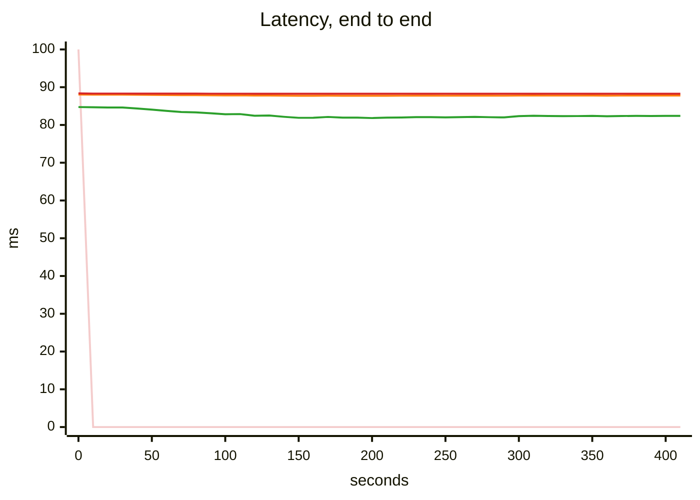
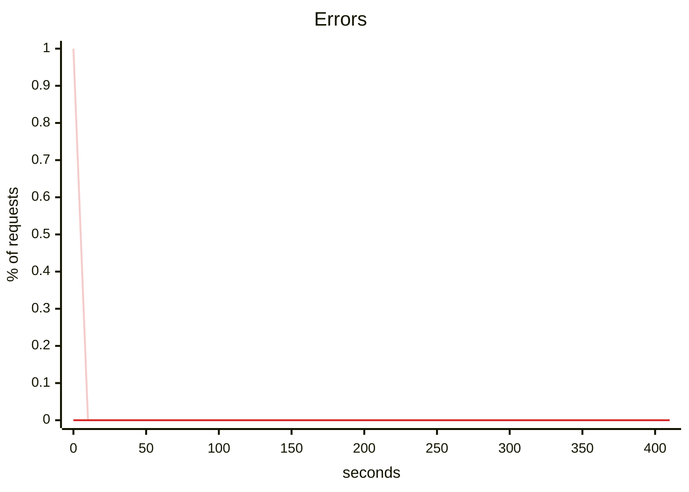
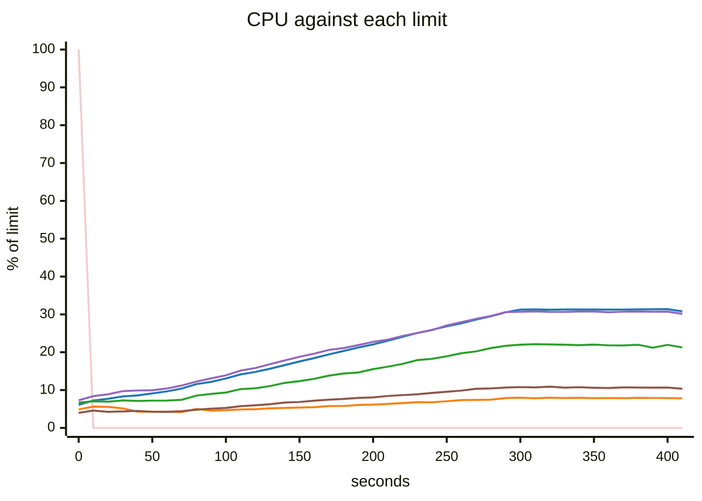

# connection-pool-trap-pgbouncer: run report

_run `connection-pool-trap-pgbouncer-20261111-121407` · completed · 11 Nov 2026 12:14 UTC · scale 1 · seed 1_

## Verdict

**Held.** Held the whole profile: up to 1,400 rps offered, 1,400 rps served at best, worst 10-second p99 88 ms, at most 0% errors.

<sub>Sources: offered load: the load profile in plan.json (offered arrival rate); served: k6_http_reqs_total{expected_response="true"} (k6: successful responses); p99: k6_http_req_duration_seconds (k6 histogram, end to end); errors: k6_http_reqs_total{expected_response="false"} ÷ k6_http_reqs_total (k6). Windows are 10 seconds; what counts as broken is under [Thresholds](#thresholds).</sub>

## Diagram at 6:30

Measured in the 10-second window from 6:30 to 6:40 (the busiest window: the most successful responses). Nodes are colored by their most saturated resource, CPU against its limit or a connection pool's connections in use: red at 90% or more, amber from 70%, green below.



<sub>Sources: offered from the load profile in plan.json (offered arrival rate); load edge from k6_http_reqs_total (k6: all responses) and k6_http_req_duration_seconds (k6 histogram, end to end); CPU from container_cpu_usage_seconds_total (cAdvisor) ÷ the container's CPU limit; calls/s from loadlore_calls_total (the caller's outbound call attempts) and their p99 from loadlore_call_duration_seconds (the caller's histogram, pool wait included); pools from loadlore_pool_connections{state="in_use"} and loadlore_pool_max_connections and loadlore_pool_pending (callers waiting for a connection); lb traffic from haproxy_backend_http_requests_total (HAProxy), replicas up from haproxy_backend_active_servers (HAProxy), and the lb edge's p99 from loadlore_request_duration_seconds (the service's own histogram); conns from pg_stat_activity_count and pg_settings_max_connections (postgres_exporter); PgBouncer's client conns from pgbouncer_pools_client_{active,waiting}_connections and pgbouncer_config_max_client_connections, its server pools from pgbouncer_pools_server_active_connections against pgbouncer_databases_pool_size plus reserve_pool (PgBouncer's server connections) and pgbouncer_pools_client_waiting_connections (clients waiting in PgBouncer for a server connection), and transactions/s on its edges from pgbouncer_stats_totals_sql_transactions_pooled_total.</sub>

## Charts

One point per 10-second window, at the window's start; x is seconds from the start of the load.



<sub>Grey: offered load (the load profile in plan.json (offered arrival rate)). Blue: successful responses (k6_http_reqs_total{expected_response="true"} (k6: successful responses)). Pink spikes mark 0:00 latency +80 ms on connections into payments.</sub>



<sub>Green: p50. Orange: p95. Red: p99 (k6_http_req_duration_seconds (k6 histogram, end to end)). Pink spikes mark 0:00 latency +80 ms on connections into payments.</sub>



<sub>Failed requests as a share of all responses (k6_http_reqs_total{expected_response="false"} ÷ k6_http_reqs_total (k6)), timeouts included. Pink spikes mark 0:00 latency +80 ms on connections into payments.</sub>



<sub>Blue: api. Orange: db. Green: lb. Purple: payments. Brown: pgb (container_cpu_usage_seconds_total (cAdvisor) ÷ the container's CPU limit, mean over the window). Pink spikes mark 0:00 latency +80 ms on connections into payments.</sub>

## Diagnosis

No diagnosis rule fired. Rules checked: connection pool exhausted, queueing knee (rules version 5; thresholds below).

## Predictions

2 of 2 scored predictions held.

| Prediction | Result | Worst value | Checked over | Notes |
| --- | --- | --- | --- | --- |
| `p99_ms < 300 until load_rps >= 1000` | **held** | 88 ms | 0:00 to 3:30, when load_rps >= 1,000 rps first held | source: k6_http_req_duration_seconds (k6 histogram, end to end) |
| `error_rate < 1% throughout` | **held** | 0% | the whole run | source: k6_http_reqs_total{expected_response="false"} ÷ k6_http_reqs_total (k6) |

## Timeline

| Time | Event |
| --- | --- |
| 0:00 | fault started: latency +80 ms on connections into payments |
| 7:00 | fault ended: latency +80 ms on connections into payments |

<sub>From events.jsonl: the fault timeline and Docker container events.</sub>

## Assumptions

### From the design

The design lists no assumptions.

### Chosen by Loadlore

| Field | Value | Why |
| --- | --- | --- |
| workload.timeout_ms | 10s | the default; k6 gives up on a request after this long and counts it as failed |
| workload.slo.p99_ms | 500 ms | the default; a break on p99 alone needs p99 at or above this as well as 10x the low-load p99, so latency users would still accept isn't called a break |
| resources.cpu_period_ms | 100 ms for api, db, lb, payments, pgb | Docker's default. A container that uses its CPU share early in a period stalls until the next one, which can show up in p99 when a service has a fraction of a CPU |
| services.lb timeouts | connect 5s, server 60s | HAProxy's own timeouts, with its defaults otherwise. A request already sent to a replica that dies waits for the server timeout (or the load generator's); health checks only stop new requests going there |
| services.pgb.pool_mode | transaction | a server connection serves one client's transaction, then the next client's (transaction); for the whole client connection (session); or for one statement (statement). Loadlore's default is transaction, PgBouncer's is session |
| services.pgb.default_pool_size | 20 | server connections to db for the database and user; clients beyond them wait in PgBouncer for one |
| services.pgb.config.max_client_conn | 500 | set in the design: clients beyond it are refused |
| services.pgb.config.server_login_retry | 15s | PgBouncer's own default: after a failed connection to db, PgBouncer waits this long before trying again, so it can recover from a restart of db later than a direct client would |
| services.api.pools.pgb.min | 0 | the default, as pgxpool's: each replica opens connections only when callers need them, so a pool fills as load rises, and a burst opens many at once |
| services.api.pools.pgb.hold | request | set in the design: a request keeps the connection from its first call to pgb until it responds, through any slower calls in between, as Rails and Django check out a connection per request |

### How the run was planned

- Loadlore's own containers get fixed budgets: load generator 1.5 CPU (peak 1400 rps), Toxiproxy 1 CPU (about 5880 proxied calls/s at peak), Prometheus 0.1, cAdvisor 0.1, exporters 0.1 each

## Thresholds

- **Broke:** 2 windows in a row with at least 1.0% of requests failing or successful responses below 90% of the offered rate, or 3 windows in a row with any of those or p99 at least 10x the low-load p99 (the median p99 of windows offered at most 25% of the peak, before errors or a shortfall in 2 windows in a row) and at least the SLO, 500 ms (workload.slo.p99_ms): 883 ms in this run. A shorter episode is shown as a stall in the timeline, not a break.
- **Doubtful:** a break on p99 alone, when the load generator was stalled at its CPU limit in 1.0% or more of its scheduling periods in one of the break's windows and the entry service's own p99 (loadlore_request_duration_seconds (the service's own histogram)) was below the limit in one of them. The verdict stays what it was.
- **Inconclusive:** before the break (or anywhere, if nothing broke), the load generator dropped more than 1.0% of a window's arrivals, or the load generator or Toxiproxy used 90% or more of its CPU budget, or was stalled at its CPU limit in 5.0% or more of its scheduling periods (from 1.0% it's noted as a caveat). The first 10 s of load are a warm-up and don't count: the load generator starts its VUs and connections open then. A cause is named only with evidence: on a Linux host, the hypervisor giving 2.0% or more of CPU time to other virtual machines (steal), or other programs using 10% or more of the host's CPUs (at least 0.5); inside a VM on this machine, only as a possibility.
- **Connection pool exhausted:** for two windows in a row, a pool at 95% or more of its size with callers waiting, while the target wasn't busy (busy: its CPU at 80% or more, or its time per call with a connection at least 3x the low-load value and 1 ms above it; CPU throttling alone doesn't count) and the caller's CPU stayed below 90%.
- **Queueing knee:** for 3 windows in a row, p99 at least 3x the low-load p99 and 10 ms above it, with a CPU or pool at 70% or more. When that is a pool whose target was busy in any of those windows, or a service's CPU whose requests spent 50% or more of their time in calls to a busy target, the knee is the target's.
- **Connection storm:** up to the break, a service's pools to a Postgres opening at least 50% of their combined size, and 10 or more connections, in one window, while p99 in that window or the next was at least 10x the low-load p99 and 10 ms above it. New connections are counted by loadlore_pool_connect_seconds (new connections the pools opened, and how long each took), or for runs from before it, from the rise in open connections.

## Environment

- loadl dev, profile 7m0s, scale 1, seed 1
- Host: 8 CPUs, 9.7 GiB memory, Ubuntu 24.04.4 LTS (aarch64, kernel 6.8.0-117-generic), cgroup v2
- Docker 29.5.2, Compose 5.1.1
- Host speed index 999 (hash 983, memory 1005, syscalls 1010): one CPU's work against the reference machine's 1000 (MacBook Air M4 (4 performance and 6 efficiency cores), Colima VM with 8 vCPUs). CPU limits are fractions of this host's cores, so a lower index means the design breaks at a lower load
- Cool-down: none needed; the first benchmark (999) was within 5.0% of the run it's compared with (991)
- Host CPU: Docker runs in a VM on this machine, so other programs' use of the CPU can't be seen
- Data: a fresh copy of the cached seeded dataset
- Load generator summary (k6): 392,994 requests, 0 dropped arrivals, 0% failed

<details><summary>Containers and images</summary>

| Container | Image |
| --- | --- |
| loadlore-connection-pool-trap-pgbouncer-20261111-121407-api-0-1 | loadlore/synthetic:dev |
| loadlore-connection-pool-trap-pgbouncer-20261111-121407-api-1-1 | loadlore/synthetic:dev |
| loadlore-connection-pool-trap-pgbouncer-20261111-121407-api-2-1 | loadlore/synthetic:dev |
| loadlore-connection-pool-trap-pgbouncer-20261111-121407-api-3-1 | loadlore/synthetic:dev |
| loadlore-connection-pool-trap-pgbouncer-20261111-121407-db-1 | postgres:17.11 |
| loadlore-connection-pool-trap-pgbouncer-20261111-121407-lb-1 | haproxy:3.2.26 |
| loadlore-connection-pool-trap-pgbouncer-20261111-121407-lore-cadvisor-1 | ghcr.io/google/cadvisor:v0.60.6 |
| loadlore-connection-pool-trap-pgbouncer-20261111-121407-lore-k6-1 | grafana/k6:2.3.0 |
| loadlore-connection-pool-trap-pgbouncer-20261111-121407-lore-pgbexp-pgb-1 | prometheuscommunity/pgbouncer-exporter:v0.12.1 |
| loadlore-connection-pool-trap-pgbouncer-20261111-121407-lore-pgexp-db-1 | quay.io/prometheuscommunity/postgres-exporter:v0.20.1 |
| loadlore-connection-pool-trap-pgbouncer-20261111-121407-lore-prometheus-1 | prom/prometheus:v3.16.0 |
| loadlore-connection-pool-trap-pgbouncer-20261111-121407-lore-toxiproxy-1 | ghcr.io/shopify/toxiproxy:2.13.0 |
| loadlore-connection-pool-trap-pgbouncer-20261111-121407-payments-0-1 | loadlore/synthetic:dev |
| loadlore-connection-pool-trap-pgbouncer-20261111-121407-pgb-1 | edoburu/pgbouncer:v1.26.1-p0 |

</details>

## Per-window data

<details><summary>42 windows of 10 seconds</summary>

| t | offered | served | dropped | errors | p50 | p99 | api CPU | db CPU | db conns | lb CPU | lb up | payments CPU | pgb CPU | pgb conns | api→payments pool | wait | api→pgb pool | wait | pgb→db pool | wait | k6 CPU | Toxiproxy CPU | k6 / Toxiproxy stalled |
| --- | --- | --- | --- | --- | --- | --- | --- | --- | --- | --- | --- | --- | --- | --- | --- | --- | --- | --- | --- | --- | --- | --- | --- |
| 0:00 | 122 | 120 | 0 | 0% | 85 ms | 88 ms | 6.1% | 4.9% | 4 | 6.7% | 4 | 7.3% | 4.0% | 16 | 12/200 | 0.0 ms | 12/400 | 0.0 ms | 0/20 | 0.0 ms | 5.3% | 12% | 0% / 0% |
| 0:10 | 165 | 164 | 0 | 0% | 85 ms | 88 ms | 7.3% | 5.6% | 5 | 7.0% | 4 | 8.4% | 4.6% | 20 | 14/200 | 0.0 ms | 15/400 | 0.0 ms | 1/20 | 0.0 ms | 5.2% | 12% | 0% / 0% |
| 0:20 | 208 | 208 | 0 | 0% | 85 ms | 88 ms | 7.7% | 5.5% | 5 | 6.9% | 4 | 8.9% | 4.3% | 24 | 17/200 | 0.0 ms | 17/400 | 0.0 ms | 0/20 | 0.0 ms | 4.4% | 12% | 0% / 0% |
| 0:30 | 252 | 251 | 0 | 0% | 85 ms | 88 ms | 8.3% | 5.2% | 5 | 7.3% | 4 | 9.7% | 4.4% | 27 | 22/200 | 0.0 ms | 22/400 | 0.0 ms | 0/20 | 0.0 ms | 4.8% | 14% | 0% / 0% |
| 0:40 | 295 | 294 | 0 | 0% | 84 ms | 88 ms | 8.6% | 4.3% | 6 | 7.1% | 4 | 9.9% | 4.5% | 31 | 26/200 | 0.0 ms | 26/400 | 0.0 ms | 0/20 | 0.0 ms | 4.9% | 13% | 0% / 0% |
| 0:50 | 338 | 338 | 0 | 0% | 84 ms | 88 ms | 9.1% | 4.3% | 6 | 7.2% | 4 | 10.0% | 4.3% | 33 | 30/200 | 0.0 ms | 30/400 | 0.0 ms | 0/20 | 0.0 ms | 4.9% | 14% | 0% / 0% |
| 1:00 | 382 | 381 | 0 | 0% | 84 ms | 88 ms | 9.7% | 4.3% | 6 | 7.2% | 4 | 10% | 4.3% | 36 | 32/200 | 0.0 ms | 32/400 | 0.0 ms | 1/20 | 0.0 ms | 4.9% | 14% | 0% / 0% |
| 1:10 | 425 | 424 | 0 | 0% | 83 ms | 88 ms | 10% | 4.2% | 6 | 7.4% | 4 | 11% | 4.4% | 40 | 36/200 | 0.0 ms | 36/400 | 0.0 ms | 0/20 | 0.0 ms | 5.1% | 15% | 0% / 0% |
| 1:20 | 468 | 468 | 0 | 0% | 83 ms | 88 ms | 12% | 5.0% | 6 | 8.5% | 4 | 12% | 4.8% | 44 | 40/200 | 0.0 ms | 40/400 | 0.0 ms | 0/20 | 0.0 ms | 5.9% | 16% | 0% / 0% |
| 1:30 | 512 | 511 | 0 | 0% | 83 ms | 88 ms | 12% | 4.6% | 6 | 9.0% | 4 | 13% | 5.1% | 48 | 42/200 | 0.0 ms | 42/400 | 0.0 ms | 1/20 | 0.0 ms | 6.0% | 17% | 0% / 0% |
| 1:40 | 555 | 555 | 0 | 0% | 83 ms | 88 ms | 13% | 4.7% | 6 | 9.4% | 4 | 14% | 5.3% | 51 | 46/200 | 0.0 ms | 48/400 | 0.0 ms | 0/20 | 0.0 ms | 6.5% | 17% | 0% / 0% |
| 1:50 | 598 | 598 | 0 | 0% | 83 ms | 88 ms | 14% | 4.9% | 6 | 10% | 4 | 15% | 5.7% | 56 | 49/200 | 0.0 ms | 49/400 | 0.0 ms | 0/20 | 0.0 ms | 6.8% | 19% | 0% / 0% |
| 2:00 | 642 | 641 | 0 | 0% | 82 ms | 88 ms | 15% | 4.9% | 6 | 10% | 4 | 16% | 6.0% | 58 | 53/200 | 0.0 ms | 53/400 | 0.0 ms | 0/20 | 0.0 ms | 6.9% | 20% | 0% / 0% |
| 2:10 | 685 | 684 | 0 | 0% | 82 ms | 88 ms | 16% | 5.2% | 6 | 11% | 4 | 17% | 6.3% | 64 | 57/200 | 0.0 ms | 57/400 | 0.0 ms | 1/20 | 0.0 ms | 7.6% | 21% | 0% / 0% |
| 2:20 | 728 | 728 | 0 | 0% | 82 ms | 88 ms | 17% | 5.3% | 6 | 12% | 4 | 18% | 6.7% | 65 | 60/200 | 0.0 ms | 61/400 | 0.0 ms | 0/20 | 0.0 ms | 7.6% | 22% | 0% / 0% |
| 2:30 | 772 | 771 | 0 | 0% | 82 ms | 88 ms | 18% | 5.4% | 6 | 12% | 4 | 19% | 6.8% | 69 | 64/200 | 0.0 ms | 64/400 | 0.0 ms | 0/20 | 0.0 ms | 8.3% | 23% | 0% / 0% |
| 2:40 | 815 | 814 | 0 | 0% | 82 ms | 88 ms | 18% | 5.5% | 6 | 13% | 4 | 20% | 7.2% | 72 | 67/200 | 0.0 ms | 67/400 | 0.0 ms | 1/20 | 0.0 ms | 8.4% | 24% | 0% / 0% |
| 2:50 | 858 | 858 | 0 | 0% | 82 ms | 88 ms | 19% | 5.8% | 6 | 14% | 4 | 21% | 7.5% | 76 | 72/200 | 0.0 ms | 72/400 | 0.0 ms | 0/20 | 0.0 ms | 8.8% | 25% | 0% / 0% |
| 3:00 | 902 | 901 | 0 | 0% | 82 ms | 88 ms | 20% | 5.8% | 6 | 14% | 4 | 21% | 7.7% | 80 | 74/200 | 0.0 ms | 74/400 | 0.0 ms | 0/20 | 0.0 ms | 9.2% | 25% | 0% / 0% |
| 3:10 | 945 | 944 | 0 | 0% | 82 ms | 88 ms | 21% | 6.1% | 6 | 15% | 4 | 22% | 7.9% | 86 | 77/200 | 0.0 ms | 77/400 | 0.0 ms | 2/20 | 0.0 ms | 9.4% | 26% | 0% / 0% |
| 3:20 | 988 | 988 | 0 | 0% | 82 ms | 88 ms | 22% | 6.2% | 6 | 16% | 4 | 23% | 8.1% | 88 | 81/200 | 0.0 ms | 81/400 | 0.0 ms | 1/20 | 0.0 ms | 9.6% | 27% | 0% / 0% |
| 3:30 | 1,032 | 1,031 | 0 | 0% | 82 ms | 88 ms | 23% | 6.3% | 6 | 16% | 4 | 23% | 8.4% | 90 | 85/200 | 0.0 ms | 85/400 | 0.0 ms | 2/20 | 0.0 ms | 9.9% | 28% | 0% / 0% |
| 3:40 | 1,075 | 1,074 | 0 | 0% | 82 ms | 88 ms | 24% | 6.6% | 6 | 17% | 4 | 24% | 8.7% | 95 | 87/200 | 0.0 ms | 89/400 | 0.0 ms | 1/20 | 0.0 ms | 10% | 29% | 0% / 0% |
| 3:50 | 1,118 | 1,118 | 0 | 0% | 82 ms | 88 ms | 25% | 6.8% | 6 | 18% | 4 | 25% | 8.9% | 97 | 92/200 | 0.0 ms | 92/400 | 0.0 ms | 1/20 | 0.0 ms | 11% | 30% | 0% / 0% |
| 4:00 | 1,162 | 1,162 | 0 | 0% | 82 ms | 88 ms | 26% | 6.8% | 6 | 18% | 4 | 26% | 9.3% | 101 | 95/200 | 0.0 ms | 96/400 | 0.0 ms | 1/20 | 0.0 ms | 11% | 30% | 0% / 0% |
| 4:10 | 1,205 | 1,204 | 0 | 0% | 82 ms | 88 ms | 27% | 7.0% | 6 | 19% | 4 | 27% | 9.6% | 105 | 100/200 | 0.0 ms | 100/400 | 0.0 ms | 3/20 | 0.0 ms | 11% | 32% | 0% / 0% |
| 4:20 | 1,248 | 1,248 | 0 | 0% | 82 ms | 88 ms | 28% | 7.4% | 6 | 20% | 4 | 28% | 9.9% | 108 | 102/200 | 0.0 ms | 103/400 | 0.0 ms | 1/20 | 0.0 ms | 11% | 32% | 0% / 0% |
| 4:30 | 1,292 | 1,291 | 0 | 0% | 82 ms | 88 ms | 29% | 7.4% | 7 | 20% | 4 | 29% | 10% | 113 | 106/200 | 0.0 ms | 106/400 | 0.0 ms | 2/20 | 0.0 ms | 12% | 33% | 0% / 0% |
| 4:40 | 1,335 | 1,335 | 0 | 0% | 82 ms | 88 ms | 30% | 7.5% | 7 | 21% | 4 | 30% | 10% | 116 | 109/200 | 0.0 ms | 110/400 | 0.0 ms | 1/20 | 0.0 ms | 12% | 34% | 0% / 0% |
| 4:50 | 1,378 | 1,378 | 0 | 0% | 82 ms | 88 ms | 31% | 7.9% | 7 | 22% | 4 | 31% | 11% | 120 | 112/200 | 0.0 ms | 112/400 | 0.0 ms | 1/20 | 0.0 ms | 12% | 35% | 0% / 0% |
| 5:00 | 1,400 | 1,400 | 0 | 0% | 82 ms | 88 ms | 31% | 8.0% | 7 | 22% | 4 | 31% | 11% | 121 | 114/200 | 0.0 ms | 114/400 | 0.0 ms | 2/20 | 0.0 ms | 12% | 36% | 0% / 0% |
| 5:10 | 1,400 | 1,400 | 0 | 0% | 82 ms | 88 ms | 31% | 7.8% | 7 | 22% | 4 | 31% | 11% | 122 | 113/200 | 0.0 ms | 113/400 | 0.0 ms | 0/20 | 0.0 ms | 13% | 35% | 0% / 0% |
| 5:20 | 1,400 | 1,400 | 0 | 0% | 82 ms | 88 ms | 31% | 8.0% | 7 | 22% | 4 | 31% | 11% | 123 | 114/200 | 0.0 ms | 114/400 | 0.0 ms | 2/20 | 0.0 ms | 13% | 36% | 0% / 0% |
| 5:30 | 1,400 | 1,400 | 0 | 0% | 82 ms | 88 ms | 31% | 7.9% | 7 | 22% | 4 | 31% | 11% | 123 | 113/200 | 0.0 ms | 114/400 | 0.0 ms | 2/20 | 0.0 ms | 13% | 35% | 0% / 0% |
| 5:40 | 1,400 | 1,400 | 0 | 0% | 82 ms | 88 ms | 31% | 8.0% | 7 | 22% | 4 | 31% | 11% | 124 | 114/200 | 0.0 ms | 114/400 | 0.0 ms | 3/20 | 0.0 ms | 12% | 36% | 0% / 0% |
| 5:50 | 1,400 | 1,400 | 0 | 0% | 82 ms | 88 ms | 31% | 7.9% | 7 | 22% | 4 | 31% | 11% | 124 | 114/200 | 0.0 ms | 114/400 | 0.0 ms | 0/20 | 0.0 ms | 13% | 36% | 0% / 0% |
| 6:00 | 1,400 | 1,400 | 0 | 0% | 82 ms | 88 ms | 31% | 7.9% | 7 | 22% | 4 | 31% | 11% | 124 | 114/200 | 0.0 ms | 114/400 | 0.0 ms | 1/20 | 0.0 ms | 13% | 35% | 0% / 0% |
| 6:10 | 1,400 | 1,400 | 0 | 0% | 82 ms | 88 ms | 31% | 7.8% | 7 | 22% | 4 | 31% | 11% | 124 | 114/200 +1 | 0.0 ms | 114/400 | 0.0 ms | 2/20 | 0.0 ms | 12% | 35% | 0% / 0% |
| 6:20 | 1,400 | 1,400 | 0 | 0% | 82 ms | 88 ms | 31% | 8.0% | 7 | 22% | 4 | 31% | 11% | 125 | 113/200 | 0.0 ms | 113/400 | 0.0 ms | 1/20 | 0.0 ms | 13% | 35% | 0% / 0% |
| 6:30 | 1,400 | 1,400 | 0 | 0% | 82 ms | 88 ms | 31% | 7.9% | 7 | 21% | 4 | 31% | 11% | 125 | 113/200 | 0.0 ms | 113/400 | 0.0 ms | 1/20 | 0.0 ms | 12% | 36% | 0% / 0% |
| 6:40 | 1,400 | 1,400 | 0 | 0% | 82 ms | 88 ms | 31% | 7.9% | 7 | 22% | 4 | 31% | 11% | 125 | 113/200 | 0.0 ms | 114/400 | 0.0 ms | 1/20 | 0.0 ms | 12% | 36% | 0% / 0% |
| 6:50 | 1,400 | 1,400 | 0 | 0% | 82 ms | 88 ms | 31% | 7.8% | 7 | 21% | 4 | 30% | 10% | 125 | 113/200 | 0.0 ms | 113/400 | 0.0 ms | 1/20 | 0.0 ms | 11% | 34% | 0% / 0% |

Columns: offered is the load profile in plan.json (offered arrival rate); served is k6_http_reqs_total{expected_response="true"} (k6: successful responses); dropped is k6_dropped_iterations_total (k6: arrivals it couldn't start); errors are k6_http_reqs_total{expected_response="false"} ÷ k6_http_reqs_total (k6); p50 and p99 are from k6_http_req_duration_seconds (k6 histogram, end to end); CPU is container_cpu_usage_seconds_total (cAdvisor) ÷ the container's CPU limit, mean over the window; conns are pg_stat_activity_count and pg_settings_max_connections (postgres_exporter); a PgBouncer's are its clients, from pgbouncer_pools_client_{active,waiting}_connections and pgbouncer_config_max_client_connections; hit rate is from redis_keyspace_hits_total and redis_keyspace_misses_total (redis_exporter); up is haproxy_backend_active_servers (HAProxy); pools are loadlore_pool_connections{state="in_use"} and loadlore_pool_max_connections (peak in use/size, +peak waiting), wait is the mean from loadlore_pool_wait_seconds (time to get a connection); a PgBouncer's are its server connections, from pgbouncer_pools_server_active_connections against pgbouncer_databases_pool_size plus reserve_pool (PgBouncer's server connections), and its wait pgbouncer_stats_totals_client_wait_seconds_total ÷ server_assignments_total (PgBouncer); k6 and Toxiproxy CPU are against their budgets.

</details>

## Design file

The exact `design.yaml` this run used:

```yaml
version: 1
name: connection-pool-trap-pgbouncer

# The starting design with PgBouncer between api and db, in transaction mode.
#
# A checkout service: every request reads the cart from Postgres, then asks
# the payment provider to authorize the card, and one in ten also writes
# the order. Like Rails and Django, the api's framework checks out a
# database connection when a request first needs one and keeps it until the
# response.

services:
  lb:
    kind: lb
    target: api
    health_check: { interval_ms: 2000, fall: 3, rise: 2 }

  api:
    image: loadlore/synthetic
    replicas: 4
    resources: { cpu: 0.6, memory: 512m }
    behavior:
      cpu_ms: 0.3
      calls:
        - { target: pgb, op: read }                         # the cart
        - { target: payments, op: http }                    # authorize the card
        - { target: pgb, op: write, when: write }           # the order
    pools:
      pgb: { size: 100, hold: request }  # client connections to PgBouncer: 4 x 100 = 400
      payments: 50

  pgb:
    kind: pgbouncer
    target: db
    pool_mode: transaction        # a server connection per transaction, not per client
    default_pool_size: 20         # what db sees: 20 connections
    resources: { cpu: 0.5, memory: 128m }
    config: { max_client_conn: 500 }

  payments:
    image: loadlore/synthetic
    resources: { cpu: 0.5, memory: 256m }
    behavior:
      cpu_ms: 0.05

  db:
    kind: postgres
    version: "17"
    resources: { cpu: 1, memory: 1g }
    config: { max_connections: 100, shared_buffers: 256MB }
    dataset: { rows: 1000000, row_bytes: 512 }

workload:
  entry: lb
  profile:
    - ramp: { from: 100, to: 1400, over: 5m }
    - hold: { rps: 1400, for: 2m }
  mix: { read: 0.9, write: 0.1 }
  keys: { distribution: zipf, skew: 1.1, count: 1000000 }

# The payment provider is outside your system and answers in about 80 ms,
# modeled as network latency on the way to it for the whole run.
scenario:
  - { at: 0s, inject: latency, target: payments, add_ms: 80 }

# Your predictions, scored in the report. Replace these with your own
# before you run it.
expect:
  - p99_ms < 300 until load_rps >= 1000
  - error_rate < 1% throughout
```
