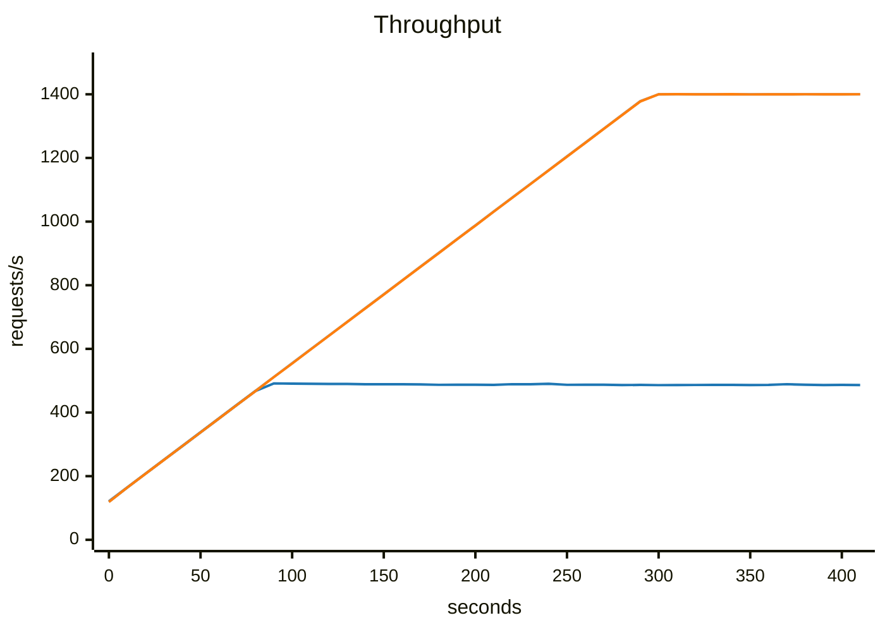
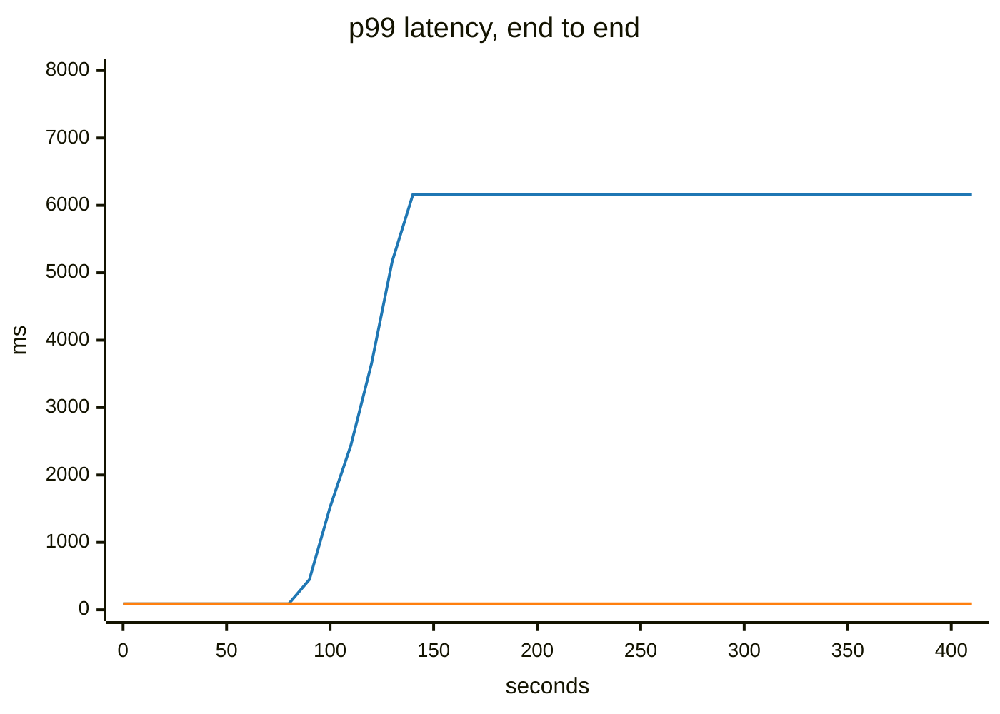

# Compare: connection-pool-trap vs connection-pool-trap-release-between-queries

_A: run `connection-pool-trap-20261117-221124` · B: run `connection-pool-trap-release-between-queries-20261117-222640`_

| | A | B |
| --- | --- | --- |
| Design | connection-pool-trap | connection-pool-trap-release-between-queries |
| Verdict | broke at 1:40 (555 rps offered) | held |
| Most served | 492 rps at 1:30 | 1,400 rps at 5:40 |
| Worst 10-second p99 | 6.16 s | 88 ms |
| Worst error rate | 0% | 0% |
| Diagnoses | Connection pool exhausted (api → db) from 1:30 | none fired |
| Predictions held | 1 of 2 | 2 of 2 |
| Peak offered | 1,400 rps | 1,400 rps |
| Scale, seed | 1, 1 | 1, 1 |
| Host | 8 CPUs, 9.7 GiB, Docker 29.5.2 | 8 CPUs, 9.7 GiB, Docker 29.5.2 |
| Data | fresh copy | fresh copy |

<sub>Sources as in each run's report: served from k6_http_reqs_total{expected_response="true"} (k6: successful responses), p99 from k6_http_req_duration_seconds (k6 histogram, end to end), errors from k6_http_reqs_total{expected_response="false"} ÷ k6_http_reqs_total (k6).</sub>

**Before reading the difference:**

- Both are single runs. The same design varies from run to run on one machine, so a small difference may be noise: `loadl run --repeat 3` on each design measures how much on this host.

## Verdicts

**A.** Broke 1:40 into the load, at 555 rps offered: p99 reached 1.53 s (88 ms at low load) and only 491 rps succeeded. Most saturated then: api → db pool 40 of 40 connections in use. After the break the load generator couldn't send 57% of the arrivals the profile asked for (202,553 arrivals from 1:50; k6_dropped_iterations_total (k6: arrivals it couldn't start)): slow responses held its 2,800 VUs, so served throughput from then on is partly the generator's limit, not only the system's. It hadn't recovered when the load ended.

**B.** Held the whole profile: up to 1,400 rps offered, 1,400 rps served at best, worst 10-second p99 88 ms, at most 0% errors.

## Charts



<sub>Grey: offered (A). Blue: served, A. Orange: served, B (k6_http_reqs_total{expected_response="true"} (k6: successful responses)). Windows without data are drawn at 0.</sub>



<sub>Blue: A. Orange: B (k6_http_req_duration_seconds (k6 histogram, end to end)). Windows without data are drawn at 0.</sub>

<details><summary>Per-window numbers, side by side</summary>

| t | offered A | offered B | served A | served B | p99 A | p99 B | errors A | errors B |
| --- | --- | --- | --- | --- | --- | --- | --- | --- |
| 0:00 | 122 | 122 | 120 | 119 | 88 ms | 88 ms | 0% | 0% |
| 0:10 | 165 | 165 | 164 | 164 | 88 ms | 88 ms | 0% | 0% |
| 0:20 | 208 | 208 | 208 | 208 | 88 ms | 88 ms | 0% | 0% |
| 0:30 | 252 | 252 | 251 | 251 | 88 ms | 88 ms | 0% | 0% |
| 0:40 | 295 | 295 | 294 | 294 | 88 ms | 88 ms | 0% | 0% |
| 0:50 | 338 | 338 | 338 | 337 | 88 ms | 88 ms | 0% | 0% |
| 1:00 | 382 | 382 | 381 | 381 | 88 ms | 88 ms | 0% | 0% |
| 1:10 | 425 | 425 | 424 | 424 | 88 ms | 88 ms | 0% | 0% |
| 1:20 | 468 | 468 | 468 | 467 | 88 ms | 88 ms | 0% | 0% |
| 1:30 | 512 | 512 | 492 | 511 | 449 ms | 88 ms | 0% | 0% |
| 1:40 | 555 | 555 | 491 | 554 | 1.53 s | 88 ms | 0% | 0% |
| 1:50 | 598 | 598 | 490 | 598 | 2.44 s | 88 ms | 0% | 0% |
| 2:00 | 642 | 642 | 490 | 641 | 3.65 s | 88 ms | 0% | 0% |
| 2:10 | 685 | 685 | 490 | 684 | 5.17 s | 88 ms | 0% | 0% |
| 2:20 | 728 | 728 | 489 | 727 | 6.16 s | 88 ms | 0% | 0% |
| 2:30 | 772 | 772 | 489 | 771 | 6.16 s | 88 ms | 0% | 0% |
| 2:40 | 815 | 815 | 489 | 814 | 6.16 s | 88 ms | 0% | 0% |
| 2:50 | 858 | 858 | 488 | 857 | 6.16 s | 88 ms | 0% | 0% |
| 3:00 | 902 | 902 | 487 | 901 | 6.16 s | 88 ms | 0% | 0% |
| 3:10 | 945 | 945 | 487 | 944 | 6.16 s | 88 ms | 0% | 0% |
| 3:20 | 988 | 988 | 487 | 987 | 6.16 s | 88 ms | 0% | 0% |
| 3:30 | 1,032 | 1,032 | 487 | 1,031 | 6.16 s | 88 ms | 0% | 0% |
| 3:40 | 1,075 | 1,075 | 489 | 1,074 | 6.16 s | 88 ms | 0% | 0% |
| 3:50 | 1,118 | 1,118 | 489 | 1,117 | 6.16 s | 88 ms | 0% | 0% |
| 4:00 | 1,162 | 1,162 | 490 | 1,161 | 6.16 s | 88 ms | 0% | 0% |
| 4:10 | 1,205 | 1,205 | 487 | 1,204 | 6.16 s | 88 ms | 0% | 0% |
| 4:20 | 1,248 | 1,248 | 487 | 1,247 | 6.16 s | 88 ms | 0% | 0% |
| 4:30 | 1,292 | 1,292 | 487 | 1,291 | 6.16 s | 88 ms | 0% | 0% |
| 4:40 | 1,335 | 1,335 | 486 | 1,334 | 6.16 s | 88 ms | 0% | 0% |
| 4:50 | 1,378 | 1,378 | 487 | 1,377 | 6.16 s | 88 ms | 0% | 0% |
| 5:00 | 1,400 | 1,400 | 486 | 1,400 | 6.16 s | 88 ms | 0% | 0% |
| 5:10 | 1,400 | 1,400 | 486 | 1,400 | 6.16 s | 88 ms | 0% | 0% |
| 5:20 | 1,400 | 1,400 | 487 | 1,400 | 6.16 s | 88 ms | 0% | 0% |
| 5:30 | 1,400 | 1,400 | 487 | 1,400 | 6.16 s | 88 ms | 0% | 0% |
| 5:40 | 1,400 | 1,400 | 487 | 1,400 | 6.16 s | 88 ms | 0% | 0% |
| 5:50 | 1,400 | 1,400 | 486 | 1,400 | 6.16 s | 88 ms | 0% | 0% |
| 6:00 | 1,400 | 1,400 | 487 | 1,400 | 6.16 s | 88 ms | 0% | 0% |
| 6:10 | 1,400 | 1,400 | 489 | 1,400 | 6.16 s | 88 ms | 0% | 0% |
| 6:20 | 1,400 | 1,400 | 487 | 1,400 | 6.16 s | 88 ms | 0% | 0% |
| 6:30 | 1,400 | 1,400 | 486 | 1,400 | 6.16 s | 88 ms | 0% | 0% |
| 6:40 | 1,400 | 1,400 | 487 | 1,400 | 6.16 s | 88 ms | 0% | 0% |
| 6:50 | 1,400 | 1,400 | 486 | 1,400 | 6.16 s | 88 ms | 0% | 0% |

</details>

## Diagnosis

### A

- **Connection pool exhausted (api → db), from 1:30.** From 1:30, every connection in api's pool to db was in use and requests waited for one, while db still had CPU to spare. Requests were queueing for a connection, not for the database.

### B

No diagnosis rule fired.

## Predictions

| Prediction | A | B |
| --- | --- | --- |
| `break_load_rps within 25% of 1000` | broken, worst 555 rps at 1:40 | not in this design |
| `errors_load_rps none` | held, worst no failures | not in this design |
| `p99_ms < 300 until load_rps >= 1000` | not in this design | held, worst 88 ms |
| `error_rate < 1% throughout` | not in this design | held, worst 0% |

## Design changes

```diff
--- A/design.yaml
+++ B/design.yaml
@@ -1,6 +1,8 @@
 version: 1
-name: connection-pool-trap
+name: connection-pool-trap-release-between-queries
 
+# The starting design with connections released between queries.
+#
 # A checkout service: every request reads the cart from Postgres, then asks
 # the payment provider to authorize the card, and one in ten also writes
 # the order. Like Rails and Django, the api's framework checks out a
@@ -24,7 +26,7 @@
         - { target: payments, op: http }                    # authorize the card
         - { target: db, op: write, when: write }            # the order
     pools:
-      db: { size: 10, hold: request }   # 4 replicas x 10 = 40 connections
+      db: { size: 10, hold: call }      # take a connection for each query, then hand it back
       payments: 50
 
   payments:
@@ -56,5 +58,5 @@
 # Your predictions, scored in the report. Replace these with your own
 # before you run it.
 expect:
-  - break_load_rps within 25% of 1000
-  - errors_load_rps none
+  - p99_ms < 300 until load_rps >= 1000
+  - error_rate < 1% throughout
```
