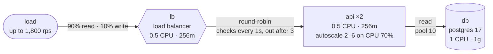

# Featured on Hacker News

Level 2 · about 40 minutes · teaches autoscaling, scale-up lag, choosing the metric an autoscaler scales on, and headroom

## The story

You run the api for a small product. It sits behind a load balancer on two replicas, and the platform autoscales it on CPU, as its defaults suggest: hold the replicas' CPU at 70%, between 2 and 6 of them. Each replica's CPU request and limit are the same, half a CPU, as many teams set them, so the autoscaler measures CPU against the limit. Each replica serves about 470 requests a second at its limit.



This afternoon, someone posts about the product and it reaches the front page of Hacker News. Traffic goes from 200 requests a second to 1,800 in under a minute, and stays there.

The autoscaler decides every 15 seconds, Kubernetes' default, and a new replica takes about 30 seconds to be scheduled and pull its image before it starts (`startup_s`, printed in the report's assumptions). Six replicas can serve the surge with room to spare. The question is whether they arrive in time.

## The question

Before you run anything, write down your guesses. Don't work them out: a gut answer is fine, and where the run differs from it is what you'll learn from.

1. At what load does it break, if it does?
2. How long after the surge starts will it run all six replicas?
3. If the autoscaler decided every 5 seconds instead of every 15, what would change?

Loads depend on your machine: slower cores break the same design at a lower load, so a guess can miss even when the reasoning behind it is right.

`loadl predict design.yaml` asks questions like these and writes your answers into the `expect` block at the bottom of `design.yaml`, or write them there yourself. The report scores each one against what the run measured. The line already there is an example; the grammar is in the [design file reference](../../skills/loadlore-designer/references/schema.md).

## Run it

```sh
loadl run scenarios/featured-on-hacker-news/design.yaml
loadl report latest --print | less
```

The run takes about 4 minutes. It needs 8 CPUs and 8 GB available to Docker: the design and Loadlore's own containers add up to 7.3 CPUs, counting all six replicas the autoscaler may run. On a smaller machine, add `--scale` with the largest value that fits; `loadl run` warns you when the host is too small and suggests one. The numbers here come from a MacBook Air M4 on mains power.

Watch the run's output: each autoscaler decision and each new replica taking traffic prints as it happens, and the report's timeline lists them.

Stuck? `loadl hint featured-on-hacker-news` reveals one hint at a time.

## What to try next

When you know why it broke, change one thing and run it again. Write an `expect` line for what you think will happen, then compare the two runs:

```sh
loadl compare <first-run> latest -o compare.md
```

Some directions: what the autoscaler scales on and its target, how many replicas run before the surge, and how often it decides. Before each run, work out how many replicas it asks for at each decision.

`solutions/` has two worked answers with their reports, and `variants/faster-decisions` is a fix that fits a different problem. They give the game away, so try your own first.
