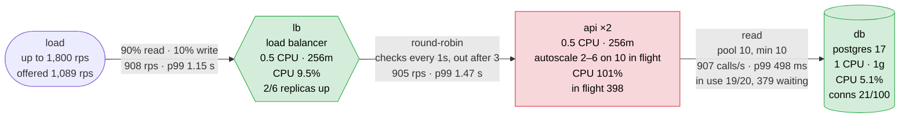
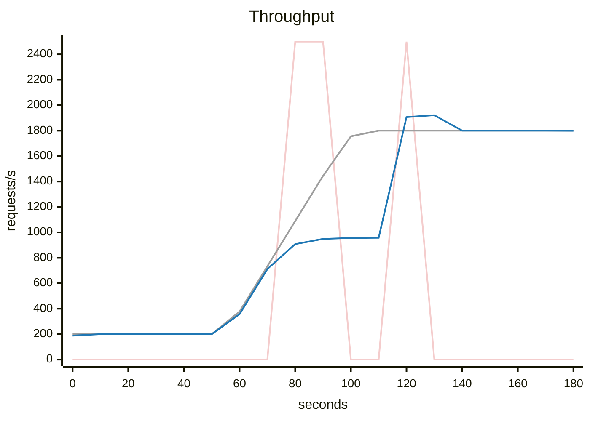
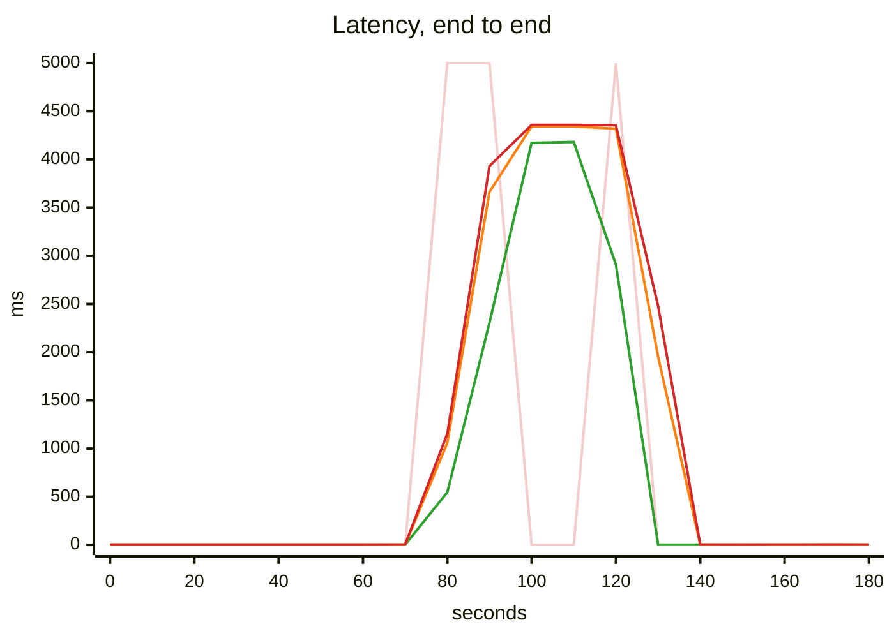
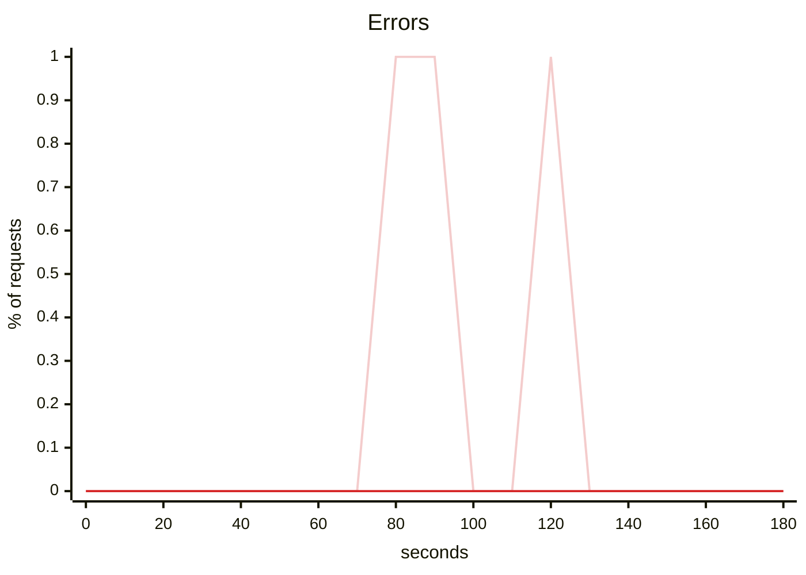
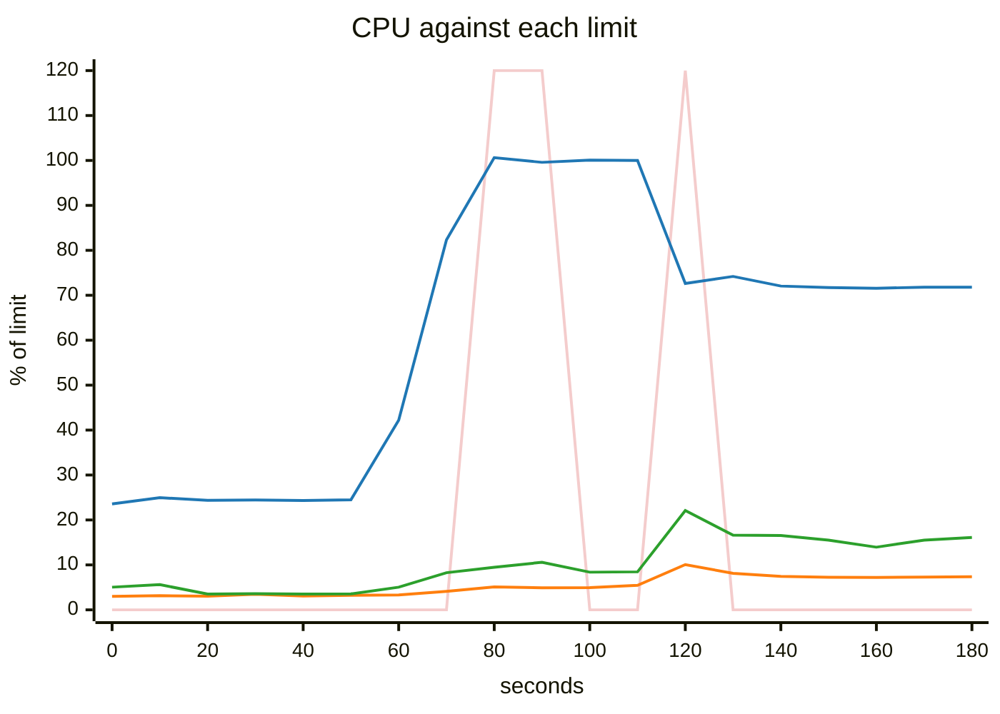

# featured-on-hacker-news-scale-on-inflight: run report

_run `featured-on-hacker-news-scale-on-inflight-20261117-214923` · completed · 17 Nov 2026 21:49 UTC · scale 1 · seed 1_

## Verdict

**Broke.** Broke 1:20 into the load, at 1,089 rps offered: p99 reached 1.15 s (2.5 ms at low load) and only 908 rps succeeded. Most saturated then: api CPU at 101% of its limit. After the break the load generator couldn't send 12% of the arrivals the profile asked for (20,358 arrivals from 1:30; k6_dropped_iterations_total (k6: arrivals it couldn't start)): slow responses held its 4,000 VUs, so served throughput from then on is partly the generator's limit, not only the system's. It recovered at 2:20, 1:00 after the break, and stayed healthy to the end.

Caveat: at 1:10 the load generator hit its CPU limit and was stalled in 1.0% of its scheduling periods (container_cpu_cfs_throttled_periods_total ÷ container_cpu_cfs_periods_total (cAdvisor)); work caught in a stall waits for the next 100 ms period, which can show up in p99.

<sub>Sources: offered load: the load profile in plan.json (offered arrival rate); served: k6_http_reqs_total{expected_response="true"} (k6: successful responses); p99: k6_http_req_duration_seconds (k6 histogram, end to end); errors: k6_http_reqs_total{expected_response="false"} ÷ k6_http_reqs_total (k6); saturation: container_cpu_usage_seconds_total (cAdvisor) ÷ the container's CPU limit. Windows are 10 seconds; what counts as broken is under [Thresholds](#thresholds).</sub>

## Diagram at 1:20

Measured in the 10-second window from 1:20 to 1:30 (the break). Nodes are colored by their most saturated resource, CPU against its limit or a connection pool's connections in use: red at 90% or more, amber from 70%, green below.



<sub>Sources: offered from the load profile in plan.json (offered arrival rate); load edge from k6_http_reqs_total (k6: all responses) and k6_http_req_duration_seconds (k6 histogram, end to end); CPU from container_cpu_usage_seconds_total (cAdvisor) ÷ the container's CPU limit; calls/s from loadlore_calls_total (the caller's outbound call attempts) and their p99 from loadlore_call_duration_seconds (the caller's histogram, pool wait included); pools from loadlore_pool_connections{state="in_use"} and loadlore_pool_max_connections and loadlore_pool_pending (callers waiting for a connection); lb traffic from haproxy_backend_http_requests_total (HAProxy), replicas up from haproxy_backend_active_servers (HAProxy), and the lb edge's p99 from loadlore_request_duration_seconds (the service's own histogram); conns from pg_stat_activity_count and pg_settings_max_connections (postgres_exporter).</sub>

## Charts

One point per 10-second window, at the window's start; x is seconds from the start of the load.



<sub>Grey: offered load (the load profile in plan.json (offered arrival rate)). Blue: successful responses (k6_http_reqs_total{expected_response="true"} (k6: successful responses)). Pink spikes mark 1:30 api 2 → 6 replicas (94.5 requests in flight per replica, target 10); 2:00 api-4 start; 2:00 api-3 start; 2:00 api-5 start; 2:00 api-2 start; 2:02 api-2 took traffic, 31.8 s after the decision; 2:02 api-3 took traffic, 31.9 s after the decision; 2:02 api-4 took traffic, 32.0 s after the decision; 2:02 api-5 took traffic, 32.1 s after the decision; 1:20 break.</sub>



<sub>Green: p50. Orange: p95. Red: p99 (k6_http_req_duration_seconds (k6 histogram, end to end)). Pink spikes mark 1:30 api 2 → 6 replicas (94.5 requests in flight per replica, target 10); 2:00 api-4 start; 2:00 api-3 start; 2:00 api-5 start; 2:00 api-2 start; 2:02 api-2 took traffic, 31.8 s after the decision; 2:02 api-3 took traffic, 31.9 s after the decision; 2:02 api-4 took traffic, 32.0 s after the decision; 2:02 api-5 took traffic, 32.1 s after the decision; 1:20 break.</sub>



<sub>Failed requests as a share of all responses (k6_http_reqs_total{expected_response="false"} ÷ k6_http_reqs_total (k6)), timeouts included. Pink spikes mark 1:30 api 2 → 6 replicas (94.5 requests in flight per replica, target 10); 2:00 api-4 start; 2:00 api-3 start; 2:00 api-5 start; 2:00 api-2 start; 2:02 api-2 took traffic, 31.8 s after the decision; 2:02 api-3 took traffic, 31.9 s after the decision; 2:02 api-4 took traffic, 32.0 s after the decision; 2:02 api-5 took traffic, 32.1 s after the decision; 1:20 break.</sub>



<sub>Blue: api. Orange: db. Green: lb (container_cpu_usage_seconds_total (cAdvisor) ÷ the container's CPU limit, mean over the window). Pink spikes mark 1:30 api 2 → 6 replicas (94.5 requests in flight per replica, target 10); 2:00 api-4 start; 2:00 api-3 start; 2:00 api-5 start; 2:00 api-2 start; 2:02 api-2 took traffic, 31.8 s after the decision; 2:02 api-3 took traffic, 31.9 s after the decision; 2:02 api-4 took traffic, 32.0 s after the decision; 2:02 api-5 took traffic, 32.1 s after the decision; 1:20 break.</sub>

## Diagnosis

### 1. Autoscale lag (api), from 1:20

At the break, 1:20, api ran 2 of up to 6 replicas, their CPU at 101% of the limit: the load grew faster than the autoscaler added capacity. It reached 6 at 1:30.

Evidence:

- api CPU at 101% of its limit at 1:20, over 2 replicas <sub>(container_cpu_usage_seconds_total (cAdvisor) ÷ the container's CPU limit)</sub>
- autoscale 1:30 api 2 → 6 replicas (94.5 requests in flight per replica, target 10) <sub>(events.jsonl (Loadlore's autoscaler))</sub>
- 2:02 api-2 took traffic, 31.8 s after the decision <sub>(events.jsonl (Loadlore's autoscaler))</sub>
- 2:02 api-3 took traffic, 31.9 s after the decision <sub>(events.jsonl (Loadlore's autoscaler))</sub>
- 2:02 api-4 took traffic, 32.0 s after the decision <sub>(events.jsonl (Loadlore's autoscaler))</sub>
- 2:02 api-5 took traffic, 32.1 s after the decision <sub>(events.jsonl (Loadlore's autoscaler))</sub>

**Try next:** Let api's autoscaler react sooner and in bigger steps: decide more often (interval_s), and keep more replicas running before a spike you expect (min).

### 2. Queueing knee (db, slower without running out of CPU), from 1:20

From 1:20, p99 stayed above 12 ms (2.5 ms at low load): db answered more slowly while its CPU stayed at most 5.1% of its limit, so callers held their connections longer and queued for them. The slowdown wasn't its CPU.

Evidence:

- 1:20 to 1:50: p99 1.15 s, 3.93 s, 4.36 s <sub>(k6_http_req_duration_seconds (k6 histogram, end to end))</sub>
- api CPU at 101% of its limit at 1:20: not where requests queued, since most of their time went to calls to db <sub>(container_cpu_usage_seconds_total (cAdvisor) ÷ the container's CPU limit)</sub>
- api's requests spent 52% of their time in calls to db at 1:20: 1 calls per request × 279 ms each, against 536 ms per request <sub>(loadlore_calls_total (the caller's outbound call attempts); loadlore_call_duration_seconds (the caller's histogram, pool wait included); loadlore_request_duration_seconds (the service's own histogram))</sub>
- api's calls to db took 9.1 ms each once they had a connection at 1:20, against 0.4 ms at low load <sub>(loadlore_call_duration_seconds minus loadlore_pool_wait_seconds, per call (time with a connection))</sub>
- db CPU at most 5.1% of its limit from 1:20 to 1:50 <sub>(container_cpu_usage_seconds_total (cAdvisor) ÷ the container's CPU limit)</sub>

**Try next:** Find what db waited on besides CPU, such as disk writes or locks, in its own logs and metrics, then re-run the ramp.

<sub>Rules version 22. Rules are deterministic and offline; their thresholds are listed below.</sub>

## Predictions

1 of 1 scored prediction held.

| Prediction | Result | Worst value | Checked over | Notes |
| --- | --- | --- | --- | --- |
| `p99_ms < 500 until load_rps >= 1000` | **held** | 3.2 ms | 0:00 to 1:20, when load_rps >= 1,000 rps first held | source: k6_http_req_duration_seconds (k6 histogram, end to end) |

Loads and request rates depend on this machine: slower cores break the same design at a lower load, so a load guess can miss even when the reasoning behind it was right.

## Timeline

| Time | Event |
| --- | --- |
| 1:30 | autoscale: api 2 → 6 replicas (94.5 requests in flight per replica, target 10) |
| 2:00 | container: api-4 start |
| 2:00 | container: api-3 start |
| 2:00 | container: api-5 start |
| 2:00 | container: api-2 start |
| 2:02 | replica ready: api-2 took traffic, 31.8 s after the decision |
| 2:02 | replica ready: api-3 took traffic, 31.9 s after the decision |
| 2:02 | replica ready: api-4 took traffic, 32.0 s after the decision |
| 2:02 | replica ready: api-5 took traffic, 32.1 s after the decision |

<sub>From events.jsonl: the fault timeline and Docker container events.</sub>

## Assumptions

### From the design

| Field | Value | Basis | Why |
| --- | --- | --- | --- |
| `services.api.behavior.cpu_ms` |  | guessed | a JSON handler with some work in it: a replica of 0.5 CPU serves about 470 requests a second |
| `workload.profile` |  | guessed | a front-page surge: nine times the usual traffic in under a minute |
| `services.api.autoscale.startup_s` |  | guessed | a new pod waits about 30 s to be scheduled and pull its image |

3 of these are guessed, not measured: the result depends on them.

### Chosen by Loadlore

| Field | Value | Why |
| --- | --- | --- |
| workload.timeout_ms | 10s | the default; k6 gives up on a request after this long and counts it as failed |
| workload.slo.p99_ms | 500 ms | the default; a break on p99 alone needs p99 at or above this as well as 10x the low-load p99, so latency users would still accept isn't called a break |
| network.profile | same-zone: 0.3 ms round trip | the default: every service in one availability zone. AWS says a round trip between two instances in the same zone is generally sub-millisecond with enhanced networking, and publishes no exact figure, so the 0.3 ms round trip Loadlore adds between any two containers is its own estimate, inside that bound. Applied between any two of the stack's containers, the load generator and the entry point included, as half the round trip on each side's outgoing packets; Loadlore's own tooling isn't slowed. Not scaled with --scale. Source: AWS Architecture Blog, Improving performance and reducing cost using Availability Zone Affinity: https://aws.amazon.com/blogs/architecture/improving-performance-and-reducing-cost-using-availability-zone-affinity/ |
| resources.cpu_period_ms | 100 ms for api, db, lb | Docker's default. A container that uses its CPU share early in a period stalls until the next one, which can show up in p99 when a service has a fraction of a CPU |
| services.api.autoscale | 10 requests in flight per replica, 2 to 6 replicas (starts with 2), every 15 s, scale-up cooldown 0 s, scale-down cooldown 300 s | as a Kubernetes HorizontalPodAutoscaler: it wants ceil(replicas taking traffic × metric ÷ target), ignores changes within 10%, and goes on deciding while new replicas start, adding more if it wants more; it scales down only once none are starting. Unset values are Kubernetes' defaults: 15 s, no wait to scale up, 300 s before scaling down |
| services.api.autoscale.startup_s | 30 s | set in the design |
| services.db.disk | laptop: the Docker host's | no disk block: a read that misses db's memory goes to the Docker host's disk, which on a laptop mostly answers from the host's own memory, fast and uncapped, and a commit's fsync returns in a fraction of a millisecond. Add disk: { profile: gp3 } for a cloud volume's waits and caps |
| services.lb timeouts | connect 5s, server 60s | HAProxy's own timeouts, with its defaults otherwise. A request already sent to a replica that dies waits for the server timeout (or the load generator's); health checks only stop new requests going there |
| services.api.pools.db.min | 10 | set in the design: each replica opens 10 connections before the load starts and keeps them open |
| services.api.pools.db.hold | call | the default, as pgxpool's: a request takes a connection for each call and hands it back straight away |

### How the run was planned

- load generator: 4000 VUs started before the load, the scenario's measured prealloc_vus 4000 at --scale 1, more than 1800 rps × the SLO's 500 ms
- Loadlore's own containers get fixed budgets: load generator 1.5 CPU (peak 1800 rps), Prometheus 0.1, cAdvisor 0.1, exporters 0.1 each. No fault acts on a connection, so every connection is direct and there is no Toxiproxy

## Thresholds

- **Broke:** 2 windows in a row with at least 1.0% of requests failing or successful responses below 90% of the offered rate, or 3 windows in a row with any of those or p99 at least 10x the low-load p99 (the median p99 of windows offered at most 25% of the peak, before errors or a shortfall in 2 windows in a row) and at least the SLO, 500 ms (workload.slo.p99_ms): 500 ms in this run. A shorter episode is shown as a stall in the timeline, not a break.
- **Doubtful:** a break on p99 alone, when the load generator was stalled at its CPU limit in 1.0% or more of its scheduling periods in one of the break's windows and the entry service's own p99 (loadlore_request_duration_seconds (the service's own histogram)) was below the limit in one of them. The verdict stays what it was.
- **Inconclusive:** before the break (or anywhere, if nothing broke), the load generator dropped more than 1.0% of a window's arrivals (more than 5.0% in a window where the system itself failed 1.0% or more of requests; up to that it's a caveat that gives the share), or the load generator used 90% or more of its CPU budget, or was stalled at its CPU limit in 5.0% or more of its scheduling periods (from 1.0% it's noted as a caveat). The first 10 s of load are a warm-up and don't count: the load generator starts its VUs and connections open then. A cause is named only with evidence: on a Linux host, the hypervisor giving 2.0% or more of CPU time to other virtual machines (steal), or other programs using 10% or more of the host's CPUs (at least 0.5); inside a VM on this machine, only as a possibility. A fault that couldn't be injected, or an autoscaler decision that couldn't be carried out, also makes a run inconclusive: it measured a different design.
- **Connection pool exhausted:** for two windows in a row, a pool at 95% or more of its size with callers waiting, while the target wasn't busy (busy: its CPU at 80% or more, or its time per call with a connection at least 3x the low-load value and 1 ms above it; CPU throttling alone doesn't count) and the caller's CPU stayed below 90%.
- **Queueing knee:** for 3 windows in a row, p99 at least 3x the low-load p99 and 10 ms above it, with a CPU or pool at 70% or more. When that is a pool whose target was busy in any of those windows, or a service's CPU whose requests spent 50% or more of their time in calls to a busy target, the knee is the target's.
- **Connection storm:** up to the break, a service's pools to a Postgres opening at least 50% of their combined size, and 10 or more connections, in one window, while p99 in that window or the next was at least 10x the low-load p99 and 10 ms above it. New connections are counted by loadlore_pool_connect_seconds (new connections the pools opened, and how long each took), or for runs from before it, from the rise in open connections.
- **Retry storm:** for two windows in a row, a caller that retries sending 1.5x or more of its low-load calls per request to a target, with retries 20% or more of them, while the target failed 1.0% or more of its calls or its p99 was 3x its low-load value.
- **Cold cache:** a cache's share of lookups that miss rising to 5x its level before or more, and to 5.0% of lookups at least, while its callers' reads of the database behind it reach 2x their rate before (counted as at least 1 a second, for a cache warm enough to send none).
- **Working set doesn't fit:** for two windows in a row, a Postgres answering less than 90% of block reads from shared_buffers and reading 100 blocks a second or more from outside them, while p99 was 3x the low-load p99 or more. When Postgres times its reads (track_io_timing, on with a disk block), each block read must also take 3x its low-load time or more, and 1 ms more.
- **Replication lag:** for two windows in a row, a read replica 1 s or more behind its primary, or 5.0% or more of the reads after a write it served missing the write.
- **Consumer lag:** for two windows in a row, a queue's oldest unfinished job had waited 5 s or more, or the queue held more jobs than its workers run at once and grew, with jobs published 5.0% or more faster than they were finished. Named a full queue once its memory reached 90% of its maxmemory or it refused jobs.
- **Autoscale lag:** the run broke while an autoscaled service's replicas were at 90% or more of their CPU limit: below its max, the autoscaler hadn't caught up; at its max (autoscale ceiling), it had nothing left to add.
- **Hot rows:** for two windows in a row, 2 or more of a Postgres's backends waiting on locks on average, while a caller's writes to it took 3x their low-load time or more (and 2 ms more). Reads of the same rows may slow too, and the summary says when the database's CPU per request reached 3x its low-load value: the contention burning CPU. A queueing knee on that database's CPU at the same time then points at the rows. Windows with a disk_slow fault on the database don't count.
- **Hot shard:** for two windows in a row, a caller sending calls to shards by key, one shard taking 1.5x the calls of the next busiest shard or more while it was busy (CPU 80% or more, or its calls 3x their low-load time and 1 ms more) and another shard's CPU under 50%. A queueing knee on that shard at the same time then points at its popular keys.
- **CPU bursts at the limit:** a stall no other rule covers and no fault made, in which a component was CPU-throttled for 3 s or more in a window (summed over its threads) while its average CPU stayed under 90% of its limit: bursts of work used up a CFS period's quota early and waited for the next period.
- **Host disk stalls:** for 2 seconds or more, a Postgres on the Docker host's own disk read no blocks and committed at most 10% of its median over the 10 s before (50 a second or more), while 5 or more queries waited on disk reads or WAL flushes and its exporter answered. Near the break it makes the run inconclusive; anywhere else it's a caveat, and its windows are flagged and left out of exports.

## Environment

- loadl dev, profile 3m15s, scale 1, seed 1
- Host: 8 CPUs, 9.7 GiB memory, Ubuntu 24.04.4 LTS (aarch64, kernel 6.8.0-117-generic), cgroup v2
- Docker 29.5.2, Compose 5.1.1
- Host speed index 982 (hash 920, memory 1050, syscalls 982): one CPU's work against the reference machine's 1000 (MacBook Air M4 (4 performance and 6 efficiency cores), Colima VM with 8 vCPUs). CPU limits are fractions of this host's cores, so a lower index means the design breaks at a lower load
- Cool-down: none needed; the first benchmark (982) was within 5.0% of the run it's compared with (970)
- Host CPU: Docker runs in a VM on this machine, so other programs' use of the CPU can't be seen
- Data: a fresh copy of the cached seeded dataset
- Load generator summary (k6): 198,612 requests, 20,358 dropped arrivals, 0% failed

<details><summary>Containers and images</summary>

| Container | Image |
| --- | --- |
| loadlore-featured-on-hacker-news-scale-on-inflight-20261117-214923-api-0-1 | loadlore/synthetic:dev |
| loadlore-featured-on-hacker-news-scale-on-inflight-20261117-214923-api-1-1 | loadlore/synthetic:dev |
| loadlore-featured-on-hacker-news-scale-on-inflight-20261117-214923-api-2-1 | loadlore/synthetic:dev |
| loadlore-featured-on-hacker-news-scale-on-inflight-20261117-214923-api-3-1 | loadlore/synthetic:dev |
| loadlore-featured-on-hacker-news-scale-on-inflight-20261117-214923-api-4-1 | loadlore/synthetic:dev |
| loadlore-featured-on-hacker-news-scale-on-inflight-20261117-214923-api-5-1 | loadlore/synthetic:dev |
| loadlore-featured-on-hacker-news-scale-on-inflight-20261117-214923-db-1 | postgres:17.11 |
| loadlore-featured-on-hacker-news-scale-on-inflight-20261117-214923-lb-1 | haproxy:3.2.26 |
| loadlore-featured-on-hacker-news-scale-on-inflight-20261117-214923-lore-cadvisor-1 | ghcr.io/google/cadvisor:v0.60.6 |
| loadlore-featured-on-hacker-news-scale-on-inflight-20261117-214923-lore-k6-1 | grafana/k6:2.3.0 |
| loadlore-featured-on-hacker-news-scale-on-inflight-20261117-214923-lore-pgexp-db-1 | quay.io/prometheuscommunity/postgres-exporter:v0.20.1 |
| loadlore-featured-on-hacker-news-scale-on-inflight-20261117-214923-lore-prometheus-1 | prom/prometheus:v3.16.0 |

</details>

## Per-window data

<details><summary>19 windows of 10 seconds</summary>

| t | offered | served | dropped | errors | p50 | p99 | api CPU | api replicas | db CPU | db conns | lb CPU | lb up | api→db pool | wait | k6 CPU | k6 stalled |
| --- | --- | --- | --- | --- | --- | --- | --- | --- | --- | --- | --- | --- | --- | --- | --- | --- |
| 0:00 | 200 | 188 | 0 | 0% | 2.4 ms | 3.0 ms | 24% | 2 | 3.0% | 21 | 5.0% | 2 | 0/20 | 0.0 ms | 9.4% | 5.0% |
| 0:10 | 200 | 200 | 0 | 0% | 2.4 ms | 2.7 ms | 25% | 2 | 3.2% | 21 | 5.6% | 2 | 0/20 | 0.0 ms | 5.3% | 0% |
| 0:20 | 200 | 200 | 0 | 0% | 2.1 ms | 2.6 ms | 24% | 2 | 3.1% | 21 | 3.5% | 2 | 1/20 | 0.0 ms | 2.6% | 0% |
| 0:30 | 200 | 200 | 0 | 0% | 2.1 ms | 2.5 ms | 24% | 2 | 3.5% | 21 | 3.6% | 2 | 1/20 | 0.0 ms | 2.5% | 0% |
| 0:40 | 200 | 200 | 0 | 0% | 2.1 ms | 2.5 ms | 24% | 2 | 3.1% | 21 | 3.5% | 2 | 1/20 | 0.0 ms | 2.4% | 0% |
| 0:50 | 200 | 200 | 0 | 0% | 2.1 ms | 2.5 ms | 24% | 2 | 3.2% | 21 | 3.6% | 2 | 1/20 | 0.0 ms | 2.3% | 0% |
| 1:00 | 378 | 357 | 0 | 0% | 2.1 ms | 2.3 ms | 42% | 2 | 3.3% | 21 | 5.0% | 2 | 1/20 | 0.0 ms | 3.2% | 0% |
| 1:10 | 733 | 712 | 0 | 0% | 2.0 ms | 3.2 ms | 82% | 2 | 4.1% | 21 | 8.3% | 2 | 2/20 | 0.0 ms | 7.6% | 1.0% |
| 1:20 | 1,089 | 908 | 0 | 0% | 546 ms | 1.15 s | 101% | 2 | 5.1% | 21 | 9.5% | 2 | 19/20 +379 | 270 ms | 6.3% | 0% |
| 1:30 | 1,444 | 949 | 2,366 | 0% | 2.30 s | 3.93 s | 100% | 2 | 4.9% | 21 | 11% | 2 | 17/20 +379 | 393 ms | 8.3% | 1.0% |
| 1:40 | 1,756 | 956 | 7,874 | 0% | 4.17 s | 4.36 s | 100% | 2 | 5.0% | 21 | 8.4% | 2 | 15/20 +379 | 390 ms | 5.2% | 0% |
| 1:50 | 1,800 | 958 | 8,425 | 0% | 4.18 s | 4.36 s | 100% | 2 | 5.5% | 21 | 8.5% | 2 | 17/20 +379 | 390 ms | 7.5% | 2.0% |
| 2:00 | 1,800 | 1,907 | 1,692 | 0% | 2.91 s | 4.35 s | 73% | 6 | 10% | 61 | 22% | 2 | 19/60 +377 | 196 ms | 15% | 1.0% |
| 2:10 | 1,800 | 1,921 | 0 | 0% | 2.0 ms | 2.48 s | 74% | 6 | 8.1% | 61 | 17% | 6 | 20/60 +377 | 49 ms | 13% | 0% |
| 2:20 | 1,800 | 1,800 | 0 | 0% | 2.0 ms | 3.9 ms | 72% | 6 | 7.5% | 61 | 17% | 6 | 1/60 | 0.0 ms | 15% | 2.0% |
| 2:30 | 1,800 | 1,800 | 0 | 0% | 2.0 ms | 2.9 ms | 72% | 6 | 7.2% | 61 | 16% | 6 | 1/60 | 0.0 ms | 14% | 1.0% |
| 2:40 | 1,800 | 1,800 | 0 | 0% | 2.0 ms | 3.3 ms | 72% | 6 | 7.2% | 61 | 14% | 6 | 2/60 | 0.0 ms | 12% | 0% |
| 2:50 | 1,800 | 1,800 | 0 | 0% | 2.0 ms | 3.5 ms | 72% | 6 | 7.3% | 61 | 16% | 6 | 2/60 | 0.0 ms | 14% | 2.0% |
| 3:00 | 1,800 | 1,800 | 0 | 0% | 2.0 ms | 3.2 ms | 72% | 6 | 7.4% | 61 | 16% | 6 | 1/60 | 0.0 ms | 14% | 1.0% |

Columns: offered is the load profile in plan.json (offered arrival rate); served is k6_http_reqs_total{expected_response="true"} (k6: successful responses); dropped is k6_dropped_iterations_total (k6: arrivals it couldn't start); errors are k6_http_reqs_total{expected_response="false"} ÷ k6_http_reqs_total (k6); p50 and p99 are from k6_http_req_duration_seconds (k6 histogram, end to end); CPU is container_cpu_usage_seconds_total (cAdvisor) ÷ the container's CPU limit, mean over the window; conns are pg_stat_activity_count and pg_settings_max_connections (postgres_exporter); hit rate is from redis_keyspace_hits_total and redis_keyspace_misses_total (redis_exporter); up is haproxy_backend_active_servers (HAProxy); pools are loadlore_pool_connections{state="in_use"} and loadlore_pool_max_connections (peak in use/size, +peak waiting), wait is the mean from loadlore_pool_wait_seconds (time to get a connection); k6 CPU is against its budget.

</details>

## Design file

The exact `design.yaml` this run used:

```yaml
version: 1
name: featured-on-hacker-news-scale-on-inflight

# A small product's api, autoscaled on CPU as the platform's defaults
# suggest. It runs two replicas for its usual traffic. Then a post about
# the product reaches the front page of Hacker News.

services:
  lb:
    kind: lb
    target: api
    health_check: { interval_ms: 1000, fall: 3, rise: 2 }

  api:
    image: loadlore/synthetic
    replicas: 2
    resources: { cpu: 0.5, memory: 256m }
    behavior:
      cpu_ms: 1
      calls:
        - { target: db, op: read }
      resilience:
        timeout_ms: 2000
    pools: { db: { size: 10, min: 10 } }   # opened when a replica starts
    autoscale: { max: 6, metric: inflight, target: 10 }   # was metric: cpu, target: 0.7

  db:
    kind: postgres
    version: "17"
    resources: { cpu: 1, memory: 1g }
    config: { max_connections: 100 }
    dataset: { rows: 100000, row_bytes: 256 }

workload:
  entry: lb
  profile:
    - hold: { rps: 200, for: 1m }                  # a normal afternoon
    - ramp: { from: 200, to: 1800, over: 45s }    # the post reaches the front page
    - hold: { rps: 1800, for: 1m30s }

assumptions:
  - { field: services.api.behavior.cpu_ms, basis: guessed, why: "a JSON handler with some work in it: a replica of 0.5 CPU serves about 470 requests a second" }
  - { field: workload.profile, basis: guessed, why: "a front-page surge: nine times the usual traffic in under a minute" }
  - { field: services.api.autoscale.startup_s, basis: guessed, why: "a new pod waits about 30 s to be scheduled and pull its image" }

# Your predictions, scored in the report. The line here is an example;
# loadl predict design.yaml replaces it with your answers.
expect:
  - p99_ms < 500 until load_rps >= 1000
```
