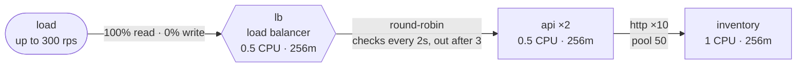

# The flaky network

Level 2 · about 40 minutes · teaches packet loss and TCP retransmits, how fan-out multiplies the tail, and timeouts sized to it

## The story

You run a product listing page. Each request asks the inventory service about each of the 10 products on the page, one call after another. Inventory answers in a couple of milliseconds, and the whole page in about 3, so the api gives each call 150 ms, fifty times what it needs.



The load ramps to 300 requests a second over 30 seconds and holds there. At 1:01, inventory's network starts losing 1% of the packets it sends, for two minutes: a bad cable, a busy switch, a noisy neighbour on its host. Nothing crashes, nothing runs out of CPU. One packet in a hundred just doesn't arrive.

## The question

Before you run anything, write down your answers:

1. What share of page requests fail while 1% of inventory's packets are lost?
2. How long does a call whose reply lost a packet take?
3. If you raised the timeout to 200 ms, what would change?

`loadl predict design.yaml` asks questions like these and writes your answers into the `expect` block at the bottom of `design.yaml`, or write them there yourself. The report scores each one against what the run measured. The line already there is an example; the grammar is in the [design file reference](../../skills/loadlore-designer/references/schema.md).

## Run it

```sh
loadl run scenarios/flaky-network/design.yaml
loadl report latest --print | less
```

The run takes about 5 minutes. It needs 6 CPUs and 4 GB available to Docker, Loadlore's own containers included; on a smaller machine, add `--scale` with the largest value that fits. `loadl run` warns you when the host is too small and suggests one.

The loss comes from the kernel's netem, inside inventory's network namespace: real packets, really lost, and really resent by TCP. Its timings come from TCP itself, not from your machine's speed, so this scenario's numbers should look much the same on any host.

Stuck? `loadl hint flaky-network` reveals one hint at a time.

## What to try next

When you know why it broke, change one thing in the api's `resilience` settings and run it again. Write an `expect` line for what you think will happen, then compare the two runs:

```sh
loadl compare <first-run> latest -o compare.md
```

Some directions: the timeout, retries, and how many calls a page makes. For each, work out what one lost packet costs a page.

`solutions/` has two worked answers with their reports, and `variants/timeout-200ms` is the fix that looks right and isn't. They give the game away, so try your own first.
