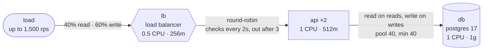

# The flash sale

Level 3 · about 45 minutes · teaches hot rows when every commit waits on the disk, what a queue in front of the writes buys and what it can't, and why fewer connections don't fix it

## The story

You run the shop for a sneaker brand. At ten o'clock a limited shoe goes on sale. Each purchase takes one from the shoe's stock, one row in Postgres: an update, then a commit. Product pages read the stock back. Postgres keeps its data on a network-attached cloud volume, so each commit waits about a millisecond longer for the disk than it would on a laptop. Each of the two api replicas keeps a pool of 40 database connections, opened at start.



The drop opens and traffic climbs from 200 requests a second to 1,500 over a minute, three in five of them purchases and nineteen in twenty for the shoe. It stays there for a minute, then the shoe sells out and traffic falls back. The rule from the business: checkout must not fail during the drop, and every buyer hears whether they got a pair within two minutes.

## The question

Before you run anything, write down your guesses. Don't work them out: a gut answer is fine, and where the run differs from it is what you'll learn from.

1. Does checkout break during the drop? If so, from what load?
2. How many purchases a second can the shoe's stock row take?
3. If each api replica kept only 4 connections to the database instead of 40, what would happen?

Loads depend on your machine: slower cores and slower disks break the same design at a different load, so a guess can miss even when the reasoning behind it is right.

`loadl predict design.yaml` asks questions like these and writes your answers into the `expect` block at the bottom of `design.yaml`, or write them there yourself. The report scores each one against what the run measured. The line already there is an example; the grammar is in the [design file reference](../../skills/loadlore-designer/references/schema.md).

## Run it

```sh
loadl run scenarios/flash-sale/design.yaml
loadl report latest --print | less
```

The run takes about 6 minutes. It needs 8 CPUs and 8 GB available to Docker: the design and Loadlore's own containers add up to 6.8 CPUs. On a smaller machine, add `--scale` with the largest value that fits; `loadl run` warns you when the host is too small and suggests one. The slower commits are a `disk_slow` fault on the database for the whole run. The numbers here come from a MacBook Air M4 on mains power.

Stuck? `loadl hint flash-sale` reveals one hint at a time.

## What to try next

When you know why it broke, change one thing and run it again. Write an `expect` line for what you think will happen, then compare the two runs:

```sh
loadl compare <first-run> latest -o compare.md
```

Some directions: how many connections write the row at once, and whether checkout has to wait for the write at all. A design can publish jobs to a queue (`kind: queue`, `op: publish`) and run workers that take them (`role: worker`); the [design file reference](../../skills/loadlore-designer/references/schema.md) has the details.

`solutions/` has a worked answer with its report, and `variants/smaller-pool` is a fix you're likely to try first. They give the game away, so try your own first.
