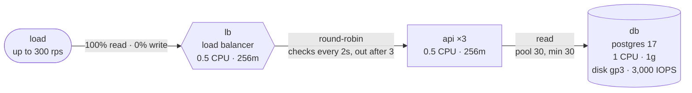

# Healthy but broken

Level 2 · about 40 minutes · teaches shallow and deep health checks, and the risk of deep ones

## The story

You run the account page behind a load balancer. Three api replicas each read the account from Postgres, through pools of 30 connections opened at start. The load balancer asks each replica's `/healthz` every 2 seconds, and takes a replica out of rotation after 3 failed checks in a row. `/healthz` answers as long as the replica's process is up.



The load ramps to 300 requests a second over 30 seconds and holds there. At 1:01, the third replica loses its route to the database, for two minutes: a security group change, a broken route on its node, a full connection table on its host. Its process is fine, and it keeps answering `/healthz`.

## The question

Before you run anything, write down your guesses. Don't work them out: a gut answer is fine, and where the run differs from it is what you'll learn from.

1. What share of requests fail while the third replica can't reach the database?
2. Does the load balancer take that replica out? After how long?
3. What would you change so it does, and what could go wrong with that?

`loadl predict design.yaml` asks questions like these and writes your answers into the `expect` block at the bottom of `design.yaml`, or write them there yourself. The report scores each one against what the run measured. The line already there is an example; the grammar is in the [design file reference](../../skills/loadlore-designer/references/schema.md).

## Run it

```sh
loadl run scenarios/healthy-but-broken/design.yaml
loadl report latest --print | less
```

The run takes about 6 minutes, plus about half a minute the first time to seed the 100,000-row table. It needs 6 CPUs and 4 GB available to Docker, Loadlore's own containers included; on a smaller machine, add `--scale` with the largest value that fits. `loadl run` warns you when the host is too small and suggests one.

The partition is real: inside the third replica's network namespace, every packet it sends toward the database is dropped, so its queries hang until they time out, as they would on a network that stopped carrying them.

Stuck? `loadl hint healthy-but-broken` reveals one hint at a time.

## What to try next

When you know why it broke, change the load balancer's `health_check` and run it again. Write an `expect` line for what you think will happen, then compare the two runs:

```sh
loadl compare <first-run> latest -o compare.md
```

Some directions: what the check asks, how often, and how long it waits for an answer. For each, work out how long a broken replica keeps its share of traffic, and what the check would do if the database itself were slow for a while.

`solutions/` has a worked answer with its report; `variants/deep-check-slow-db` is what can go wrong with it, and `variants/shallow-check-slow-db` the same slow database behind the starting design's check. They give the game away, so try your own first.
