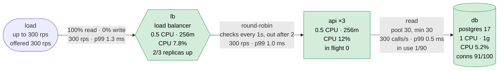
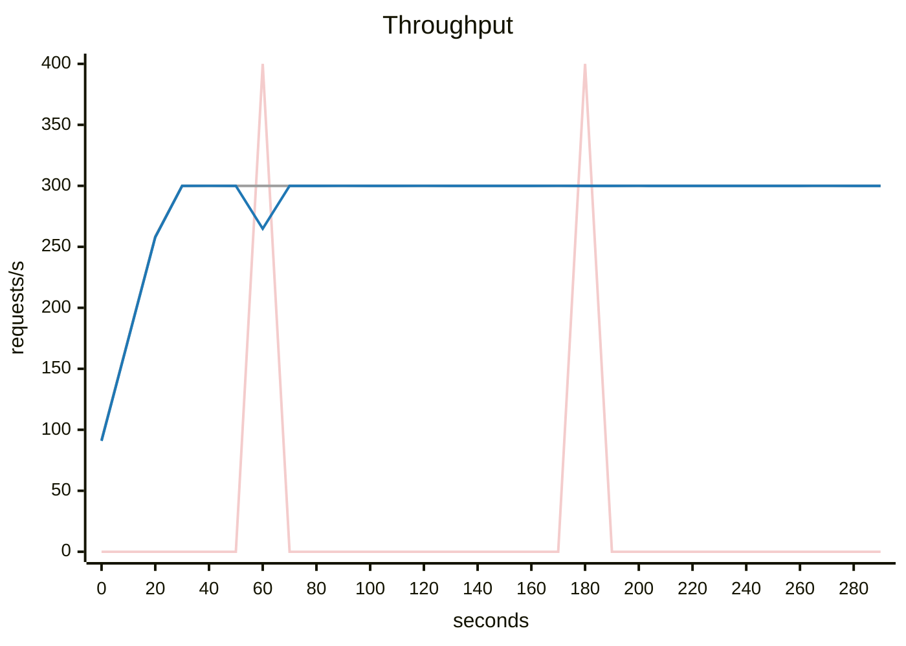
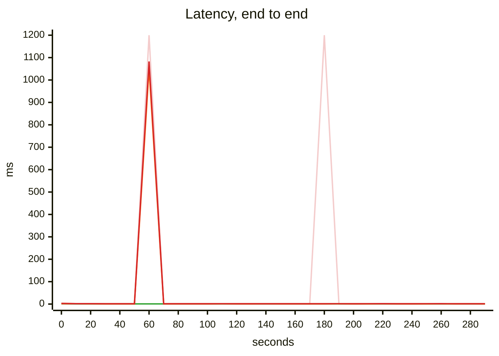
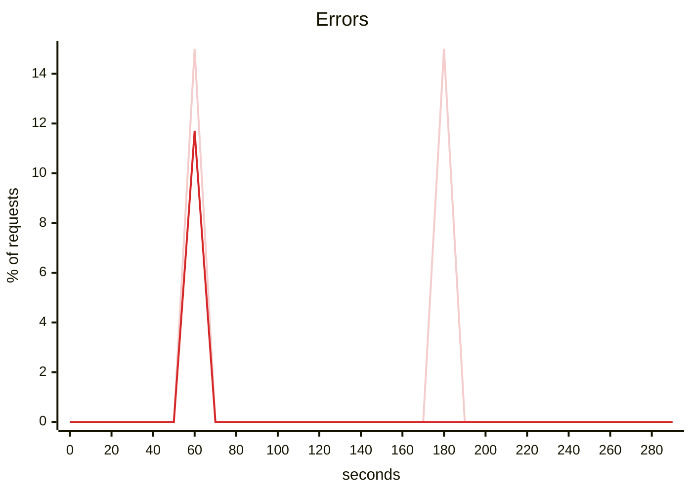
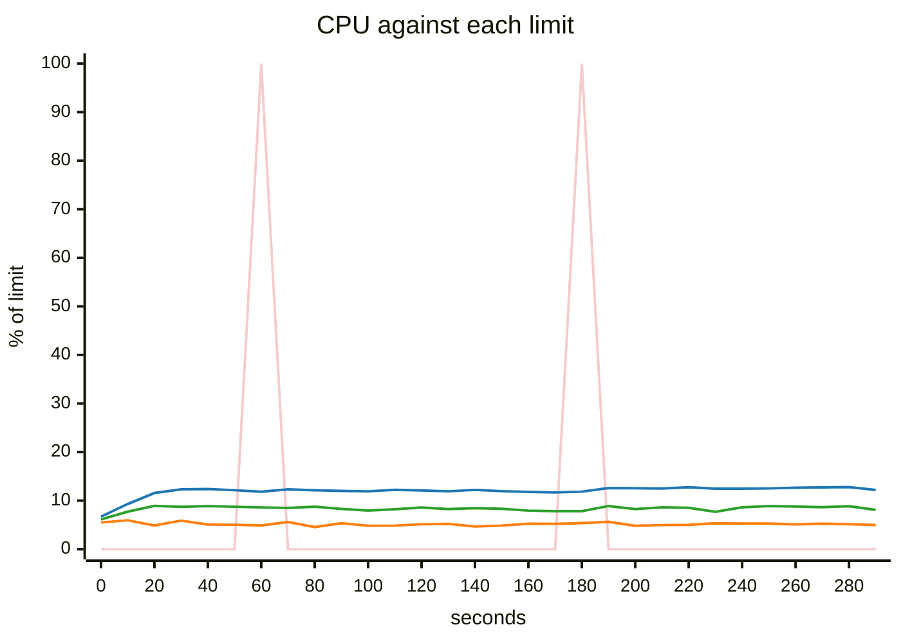

# healthy-but-broken-deep-health-check: run report

_run `healthy-but-broken-deep-health-check-20261112-132418` · completed · 12 Nov 2026 13:24 UTC · scale 1 · seed 1_

## Verdict

**Held.** Held the whole profile: up to 300 rps offered, 300 rps served at best, worst 10-second p99 1.08 s, at most 12% errors.

<sub>Sources: offered load: the load profile in plan.json (offered arrival rate); served: k6_http_reqs_total{expected_response="true"} (k6: successful responses); p99: k6_http_req_duration_seconds (k6 histogram, end to end); errors: k6_http_reqs_total{expected_response="false"} ÷ k6_http_reqs_total (k6). Windows are 10 seconds; what counts as broken is under [Thresholds](#thresholds).</sub>

## Diagram at 2:50

Measured in the 10-second window from 2:50 to 3:00 (the busiest window: the most successful responses). Nodes are colored by their most saturated resource, CPU against its limit or a connection pool's connections in use: red at 90% or more, amber from 70%, green below.



<sub>Sources: offered from the load profile in plan.json (offered arrival rate); load edge from k6_http_reqs_total (k6: all responses) and k6_http_req_duration_seconds (k6 histogram, end to end); CPU from container_cpu_usage_seconds_total (cAdvisor) ÷ the container's CPU limit; calls/s from loadlore_calls_total (the caller's outbound call attempts) and their p99 from loadlore_call_duration_seconds (the caller's histogram, pool wait included); pools from loadlore_pool_connections{state="in_use"} and loadlore_pool_max_connections and loadlore_pool_pending (callers waiting for a connection); lb traffic from haproxy_backend_http_requests_total (HAProxy), replicas up from haproxy_backend_active_servers (HAProxy), and the lb edge's p99 from loadlore_request_duration_seconds (the service's own histogram); conns from pg_stat_activity_count and pg_settings_max_connections (postgres_exporter).</sub>

## Charts

One point per 10-second window, at the window's start; x is seconds from the start of the load.



<sub>Grey: offered load (the load profile in plan.json (offered arrival rate)). Blue: successful responses (k6_http_reqs_total{expected_response="true"} (k6: successful responses)). Pink spikes mark 1:00 stall; 1:01 beautiful_goodall start; 1:01 beautiful_goodall die (exit code 0); 1:01 partition between api[2] and db for 2m0s; 3:01 inspiring_napier start; 3:01 inspiring_napier die (exit code 0).</sub>



<sub>Green: p50. Orange: p95. Red: p99 (k6_http_req_duration_seconds (k6 histogram, end to end)). Pink spikes mark 1:00 stall; 1:01 beautiful_goodall start; 1:01 beautiful_goodall die (exit code 0); 1:01 partition between api[2] and db for 2m0s; 3:01 inspiring_napier start; 3:01 inspiring_napier die (exit code 0).</sub>



<sub>Failed requests as a share of all responses (k6_http_reqs_total{expected_response="false"} ÷ k6_http_reqs_total (k6)), timeouts included. Pink spikes mark 1:00 stall; 1:01 beautiful_goodall start; 1:01 beautiful_goodall die (exit code 0); 1:01 partition between api[2] and db for 2m0s; 3:01 inspiring_napier start; 3:01 inspiring_napier die (exit code 0).</sub>

| Service | Failed requests | Share of its failures | Cause | From calls to | First seen | What it means |
| --- | --- | --- | --- | --- | --- | --- |
| api | 350 | 100% | `pool_timeout` | db | 1:00 | they timed out waiting for a pool connection to db |
| api | 1 | 0.3% | `timeout` | db | 1:00 | calls to db ran past their timeout |

<sub>Why requests failed, over the whole run (loadlore_request_errors_total and loadlore_call_errors_total, by cause). A request that failed after retries counts once, by its last attempt's cause.</sub>



<sub>Blue: api. Orange: db. Green: lb (container_cpu_usage_seconds_total (cAdvisor) ÷ the container's CPU limit, mean over the window). Pink spikes mark 1:00 stall; 1:01 beautiful_goodall start; 1:01 beautiful_goodall die (exit code 0); 1:01 partition between api[2] and db for 2m0s; 3:01 inspiring_napier start; 3:01 inspiring_napier die (exit code 0).</sub>

## Diagnosis

No diagnosis rule fired. Rules checked: connection pool exhausted, queueing knee (rules version 8; thresholds below).

## Predictions

The design has no `expect` lines. Writing a prediction before a run turns it into a test of your mental model.

## Timeline

| Time | Event |
| --- | --- |
| 1:00 | stall: p99 reached 1.08 s (1.9 ms at low load), 12% of requests failed, only 88% of the offered rate was served for 10 s, then recovered; too short to count as a break |
| 1:01 | container: beautiful_goodall start |
| 1:01 | container: beautiful_goodall die (exit code 0) |
| 1:01 | fault started: partition between api[2] and db for 2m0s |
| 3:01 | container: inspiring_napier start |
| 3:01 | container: inspiring_napier die (exit code 0) |
| 3:01 | fault ended: partition between api[2] and db for 2m0s |

<sub>From events.jsonl: the fault timeline and Docker container events. Stalls are from the per-window numbers below, judged by the thresholds.</sub>

## Assumptions

### From the design

The design lists no assumptions.

### Chosen by Loadlore

| Field | Value | Why |
| --- | --- | --- |
| workload.timeout_ms | 10s | the default; k6 gives up on a request after this long and counts it as failed |
| workload.slo.p99_ms | 500 ms | the default; a break on p99 alone needs p99 at or above this as well as 10x the low-load p99, so latency users would still accept isn't called a break |
| resources.cpu_period_ms | 100 ms for api, db, lb | Docker's default. A container that uses its CPU share early in a period stalls until the next one, which can show up in p99 when a service has a fraction of a CPU |
| services.lb timeouts | connect 5s, server 60s | HAProxy's own timeouts, with its defaults otherwise. A request already sent to a replica that dies waits for the server timeout (or the load generator's); health checks only stop new requests going there |
| services.api.pools.db.min | 30 | set in the design: each replica opens 30 connections before the load starts and keeps them open |
| services.api.pools.db.hold | call | the default, as pgxpool's: a request takes a connection for each call and hands it back straight away |

### How the run was planned

- load generator: 152 VUs started before the load, the scenario's measured prealloc_vus 152 at --scale 1, more than 300 rps × the SLO's 500 ms
- Loadlore's own containers get fixed budgets: load generator 1.5 CPU (peak 300 rps), Toxiproxy 1 CPU (about 600 proxied calls/s at peak), Prometheus 0.1, cAdvisor 0.1, exporters 0.1 each

## Thresholds

- **Broke:** 2 windows in a row with at least 1.0% of requests failing or successful responses below 90% of the offered rate, or 3 windows in a row with any of those or p99 at least 10x the low-load p99 (the median p99 of windows offered at most 25% of the peak, before errors or a shortfall in 2 windows in a row) and at least the SLO, 500 ms (workload.slo.p99_ms): 500 ms in this run. A shorter episode is shown as a stall in the timeline, not a break.
- **Doubtful:** a break on p99 alone, when the load generator was stalled at its CPU limit in 1.0% or more of its scheduling periods in one of the break's windows and the entry service's own p99 (loadlore_request_duration_seconds (the service's own histogram)) was below the limit in one of them. The verdict stays what it was.
- **Inconclusive:** before the break (or anywhere, if nothing broke), the load generator dropped more than 1.0% of a window's arrivals (more than 5.0% in a window where the system itself failed 1.0% or more of requests; up to that it's a caveat that gives the share), or the load generator or Toxiproxy used 90% or more of its CPU budget, or was stalled at its CPU limit in 5.0% or more of its scheduling periods (from 1.0% it's noted as a caveat). The first 10 s of load are a warm-up and don't count: the load generator starts its VUs and connections open then. A cause is named only with evidence: on a Linux host, the hypervisor giving 2.0% or more of CPU time to other virtual machines (steal), or other programs using 10% or more of the host's CPUs (at least 0.5); inside a VM on this machine, only as a possibility.
- **Connection pool exhausted:** for two windows in a row, a pool at 95% or more of its size with callers waiting, while the target wasn't busy (busy: its CPU at 80% or more, or its time per call with a connection at least 3x the low-load value and 1 ms above it; CPU throttling alone doesn't count) and the caller's CPU stayed below 90%.
- **Queueing knee:** for 3 windows in a row, p99 at least 3x the low-load p99 and 10 ms above it, with a CPU or pool at 70% or more. When that is a pool whose target was busy in any of those windows, or a service's CPU whose requests spent 50% or more of their time in calls to a busy target, the knee is the target's.
- **Connection storm:** up to the break, a service's pools to a Postgres opening at least 50% of their combined size, and 10 or more connections, in one window, while p99 in that window or the next was at least 10x the low-load p99 and 10 ms above it. New connections are counted by loadlore_pool_connect_seconds (new connections the pools opened, and how long each took), or for runs from before it, from the rise in open connections.
- **Retry storm:** for two windows in a row, a caller that retries sending 1.5x or more of its low-load calls per request to a target, with retries 20% or more of them, while the target failed 1.0% or more of its calls or its p99 was 3x its low-load value.
- **Cold cache:** a cache's share of lookups that miss rising to 5x its level before or more, and to 5.0% of lookups at least, while its callers' reads of the database behind it reach 2x their rate before (counted as at least 1 a second, for a cache warm enough to send none).
- **Working set doesn't fit:** for two windows in a row, a Postgres answering less than 90% of block reads from shared_buffers and reading 100 blocks a second or more from outside them, while p99 was 3x the low-load p99 or more.
- **Hot rows:** for two windows in a row, 1 or more of a Postgres's backends waiting on locks on average, while a caller's writes to it took 3x their low-load time or more (and 2 ms more), its reads stayed within 1.5x of theirs and the database's CPU was below 80%. Windows with a disk_slow fault on the database don't count.

## Environment

- loadl dev, profile 5m0s, scale 1, seed 1
- Host: 8 CPUs, 9.7 GiB memory, Ubuntu 24.04.4 LTS (aarch64, kernel 6.8.0-117-generic), cgroup v2
- Docker 29.5.2, Compose 5.1.1
- Host speed index 1030 (hash 1005, memory 1008, syscalls 1078): one CPU's work against the reference machine's 1000 (MacBook Air M4 (4 performance and 6 efficiency cores), Colima VM with 8 vCPUs). CPU limits are fractions of this host's cores, so a lower index means the design breaks at a lower load
- Cool-down: none needed; the first benchmark (1030) was within 5.0% of the run it's compared with (1044)
- Host CPU: Docker runs in a VM on this machine, so other programs' use of the CPU can't be seen
- Data: a fresh copy of the cached seeded dataset
- Load generator summary (k6): 86,249 requests, 0 dropped arrivals, 0.4% failed

<details><summary>Containers and images</summary>

| Container | Image |
| --- | --- |
| loadlore-healthy-but-broken-deep-health-check-20261112-132418-api-0-1 | loadlore/synthetic:dev |
| loadlore-healthy-but-broken-deep-health-check-20261112-132418-api-1-1 | loadlore/synthetic:dev |
| loadlore-healthy-but-broken-deep-health-check-20261112-132418-api-2-1 | loadlore/synthetic:dev |
| loadlore-healthy-but-broken-deep-health-check-20261112-132418-db-1 | postgres:17.11 |
| loadlore-healthy-but-broken-deep-health-check-20261112-132418-lb-1 | haproxy:3.2.26 |
| loadlore-healthy-but-broken-deep-health-check-20261112-132418-lore-cadvisor-1 | ghcr.io/google/cadvisor:v0.60.6 |
| loadlore-healthy-but-broken-deep-health-check-20261112-132418-lore-k6-1 | grafana/k6:2.3.0 |
| loadlore-healthy-but-broken-deep-health-check-20261112-132418-lore-pgexp-db-1 | quay.io/prometheuscommunity/postgres-exporter:v0.20.1 |
| loadlore-healthy-but-broken-deep-health-check-20261112-132418-lore-prometheus-1 | prom/prometheus:v3.16.0 |
| loadlore-healthy-but-broken-deep-health-check-20261112-132418-lore-toxiproxy-1 | ghcr.io/shopify/toxiproxy:2.13.0 |

</details>

## Per-window data

<details><summary>30 windows of 10 seconds</summary>

| t | offered | served | dropped | errors | p50 | p99 | api CPU | db CPU | db conns | lb CPU | lb up | api→db pool | wait | k6 CPU | Toxiproxy CPU | k6 / Toxiproxy stalled |
| --- | --- | --- | --- | --- | --- | --- | --- | --- | --- | --- | --- | --- | --- | --- | --- | --- |
| 0:00 | 92 | 91 | 0 | 0% | 1.2 ms | 2.9 ms | 6.7% | 5.5% | 91 | 6.1% | 3 | 0/90 | 0.0 ms | 3.9% | 5.3% | 0% / 0% |
| 0:10 | 175 | 174 | 0 | 0% | 1.0 ms | 1.9 ms | 9.3% | 6.0% | 91 | 7.7% | 3 | 1/90 | 0.0 ms | 4.6% | 6.0% | 0% / 0% |
| 0:20 | 258 | 258 | 0 | 0% | 0.9 ms | 1.7 ms | 12% | 4.9% | 91 | 8.9% | 3 | 1/90 | 0.0 ms | 5.6% | 7.6% | 0% / 0% |
| 0:30 | 300 | 300 | 0 | 0% | 0.8 ms | 1.5 ms | 12% | 5.9% | 92 | 8.7% | 3 | 0/90 | 0.0 ms | 5.5% | 7.7% | 0% / 0% |
| 0:40 | 300 | 300 | 0 | 0% | 0.8 ms | 1.5 ms | 12% | 5.1% | 91 | 8.9% | 3 | 0/90 | 0.0 ms | 5.7% | 8.0% | 0% / 0% |
| 0:50 | 300 | 300 | 0 | 0% | 0.8 ms | 1.4 ms | 12% | 5.0% | 91 | 8.7% | 3 | 0/90 | 0.0 ms | 5.5% | 7.7% | 0% / 0% |
| 1:00 | 300 | 265 | 0 | 12% | 0.8 ms | 1.08 s | 12% | 4.9% | 91 | 8.6% | 2 | 30/90 +100 | 117 ms | 5.6% | 7.6% | 0% / 0% |
| 1:10 | 300 | 300 | 0 | 0% | 0.8 ms | 1.5 ms | 12% | 5.6% | 91 | 8.5% | 2 | 30/90 | 0.0 ms | 5.7% | 7.9% | 0% / 0% |
| 1:20 | 300 | 300 | 0 | 0% | 0.8 ms | 1.4 ms | 12% | 4.5% | 91 | 8.8% | 2 | 1/90 | 0.0 ms | 6.0% | 8.1% | 0% / 0% |
| 1:30 | 300 | 300 | 0 | 0% | 0.8 ms | 1.4 ms | 12% | 5.3% | 91 | 8.3% | 2 | 0/90 | 0.0 ms | 5.6% | 7.7% | 0% / 0% |
| 1:40 | 300 | 300 | 0 | 0% | 0.8 ms | 1.4 ms | 12% | 4.8% | 91 | 8.0% | 2 | 0/90 | 0.0 ms | 5.5% | 7.5% | 0% / 0% |
| 1:50 | 300 | 300 | 0 | 0% | 0.8 ms | 1.6 ms | 12% | 4.9% | 91 | 8.2% | 2 | 0/90 | 0.0 ms | 6.1% | 8.1% | 0% / 0% |
| 2:00 | 300 | 300 | 0 | 0% | 0.8 ms | 1.4 ms | 12% | 5.1% | 91 | 8.6% | 2 | 0/90 | 0.0 ms | 6.0% | 7.9% | 0% / 0% |
| 2:10 | 300 | 300 | 0 | 0% | 0.8 ms | 1.4 ms | 12% | 5.2% | 91 | 8.3% | 2 | 1/90 | 0.0 ms | 5.6% | 7.7% | 0% / 0% |
| 2:20 | 300 | 300 | 0 | 0% | 0.8 ms | 1.5 ms | 12% | 4.7% | 91 | 8.5% | 2 | 0/90 | 0.0 ms | 5.8% | 7.9% | 0% / 0% |
| 2:30 | 300 | 300 | 0 | 0% | 0.8 ms | 1.5 ms | 12% | 4.9% | 91 | 8.3% | 2 | 0/90 | 0.0 ms | 5.9% | 7.8% | 0% / 0% |
| 2:40 | 300 | 300 | 0 | 0% | 0.8 ms | 1.3 ms | 12% | 5.3% | 91 | 7.9% | 2 | 0/90 | 0.0 ms | 5.6% | 7.6% | 0% / 0% |
| 2:50 | 300 | 300 | 0 | 0% | 0.8 ms | 1.3 ms | 12% | 5.2% | 91 | 7.8% | 2 | 1/90 | 0.0 ms | 5.5% | 7.5% | 0% / 0% |
| 3:00 | 300 | 300 | 0 | 0% | 0.8 ms | 1.3 ms | 12% | 5.4% | 91 | 7.8% | 2 | 1/90 | 0.0 ms | 5.6% | 7.6% | 0% / 0% |
| 3:10 | 300 | 300 | 0 | 0% | 0.9 ms | 1.6 ms | 13% | 5.7% | 91 | 8.9% | 2 | 0/90 | 0.0 ms | 6.3% | 8.4% | 0% / 0% |
| 3:20 | 300 | 300 | 0 | 0% | 0.8 ms | 1.5 ms | 13% | 4.8% | 63 | 8.3% | 2 | 0/90 | 0.0 ms | 5.7% | 7.8% | 0% / 0% |
| 3:30 | 300 | 300 | 0 | 0% | 0.8 ms | 1.6 ms | 13% | 5.0% | 63 | 8.6% | 2 | 0/90 | 0.0 ms | 5.7% | 7.8% | 0% / 0% |
| 3:40 | 300 | 300 | 0 | 0% | 0.8 ms | 1.7 ms | 13% | 5.0% | 63 | 8.5% | 2 | 1/90 | 0.0 ms | 5.9% | 8.0% | 0% / 0% |
| 3:50 | 300 | 300 | 0 | 0% | 0.8 ms | 1.5 ms | 12% | 5.4% | 92 | 7.7% | 2 | 0/90 | 0.0 ms | 5.4% | 7.7% | 0% / 0% |
| 4:00 | 300 | 300 | 0 | 0% | 0.8 ms | 1.5 ms | 12% | 5.3% | 92 | 8.6% | 3 | 0/90 | 0.0 ms | 5.8% | 7.9% | 0% / 0% |
| 4:10 | 300 | 300 | 0 | 0% | 0.8 ms | 1.6 ms | 13% | 5.3% | 92 | 8.9% | 3 | 0/90 | 0.0 ms | 5.7% | 8.0% | 0% / 0% |
| 4:20 | 300 | 300 | 0 | 0% | 0.8 ms | 1.6 ms | 13% | 5.1% | 92 | 8.8% | 3 | 0/90 | 0.0 ms | 5.8% | 8.0% | 0% / 0% |
| 4:30 | 300 | 300 | 0 | 0% | 0.8 ms | 1.5 ms | 13% | 5.3% | 92 | 8.7% | 3 | 0/90 | 0.0 ms | 5.9% | 8.2% | 0% / 0% |
| 4:40 | 300 | 300 | 0 | 0% | 0.8 ms | 1.5 ms | 13% | 5.2% | 92 | 8.8% | 3 | 0/90 | 0.0 ms | 6.0% | 8.2% | 0% / 0% |
| 4:50 | 300 | 300 | 0 | 0% | 0.8 ms | 1.5 ms | 12% | 5.0% | 91 | 8.1% | 3 | 0/90 | 0.0 ms | 4.5% | 7.5% | 0% / 0% |

Columns: offered is the load profile in plan.json (offered arrival rate); served is k6_http_reqs_total{expected_response="true"} (k6: successful responses); dropped is k6_dropped_iterations_total (k6: arrivals it couldn't start); errors are k6_http_reqs_total{expected_response="false"} ÷ k6_http_reqs_total (k6); p50 and p99 are from k6_http_req_duration_seconds (k6 histogram, end to end); CPU is container_cpu_usage_seconds_total (cAdvisor) ÷ the container's CPU limit, mean over the window; conns are pg_stat_activity_count and pg_settings_max_connections (postgres_exporter); hit rate is from redis_keyspace_hits_total and redis_keyspace_misses_total (redis_exporter); up is haproxy_backend_active_servers (HAProxy); pools are loadlore_pool_connections{state="in_use"} and loadlore_pool_max_connections (peak in use/size, +peak waiting), wait is the mean from loadlore_pool_wait_seconds (time to get a connection); k6 and Toxiproxy CPU are against their budgets.

</details>

## Design file

The exact `design.yaml` this run used:

```yaml
version: 1
name: healthy-but-broken-deep-health-check

# Solution: a deep health check. The load balancer asks each replica's
# /readyz, which answers only when the replica can reach its dependencies,
# every second, and takes it out after 2 failed checks.

services:
  lb:
    kind: lb
    target: api
    health_check: { path: /readyz, interval_ms: 1000, fall: 2, rise: 2 }

  api:
    image: loadlore/synthetic
    replicas: 3
    resources: { cpu: 0.5, memory: 256m }
    behavior:
      cpu_ms: 0.3
      calls:
        - { target: db, op: read }
      resilience:
        timeout_ms: 1000
    pools:
      db: { size: 30, min: 30 }   # 3 replicas x 30 = 90 connections, all opened at start

  db:
    kind: postgres
    version: "17"
    resources: { cpu: 1, memory: 1g }
    dataset: { rows: 100000, row_bytes: 256 }

workload:
  entry: lb
  profile:
    - ramp: { from: 50, to: 300, over: 30s }
    - hold: { rps: 300, for: 4m30s }
  mix: { read: 1.0 }

# From 1:01, the third replica can't reach the database, for two minutes:
# a security group change, a broken route on its node, a full connection
# table on its host. Its process is fine.
scenario:
  - { at: 1m1s, inject: partition, between: ["api[2]", db], for: 2m }
```
