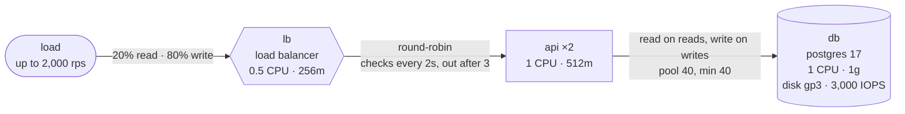

# The live vote

Level 2 · about 40 minutes · teaches row locks, hot rows, lock contention that burns CPU, and counting somewhere other than one row

## The story

You run the voting api for a TV talent show. During the live final, viewers vote in the app: each vote adds one to the contestant's tally, a row in Postgres, and the results screen reads the tallies back. There are ten contestants, and this year there's a clear favourite: nine votes in ten go to them. Each of the two api replicas keeps a pool of 40 database connections, opened at start.



The vote opens and traffic climbs from 200 to 2,000 requests a second over four minutes, four in five of them votes, and stays at 2,000 for the vote's last minute. The producers want to know the app will take the peak.

## The question

Before you run anything, write down your guesses. Don't work them out: a gut answer is fine, and where the run differs from it is what you'll learn from.

1. Which component gives out first, and how busy is the database's CPU when it does?
2. Would a database with twice the CPU take the vote without breaking? This is the guess the lesson turns on.
3. At what load does it break, if it does? Only a rough guess.

Hot rows tip over unpredictably. When many writes queue for one row, the line can stay short for a while and then collapse within seconds, so where this design breaks can move from run to run on the same machine: in earlier checks, on a faster disk than this one, it moved by up to a quarter of the load even when the machine's speed didn't change. That's part of what's being taught: a hot row gives no warning before it goes. So the load guess scores loosely, right within 35%, and loads also depend on your machine: slower cores break the same design at a lower load. What doesn't move from run to run is what more CPU does, which is why question 2 is the one that counts.

`loadl predict design.yaml` asks these questions and writes your answers into the `expect` block at the bottom of `design.yaml`, or write them there yourself. Your answer to question 2 goes into `variants/bigger-db/design.yaml`, this design with twice the database's CPU and nothing else changed: run that design after this one, and its report scores the guess. The report scores each line against what the run measured. The line already there is an example; the grammar is in the [design file reference](../../skills/loadlore-designer/references/schema.md).

## Run it

```sh
loadl run scenarios/live-vote/design.yaml
loadl report latest --print | less
```

The run takes about 6 minutes. It needs 8 CPUs and 8 GB available to Docker: the design and Loadlore's own containers add up to 5.8 CPUs (6.8 for the bigger database). On a smaller machine, add `--scale` with the largest value that fits; `loadl run` warns you when the host is too small and suggests one. Scale shrinks the request rate but not the time a row stays locked, so at small scales the votes may not collide enough to show the problem. The numbers here come from a MacBook Air M4 on mains power.

Stuck? `loadl hint live-vote` reveals one hint at a time.

## What to try next

When you know why it broke, change one thing and run it again. Write an `expect` line for what you think will happen, then compare the two runs:

```sh
loadl compare <first-run> latest -o compare.md
```

Some directions: the database's resources, the pool sizes, and where and how a vote is counted. Before each run, work out how many votes a second land on the favourite's row.

`solutions/` has one worked answer with its report; it gives the game away, so try your own first. `variants/bigger-db/design.yaml` is the twice-the-CPU design that question 2 is about: run it to score your guess, but its README tells you what happens, so read that after.
