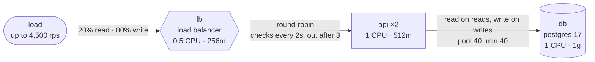

# The live vote

Level 2 · about 40 minutes · teaches row locks, hot rows, lock contention that burns CPU, and counting somewhere other than one row

## The story

You run the voting api for a TV talent show. During the live final, viewers vote in the app: each vote adds one to the contestant's tally, a row in Postgres, and the results screen reads the tallies back. There are ten contestants, and this year there's a clear favourite: nine votes in ten go to them. Each of the two api replicas keeps a pool of 40 database connections, opened at start.



The vote opens and traffic climbs from 200 to 4,500 requests a second over four minutes, four in five of them votes, and stays at 4,500 for the vote's last minute. The producers want to know the app will take the peak.

## The question

Before you run anything, write down your guesses. Don't work them out: a gut answer is fine, and where the run differs from it is what you'll learn from.

1. At what load does it break, if it does?
2. Which component gives out first, and how busy is the database's CPU when it does?
3. If you gave the database twice the CPU, what would happen?

Loads depend on your machine: slower cores break the same design at a lower load, so a guess can miss even when the reasoning behind it is right.

`loadl predict design.yaml` asks questions like these and writes your answers into the `expect` block at the bottom of `design.yaml`, or write them there yourself. The report scores each one against what the run measured. The line already there is an example; the grammar is in the [design file reference](../../skills/loadlore-designer/references/schema.md).

## Run it

```sh
loadl run scenarios/live-vote/design.yaml
loadl report latest --print | less
```

The run takes about 6 minutes. It needs 8 CPUs and 8 GB available to Docker: the design and Loadlore's own containers add up to 6.8 CPUs (7.8 for the bigger database). On a smaller machine, add `--scale` with the largest value that fits; `loadl run` warns you when the host is too small and suggests one. Scale shrinks the request rate but not the time a row stays locked, so at small scales the votes may not collide enough to show the problem. The numbers here come from a MacBook Air M4 on mains power.

Stuck? `loadl hint live-vote` reveals one hint at a time.

## What to try next

When you know why it broke, change one thing and run it again. Write an `expect` line for what you think will happen, then compare the two runs:

```sh
loadl compare <first-run> latest -o compare.md
```

Some directions: the database's resources, the pool sizes, and where and how a vote is counted. Before each run, work out how many votes a second land on the favourite's row.

`solutions/` has one worked answer with its report, and `variants/bigger-db` is the fix that fits a different problem. They give the game away, so try your own first.
