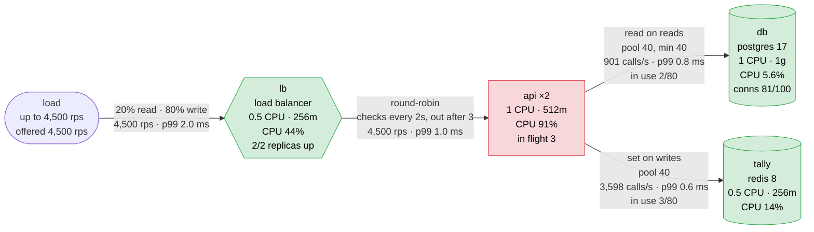
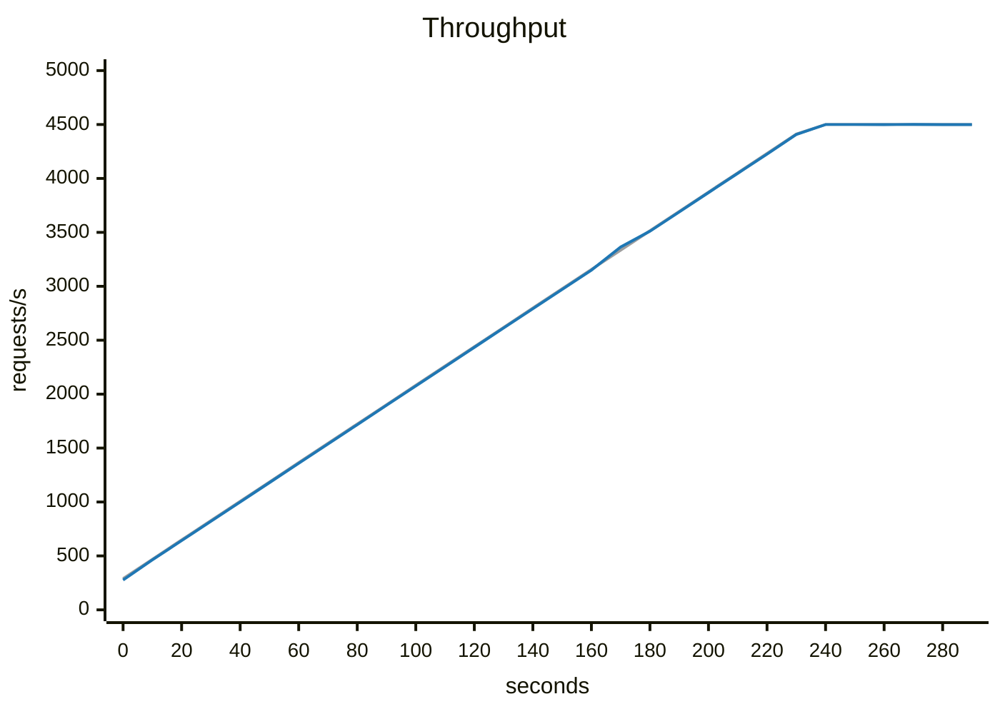
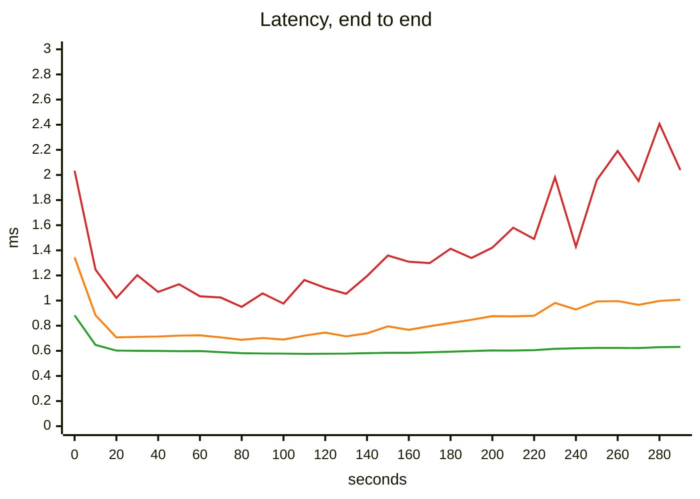
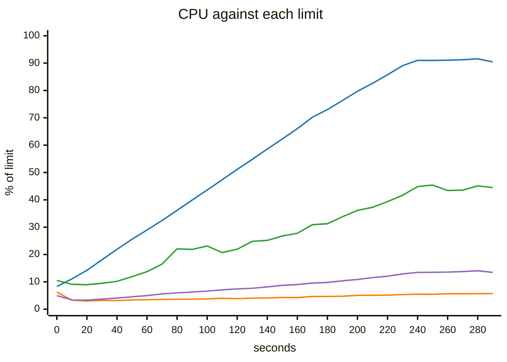

# live-vote-redis-tally: run report

_run `live-vote-redis-tally-20261116-094220` · completed · 16 Nov 2026 09:43 UTC · scale 1 · seed 1_

## Verdict

**Held.** Held the whole profile: up to 4,500 rps offered, 4,500 rps served at best, worst 10-second p99 2.4 ms, at most 0% errors.

<sub>Sources: offered load: the load profile in plan.json (offered arrival rate); served: k6_http_reqs_total{expected_response="true"} (k6: successful responses); p99: k6_http_req_duration_seconds (k6 histogram, end to end); errors: k6_http_reqs_total{expected_response="false"} ÷ k6_http_reqs_total (k6). Windows are 10 seconds; what counts as broken is under [Thresholds](#thresholds).</sub>

## Diagram at 4:30

Measured in the 10-second window from 4:30 to 4:40 (the busiest window: the most successful responses). Nodes are colored by their most saturated resource, CPU against its limit or a connection pool's connections in use: red at 90% or more, amber from 70%, green below.



<sub>Sources: offered from the load profile in plan.json (offered arrival rate); load edge from k6_http_reqs_total (k6: all responses) and k6_http_req_duration_seconds (k6 histogram, end to end); CPU from container_cpu_usage_seconds_total (cAdvisor) ÷ the container's CPU limit; calls/s from loadlore_calls_total (the caller's outbound call attempts) and their p99 from loadlore_call_duration_seconds (the caller's histogram, pool wait included); pools from loadlore_pool_connections{state="in_use"} and loadlore_pool_max_connections and loadlore_pool_pending (callers waiting for a connection); lb traffic from haproxy_backend_http_requests_total (HAProxy), replicas up from haproxy_backend_active_servers (HAProxy), and the lb edge's p99 from loadlore_request_duration_seconds (the service's own histogram); conns from pg_stat_activity_count and pg_settings_max_connections (postgres_exporter); hit rate from redis_keyspace_hits_total and redis_keyspace_misses_total (redis_exporter).</sub>

## Charts

One point per 10-second window, at the window's start; x is seconds from the start of the load.



<sub>Grey: offered load (the load profile in plan.json (offered arrival rate)). Blue: successful responses (k6_http_reqs_total{expected_response="true"} (k6: successful responses)).</sub>



<sub>Green: p50. Orange: p95. Red: p99 (k6_http_req_duration_seconds (k6 histogram, end to end)).</sub>

```mermaid
---
config:
  themeVariables:
    xyChart:
      backgroundColor: "transparent"
      plotColorPalette: "#d62728"
---
xychart-beta
    title "Errors"
    x-axis "seconds" 0 --> 290
    y-axis "% of requests" 0 --> 1
    line [0, 0, 0, 0, 0, 0, 0, 0, 0, 0, 0, 0, 0, 0, 0, 0, 0, 0, 0, 0, 0, 0, 0, 0, 0, 0, 0, 0, 0, 0]
```

<sub>Failed requests as a share of all responses (k6_http_reqs_total{expected_response="false"} ÷ k6_http_reqs_total (k6)), timeouts included.</sub>



<sub>Blue: api. Orange: db. Green: lb. Purple: tally (container_cpu_usage_seconds_total (cAdvisor) ÷ the container's CPU limit, mean over the window).</sub>

## Diagnosis

No diagnosis rule fired. Rules checked: connection pool exhausted, queueing knee (rules version 12; thresholds below).

## Predictions

1 of 1 scored prediction held.

| Prediction | Result | Worst value | Checked over | Notes |
| --- | --- | --- | --- | --- |
| `p99_ms < 100 until load_rps >= 1000` | **held** | 2.0 ms | 0:00 to 0:40, when load_rps >= 1,000 rps first held | source: k6_http_req_duration_seconds (k6 histogram, end to end) |

Loads and request rates depend on this machine: slower cores break the same design at a lower load, so a load guess can miss even when the reasoning behind it was right.

## Assumptions

### From the design

| Field | Value | Basis | Why |
| --- | --- | --- | --- |
| `services.api.behavior.cpu_ms` |  | guessed | a small JSON handler |
| `workload.mix` |  | guessed | during the vote, most requests are votes |
| `workload.keys` |  | guessed | a clear favourite takes nine votes in ten |

3 of these are guessed, not measured: the result depends on them.

### Chosen by Loadlore

| Field | Value | Why |
| --- | --- | --- |
| services.tally.config.maxmemory | 192m | 75% of the container's 256m memory limit, as managed Redis usually does; the rest is for fragmentation and client buffers. Set maxmemory: 0 for stock Redis (no cap) |
| services.tally.config.maxmemory-policy | allkeys-lru | evict the least recently used keys when the cache is full, as managed Redis usually does |
| workload.timeout_ms | 10s | the default; k6 gives up on a request after this long and counts it as failed |
| workload.slo.p99_ms | 500 ms | the default; a break on p99 alone needs p99 at or above this as well as 10x the low-load p99, so latency users would still accept isn't called a break |
| resources.cpu_period_ms | 100 ms for api, db, lb, tally | Docker's default. A container that uses its CPU share early in a period stalls until the next one, which can show up in p99 when a service has a fraction of a CPU |
| services.db.disk | the Docker host's | no disk block: a read that misses db's memory goes to the Docker host's disk, which on a laptop mostly answers from the host's own memory, fast and uncapped. Add disk: {} for a cloud volume's wait and IOPS cap |
| services.lb timeouts | connect 5s, server 60s | HAProxy's own timeouts, with its defaults otherwise. A request already sent to a replica that dies waits for the server timeout (or the load generator's); health checks only stop new requests going there |
| services.api.pools.db.min | 40 | set in the design: each replica opens 40 connections before the load starts and keeps them open |
| services.api.pools.db.hold | call | the default, as pgxpool's: a request takes a connection for each call and hands it back straight away |

### How the run was planned

- Loadlore's own containers get fixed budgets: load generator 2 CPU (peak 4500 rps), Toxiproxy 1 CPU (about 9000 proxied calls/s at peak), Prometheus 0.1, cAdvisor 0.1, exporters 0.1 each

## Thresholds

- **Broke:** 2 windows in a row with at least 1.0% of requests failing or successful responses below 90% of the offered rate, or 3 windows in a row with any of those or p99 at least 10x the low-load p99 (the median p99 of windows offered at most 25% of the peak, before errors or a shortfall in 2 windows in a row) and at least the SLO, 500 ms (workload.slo.p99_ms): 500 ms in this run. A shorter episode is shown as a stall in the timeline, not a break.
- **Doubtful:** a break on p99 alone, when the load generator was stalled at its CPU limit in 1.0% or more of its scheduling periods in one of the break's windows and the entry service's own p99 (loadlore_request_duration_seconds (the service's own histogram)) was below the limit in one of them. The verdict stays what it was.
- **Inconclusive:** before the break (or anywhere, if nothing broke), the load generator dropped more than 1.0% of a window's arrivals (more than 5.0% in a window where the system itself failed 1.0% or more of requests; up to that it's a caveat that gives the share), or the load generator or Toxiproxy used 90% or more of its CPU budget, or was stalled at its CPU limit in 5.0% or more of its scheduling periods (from 1.0% it's noted as a caveat). The first 10 s of load are a warm-up and don't count: the load generator starts its VUs and connections open then. A cause is named only with evidence: on a Linux host, the hypervisor giving 2.0% or more of CPU time to other virtual machines (steal), or other programs using 10% or more of the host's CPUs (at least 0.5); inside a VM on this machine, only as a possibility.
- **Toxiproxy stalls:** no new connection accepted on one of Toxiproxy's edges for 1 s or more, where it had accepted 10 a second or more over the 5 s before, then 10 or more accepted within 100 ms with a median spacing under 0.5 ms: connections queued behind one upstream dial, which a real network doesn't do. Up to the end of the break's first window it makes the run inconclusive; after a break the system didn't recover from, it's a doubt on the recovery, and `loadl scenario check` doesn't judge claims that rest on not recovering; in a run that held, or recovered, it's a caveat: a stall only adds failure.
- **Connection pool exhausted:** for two windows in a row, a pool at 95% or more of its size with callers waiting, while the target wasn't busy (busy: its CPU at 80% or more, or its time per call with a connection at least 3x the low-load value and 1 ms above it; CPU throttling alone doesn't count) and the caller's CPU stayed below 90%.
- **Queueing knee:** for 3 windows in a row, p99 at least 3x the low-load p99 and 10 ms above it, with a CPU or pool at 70% or more. When that is a pool whose target was busy in any of those windows, or a service's CPU whose requests spent 50% or more of their time in calls to a busy target, the knee is the target's.
- **Connection storm:** up to the break, a service's pools to a Postgres opening at least 50% of their combined size, and 10 or more connections, in one window, while p99 in that window or the next was at least 10x the low-load p99 and 10 ms above it. New connections are counted by loadlore_pool_connect_seconds (new connections the pools opened, and how long each took), or for runs from before it, from the rise in open connections.
- **Retry storm:** for two windows in a row, a caller that retries sending 1.5x or more of its low-load calls per request to a target, with retries 20% or more of them, while the target failed 1.0% or more of its calls or its p99 was 3x its low-load value.
- **Cold cache:** a cache's share of lookups that miss rising to 5x its level before or more, and to 5.0% of lookups at least, while its callers' reads of the database behind it reach 2x their rate before (counted as at least 1 a second, for a cache warm enough to send none).
- **Working set doesn't fit:** for two windows in a row, a Postgres answering less than 90% of block reads from shared_buffers and reading 100 blocks a second or more from outside them, while p99 was 3x the low-load p99 or more. When Postgres times its reads (track_io_timing, on with a disk block), each block read must also take 3x its low-load time or more, and 1 ms more.
- **Replication lag:** for two windows in a row, a read replica 1 s or more behind its primary, or 5.0% or more of the reads after a write it served missing the write.
- **Autoscale lag:** the run broke while an autoscaled service's replicas were at 90% or more of their CPU limit: below its max, the autoscaler hadn't caught up; at its max (autoscale ceiling), it had nothing left to add.
- **Hot rows:** for two windows in a row, 2 or more of a Postgres's backends waiting on locks on average, while a caller's writes to it took 3x their low-load time or more (and 2 ms more). Reads of the same rows may slow too, and the summary says when the database's CPU per request reached 3x its low-load value: the contention burning CPU. A queueing knee on that database's CPU at the same time then points at the rows. Windows with a disk_slow fault on the database don't count.

## Environment

- loadl dev, profile 5m0s, scale 1, seed 1
- Host: 8 CPUs, 9.7 GiB memory, Ubuntu 24.04.4 LTS (aarch64, kernel 6.8.0-117-generic), cgroup v2
- Docker 29.5.2, Compose 5.1.1
- Host speed index 1001 (hash 1003, memory 983, syscalls 1017): one CPU's work against the reference machine's 1000 (MacBook Air M4 (4 performance and 6 efficiency cores), Colima VM with 8 vCPUs). CPU limits are fractions of this host's cores, so a lower index means the design breaks at a lower load
- Cool-down: waited 33s for the host to cool, from speed index 949 to within 5.0% of the run it's compared with (1031)
- Host CPU: Docker runs in a VM on this machine, so other programs' use of the CPU can't be seen
- Data: a fresh copy of the cached seeded dataset
- Load generator summary (k6): 833,953 requests, 0 dropped arrivals, 0% failed

<details><summary>Containers and images</summary>

| Container | Image |
| --- | --- |
| loadlore-live-vote-redis-tally-20261116-094220-api-0-1 | loadlore/synthetic:dev |
| loadlore-live-vote-redis-tally-20261116-094220-api-1-1 | loadlore/synthetic:dev |
| loadlore-live-vote-redis-tally-20261116-094220-db-1 | postgres:17.11 |
| loadlore-live-vote-redis-tally-20261116-094220-lb-1 | haproxy:3.2.26 |
| loadlore-live-vote-redis-tally-20261116-094220-lore-cadvisor-1 | ghcr.io/google/cadvisor:v0.60.6 |
| loadlore-live-vote-redis-tally-20261116-094220-lore-k6-1 | grafana/k6:2.3.0 |
| loadlore-live-vote-redis-tally-20261116-094220-lore-pgexp-db-1 | quay.io/prometheuscommunity/postgres-exporter:v0.20.1 |
| loadlore-live-vote-redis-tally-20261116-094220-lore-prometheus-1 | prom/prometheus:v3.16.0 |
| loadlore-live-vote-redis-tally-20261116-094220-lore-redisexp-tally-1 | oliver006/redis_exporter:v1.97.0 |
| loadlore-live-vote-redis-tally-20261116-094220-lore-toxiproxy-1 | ghcr.io/shopify/toxiproxy:2.13.0 |
| loadlore-live-vote-redis-tally-20261116-094220-tally-1 | redis:8.2 |

</details>

## Per-window data

<details><summary>30 windows of 10 seconds</summary>

| t | offered | served | dropped | errors | p50 | p99 | api CPU | db CPU | db conns | lb CPU | lb up | tally CPU | tally hit rate | api→db pool | wait | api→tally pool | wait | k6 CPU | Toxiproxy CPU | k6 / Toxiproxy stalled |
| --- | --- | --- | --- | --- | --- | --- | --- | --- | --- | --- | --- | --- | --- | --- | --- | --- | --- | --- | --- | --- |
| 0:00 | 290 | 277 | 0 | 0% | 0.9 ms | 2.0 ms | 8.3% | 6.2% | 81 | 11% | 2 | 5.0% | – | 0/80 | 0.0 ms | 1/80 | – | 8.4% | 13% | 0% / 0% |
| 0:10 | 469 | 463 | 0 | 0% | 0.6 ms | 1.2 ms | 11% | 3.3% | 81 | 9.1% | 2 | 3.4% | – | 0/80 | 0.0 ms | 1/80 | – | 4.7% | 8.2% | 0% / 0% |
| 0:20 | 648 | 642 | 0 | 0% | 0.6 ms | 1.0 ms | 14% | 3.0% | 81 | 9.0% | 2 | 3.3% | – | 1/80 | 0.0 ms | 1/80 | – | 5.6% | 9.6% | 0% / 0% |
| 0:30 | 827 | 821 | 0 | 0% | 0.6 ms | 1.2 ms | 18% | 3.2% | 81 | 9.5% | 2 | 3.7% | – | 1/80 | 0.0 ms | 1/80 | – | 6.4% | 11% | 0% / 0% |
| 0:40 | 1,006 | 1,000 | 0 | 0% | 0.6 ms | 1.1 ms | 22% | 3.1% | 81 | 10% | 2 | 4.1% | – | 1/80 | 0.0 ms | 1/80 | – | 6.9% | 13% | 0% / 0% |
| 0:50 | 1,185 | 1,179 | 0 | 0% | 0.6 ms | 1.1 ms | 26% | 3.4% | 81 | 12% | 2 | 4.5% | – | 1/80 | 0.0 ms | 1/80 | – | 7.6% | 15% | 0% / 0% |
| 1:00 | 1,365 | 1,358 | 0 | 0% | 0.6 ms | 1.0 ms | 29% | 3.5% | 81 | 14% | 2 | 5.0% | – | 1/80 | 0.0 ms | 1/80 | – | 8.5% | 17% | 0% / 0% |
| 1:10 | 1,544 | 1,538 | 0 | 0% | 0.6 ms | 1.0 ms | 32% | 3.5% | 81 | 17% | 2 | 5.6% | – | 0/80 | 0.0 ms | 2/80 | – | 9.2% | 20% | 0% / 0% |
| 1:20 | 1,723 | 1,717 | 0 | 0% | 0.6 ms | 0.9 ms | 36% | 3.6% | 81 | 22% | 2 | 6.0% | – | 0/80 | 0.0 ms | 1/80 | – | 9.9% | 23% | 0% / 0% |
| 1:30 | 1,902 | 1,896 | 0 | 0% | 0.6 ms | 1.1 ms | 40% | 3.7% | 81 | 22% | 2 | 6.3% | – | 1/80 | 0.0 ms | 1/80 | – | 11% | 25% | 0% / 0% |
| 1:40 | 2,081 | 2,075 | 0 | 0% | 0.6 ms | 1.0 ms | 44% | 3.8% | 81 | 23% | 2 | 6.6% | – | 0/80 | 0.0 ms | 1/80 | – | 10% | 26% | 0% / 0% |
| 1:50 | 2,260 | 2,254 | 0 | 0% | 0.6 ms | 1.2 ms | 47% | 4.0% | 81 | 21% | 2 | 7.1% | – | 1/80 | 0.0 ms | 1/80 | – | 11% | 27% | 0% / 0% |
| 2:00 | 2,440 | 2,434 | 0 | 0% | 0.6 ms | 1.1 ms | 51% | 3.8% | 81 | 22% | 2 | 7.4% | – | 1/80 | 0.0 ms | 1/80 | – | 12% | 28% | 0% / 0% |
| 2:10 | 2,619 | 2,613 | 0 | 0% | 0.6 ms | 1.1 ms | 55% | 4.1% | 81 | 25% | 2 | 7.6% | – | 0/80 | 0.0 ms | 2/80 | – | 13% | 30% | 0% / 0% |
| 2:20 | 2,798 | 2,792 | 0 | 0% | 0.6 ms | 1.2 ms | 59% | 4.1% | 81 | 25% | 2 | 8.2% | – | 0/80 | 0.0 ms | 1/80 | – | 13% | 31% | 0% / 0% |
| 2:30 | 2,977 | 2,971 | 0 | 0% | 0.6 ms | 1.4 ms | 62% | 4.3% | 81 | 27% | 2 | 8.7% | – | 1/80 | 0.0 ms | 2/80 | – | 14% | 33% | 0% / 0% |
| 2:40 | 3,156 | 3,150 | 0 | 0% | 0.6 ms | 1.3 ms | 66% | 4.2% | 81 | 28% | 2 | 9.0% | – | 1/80 | 0.0 ms | 2/80 | – | 15% | 35% | 0% / 0% |
| 2:50 | 3,335 | 3,364 | 0 | 0% | 0.6 ms | 1.3 ms | 70% | 4.7% | 81 | 31% | 2 | 9.5% | – | 2/80 | 0.0 ms | 2/80 | – | 15% | 37% | 0% / 0% |
| 3:00 | 3,515 | 3,511 | 0 | 0% | 0.6 ms | 1.4 ms | 73% | 4.7% | 81 | 31% | 2 | 9.8% | – | 1/80 | 0.0 ms | 2/80 | – | 16% | 37% | 0% / 0% |
| 3:10 | 3,694 | 3,689 | 0 | 0% | 0.6 ms | 1.3 ms | 76% | 4.8% | 81 | 34% | 2 | 10% | – | 0/80 | 0.0 ms | 2/80 | – | 17% | 38% | 0% / 0% |
| 3:20 | 3,873 | 3,869 | 0 | 0% | 0.6 ms | 1.4 ms | 80% | 5.1% | 81 | 36% | 2 | 11% | – | 1/80 | 0.0 ms | 2/80 | – | 18% | 41% | 0% / 0% |
| 3:30 | 4,052 | 4,047 | 0 | 0% | 0.6 ms | 1.6 ms | 83% | 5.1% | 81 | 37% | 2 | 12% | – | 1/80 | 0.0 ms | 2/80 | – | 19% | 42% | 0% / 0% |
| 3:40 | 4,231 | 4,226 | 0 | 0% | 0.6 ms | 1.5 ms | 86% | 5.1% | 81 | 39% | 2 | 12% | – | 1/80 | 0.0 ms | 3/80 | – | 20% | 44% | 0% / 0% |
| 3:50 | 4,410 | 4,408 | 0 | 0% | 0.6 ms | 2.0 ms | 89% | 5.3% | 81 | 42% | 2 | 13% | – | 1/80 | 0.0 ms | 4/80 | – | 22% | 47% | 0% / 0% |
| 4:00 | 4,500 | 4,500 | 0 | 0% | 0.6 ms | 1.4 ms | 91% | 5.5% | 81 | 45% | 2 | 13% | – | 1/80 | 0.0 ms | 2/80 | – | 23% | 49% | 0% / 0% |
| 4:10 | 4,500 | 4,500 | 0 | 0% | 0.6 ms | 2.0 ms | 91% | 5.4% | 81 | 45% | 2 | 13% | – | 1/80 | 0.0 ms | 2/80 | – | 24% | 49% | 0% / 0% |
| 4:20 | 4,500 | 4,500 | 0 | 0% | 0.6 ms | 2.2 ms | 91% | 5.6% | 81 | 43% | 2 | 14% | – | 2/80 | 0.0 ms | 2/80 | – | 24% | 49% | 0% / 0% |
| 4:30 | 4,500 | 4,500 | 0 | 0% | 0.6 ms | 2.0 ms | 91% | 5.6% | 81 | 44% | 2 | 14% | – | 2/80 | 0.0 ms | 3/80 | – | 24% | 49% | 0% / 0% |
| 4:40 | 4,500 | 4,500 | 0 | 0% | 0.6 ms | 2.4 ms | 92% | 5.7% | 81 | 45% | 2 | 14% | – | 1/80 | 0.0 ms | 3/80 | – | 24% | 50% | 0% / 0% |
| 4:50 | 4,500 | 4,500 | 0 | 0% | 0.6 ms | 2.0 ms | 90% | 5.7% | 81 | 44% | 2 | 13% | – | 1/80 | 0.0 ms | 2/80 | – | 23% | 49% | 0% / 0% |

Columns: offered is the load profile in plan.json (offered arrival rate); served is k6_http_reqs_total{expected_response="true"} (k6: successful responses); dropped is k6_dropped_iterations_total (k6: arrivals it couldn't start); errors are k6_http_reqs_total{expected_response="false"} ÷ k6_http_reqs_total (k6); p50 and p99 are from k6_http_req_duration_seconds (k6 histogram, end to end); CPU is container_cpu_usage_seconds_total (cAdvisor) ÷ the container's CPU limit, mean over the window; conns are pg_stat_activity_count and pg_settings_max_connections (postgres_exporter); hit rate is from redis_keyspace_hits_total and redis_keyspace_misses_total (redis_exporter); up is haproxy_backend_active_servers (HAProxy); pools are loadlore_pool_connections{state="in_use"} and loadlore_pool_max_connections (peak in use/size, +peak waiting), wait is the mean from loadlore_pool_wait_seconds (time to get a connection); k6 and Toxiproxy CPU are against their budgets.

</details>

## Design file

The exact `design.yaml` this run used:

```yaml
version: 1
name: live-vote-redis-tally

# The votes are counted in Redis: one INCR per vote on the contestant's
# key. A job copies the totals into Postgres every few seconds, which this
# design leaves out (ten writes every few seconds).
#
# A TV talent show's live vote. During the final, viewers vote in the app:
# each vote adds one to the contestant's tally, a row in Postgres, and the
# results screen reads the tallies back. Ten contestants, and nine votes in
# ten go to the favourite.

services:
  lb:
    kind: lb
    target: api
    health_check: { interval_ms: 2000, fall: 3, rise: 2 }

  api:
    image: loadlore/synthetic
    replicas: 2
    resources: { cpu: 1, memory: 512m }
    behavior:
      cpu_ms: 0.3
      calls:
        - { target: db, op: read, when: read }    # the results screen reads a tally
        - { target: tally, op: set, when: write }  # a vote: INCR on the contestant's key in Redis
      resilience:
        timeout_ms: 2000
    pools:
      tally: 40
      db: { size: 40, min: 40 }   # opened at start; 2 replicas x 40 = 80 connections, under max_connections

  tally:
    kind: redis
    resources: { cpu: 0.5, memory: 256m }

  db:
    kind: postgres
    version: "17"
    resources: { cpu: 1, memory: 1g }
    config: { max_connections: 100, shared_buffers: 256MB }
    dataset: { rows: 1000, row_bytes: 256 }

workload:
  entry: lb
  profile:
    - ramp: { from: 200, to: 4500, over: 4m }
    - hold: { rps: 4500, for: 1m }  # the vote stays open at its peak
  mix: { read: 0.2, write: 0.8 }
  keys: { distribution: hotspot, share: 0.9, fraction: 0.1, count: 10 }

assumptions:
  - { field: services.api.behavior.cpu_ms, basis: guessed, why: "a small JSON handler" }
  - { field: workload.mix, basis: guessed, why: "during the vote, most requests are votes" }
  - { field: workload.keys, basis: guessed, why: "a clear favourite takes nine votes in ten" }

# Your predictions, scored in the report. The line here is an example;
# loadl predict design.yaml replaces it with your answers.
expect:
  - p99_ms < 100 until load_rps >= 1000
```
