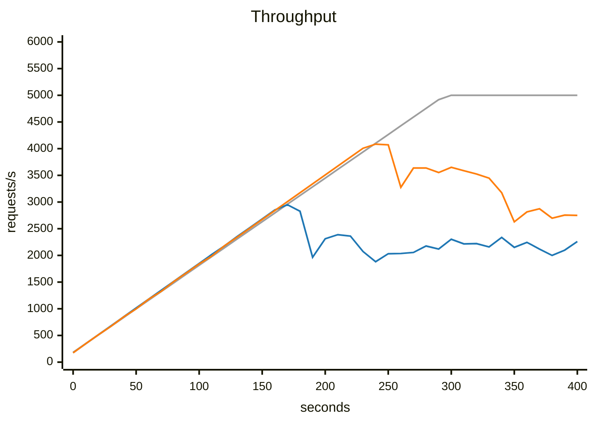
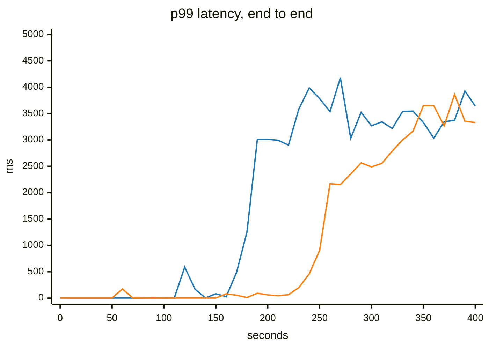

# Compare: single-postgres-breaking-point vs single-postgres-breaking-point-one-query-per-page

_A: run `single-postgres-breaking-point-20261111-015507` · B: run `single-postgres-breaking-point-one-query-per-page-20261111-014627`_

| | A | B |
| --- | --- | --- |
| Design | single-postgres-breaking-point | single-postgres-breaking-point-one-query-per-page |
| Verdict | broke at 3:00 (3,122 rps offered) | broke at 4:10 (4,265 rps offered) |
| Most served | 2,950 rps at 2:50 | 4,085 rps at 4:00 |
| Worst 10-second p99 | 4.18 s | 3.86 s |
| Worst error rate | 0% | 0% |
| Diagnoses | Queueing knee (db CPU) from 2:30 | Queueing knee (db CPU) from 3:10 |
| Predictions held | 1 of 2 | 2 of 2 |
| Peak offered | 5,000 rps | 5,000 rps |
| Scale, seed | 1, 1 | 1, 1 |
| Host | 8 CPUs, 9.7 GiB, Docker 29.5.2 | 8 CPUs, 9.7 GiB, Docker 29.5.2 |
| Data | fresh copy | fresh copy |

<sub>Sources as in each run's report: served from k6_http_reqs_total{expected_response="true"} (k6: successful responses), p99 from k6_http_req_duration_seconds (k6 histogram, end to end), errors from k6_http_reqs_total{expected_response="false"} ÷ k6_http_reqs_total (k6).</sub>

## Verdicts

**A.** Broke 3:00 into the load, at 3,122 rps offered: p99 reached 1.25 s (2.9 ms at low load). Most saturated then: db CPU at 101% of its limit. After the break the load generator couldn't send 54% of the arrivals the profile asked for (539,768 arrivals from 3:10; k6_dropped_iterations_total (k6: arrivals it couldn't start)): slow responses held its 4,000 VUs, so served throughput from then on is partly the generator's limit, not only the system's.

**B.** Broke 4:10 into the load, at 4,265 rps offered: p99 reached 904 ms (2.4 ms at low load). Most saturated then: db CPU at 101% of its limit. After the break the load generator couldn't send 36% of the arrivals the profile asked for (263,526 arrivals from 4:20; k6_dropped_iterations_total (k6: arrivals it couldn't start)): slow responses held its 4,000 VUs, so served throughput from then on is partly the generator's limit, not only the system's.

## Charts



<sub>Grey: offered (A). Blue: served, A. Orange: served, B (k6_http_reqs_total{expected_response="true"} (k6: successful responses)). Windows without data are drawn at 0.</sub>



<sub>Blue: A. Orange: B (k6_http_req_duration_seconds (k6 histogram, end to end)). Windows without data are drawn at 0.</sub>

<details><summary>Per-window numbers, side by side</summary>

| t | offered A | offered B | served A | served B | p99 A | p99 B | errors A | errors B |
| --- | --- | --- | --- | --- | --- | --- | --- | --- |
| 0:00 | 182 | 182 | 177 | 174 | 4.3 ms | 4.1 ms | 0% | 0% |
| 0:10 | 345 | 345 | 346 | 345 | 2.9 ms | 2.9 ms | 0% | 0% |
| 0:20 | 508 | 508 | 513 | 512 | 2.9 ms | 2.3 ms | 0% | 0% |
| 0:30 | 672 | 672 | 680 | 671 | 2.7 ms | 2.1 ms | 0% | 0% |
| 0:40 | 835 | 835 | 847 | 846 | 2.3 ms | 1.9 ms | 0% | 0% |
| 0:50 | 998 | 998 | 1,014 | 1,000 | 2.9 ms | 2.4 ms | 0% | 0% |
| 1:00 | 1,162 | 1,162 | 1,181 | 1,179 | 2.7 ms | 174 ms | 0% | 0% |
| 1:10 | 1,325 | 1,325 | 1,348 | 1,328 | 2.6 ms | 1.5 ms | 0% | 0% |
| 1:20 | 1,488 | 1,488 | 1,515 | 1,512 | 2.7 ms | 1.9 ms | 0% | 0% |
| 1:30 | 1,652 | 1,652 | 1,682 | 1,675 | 4.2 ms | 2.0 ms | 0% | 0% |
| 1:40 | 1,815 | 1,815 | 1,849 | 1,841 | 2.8 ms | 2.1 ms | 0% | 0% |
| 1:50 | 1,978 | 1,978 | 2,017 | 1,987 | 3.8 ms | 2.0 ms | 0% | 0% |
| 2:00 | 2,142 | 2,142 | 2,176 | 2,180 | 588 ms | 2.7 ms | 0% | 0% |
| 2:10 | 2,305 | 2,305 | 2,351 | 2,340 | 166 ms | 3.0 ms | 0% | 0% |
| 2:20 | 2,468 | 2,468 | 2,517 | 2,507 | 4.1 ms | 2.6 ms | 0% | 0% |
| 2:30 | 2,632 | 2,632 | 2,684 | 2,674 | 81 ms | 2.6 ms | 0% | 0% |
| 2:40 | 2,795 | 2,795 | 2,851 | 2,841 | 27 ms | 79 ms | 0% | 0% |
| 2:50 | 2,958 | 2,958 | 2,950 | 3,007 | 490 ms | 55 ms | 0% | 0% |
| 3:00 | 3,122 | 3,122 | 2,828 | 3,174 | 1.25 s | 12 ms | 0% | 0% |
| 3:10 | 3,285 | 3,285 | 1,965 | 3,340 | 3.01 s | 92 ms | 0% | 0% |
| 3:20 | 3,448 | 3,448 | 2,311 | 3,508 | 3.01 s | 61 ms | 0% | 0% |
| 3:30 | 3,612 | 3,612 | 2,388 | 3,674 | 2.99 s | 45 ms | 0% | 0% |
| 3:40 | 3,775 | 3,775 | 2,362 | 3,841 | 2.90 s | 65 ms | 0% | 0% |
| 3:50 | 3,938 | 3,938 | 2,073 | 4,007 | 3.59 s | 199 ms | 0% | 0% |
| 4:00 | 4,102 | 4,102 | 1,882 | 4,085 | 3.99 s | 460 ms | 0% | 0% |
| 4:10 | 4,265 | 4,265 | 2,031 | 4,072 | 3.78 s | 904 ms | 0% | 0% |
| 4:20 | 4,428 | 4,428 | 2,036 | 3,276 | 3.54 s | 2.17 s | 0% | 0% |
| 4:30 | 4,592 | 4,592 | 2,055 | 3,637 | 4.18 s | 2.15 s | 0% | 0% |
| 4:40 | 4,755 | 4,755 | 2,176 | 3,638 | 3.03 s | 2.35 s | 0% | 0% |
| 4:50 | 4,918 | 4,918 | 2,119 | 3,552 | 3.52 s | 2.56 s | 0% | 0% |
| 5:00 | 5,000 | 5,000 | 2,303 | 3,651 | 3.27 s | 2.49 s | 0% | 0% |
| 5:10 | 5,000 | 5,000 | 2,216 | 3,586 | 3.34 s | 2.56 s | 0% | 0% |
| 5:20 | 5,000 | 5,000 | 2,221 | 3,526 | 3.22 s | 2.79 s | 0% | 0% |
| 5:30 | 5,000 | 5,000 | 2,158 | 3,447 | 3.54 s | 3.00 s | 0% | 0% |
| 5:40 | 5,000 | 5,000 | 2,337 | 3,175 | 3.55 s | 3.17 s | 0% | 0% |
| 5:50 | 5,000 | 5,000 | 2,151 | 2,629 | 3.33 s | 3.65 s | 0% | 0% |
| 6:00 | 5,000 | 5,000 | 2,245 | 2,815 | 3.03 s | 3.65 s | 0% | 0% |
| 6:10 | 5,000 | 5,000 | 2,119 | 2,874 | 3.34 s | 3.27 s | 0% | 0% |
| 6:20 | 5,000 | 5,000 | 2,000 | 2,696 | 3.37 s | 3.86 s | 0% | 0% |
| 6:30 | 5,000 | 5,000 | 2,098 | 2,755 | 3.93 s | 3.36 s | 0% | 0% |
| 6:40 | 5,000 | 5,000 | 2,259 | 2,749 | 3.64 s | 3.33 s | 0% | 0% |

</details>

## Diagnosis

### A

- **Queueing knee (db CPU), from 2:30.** From 2:30, p99 stayed above 13 ms (2.9 ms at low load) with db CPU at 75%. Near saturation requests wait behind each other, so latency grows non-linearly, not in proportion to load.

### B

- **Queueing knee (db CPU), from 3:10.** From 3:10, p99 stayed above 12 ms (2.4 ms at low load) with db CPU at 74%. Near saturation requests wait behind each other, so latency grows non-linearly, not in proportion to load.

## Predictions

| Prediction | A | B |
| --- | --- | --- |
| `p99_ms < 300 until load_rps >= 3000` | broken, worst 588 ms (broke at 2:00) | held, worst 174 ms |
| `error_rate < 1% throughout` | held, worst 0% | held, worst 0% |

## Design changes

```diff
--- A/design.yaml
+++ B/design.yaml
@@ -1,5 +1,5 @@
 version: 1
-name: single-postgres-breaking-point
+name: single-postgres-breaking-point-one-query-per-page
 
 # A feed service: every request returns a page of three items from Postgres,
 # and one request in ten also updates an item.
@@ -17,7 +17,7 @@
     behavior:
       cpu_ms: 0.5
       calls:
-        - { target: db, op: read,  count: 3 }              # the page's three items, one query each
+        - { target: db, op: read,  query: batch, rows: 3 }  # the page's three items in one query
         - { target: db, op: write, count: 1, when: write }
     pools: { db: 24 }          # 4 replicas x 24 = 96 connections, under max_connections
 
@@ -36,8 +36,7 @@
   mix: { read: 0.9, write: 0.1 }
   keys: { distribution: zipf, skew: 1.1, count: 5000000 }
 
-# Your predictions, scored in the report. Replace these with your own
-# before you run it.
+# The starting design's predictions, kept so the two reports compare.
 expect:
   - p99_ms < 300 until load_rps >= 3000
   - error_rate < 1% throughout
```
