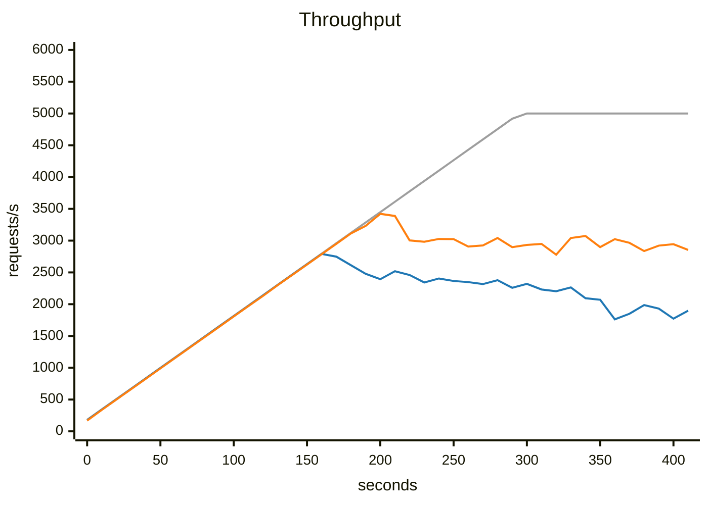
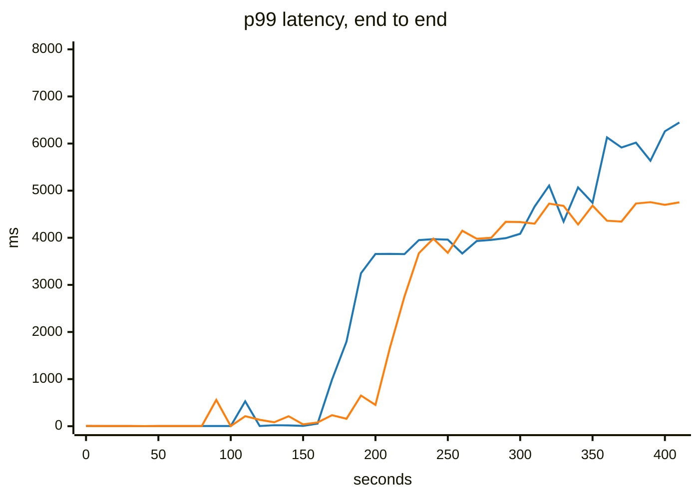

# Compare: single-postgres-breaking-point vs single-postgres-breaking-point-one-query-per-page

_A: run `single-postgres-breaking-point-20261110-004633` · B: run `single-postgres-breaking-point-one-query-per-page-20261110-084325`_

**Same verdict, different results.** Both broke at 2:50 (2,958 rps offered), but B served at most 3,422 rps against A's 2,791 (1.23×); from the break on, B served 68% of the offered load against A's 50%; p99 at the break was 233 ms against 990 ms.

<sub>Served: k6_http_reqs_total{expected_response="true"} (k6: successful responses); offered: the load profile in plan.json (offered arrival rate); p99: k6_http_req_duration_seconds (k6 histogram, end to end).</sub>

| | A | B |
| --- | --- | --- |
| Design | single-postgres-breaking-point | single-postgres-breaking-point-one-query-per-page |
| Verdict | broke at 2:50 (2,958 rps offered) | broke at 2:50 (2,958 rps offered) |
| Most served | 2,791 rps at 2:40 | 3,422 rps at 3:20 |
| Worst 10-second p99 | 6.45 s | 4.76 s |
| Worst error rate | 0% | 0% |
| Diagnoses | Queueing knee (db CPU) from 2:40 | Queueing knee (db CPU) from 1:50 |
| Predictions held | 1 of 2 | 1 of 2 |
| Peak offered | 5,000 rps | 5,000 rps |
| Scale, seed | 1, 1 | 1, 1 |
| Host | 8 CPUs, 9.7 GiB, Docker 29.5.2 | 8 CPUs, 9.7 GiB, Docker 29.5.2 |
| Data | fresh copy | fresh copy |

<sub>Sources as in each run's report: served from k6_http_reqs_total{expected_response="true"} (k6: successful responses), p99 from k6_http_req_duration_seconds (k6 histogram, end to end), errors from k6_http_reqs_total{expected_response="false"} ÷ k6_http_reqs_total (k6).</sub>

## Verdicts

**A.** Broke 2:50 into the load, at 2,958 rps offered: p99 reached 990 ms (3.2 ms at low load). Most saturated then: api → db pool 96 of 96 connections in use, waiting on db (CPU 98%, CPU-throttled 40.2 s, 8.6 ms per call with a connection, 0.1 ms at low load). After the break the load generator couldn't send 50% of the arrivals the profile asked for (546,431 arrivals from 3:00; k6_dropped_iterations_total (k6: arrivals it couldn't start)): slow responses held its 4,000 VUs, so served throughput from then on is partly the generator's limit, not only the system's.

**B.** Broke 2:50 into the load, at 2,958 rps offered: p99 reached 233 ms (3.6 ms at low load). Most saturated then: api → db pool 96 of 96 connections in use, waiting on db (CPU 87%, CPU-throttled 17.1 s, 7.8 ms per call with a connection, 0.4 ms at low load). After the break the load generator couldn't send 33% of the arrivals the profile asked for (355,690 arrivals from 3:10; k6_dropped_iterations_total (k6: arrivals it couldn't start)): slow responses held its 4,000 VUs, so served throughput from then on is partly the generator's limit, not only the system's.

## Charts



<sub>Grey: offered (A). Blue: served, A. Orange: served, B (k6_http_reqs_total{expected_response="true"} (k6: successful responses)). Windows without data are drawn at 0.</sub>



<sub>Blue: A. Orange: B (k6_http_req_duration_seconds (k6 histogram, end to end)). Windows without data are drawn at 0.</sub>

<details><summary>Per-window numbers, side by side</summary>

| t | offered A | offered B | served A | served B | p99 A | p99 B | errors A | errors B |
| --- | --- | --- | --- | --- | --- | --- | --- | --- |
| 0:00 | 182 | 182 | 176 | 169 | 4.5 ms | 5.5 ms | 0% | 0% |
| 0:10 | 345 | 345 | 341 | 336 | 3.4 ms | 4.1 ms | 0% | 0% |
| 0:20 | 508 | 508 | 505 | 500 | 3.0 ms | 3.7 ms | 0% | 0% |
| 0:30 | 672 | 672 | 668 | 663 | 3.0 ms | 3.2 ms | 0% | 0% |
| 0:40 | 835 | 835 | 831 | 827 | 2.8 ms | 2.8 ms | 0% | 0% |
| 0:50 | 998 | 998 | 995 | 990 | 3.2 ms | 3.0 ms | 0% | 0% |
| 1:00 | 1,162 | 1,162 | 1,158 | 1,153 | 3.3 ms | 3.6 ms | 0% | 0% |
| 1:10 | 1,325 | 1,325 | 1,321 | 1,316 | 3.2 ms | 3.2 ms | 0% | 0% |
| 1:20 | 1,488 | 1,488 | 1,485 | 1,480 | 3.8 ms | 3.2 ms | 0% | 0% |
| 1:30 | 1,652 | 1,652 | 1,648 | 1,643 | 3.1 ms | 558 ms | 0% | 0% |
| 1:40 | 1,815 | 1,815 | 1,811 | 1,806 | 3.9 ms | 2.7 ms | 0% | 0% |
| 1:50 | 1,978 | 1,978 | 1,975 | 1,970 | 528 ms | 212 ms | 0% | 0% |
| 2:00 | 2,142 | 2,142 | 2,138 | 2,130 | 4.2 ms | 137 ms | 0% | 0% |
| 2:10 | 2,305 | 2,305 | 2,301 | 2,300 | 21 ms | 84 ms | 0% | 0% |
| 2:20 | 2,468 | 2,468 | 2,465 | 2,460 | 17 ms | 212 ms | 0% | 0% |
| 2:30 | 2,632 | 2,632 | 2,628 | 2,623 | 7.6 ms | 40 ms | 0% | 0% |
| 2:40 | 2,795 | 2,795 | 2,791 | 2,787 | 54 ms | 80 ms | 0% | 0% |
| 2:50 | 2,958 | 2,958 | 2,748 | 2,949 | 990 ms | 233 ms | 0% | 0% |
| 3:00 | 3,122 | 3,122 | 2,613 | 3,114 | 1.80 s | 159 ms | 0% | 0% |
| 3:10 | 3,285 | 3,285 | 2,478 | 3,232 | 3.25 s | 651 ms | 0% | 0% |
| 3:20 | 3,448 | 3,448 | 2,393 | 3,422 | 3.66 s | 452 ms | 0% | 0% |
| 3:30 | 3,612 | 3,612 | 2,518 | 3,388 | 3.66 s | 1.66 s | 0% | 0% |
| 3:40 | 3,775 | 3,775 | 2,459 | 3,003 | 3.65 s | 2.75 s | 0% | 0% |
| 3:50 | 3,938 | 3,938 | 2,342 | 2,982 | 3.95 s | 3.67 s | 0% | 0% |
| 4:00 | 4,102 | 4,102 | 2,404 | 3,026 | 3.97 s | 3.98 s | 0% | 0% |
| 4:10 | 4,265 | 4,265 | 2,365 | 3,024 | 3.96 s | 3.68 s | 0% | 0% |
| 4:20 | 4,428 | 4,428 | 2,348 | 2,907 | 3.67 s | 4.15 s | 0% | 0% |
| 4:30 | 4,592 | 4,592 | 2,316 | 2,925 | 3.93 s | 3.98 s | 0% | 0% |
| 4:40 | 4,755 | 4,755 | 2,378 | 3,041 | 3.95 s | 4.00 s | 0% | 0% |
| 4:50 | 4,918 | 4,918 | 2,259 | 2,897 | 3.99 s | 4.34 s | 0% | 0% |
| 5:00 | 5,000 | 5,000 | 2,320 | 2,932 | 4.08 s | 4.33 s | 0% | 0% |
| 5:10 | 5,000 | 5,000 | 2,232 | 2,948 | 4.66 s | 4.30 s | 0% | 0% |
| 5:20 | 5,000 | 5,000 | 2,204 | 2,779 | 5.11 s | 4.73 s | 0% | 0% |
| 5:30 | 5,000 | 5,000 | 2,265 | 3,041 | 4.34 s | 4.68 s | 0% | 0% |
| 5:40 | 5,000 | 5,000 | 2,094 | 3,073 | 5.07 s | 4.28 s | 0% | 0% |
| 5:50 | 5,000 | 5,000 | 2,070 | 2,898 | 4.74 s | 4.68 s | 0% | 0% |
| 6:00 | 5,000 | 5,000 | 1,762 | 3,023 | 6.13 s | 4.36 s | 0% | 0% |
| 6:10 | 5,000 | 5,000 | 1,850 | 2,964 | 5.92 s | 4.34 s | 0% | 0% |
| 6:20 | 5,000 | 5,000 | 1,986 | 2,836 | 6.02 s | 4.73 s | 0% | 0% |
| 6:30 | 5,000 | 5,000 | 1,931 | 2,921 | 5.64 s | 4.76 s | 0% | 0% |
| 6:40 | 5,000 | 5,000 | 1,772 | 2,944 | 6.26 s | 4.70 s | 0% | 0% |
| 6:50 | 5,000 | 5,000 | 1,897 | 2,854 | 6.45 s | 4.75 s | 0% | 0% |

</details>

## Diagnosis

### A

- **Queueing knee (db CPU), from 2:40.** From 2:40, p99 stayed above 13 ms (3.2 ms at low load) with db CPU at 86%. Near saturation requests wait behind each other, so latency grows non-linearly, not in proportion to load.

### B

- **Queueing knee (db CPU), from 1:50.** From 1:50, p99 stayed above 14 ms (3.6 ms at low load) with db CPU at 70%. Near saturation requests wait behind each other, so latency grows non-linearly, not in proportion to load.

## Predictions

| Prediction | A | B |
| --- | --- | --- |
| `p99_ms < 300 until load_rps >= 3000` | broken, worst 990 ms (broke at 1:50) | broken, worst 558 ms (broke at 1:30) |
| `error_rate < 1% throughout` | held, worst 0% | held, worst 0% |

## Design changes

```diff
--- A/design.yaml
+++ B/design.yaml
@@ -1,6 +1,9 @@
 version: 1
-name: single-postgres-breaking-point
+name: single-postgres-breaking-point-one-query-per-page
 
+# A feed service: every request returns a page of three items from Postgres,
+# and one request in ten also updates an item.
+
 services:
   lb:
     kind: lb
@@ -10,18 +13,18 @@
   api:
     image: loadlore/synthetic
     replicas: 4
-    resources: { cpu: 0.8, memory: 512m }   # 4 x 0.8 keeps the run within 8 vCPUs, tooling included
+    resources: { cpu: 0.8, memory: 512m }
     behavior:
       cpu_ms: 0.5
       calls:
-        - { target: db, op: read,  count: 3 }
+        - { target: db, op: read,  query: batch, rows: 3 }  # the page's three items in one query
         - { target: db, op: write, count: 1, when: write }
-    pools: { db: 24 }          # 4 x 24 = 96; exporter and reserved slots need the rest
+    pools: { db: 24 }          # 4 replicas x 24 = 96 connections, under max_connections
 
   db:
     kind: postgres
     version: "17"
-    resources: { cpu: 0.5, memory: 1g }   # starting point; tuned by measurement
+    resources: { cpu: 0.5, memory: 1g }
     config: { max_connections: 100, shared_buffers: 256MB }
     dataset: { rows: 5000000, row_bytes: 512 }
 
@@ -33,6 +36,7 @@
   mix: { read: 0.9, write: 0.1 }
   keys: { distribution: zipf, skew: 1.1, count: 5000000 }
 
+# The starting design's predictions, kept so the two reports compare.
 expect:
   - p99_ms < 300 until load_rps >= 3000
   - error_rate < 1% throughout
```
