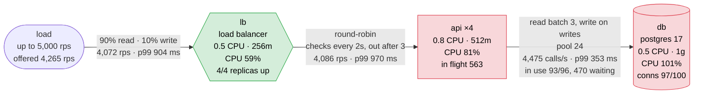
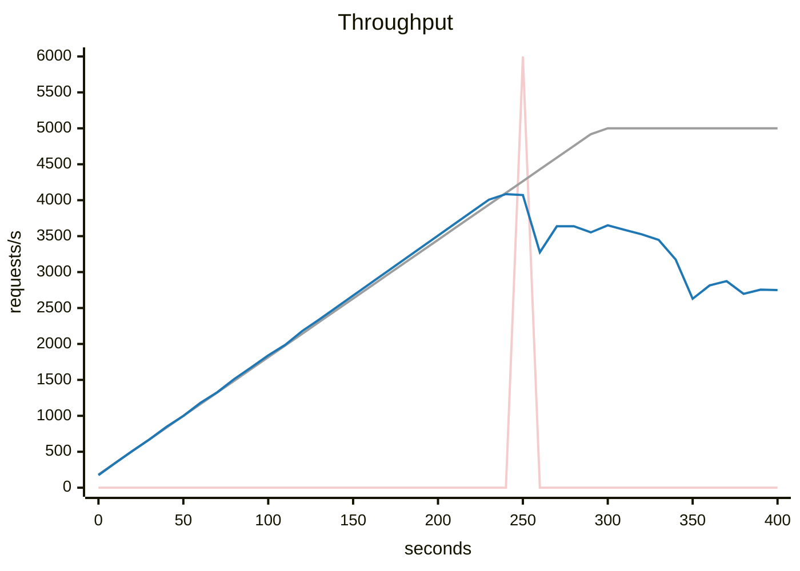
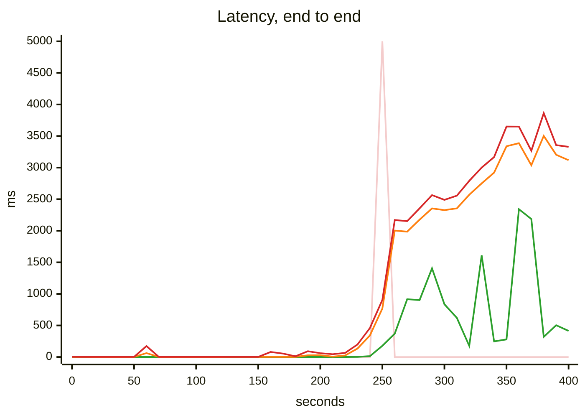
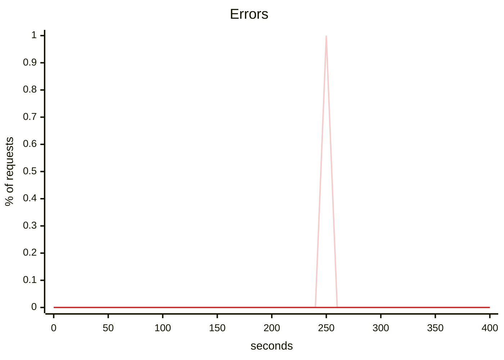
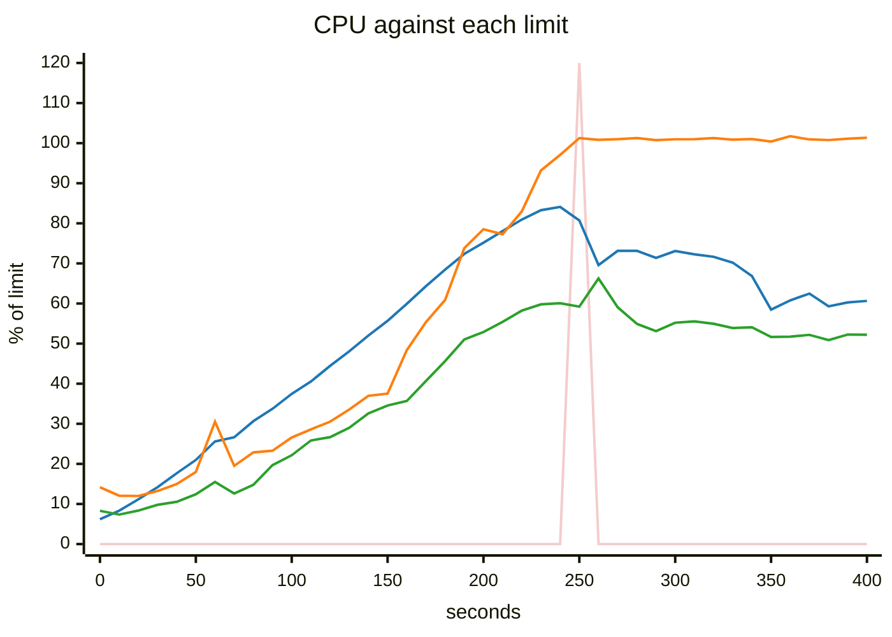

# single-postgres-breaking-point-one-query-per-page: run report

_run `single-postgres-breaking-point-one-query-per-page-20261111-014627` · completed · 11 Nov 2026 01:46 UTC · scale 1 · seed 1_

## Verdict

**Broke.** Broke 4:10 into the load, at 4,265 rps offered: p99 reached 904 ms (2.4 ms at low load). Most saturated then: db CPU at 101% of its limit. After the break the load generator couldn't send 36% of the arrivals the profile asked for (263,526 arrivals from 4:20; k6_dropped_iterations_total (k6: arrivals it couldn't start)): slow responses held its 4,000 VUs, so served throughput from then on is partly the generator's limit, not only the system's.

<sub>Sources: offered load: the load profile in plan.json (offered arrival rate); served: k6_http_reqs_total{expected_response="true"} (k6: successful responses); p99: k6_http_req_duration_seconds (k6 histogram, end to end); errors: k6_http_reqs_total{expected_response="false"} ÷ k6_http_reqs_total (k6); saturation: container_cpu_usage_seconds_total (cAdvisor) ÷ the container's CPU limit. Windows are 10 seconds; what counts as broken is under [Thresholds](#thresholds).</sub>

## Diagram at 4:10

Measured in the 10-second window from 4:10 to 4:20 (the break). Nodes are colored by their most saturated resource, CPU against its limit or a connection pool's connections in use: red at 90% or more, amber from 70%, green below.



<sub>Sources: offered from the load profile in plan.json (offered arrival rate); load edge from k6_http_reqs_total (k6: all responses) and k6_http_req_duration_seconds (k6 histogram, end to end); CPU from container_cpu_usage_seconds_total (cAdvisor) ÷ the container's CPU limit; calls/s from loadlore_calls_total (the caller's outbound call attempts) and their p99 from loadlore_call_duration_seconds (the caller's histogram, pool wait included); pools from loadlore_pool_connections{state="in_use"} and loadlore_pool_max_connections and loadlore_pool_pending (callers waiting for a connection); lb traffic from haproxy_backend_http_requests_total (HAProxy), replicas up from haproxy_backend_active_servers (HAProxy), and the lb edge's p99 from loadlore_request_duration_seconds (the service's own histogram); conns from pg_stat_activity_count and pg_settings_max_connections (postgres_exporter).</sub>

## Charts

One point per 10-second window, at the window's start; x is seconds from the start of the load.



<sub>Grey: offered load (the load profile in plan.json (offered arrival rate)). Blue: successful responses (k6_http_reqs_total{expected_response="true"} (k6: successful responses)). Pink spikes mark 4:10 break.</sub>



<sub>Green: p50. Orange: p95. Red: p99 (k6_http_req_duration_seconds (k6 histogram, end to end)). Pink spikes mark 4:10 break.</sub>



<sub>Failed requests as a share of all responses (k6_http_reqs_total{expected_response="false"} ÷ k6_http_reqs_total (k6)), timeouts included. Pink spikes mark 4:10 break.</sub>



<sub>Blue: api. Orange: db. Green: lb (container_cpu_usage_seconds_total (cAdvisor) ÷ the container's CPU limit, mean over the window). Pink spikes mark 4:10 break.</sub>

## Diagnosis

### 1. Queueing knee (db CPU), from 3:10

From 3:10, p99 stayed above 12 ms (2.4 ms at low load) with db CPU at 74%. Near saturation requests wait behind each other, so latency grows non-linearly, not in proportion to load.

Evidence:

- median end-to-end p99 by db CPU: below 50%: 2.4 ms (17 windows); 50–70%: 33 ms (2 windows); 70–80%: 61 ms (3 windows); 80–90%: 65 ms (1 window); 90% and up: 2.68 s (18 windows) <sub>(k6_http_req_duration_seconds (k6 histogram, end to end); container_cpu_usage_seconds_total (cAdvisor) ÷ the container's CPU limit)</sub>
- 3:10 to 3:40: p99 92 ms, 61 ms, 45 ms with db CPU 74%, 79%, 77% <sub>(k6_http_req_duration_seconds (k6 histogram, end to end); container_cpu_usage_seconds_total (cAdvisor) ÷ the container's CPU limit)</sub>
- db was CPU-throttled for 4.7 s (summed over its threads) in the window from 3:10, while its average CPU was 74% of its limit: bursts of work hit the 0.5-CPU limit and waited for the next period <sub>(container_cpu_cfs_throttled_seconds_total (cAdvisor))</sub>

**Try next:** Add capacity or cut per-request work on db, then re-run the ramp.

<sub>Rules version 2. Rules are deterministic and offline; their thresholds are listed below.</sub>

## Predictions

2 of 2 scored predictions held.

| Prediction | Result | Worst value | Checked over | Notes |
| --- | --- | --- | --- | --- |
| `p99_ms < 300 until load_rps >= 3000` | **held** | 174 ms | 0:00 to 3:00, when load_rps >= 3,000 rps first held | source: k6_http_req_duration_seconds (k6 histogram, end to end) |
| `error_rate < 1% throughout` | **held** | 0% | the whole run | source: k6_http_reqs_total{expected_response="false"} ÷ k6_http_reqs_total (k6) |

## Assumptions

### From the design

The design lists no assumptions.

### Chosen by Loadlore

| Field | Value | Why |
| --- | --- | --- |
| workload.timeout_ms | 10s | the default; k6 gives up on a request after this long and counts it as failed |
| workload.slo.p99_ms | 500 ms | the default; a break on p99 alone needs p99 at or above this as well as 10x the low-load p99, so latency users would still accept isn't called a break |
| resources.cpu_period_ms | 100 ms for api, db, lb | Docker's default. A container that uses its CPU share early in a period stalls until the next one, which can show up in p99 when a service has a fraction of a CPU |
| services.lb timeouts | connect 5s, server 60s | HAProxy's own timeouts, with its defaults otherwise. A request already sent to a replica that dies waits for the server timeout (or the load generator's); health checks only stop new requests going there |

### How the run was planned

- Loadlore's own containers get fixed budgets: load generator 2 CPU (peak 5000 rps), Toxiproxy 1 CPU (about 10500 proxied calls/s at peak), Prometheus 0.1, cAdvisor 0.1, exporters 0.1 each

## Thresholds

- **Broke:** 2 windows in a row with at least 1.0% of requests failing or successful responses below 90% of the offered rate, or 3 windows in a row with any of those or p99 at least 10x the low-load p99 (the median p99 of windows offered at most 25% of the peak, before errors or a shortfall in 2 windows in a row) and at least the SLO, 500 ms (workload.slo.p99_ms): 500 ms in this run. A shorter episode is shown as a stall in the timeline, not a break.
- **Doubtful:** a break on p99 alone, when the load generator was stalled at its CPU limit in 1.0% or more of its scheduling periods in one of the break's windows and the entry service's own p99 (loadlore_request_duration_seconds (the service's own histogram)) was below the limit in one of them. The verdict stays what it was.
- **Inconclusive:** before the break (or anywhere, if nothing broke), the load generator dropped more than 1.0% of a window's arrivals, or the load generator or Toxiproxy used 90% or more of its CPU budget, or was stalled at its CPU limit in 5.0% or more of its scheduling periods (from 1.0% it's noted as a caveat). The first 10 s of load are a warm-up and don't count: the load generator starts its VUs and connections open then. A cause is named only with evidence: on a Linux host, the hypervisor giving 2.0% or more of CPU time to other virtual machines (steal), or other programs using 10% or more of the host's CPUs (at least 0.5); inside a VM on this machine, only as a possibility.
- **Connection pool exhausted:** for two windows in a row, a pool at 95% or more of its size with callers waiting, while the target wasn't busy (busy: its CPU at 80% or more, or its time per call with a connection at least 3x the low-load value and 1 ms above it; CPU throttling alone doesn't count) and the caller's CPU stayed below 90%.
- **Queueing knee:** for 3 windows in a row, p99 at least 3x the low-load p99 and 10 ms above it, with a CPU or pool at 70% or more. When that is a pool whose target was busy in any of those windows, the knee is the target's.

## Environment

- loadl dev, profile 7m0s, scale 1, seed 1
- Host: 8 CPUs, 9.7 GiB memory, Ubuntu 24.04.4 LTS (aarch64, kernel 6.8.0-117-generic), cgroup v2
- Docker 29.5.2, Compose 5.1.1
- Host speed index 951 (hash 917, memory 947, syscalls 991): one CPU's work against the reference machine's 1000 (MacBook Air M4 (4 performance and 6 efficiency cores), Colima VM with 8 vCPUs). CPU limits are fractions of this host's cores, so a lower index means the design breaks at a lower load
- Host CPU: Docker runs in a VM on this machine, so other programs' use of the CPU can't be seen
- Data: a fresh copy of the cached seeded dataset
- Load generator summary (k6): 1,083,305 requests, 281,663 dropped arrivals, 0% failed

<details><summary>Containers and images</summary>

| Container | Image |
| --- | --- |
| loadlore-single-postgres-breaking-point-one-query-per-page-20261111-014627-api-0-1 | loadlore/synthetic:dev |
| loadlore-single-postgres-breaking-point-one-query-per-page-20261111-014627-api-1-1 | loadlore/synthetic:dev |
| loadlore-single-postgres-breaking-point-one-query-per-page-20261111-014627-api-2-1 | loadlore/synthetic:dev |
| loadlore-single-postgres-breaking-point-one-query-per-page-20261111-014627-api-3-1 | loadlore/synthetic:dev |
| loadlore-single-postgres-breaking-point-one-query-per-page-20261111-014627-db-1 | postgres:17.11 |
| loadlore-single-postgres-breaking-point-one-query-per-page-20261111-014627-lb-1 | haproxy:3.2.26 |
| loadlore-single-postgres-breaking-point-one-query-per-page-20261111-014627-lore-cadvisor-1 | ghcr.io/google/cadvisor:v0.60.6 |
| loadlore-single-postgres-breaking-point-one-query-per-page-20261111-014627-lore-k6-1 | grafana/k6:2.3.0 |
| loadlore-single-postgres-breaking-point-one-query-per-page-20261111-014627-lore-pgexp-db-1 | quay.io/prometheuscommunity/postgres-exporter:v0.20.1 |
| loadlore-single-postgres-breaking-point-one-query-per-page-20261111-014627-lore-prometheus-1 | prom/prometheus:v3.16.0 |
| loadlore-single-postgres-breaking-point-one-query-per-page-20261111-014627-lore-toxiproxy-1 | ghcr.io/shopify/toxiproxy:2.13.0 |

</details>

## Per-window data

<details><summary>41 windows of 10 seconds</summary>

| t | offered | served | dropped | errors | p50 | p99 | api CPU | db CPU | db conns | lb CPU | lb up | api→db pool | wait | k6 CPU | Toxiproxy CPU | k6 / Toxiproxy stalled |
| --- | --- | --- | --- | --- | --- | --- | --- | --- | --- | --- | --- | --- | --- | --- | --- | --- |
| 0:00 | 182 | 174 | 0 | 0% | 1.2 ms | 4.1 ms | 6.2% | 14% | 6 | 8.3% | 4 | 0/96 | 0.0 ms | 5.6% | 8.9% | 0% / 0% |
| 0:10 | 345 | 345 | 0 | 0% | 0.9 ms | 2.9 ms | 8.3% | 12% | 8 | 7.4% | 4 | 1/96 | 0.0 ms | 4.1% | 6.5% | 0% / 0% |
| 0:20 | 508 | 512 | 0 | 0% | 0.8 ms | 2.3 ms | 11% | 12% | 9 | 8.4% | 4 | 1/96 | 0.0 ms | 4.3% | 7.8% | 0% / 0% |
| 0:30 | 672 | 671 | 0 | 0% | 0.8 ms | 2.1 ms | 14% | 13% | 10 | 9.8% | 4 | 1/96 | 0.0 ms | 5.2% | 9.6% | 0% / 0% |
| 0:40 | 835 | 846 | 0 | 0% | 0.8 ms | 1.9 ms | 18% | 15% | 16 | 11% | 4 | 2/96 | 0.0 ms | 5.6% | 11% | 0% / 0% |
| 0:50 | 998 | 1,000 | 0 | 0% | 0.8 ms | 2.4 ms | 21% | 18% | 16 | 12% | 4 | 2/96 | 0.0 ms | 6.9% | 14% | 0% / 0% |
| 1:00 | 1,162 | 1,179 | 0 | 0% | 0.8 ms | 174 ms | 26% | 31% | 97 | 16% | 4 | 24/96 +62 | 5.4 ms | 8.8% | 18% | 0% / 0% |
| 1:10 | 1,325 | 1,328 | 0 | 0% | 0.8 ms | 1.5 ms | 27% | 20% | 97 | 13% | 4 | 1/96 | 0.0 ms | 6.9% | 17% | 0% / 0% |
| 1:20 | 1,488 | 1,512 | 0 | 0% | 0.8 ms | 1.9 ms | 31% | 23% | 97 | 15% | 4 | 1/96 | 0.0 ms | 8.1% | 19% | 0% / 0% |
| 1:30 | 1,652 | 1,675 | 0 | 0% | 0.8 ms | 2.0 ms | 34% | 23% | 97 | 20% | 4 | 1/96 | 0.0 ms | 8.4% | 20% | 0% / 0% |
| 1:40 | 1,815 | 1,841 | 0 | 0% | 0.8 ms | 2.1 ms | 37% | 27% | 97 | 22% | 4 | 2/96 | 0.0 ms | 9.8% | 23% | 0% / 0% |
| 1:50 | 1,978 | 1,987 | 0 | 0% | 0.8 ms | 2.0 ms | 41% | 29% | 97 | 26% | 4 | 2/96 | 0.0 ms | 11% | 25% | 0% / 0% |
| 2:00 | 2,142 | 2,180 | 0 | 0% | 0.8 ms | 2.7 ms | 44% | 31% | 97 | 27% | 4 | 3/96 | 0.0 ms | 12% | 27% | 0% / 0% |
| 2:10 | 2,305 | 2,340 | 0 | 0% | 0.8 ms | 3.0 ms | 48% | 34% | 97 | 29% | 4 | 3/96 | 0.0 ms | 13% | 30% | 0% / 0% |
| 2:20 | 2,468 | 2,507 | 0 | 0% | 0.9 ms | 2.6 ms | 52% | 37% | 97 | 33% | 4 | 2/96 | 0.0 ms | 14% | 33% | 0% / 0% |
| 2:30 | 2,632 | 2,674 | 0 | 0% | 0.9 ms | 2.6 ms | 56% | 38% | 97 | 35% | 4 | 3/96 | 0.0 ms | 15% | 35% | 0% / 0% |
| 2:40 | 2,795 | 2,841 | 0 | 0% | 0.9 ms | 79 ms | 60% | 48% | 97 | 36% | 4 | 48/96 +22 | 1.0 ms | 18% | 41% | 0% / 0% |
| 2:50 | 2,958 | 3,007 | 0 | 0% | 1.0 ms | 55 ms | 64% | 55% | 97 | 41% | 4 | 32/96 +3 | 0.4 ms | 20% | 47% | 0% / 0% |
| 3:00 | 3,122 | 3,174 | 0 | 0% | 1.1 ms | 12 ms | 68% | 61% | 97 | 46% | 4 | 27/96 +12 | 0.1 ms | 22% | 50% | 0% / 0% |
| 3:10 | 3,285 | 3,340 | 0 | 0% | 1.2 ms | 92 ms | 72% | 74% | 97 | 51% | 4 | 57/96 +74 | 1.9 ms | 25% | 53% | 0% / 0% |
| 3:20 | 3,448 | 3,508 | 0 | 0% | 1.3 ms | 61 ms | 75% | 79% | 97 | 53% | 4 | 31/96 +12 | 0.8 ms | 25% | 52% | 0% / 0% |
| 3:30 | 3,612 | 3,674 | 0 | 0% | 1.3 ms | 45 ms | 78% | 77% | 97 | 55% | 4 | 32/96 +12 | 0.4 ms | 26% | 54% | 0% / 0% |
| 3:40 | 3,775 | 3,841 | 0 | 0% | 1.4 ms | 65 ms | 81% | 83% | 97 | 58% | 4 | 41/96 +21 | 0.9 ms | 27% | 54% | 0% / 0% |
| 3:50 | 3,938 | 4,007 | 0 | 0% | 2.0 ms | 199 ms | 83% | 93% | 97 | 60% | 4 | 94/96 +384 | 18 ms | 28% | 53% | 0% / 0% |
| 4:00 | 4,102 | 4,085 | 376 | 0% | 14 ms | 460 ms | 84% | 97% | 97 | 60% | 4 | 96/96 +618 | 45 ms | 29% | 52% | 0% / 0% |
| 4:10 | 4,265 | 4,072 | 1,915 | 0% | 178 ms | 904 ms | 81% | 101% | 97 | 59% | 4 | 93/96 +470 | 89 ms | 30% | 48% | 0% / 0% |
| 4:20 | 4,428 | 3,276 | 10,288 | 0% | 371 ms | 2.17 s | 70% | 101% | 97 | 66% | 4 | 96/96 +638 | 128 ms | 37% | 58% | 0% / 1.0% |
| 4:30 | 4,592 | 3,637 | 9,913 | 0% | 915 ms | 2.15 s | 73% | 101% | 97 | 59% | 4 | 92/96 +544 | 137 ms | 32% | 49% | 0% / 1.0% |
| 4:40 | 4,755 | 3,638 | 12,053 | 0% | 902 ms | 2.35 s | 73% | 101% | 97 | 55% | 4 | 90/96 +538 | 137 ms | 34% | 47% | 0% / 2.0% |
| 4:50 | 4,918 | 3,552 | 14,493 | 0% | 1.41 s | 2.56 s | 71% | 101% | 97 | 53% | 4 | 92/96 +549 | 140 ms | 30% | 45% | 0% / 0% |
| 5:00 | 5,000 | 3,651 | 14,000 | 0% | 835 ms | 2.49 s | 73% | 101% | 97 | 55% | 4 | 93/96 +543 | 135 ms | 30% | 46% | 0% / 1.0% |
| 5:10 | 5,000 | 3,586 | 14,664 | 0% | 620 ms | 2.56 s | 72% | 101% | 97 | 56% | 4 | 88/96 +528 | 135 ms | 34% | 47% | 0% / 1.0% |
| 5:20 | 5,000 | 3,526 | 15,294 | 0% | 177 ms | 2.79 s | 72% | 101% | 97 | 55% | 4 | 91/96 +394 | 100 ms | 32% | 46% | 0% / 0.6% |
| 5:30 | 5,000 | 3,447 | 16,025 | 0% | 1.61 s | 3.00 s | 70% | 101% | 97 | 54% | 4 | 91/96 +393 | 102 ms | 31% | 46% | 0% / 0.4% |
| 5:40 | 5,000 | 3,175 | 18,781 | 0% | 247 ms | 3.17 s | 67% | 101% | 97 | 54% | 4 | 91/96 +423 | 111 ms | 34% | 47% | 0% / 1.0% |
| 5:50 | 5,000 | 2,629 | 24,183 | 0% | 279 ms | 3.65 s | 58% | 100% | 97 | 52% | 4 | 93/96 +383 | 132 ms | 35% | 47% | 0% / 0% |
| 6:00 | 5,000 | 2,815 | 22,458 | 0% | 2.34 s | 3.65 s | 61% | 102% | 97 | 52% | 4 | 95/96 +403 | 125 ms | 34% | 46% | 0% / 0% |
| 6:10 | 5,000 | 2,874 | 21,795 | 0% | 2.19 s | 3.27 s | 62% | 101% | 98 | 52% | 4 | 90/96 +408 | 122 ms | 35% | 48% | 0% / 1.0% |
| 6:20 | 5,000 | 2,696 | 23,543 | 0% | 319 ms | 3.86 s | 59% | 101% | 97 | 51% | 4 | 92/96 +385 | 129 ms | 37% | 46% | 0% / 0% |
| 6:30 | 5,000 | 2,755 | 23,041 | 0% | 503 ms | 3.36 s | 60% | 101% | 97 | 52% | 4 | 95/96 +535 | 136 ms | 37% | 49% | 0% / 1.0% |
| 6:40 | 5,000 | 2,749 | 22,995 | 0% | 413 ms | 3.33 s | 61% | 101% | 97 | 52% | 4 | 93/96 +486 | 132 ms | 37% | 48% | 0% / 0% |

Columns: offered is the load profile in plan.json (offered arrival rate); served is k6_http_reqs_total{expected_response="true"} (k6: successful responses); dropped is k6_dropped_iterations_total (k6: arrivals it couldn't start); errors are k6_http_reqs_total{expected_response="false"} ÷ k6_http_reqs_total (k6); p50 and p99 are from k6_http_req_duration_seconds (k6 histogram, end to end); CPU is container_cpu_usage_seconds_total (cAdvisor) ÷ the container's CPU limit, mean over the window; conns are pg_stat_activity_count and pg_settings_max_connections (postgres_exporter); hit rate is from redis_keyspace_hits_total and redis_keyspace_misses_total (redis_exporter); up is haproxy_backend_active_servers (HAProxy); pools are loadlore_pool_connections{state="in_use"} and loadlore_pool_max_connections (peak in use/size, +peak waiting), wait is the mean from loadlore_pool_wait_seconds (time to get a connection); k6 and Toxiproxy CPU are against their budgets.

</details>

## Design file

The exact `design.yaml` this run used:

```yaml
version: 1
name: single-postgres-breaking-point-one-query-per-page

# A feed service: every request returns a page of three items from Postgres,
# and one request in ten also updates an item.

services:
  lb:
    kind: lb
    target: api
    health_check: { interval_ms: 2000, fall: 3, rise: 2 }

  api:
    image: loadlore/synthetic
    replicas: 4
    resources: { cpu: 0.8, memory: 512m }
    behavior:
      cpu_ms: 0.5
      calls:
        - { target: db, op: read,  query: batch, rows: 3 }  # the page's three items in one query
        - { target: db, op: write, count: 1, when: write }
    pools: { db: 24 }          # 4 replicas x 24 = 96 connections, under max_connections

  db:
    kind: postgres
    version: "17"
    resources: { cpu: 0.5, memory: 1g }
    config: { max_connections: 100, shared_buffers: 256MB }
    dataset: { rows: 5000000, row_bytes: 512 }

workload:
  entry: lb
  profile:
    - ramp: { from: 100, to: 5000, over: 5m }
    - hold: { rps: 5000, for: 2m }
  mix: { read: 0.9, write: 0.1 }
  keys: { distribution: zipf, skew: 1.1, count: 5000000 }

# The starting design's predictions, kept so the two reports compare.
expect:
  - p99_ms < 300 until load_rps >= 3000
  - error_rate < 1% throughout
```
