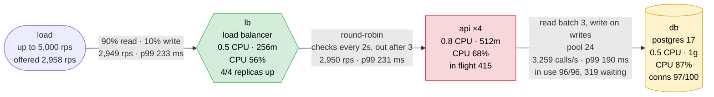
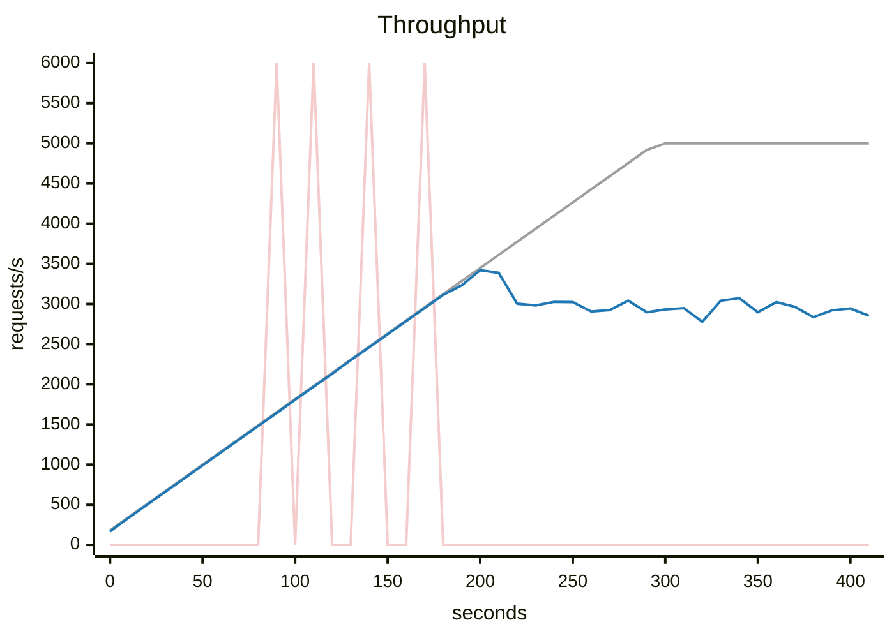
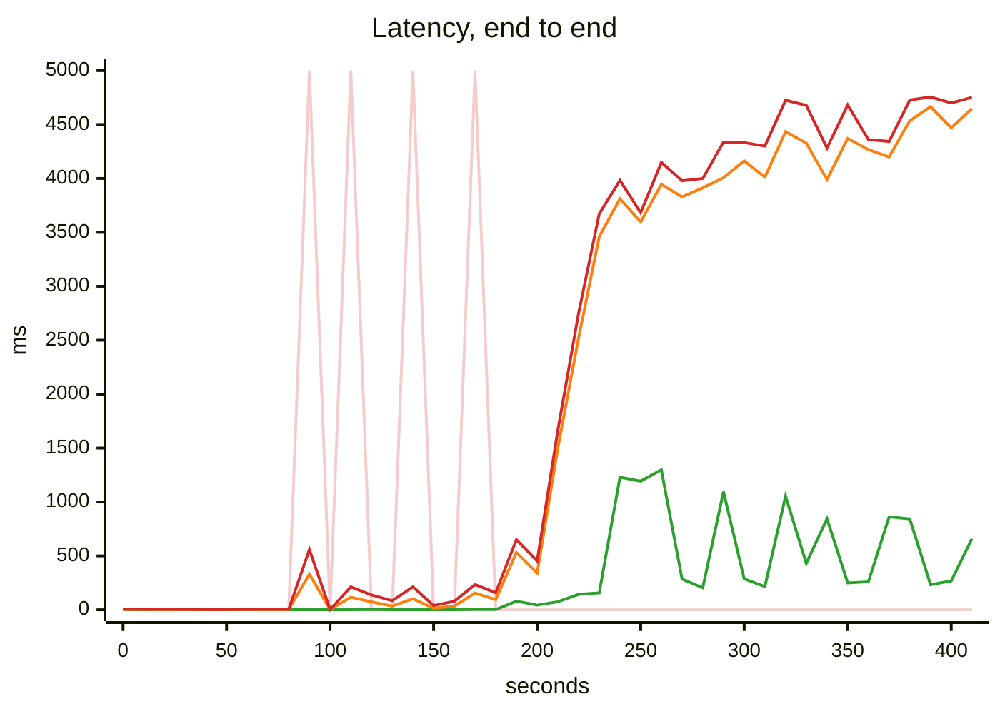
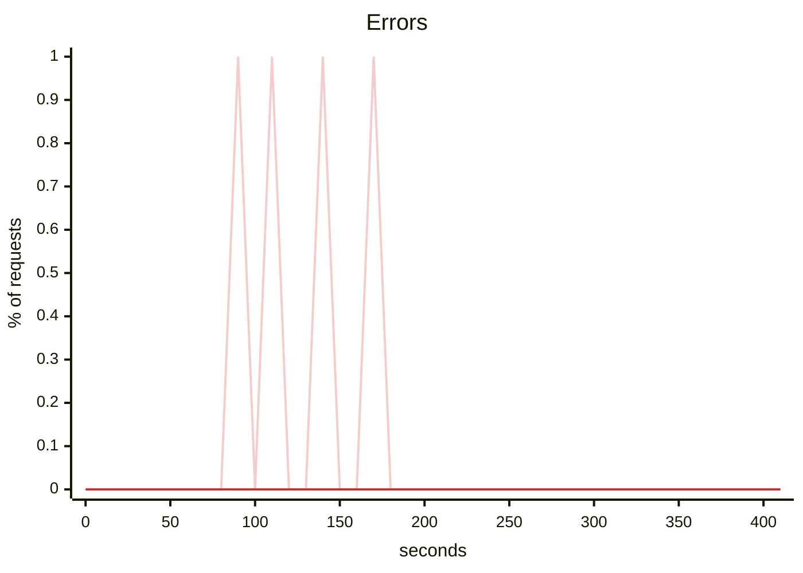
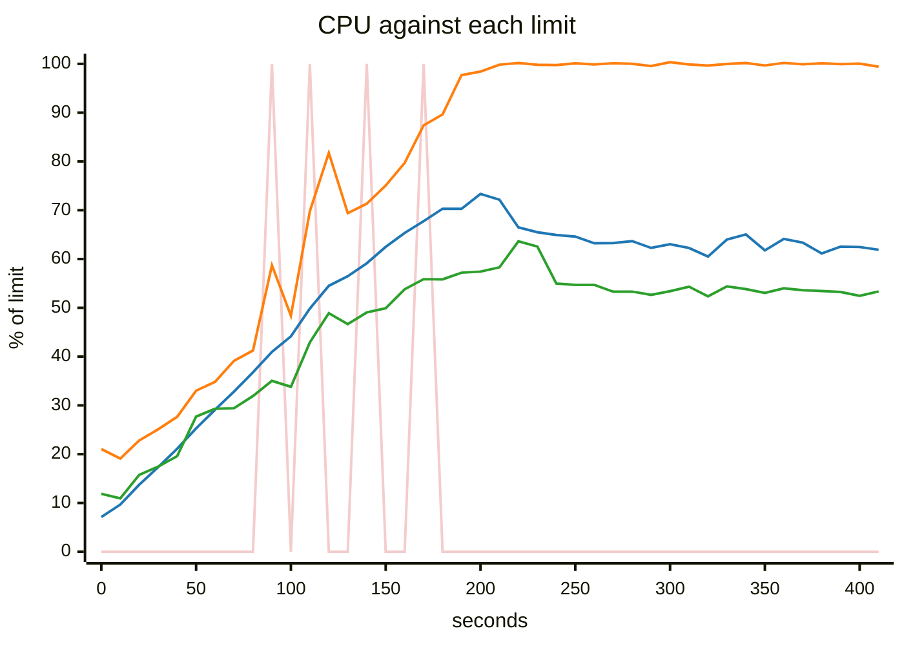

# single-postgres-breaking-point-one-query-per-page: run report

_run `single-postgres-breaking-point-one-query-per-page-20261110-084325` · completed · 10 Nov 2026 08:43 UTC · scale 1 · seed 1_

## Verdict

**Broke.** Broke 2:50 into the load, at 2,958 rps offered: p99 reached 233 ms (3.6 ms at low load). Most saturated then: api → db pool 96 of 96 connections in use. After the break the load generator couldn't send 33% of the arrivals the profile asked for (355,690 arrivals from 3:10; k6_dropped_iterations_total (k6: arrivals it couldn't start)): slow responses held its 4,000 VUs, so served throughput from then on is partly the generator's limit, not only the system's.

Caveat: at 2:30 the load generator hit its CPU limit and was stalled in 4.3% of its scheduling periods (container_cpu_cfs_throttled_periods_total ÷ container_cpu_cfs_periods_total (cAdvisor)); work caught in a stall waits for the next 100 ms period, which can show up in p99.

<sub>Sources: offered load: the load profile in plan.json (offered arrival rate); served: k6_http_reqs_total{expected_response="true"} (k6: successful responses); p99: k6_http_req_duration_seconds (k6 histogram, end to end); errors: k6_http_reqs_total{expected_response="false"} ÷ k6_http_reqs_total (k6); saturation: loadlore_pool_connections{state="in_use"} and loadlore_pool_max_connections. Windows are 10 seconds; what counts as broken is under [Thresholds](#thresholds).</sub>

## Diagram at 2:50

Measured in the 10-second window from 2:50 to 3:00 (the break). Nodes are colored by their most saturated resource, CPU against its limit or a connection pool's connections in use: red at 90% or more, amber from 70%, green below.



<sub>Sources: offered from the load profile in plan.json (offered arrival rate); load edge from k6_http_reqs_total (k6: all responses) and k6_http_req_duration_seconds (k6 histogram, end to end); CPU from container_cpu_usage_seconds_total (cAdvisor) ÷ the container's CPU limit; calls/s from loadlore_calls_total (the caller's outbound call attempts) and their p99 from loadlore_call_duration_seconds (the caller's histogram, pool wait included); pools from loadlore_pool_connections{state="in_use"} and loadlore_pool_max_connections and loadlore_pool_pending (callers waiting for a connection); lb traffic from haproxy_backend_http_requests_total (HAProxy), replicas up from haproxy_backend_active_servers (HAProxy), and the lb edge's p99 from loadlore_request_duration_seconds (the service's own histogram); conns from pg_stat_activity_count and pg_settings_max_connections (postgres_exporter).</sub>

## Charts

One point per 10-second window, at the window's start; x is seconds from the start of the load.



<sub>Grey: offered load (the load profile in plan.json (offered arrival rate)). Blue: successful responses (k6_http_reqs_total{expected_response="true"} (k6: successful responses)). Pink spikes mark 1:30 stall; 1:50 stall; 2:20 stall; 2:50 break.</sub>



<sub>Green: p50. Orange: p95. Red: p99 (k6_http_req_duration_seconds (k6 histogram, end to end)). Pink spikes mark 1:30 stall; 1:50 stall; 2:20 stall; 2:50 break.</sub>



<sub>Failed requests as a share of all responses (k6_http_reqs_total{expected_response="false"} ÷ k6_http_reqs_total (k6)), timeouts included. Pink spikes mark 1:30 stall; 1:50 stall; 2:20 stall; 2:50 break.</sub>



<sub>Blue: api. Orange: db. Green: lb (container_cpu_usage_seconds_total (cAdvisor) ÷ the container's CPU limit, mean over the window). Pink spikes mark 1:30 stall; 1:50 stall; 2:20 stall; 2:50 break.</sub>

## Diagnosis

### 1. Queueing knee (db CPU), from 1:50

From 1:50, p99 stayed above 14 ms (3.6 ms at low load) with db CPU at 70%. Near saturation requests wait behind each other, so latency grows non-linearly, not in proportion to load.

Evidence:

- median end-to-end p99 by db CPU: below 50%: 3.2 ms (10 windows); 50–70%: 212 ms (3 windows); 70–80%: 80 ms (3 windows); 80–90%: 159 ms (3 windows); 90% and up: 4.30 s (23 windows) <sub>(k6_http_req_duration_seconds (k6 histogram, end to end); container_cpu_usage_seconds_total (cAdvisor) ÷ the container's CPU limit)</sub>
- 1:50 to 2:20: p99 212 ms, 137 ms, 84 ms with db CPU 70%, 82%, 69% <sub>(k6_http_req_duration_seconds (k6 histogram, end to end); container_cpu_usage_seconds_total (cAdvisor) ÷ the container's CPU limit)</sub>
- api → db pool 73 of 96 connections in use at 1:50: a symptom, since connections stayed in use longer while db was slow to answer <sub>(loadlore_pool_connections{state="in_use"} and loadlore_pool_max_connections)</sub>
- db was CPU-throttled for 10.5 s (summed over its threads) in the window from 1:50, while its average CPU was 70% of its limit: bursts of work hit the 0.5-CPU limit and waited for the next period <sub>(container_cpu_cfs_throttled_seconds_total (cAdvisor))</sub>
- api's calls to db took 6.7 ms each once they had a connection at 1:50, against 0.4 ms at low load <sub>(loadlore_call_duration_seconds minus loadlore_pool_wait_seconds, per call (time with a connection))</sub>
- Little's law on api at 1:50: 1,966 rps × 16 ms mean time in the service = 31 in flight; measured 35 <sub>(loadlore_requests_inflight (summed over replicas); rate and mean from loadlore_request_duration_seconds (the service's own histogram))</sub>

**Try next:** Add capacity or cut per-request work on db, then re-run the ramp.

<sub>Rules version 2. Rules are deterministic and offline; their thresholds are listed below.</sub>

## Predictions

1 of 2 scored predictions held.

| Prediction | Result | Worst value | Checked over | Notes |
| --- | --- | --- | --- | --- |
| `p99_ms < 300 until load_rps >= 3000` | **broken** at 1:30 | 558 ms | 0:00 to 3:00, when load_rps >= 3,000 rps first held | source: k6_http_req_duration_seconds (k6 histogram, end to end) |
| `error_rate < 1% throughout` | **held** | 0% | the whole run | source: k6_http_reqs_total{expected_response="false"} ÷ k6_http_reqs_total (k6) |

## Timeline

| Time | Event |
| --- | --- |
| 1:30 | stall: p99 reached 558 ms (3.6 ms at low load) for 10 s, then recovered; too short to count as a break |
| 1:50 | stall: p99 reached 212 ms (3.6 ms at low load) for 20 s, then recovered; too short to count as a break |
| 2:20 | stall: p99 reached 212 ms (3.6 ms at low load) for 10 s, then recovered; too short to count as a break |

<sub>From events.jsonl: the fault timeline and Docker container events. Stalls are from the per-window numbers below, judged by the thresholds.</sub>

## Assumptions

### From the design

The design lists no assumptions.

### Chosen by Loadlore

| Field | Value | Why |
| --- | --- | --- |
| workload.timeout_ms | 10s | the default; k6 gives up on a request after this long and counts it as failed |
| services.lb timeouts | connect 5s, server 60s | HAProxy's own timeouts, with its defaults otherwise. A request already sent to a replica that dies waits for the server timeout (or the load generator's); health checks only stop new requests going there |

### How the run was planned

- Loadlore's own containers get fixed budgets: load generator 1.5 CPU (peak 5000 rps), Toxiproxy 1 CPU (about 10500 proxied calls/s at peak), Prometheus 0.25, cAdvisor 0.25, exporters 0.1 each

## Thresholds

- **Broke:** 2 windows in a row with at least 1.0% of requests failing or successful responses below 90% of the offered rate, or 3 windows in a row with any of those or p99 at least 10x the low-load p99 (the median p99 of windows offered at most 25% of the peak, before errors or a shortfall in 2 windows in a row) and at least 100 ms. A shorter episode is shown as a stall in the timeline, not a break.
- **Inconclusive:** before the break (or anywhere, if nothing broke), the load generator dropped more than 1.0% of a window's arrivals, or the load generator or Toxiproxy used 90% or more of its CPU budget, or was stalled at its CPU limit in 5.0% or more of its scheduling periods (from 1.0% it's noted as a caveat). The first 10 s of load are a warm-up and don't count: the load generator starts its VUs and connections open then. A cause is named only with evidence: on a Linux host, the hypervisor giving 2.0% or more of CPU time to other virtual machines (steal), or other programs using 10% or more of the host's CPUs (at least 0.5); inside a VM on this machine, only as a possibility.
- **Connection pool exhausted:** for two windows in a row, a pool at 95% or more of its size with callers waiting, while the target wasn't busy (busy: its CPU at 80% or more, CPU throttling of 1 s or more in a window, or its time per call with a connection at least 3x the low-load value and 1 ms above it) and the caller's CPU stayed below 90%.
- **Queueing knee:** for 3 windows in a row, p99 at least 3x the low-load p99 and 10 ms above it, with a CPU or pool at 70% or more. When that is a pool whose target was busy in any of those windows, the knee is the target's.

## Environment

- loadl c1f2e7e-dirty, profile 7m0s, scale 1, seed 1
- Host: 8 CPUs, 9.7 GiB memory, Ubuntu 24.04.4 LTS (aarch64, kernel 6.8.0-117-generic), cgroup v2
- Docker 29.5.2, Compose 5.1.1
- Host speed index: not measured
- Data: a fresh copy of the cached seeded dataset
- Load generator summary (k6): 1,008,003 requests, 356,684 dropped arrivals, 0% failed

<details><summary>Containers and images</summary>

| Container | Image |
| --- | --- |
| loadlore-single-postgres-breaking-point-one-query-per-page-20261110-084325-api-0-1 | loadlore/synthetic:dev |
| loadlore-single-postgres-breaking-point-one-query-per-page-20261110-084325-api-1-1 | loadlore/synthetic:dev |
| loadlore-single-postgres-breaking-point-one-query-per-page-20261110-084325-api-2-1 | loadlore/synthetic:dev |
| loadlore-single-postgres-breaking-point-one-query-per-page-20261110-084325-api-3-1 | loadlore/synthetic:dev |
| loadlore-single-postgres-breaking-point-one-query-per-page-20261110-084325-db-1 | postgres:17.11 |
| loadlore-single-postgres-breaking-point-one-query-per-page-20261110-084325-lb-1 | haproxy:3.2.26 |
| loadlore-single-postgres-breaking-point-one-query-per-page-20261110-084325-lore-cadvisor-1 | ghcr.io/google/cadvisor:v0.60.6 |
| loadlore-single-postgres-breaking-point-one-query-per-page-20261110-084325-lore-k6-1 | grafana/k6:2.3.0 |
| loadlore-single-postgres-breaking-point-one-query-per-page-20261110-084325-lore-pgexp-db-1 | quay.io/prometheuscommunity/postgres-exporter:v0.20.1 |
| loadlore-single-postgres-breaking-point-one-query-per-page-20261110-084325-lore-prometheus-1 | prom/prometheus:v3.16.0 |
| loadlore-single-postgres-breaking-point-one-query-per-page-20261110-084325-lore-toxiproxy-1 | ghcr.io/shopify/toxiproxy:2.13.0 |

</details>

## Per-window data

<details><summary>42 windows of 10 seconds</summary>

| t | offered | served | dropped | errors | p50 | p99 | api CPU | db CPU | db conns | lb CPU | lb up | api→db pool | wait | k6 CPU | Toxiproxy CPU | k6 / Toxiproxy stalled |
| --- | --- | --- | --- | --- | --- | --- | --- | --- | --- | --- | --- | --- | --- | --- | --- | --- |
| 0:00 | 182 | 169 | 0 | 0% | 1.6 ms | 5.5 ms | 7.1% | 21% | 8 | 12% | 4 | 0/96 | 0.0 ms | 11% | 12% | 4.0% / 0% |
| 0:10 | 345 | 336 | 0 | 0% | 1.2 ms | 4.1 ms | 9.7% | 19% | 10 | 11% | 4 | 1/96 | 0.0 ms | 7.7% | 9.8% | 0% / 0% |
| 0:20 | 508 | 500 | 0 | 0% | 1.1 ms | 3.7 ms | 14% | 23% | 14 | 16% | 4 | 1/96 | 0.0 ms | 11% | 14% | 1.0% / 0% |
| 0:30 | 672 | 663 | 0 | 0% | 1.1 ms | 3.2 ms | 17% | 25% | 16 | 17% | 4 | 2/96 | 0.0 ms | 12% | 18% | 0% / 0% |
| 0:40 | 835 | 827 | 0 | 0% | 1.1 ms | 2.8 ms | 21% | 28% | 16 | 20% | 4 | 1/96 | 0.0 ms | 14% | 21% | 0% / 0% |
| 0:50 | 998 | 990 | 0 | 0% | 1.1 ms | 3.0 ms | 25% | 33% | 16 | 28% | 4 | 2/96 | 0.0 ms | 17% | 26% | 0% / 0% |
| 1:00 | 1,162 | 1,153 | 0 | 0% | 1.1 ms | 3.6 ms | 29% | 35% | 16 | 29% | 4 | 2/96 | 0.0 ms | 17% | 29% | 1.0% / 0% |
| 1:10 | 1,325 | 1,316 | 0 | 0% | 1.1 ms | 3.2 ms | 33% | 39% | 21 | 29% | 4 | 3/96 | 0.0 ms | 18% | 32% | 1.6% / 0% |
| 1:20 | 1,488 | 1,480 | 0 | 0% | 1.1 ms | 3.2 ms | 37% | 41% | 22 | 32% | 4 | 1/96 | 0.0 ms | 19% | 35% | 1.4% / 0% |
| 1:30 | 1,652 | 1,643 | 0 | 0% | 1.2 ms | 558 ms | 41% | 59% | 97 | 35% | 4 | 94/96 +455 | 40 ms | 22% | 39% | 1.0% / 0% |
| 1:40 | 1,815 | 1,806 | 0 | 0% | 1.1 ms | 2.7 ms | 44% | 48% | 97 | 34% | 4 | 2/96 | 0.0 ms | 23% | 43% | 0% / 0% |
| 1:50 | 1,978 | 1,970 | 0 | 0% | 1.3 ms | 212 ms | 50% | 70% | 97 | 43% | 4 | 73/96 +112 | 7.3 ms | 31% | 48% | 2.0% / 0% |
| 2:00 | 2,142 | 2,130 | 0 | 0% | 1.6 ms | 137 ms | 55% | 82% | 97 | 49% | 4 | 67/96 +67 | 2.7 ms | 34% | 52% | 3.0% / 0% |
| 2:10 | 2,305 | 2,300 | 0 | 0% | 1.3 ms | 84 ms | 56% | 69% | 97 | 47% | 4 | 72/96 +36 | 0.6 ms | 31% | 53% | 2.0% / 0% |
| 2:20 | 2,468 | 2,460 | 0 | 0% | 1.3 ms | 212 ms | 59% | 71% | 97 | 49% | 4 | 74/96 +148 | 5.3 ms | 33% | 53% | 1.0% / 1.0% |
| 2:30 | 2,632 | 2,623 | 0 | 0% | 1.3 ms | 40 ms | 62% | 75% | 97 | 50% | 4 | 14/96 +9 | 0.3 ms | 34% | 54% | 4.3% / 0% |
| 2:40 | 2,795 | 2,787 | 0 | 0% | 1.4 ms | 80 ms | 65% | 80% | 97 | 54% | 4 | 48/96 +57 | 1.1 ms | 35% | 55% | 3.7% / 0% |
| 2:50 | 2,958 | 2,949 | 0 | 0% | 1.7 ms | 233 ms | 68% | 87% | 97 | 56% | 4 | 96/96 +319 | 16 ms | 37% | 53% | 2.8% / 0% |
| 3:00 | 3,122 | 3,114 | 0 | 0% | 1.9 ms | 159 ms | 70% | 90% | 97 | 56% | 4 | 78/96 +155 | 8.8 ms | 36% | 52% | 3.1% / 0% |
| 3:10 | 3,285 | 3,232 | 128 | 0% | 79 ms | 651 ms | 70% | 98% | 97 | 57% | 4 | 89/96 +528 | 92 ms | 37% | 50% | 3.9% / 0% |
| 3:20 | 3,448 | 3,422 | 0 | 0% | 43 ms | 452 ms | 73% | 98% | 98 | 57% | 4 | 96/96 +408 | 44 ms | 37% | 48% | 3.0% / 0% |
| 3:30 | 3,612 | 3,388 | 1,463 | 0% | 74 ms | 1.66 s | 72% | 100% | 97 | 58% | 4 | 96/96 +488 | 71 ms | 39% | 50% | 6.4% / 0% |
| 3:40 | 3,775 | 3,003 | 6,171 | 0% | 143 ms | 2.75 s | 66% | 100% | 97 | 64% | 4 | 96/96 +583 | 119 ms | 47% | 55% | 12% / 1.0% |
| 3:50 | 3,938 | 2,982 | 8,212 | 0% | 157 ms | 3.67 s | 65% | 100% | 97 | 63% | 4 | 96/96 +437 | 121 ms | 48% | 55% | 14% / 1.0% |
| 4:00 | 4,102 | 3,026 | 10,692 | 0% | 1.23 s | 3.98 s | 65% | 100% | 97 | 55% | 4 | 96/96 +391 | 115 ms | 40% | 45% | 8.0% / 0% |
| 4:10 | 4,265 | 3,024 | 12,297 | 0% | 1.19 s | 3.68 s | 65% | 100% | 97 | 55% | 4 | 93/96 +434 | 115 ms | 45% | 45% | 14% / 1.0% |
| 4:20 | 4,428 | 2,907 | 15,152 | 0% | 1.30 s | 4.15 s | 63% | 100% | 97 | 55% | 4 | 96/96 +509 | 122 ms | 44% | 45% | 11% / 0% |
| 4:30 | 4,592 | 2,925 | 16,583 | 0% | 285 ms | 3.98 s | 63% | 100% | 97 | 53% | 4 | 96/96 +427 | 119 ms | 41% | 45% | 9.0% / 1.0% |
| 4:40 | 4,755 | 3,041 | 17,196 | 0% | 204 ms | 4.00 s | 64% | 100% | 97 | 53% | 4 | 96/96 +402 | 116 ms | 40% | 43% | 8.0% / 0% |
| 4:50 | 4,918 | 2,897 | 19,984 | 0% | 1.10 s | 4.34 s | 62% | 100% | 97 | 53% | 4 | 96/96 +403 | 120 ms | 42% | 45% | 9.9% / 2.0% |
| 5:00 | 5,000 | 2,932 | 20,693 | 0% | 286 ms | 4.33 s | 63% | 100% | 97 | 53% | 4 | 94/96 +393 | 119 ms | 42% | 44% | 9.0% / 0% |
| 5:10 | 5,000 | 2,948 | 20,494 | 0% | 216 ms | 4.30 s | 62% | 100% | 97 | 54% | 4 | 96/96 +406 | 118 ms | 41% | 45% | 7.0% / 1.0% |
| 5:20 | 5,000 | 2,779 | 22,289 | 0% | 1.05 s | 4.73 s | 61% | 100% | 97 | 52% | 4 | 94/96 +389 | 126 ms | 42% | 44% | 9.0% / 0% |
| 5:30 | 5,000 | 3,041 | 19,527 | 0% | 430 ms | 4.68 s | 64% | 100% | 97 | 54% | 4 | 96/96 +565 | 121 ms | 42% | 46% | 8.0% / 2.0% |
| 5:40 | 5,000 | 3,073 | 19,245 | 0% | 845 ms | 4.28 s | 65% | 100% | 97 | 54% | 4 | 96/96 +397 | 113 ms | 40% | 44% | 7.0% / 0% |
| 5:50 | 5,000 | 2,898 | 21,000 | 0% | 250 ms | 4.68 s | 62% | 100% | 97 | 53% | 4 | 96/96 +399 | 121 ms | 41% | 45% | 10.0% / 1.0% |
| 6:00 | 5,000 | 3,023 | 19,761 | 0% | 259 ms | 4.36 s | 64% | 100% | 97 | 54% | 4 | 96/96 +413 | 116 ms | 46% | 44% | 14% / 0% |
| 6:10 | 5,000 | 2,964 | 20,468 | 0% | 862 ms | 4.34 s | 63% | 100% | 98 | 54% | 4 | 96/96 +392 | 118 ms | 43% | 45% | 12% / 2.0% |
| 6:20 | 5,000 | 2,836 | 21,553 | 0% | 843 ms | 4.73 s | 61% | 100% | 97 | 53% | 4 | 95/96 +411 | 123 ms | 41% | 43% | 7.0% / 0% |
| 6:30 | 5,000 | 2,921 | 20,742 | 0% | 233 ms | 4.76 s | 63% | 100% | 97 | 53% | 4 | 94/96 +392 | 119 ms | 41% | 44% | 8.0% / 0.2% |
| 6:40 | 5,000 | 2,944 | 20,592 | 0% | 267 ms | 4.70 s | 62% | 100% | 97 | 52% | 4 | 95/96 +403 | 119 ms | 40% | 45% | 7.6% / 0.8% |
| 6:50 | 5,000 | 2,854 | 21,449 | 0% | 658 ms | 4.75 s | 62% | 99% | 97 | 53% | 4 | 96/96 +410 | 123 ms | 43% | 44% | 10% / 0% |

Columns: offered is the load profile in plan.json (offered arrival rate); served is k6_http_reqs_total{expected_response="true"} (k6: successful responses); dropped is k6_dropped_iterations_total (k6: arrivals it couldn't start); errors are k6_http_reqs_total{expected_response="false"} ÷ k6_http_reqs_total (k6); p50 and p99 are from k6_http_req_duration_seconds (k6 histogram, end to end); CPU is container_cpu_usage_seconds_total (cAdvisor) ÷ the container's CPU limit, mean over the window; conns are pg_stat_activity_count and pg_settings_max_connections (postgres_exporter); hit rate is from redis_keyspace_hits_total and redis_keyspace_misses_total (redis_exporter); up is haproxy_backend_active_servers (HAProxy); pools are loadlore_pool_connections{state="in_use"} and loadlore_pool_max_connections (peak in use/size, +peak waiting), wait is the mean from loadlore_pool_wait_seconds (time to get a connection); k6 and Toxiproxy CPU are against their budgets.

</details>

## Design file

The exact `design.yaml` this run used:

```yaml
version: 1
name: single-postgres-breaking-point-one-query-per-page

# A feed service: every request returns a page of three items from Postgres,
# and one request in ten also updates an item.

services:
  lb:
    kind: lb
    target: api
    health_check: { interval_ms: 2000, fall: 3, rise: 2 }

  api:
    image: loadlore/synthetic
    replicas: 4
    resources: { cpu: 0.8, memory: 512m }
    behavior:
      cpu_ms: 0.5
      calls:
        - { target: db, op: read,  query: batch, rows: 3 }  # the page's three items in one query
        - { target: db, op: write, count: 1, when: write }
    pools: { db: 24 }          # 4 replicas x 24 = 96 connections, under max_connections

  db:
    kind: postgres
    version: "17"
    resources: { cpu: 0.5, memory: 1g }
    config: { max_connections: 100, shared_buffers: 256MB }
    dataset: { rows: 5000000, row_bytes: 512 }

workload:
  entry: lb
  profile:
    - ramp: { from: 100, to: 5000, over: 5m }
    - hold: { rps: 5000, for: 2m }
  mix: { read: 0.9, write: 0.1 }
  keys: { distribution: zipf, skew: 1.1, count: 5000000 }

# The starting design's predictions, kept so the two reports compare.
expect:
  - p99_ms < 300 until load_rps >= 3000
  - error_rate < 1% throughout
```
