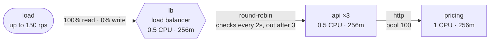

# The slow dependency

Level 2 · about 40 minutes · teaches timeouts, retry storms, circuit breakers and metastable failures

## The story

You run the product page. Every request asks the pricing service for the item's price. Pricing is a small service with one CPU, and at the 150 requests a second the page gets it's about 40% busy.

Someone was careful with the api's settings. Each call to pricing gets 250 ms, far more than the 3 or 4 ms it usually takes, and a failed call is retried right away, up to three times, so a blip in pricing never reaches the user.



The load ramps to 150 requests a second over a minute and holds there. At 2:01, pricing stops for two seconds, as a garbage-collection pause or a hiccup on its node would stop it, then carries on as if nothing happened.

## The question

Before you run anything, write down your guesses. Don't work them out: a gut answer is fine, and where the run differs from it is what you'll learn from.

1. What do users see during the two seconds pricing is stopped?
2. How long after it starts again do the errors stop?
3. How many calls does pricing get for each user request, before the pause and after it?

`loadl predict design.yaml` asks questions like these and writes your answers into the `expect` block at the bottom of `design.yaml`, or write them there yourself. The report scores each one against what the run measured. The line already there is an example; the grammar is in the [design file reference](../../skills/loadlore-designer/references/schema.md).

## Run it

```sh
loadl run scenarios/slow-dependency/design.yaml
loadl report latest --print | less
```

The run takes about 6 minutes. It needs 6 CPUs and 4 GB available to Docker, Loadlore's own containers included; on a smaller machine, add `--scale` with the largest value that fits. `loadl run` warns you when the host is too small and suggests one.

Pricing's capacity here is set by CPU time per request, so it changes less from machine to machine than in the level-1 scenarios. Plug a laptop in all the same.

Stuck? `loadl hint slow-dependency` reveals one hint at a time.

## What to try next

When you know why it broke, change one thing in the api's `resilience` settings and run it again. Write an `expect` line for what you think will happen this time, then compare the two runs:

```sh
loadl compare <first-run> latest -o compare.md
```

Some directions: how many times the api retries and how long it waits between tries, a circuit breaker, or more capacity for pricing. For each, work out how many calls pricing gets per user request while it's in trouble.

`solutions/` has two worked answers with their reports, and `variants/backoff-only` is a fix that looks right and isn't. They give the game away, so try your own first.
