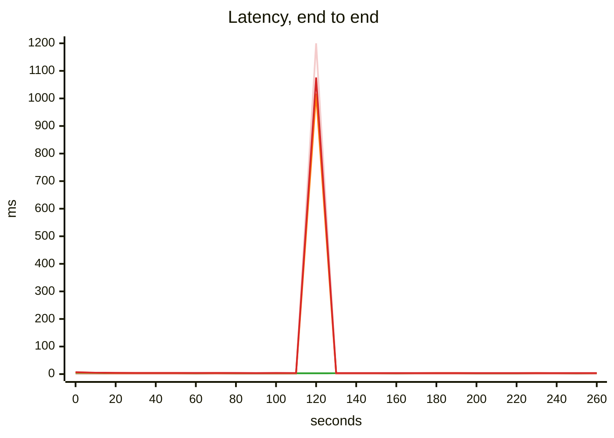
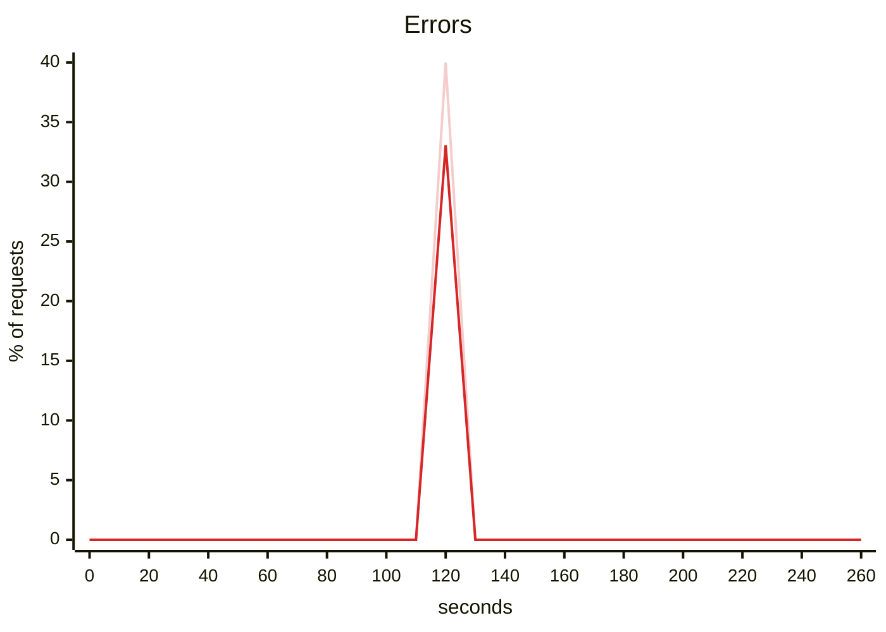
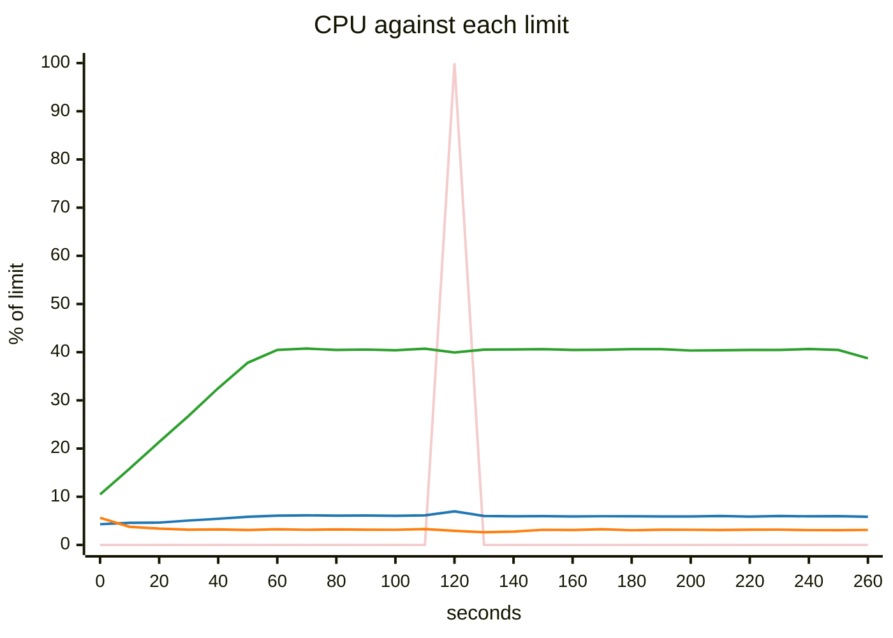

# slow-dependency-circuit-breaker: run report

_run `slow-dependency-circuit-breaker-20261112-055002` · completed · 12 Nov 2026 05:50 UTC · scale 1 · seed 1_

## Verdict

**Held.** Held the whole profile: up to 150 rps offered, 150 rps served at best, worst 10-second p99 1.08 s, at most 33% errors.

Caveat: at 2:00 the load generator dropped 39 arrivals, 2.6% of what the profile offered in that window (k6_dropped_iterations_total (k6: arrivals it couldn't start)), while 33% of requests failed: slow responses held the VUs new arrivals needed.

<sub>Sources: offered load: the load profile in plan.json (offered arrival rate); served: k6_http_reqs_total{expected_response="true"} (k6: successful responses); p99: k6_http_req_duration_seconds (k6 histogram, end to end); errors: k6_http_reqs_total{expected_response="false"} ÷ k6_http_reqs_total (k6). Windows are 10 seconds; what counts as broken is under [Thresholds](#thresholds).</sub>

## Diagram at 4:00

Measured in the 10-second window from 4:00 to 4:10 (the busiest window: the most successful responses). Nodes are colored by their most saturated resource, CPU against its limit or a connection pool's connections in use: red at 90% or more, amber from 70%, green below.


<sub>Sources: offered from the load profile in plan.json (offered arrival rate); load edge from k6_http_reqs_total (k6: all responses) and k6_http_req_duration_seconds (k6 histogram, end to end); CPU from container_cpu_usage_seconds_total (cAdvisor) ÷ the container's CPU limit; calls/s from loadlore_calls_total (the caller's outbound call attempts) and their p99 from loadlore_call_duration_seconds (the caller's histogram, pool wait included); pools from loadlore_pool_connections{state="in_use"} and loadlore_pool_max_connections and loadlore_pool_pending (callers waiting for a connection); lb traffic from haproxy_backend_http_requests_total (HAProxy), replicas up from haproxy_backend_active_servers (HAProxy), and the lb edge's p99 from loadlore_request_duration_seconds (the service's own histogram).</sub>

## Charts

One point per 10-second window, at the window's start; x is seconds from the start of the load.


<sub>Grey: offered load (the load profile in plan.json (offered arrival rate)). Blue: successful responses (k6_http_reqs_total{expected_response="true"} (k6: successful responses)). Pink spikes mark 2:00 stall; 2:01 pricing-0 pause; 2:01 pause pricing-0 for 2s; 2:03 pricing-0 unpause.</sub>



<sub>Green: p50. Orange: p95. Red: p99 (k6_http_req_duration_seconds (k6 histogram, end to end)). Pink spikes mark 2:00 stall; 2:01 pricing-0 pause; 2:01 pause pricing-0 for 2s; 2:03 pricing-0 unpause.</sub>



<sub>Failed requests as a share of all responses (k6_http_reqs_total{expected_response="false"} ÷ k6_http_reqs_total (k6)), timeouts included. Pink spikes mark 2:00 stall; 2:01 pricing-0 pause; 2:01 pause pricing-0 for 2s; 2:03 pricing-0 unpause.</sub>

| Service | Failed requests | Share of its failures | Cause | From calls to | First seen | What it means |
| --- | --- | --- | --- | --- | --- | --- |
| api | 392 | 81% | `circuit_open` | pricing | 2:00 | the circuit breaker to pricing was open |
| api | 91 | 19% | `timeout` | pricing | 2:00 | calls to pricing ran past their timeout |

<sub>Why requests failed, over the whole run (loadlore_request_errors_total and loadlore_call_errors_total, by cause). A request that failed after retries counts once, by its last attempt's cause.</sub>



<sub>Blue: api. Orange: lb. Green: pricing (container_cpu_usage_seconds_total (cAdvisor) ÷ the container's CPU limit, mean over the window). Pink spikes mark 2:00 stall; 2:01 pricing-0 pause; 2:01 pause pricing-0 for 2s; 2:03 pricing-0 unpause.</sub>

## Diagnosis

No diagnosis rule fired. Rules checked: connection pool exhausted, queueing knee (rules version 7; thresholds below).

## Predictions

The design has no `expect` lines. Writing a prediction before a run turns it into a test of your mental model.

## Timeline

| Time | Event |
| --- | --- |
| 2:00 | stall: p99 reached 1.08 s (6.8 ms at low load), 33% of requests failed, only 65% of the offered rate was served for 10 s, then recovered; too short to count as a break |
| 2:01 | container: pricing-0 pause |
| 2:01 | fault started: pause pricing-0 for 2s |
| 2:03 | container: pricing-0 unpause |
| 2:03 | fault ended: pause pricing-0 for 2s |

<sub>From events.jsonl: the fault timeline and Docker container events. Stalls are from the per-window numbers below, judged by the thresholds.</sub>

## Assumptions

### From the design

The design lists no assumptions.

### Chosen by Loadlore

| Field | Value | Why |
| --- | --- | --- |
| workload.timeout_ms | 10s | the default; k6 gives up on a request after this long and counts it as failed |
| workload.slo.p99_ms | 500 ms | the default; a break on p99 alone needs p99 at or above this as well as 10x the low-load p99, so latency users would still accept isn't called a break |
| resources.cpu_period_ms | 100 ms for api, lb, pricing | Docker's default. A container that uses its CPU share early in a period stalls until the next one, which can show up in p99 when a service has a fraction of a CPU |
| services.lb timeouts | connect 5s, server 60s | HAProxy's own timeouts, with its defaults otherwise. A request already sent to a replica that dies waits for the server timeout (or the load generator's); health checks only stop new requests going there |

### How the run was planned

- Loadlore's own containers get fixed budgets: load generator 1.5 CPU (peak 150 rps), Toxiproxy 1 CPU (about 300 proxied calls/s at peak), Prometheus 0.1, cAdvisor 0.1, exporters 0.1 each

## Thresholds

- **Broke:** 2 windows in a row with at least 1.0% of requests failing or successful responses below 90% of the offered rate, or 3 windows in a row with any of those or p99 at least 10x the low-load p99 (the median p99 of windows offered at most 25% of the peak, before errors or a shortfall in 2 windows in a row) and at least the SLO, 500 ms (workload.slo.p99_ms): 500 ms in this run. A shorter episode is shown as a stall in the timeline, not a break.
- **Doubtful:** a break on p99 alone, when the load generator was stalled at its CPU limit in 1.0% or more of its scheduling periods in one of the break's windows and the entry service's own p99 (loadlore_request_duration_seconds (the service's own histogram)) was below the limit in one of them. The verdict stays what it was.
- **Inconclusive:** before the break (or anywhere, if nothing broke), the load generator dropped more than 1.0% of a window's arrivals, or the load generator or Toxiproxy used 90% or more of its CPU budget, or was stalled at its CPU limit in 5.0% or more of its scheduling periods (from 1.0% it's noted as a caveat). The first 10 s of load are a warm-up and don't count: the load generator starts its VUs and connections open then. A cause is named only with evidence: on a Linux host, the hypervisor giving 2.0% or more of CPU time to other virtual machines (steal), or other programs using 10% or more of the host's CPUs (at least 0.5); inside a VM on this machine, only as a possibility.
- **Connection pool exhausted:** for two windows in a row, a pool at 95% or more of its size with callers waiting, while the target wasn't busy (busy: its CPU at 80% or more, or its time per call with a connection at least 3x the low-load value and 1 ms above it; CPU throttling alone doesn't count) and the caller's CPU stayed below 90%.
- **Queueing knee:** for 3 windows in a row, p99 at least 3x the low-load p99 and 10 ms above it, with a CPU or pool at 70% or more. When that is a pool whose target was busy in any of those windows, or a service's CPU whose requests spent 50% or more of their time in calls to a busy target, the knee is the target's.
- **Connection storm:** up to the break, a service's pools to a Postgres opening at least 50% of their combined size, and 10 or more connections, in one window, while p99 in that window or the next was at least 10x the low-load p99 and 10 ms above it. New connections are counted by loadlore_pool_connect_seconds (new connections the pools opened, and how long each took), or for runs from before it, from the rise in open connections.
- **Retry storm:** for two windows in a row, a caller that retries sending 1.5x or more of its low-load calls per request to a target, with retries 20% or more of them, while the target failed 1.0% or more of its calls or its p99 was 3x its low-load value.
- **Cold cache:** a cache's hit rate falling to 50% of its level before or lower while its callers' reads of the database behind it reach 2x their rate before.
- **Working set doesn't fit:** for two windows in a row, a Postgres answering less than 90% of block reads from shared_buffers and reading 100 blocks a second or more from outside them, while p99 was 3x the low-load p99 or more.
- **Hot rows:** for two windows in a row, 1 or more of a Postgres's backends waiting on locks on average, while a caller's writes to it took 3x their low-load time or more (and 2 ms more), its reads stayed within 1.5x of theirs and the database's CPU was below 80%. Windows with a disk_slow fault on the database don't count.

## Environment

- loadl dev, profile 4m30s, scale 1, seed 1
- Host: 8 CPUs, 9.7 GiB memory, Ubuntu 24.04.4 LTS (aarch64, kernel 6.8.0-117-generic), cgroup v2
- Docker 29.5.2, Compose 5.1.1
- Host speed index 1007 (hash 977, memory 1034, syscalls 1012): one CPU's work against the reference machine's 1000 (MacBook Air M4 (4 performance and 6 efficiency cores), Colima VM with 8 vCPUs). CPU limits are fractions of this host's cores, so a lower index means the design breaks at a lower load
- Cool-down: none needed; the first benchmark (1007) was within 5.0% of the run it's compared with (1015)
- Host CPU: Docker runs in a VM on this machine, so other programs' use of the CPU can't be seen
- Data: a fresh copy of the cached seeded dataset
- Load generator summary (k6): 36,561 requests, 39 dropped arrivals, 1.3% failed

<details><summary>Containers and images</summary>

| Container | Image |
| --- | --- |
| loadlore-slow-dependency-circuit-breaker-20261112-055002-api-0-1 | loadlore/synthetic:dev |
| loadlore-slow-dependency-circuit-breaker-20261112-055002-api-1-1 | loadlore/synthetic:dev |
| loadlore-slow-dependency-circuit-breaker-20261112-055002-api-2-1 | loadlore/synthetic:dev |
| loadlore-slow-dependency-circuit-breaker-20261112-055002-lb-1 | haproxy:3.2.26 |
| loadlore-slow-dependency-circuit-breaker-20261112-055002-lore-cadvisor-1 | ghcr.io/google/cadvisor:v0.60.6 |
| loadlore-slow-dependency-circuit-breaker-20261112-055002-lore-k6-1 | grafana/k6:2.3.0 |
| loadlore-slow-dependency-circuit-breaker-20261112-055002-lore-prometheus-1 | prom/prometheus:v3.16.0 |
| loadlore-slow-dependency-circuit-breaker-20261112-055002-lore-toxiproxy-1 | ghcr.io/shopify/toxiproxy:2.13.0 |
| loadlore-slow-dependency-circuit-breaker-20261112-055002-pricing-0-1 | loadlore/synthetic:dev |

</details>

## Per-window data

<details><summary>27 windows of 10 seconds</summary>

| t | offered | served | dropped | errors | p50 | p99 | api CPU | lb CPU | lb up | pricing CPU | api→pricing pool | wait | k6 CPU | Toxiproxy CPU | k6 / Toxiproxy stalled |
| --- | --- | --- | --- | --- | --- | --- | --- | --- | --- | --- | --- | --- | --- | --- | --- |
| 0:00 | 31 | 30 | 0 | 0% | 4.1 ms | 6.8 ms | 4.3% | 5.6% | 3 | 10% | 1/300 | 0.0 ms | 2.1% | 2.7% | 0% / 0% |
| 0:10 | 53 | 52 | 0 | 0% | 3.6 ms | 5.2 ms | 4.6% | 3.8% | 3 | 16% | 1/300 | 0.0 ms | 1.6% | 2.1% | 0% / 0% |
| 0:20 | 74 | 74 | 0 | 0% | 3.4 ms | 4.6 ms | 4.6% | 3.4% | 3 | 21% | 1/300 | 0.0 ms | 1.5% | 2.1% | 0% / 0% |
| 0:30 | 96 | 96 | 0 | 0% | 3.2 ms | 4.1 ms | 5.1% | 3.2% | 3 | 27% | 1/300 | 0.0 ms | 1.6% | 2.2% | 0% / 0% |
| 0:40 | 118 | 119 | 0 | 0% | 3.2 ms | 4.1 ms | 5.4% | 3.2% | 3 | 33% | 0/300 | 0.0 ms | 1.8% | 2.3% | 0% / 0% |
| 0:50 | 139 | 139 | 0 | 0% | 3.1 ms | 4.2 ms | 5.9% | 3.1% | 3 | 38% | 1/300 | 0.0 ms | 1.8% | 2.3% | 0% / 0% |
| 1:00 | 150 | 150 | 0 | 0% | 3.1 ms | 4.1 ms | 6.1% | 3.3% | 3 | 40% | 0/300 | 0.0 ms | 1.9% | 2.4% | 0% / 0% |
| 1:10 | 150 | 150 | 0 | 0% | 3.1 ms | 4.2 ms | 6.1% | 3.1% | 3 | 41% | 0/300 | 0.0 ms | 1.9% | 2.4% | 0% / 0% |
| 1:20 | 150 | 150 | 0 | 0% | 3.1 ms | 4.1 ms | 6.1% | 3.2% | 3 | 40% | 0/300 | 0.0 ms | 1.9% | 2.4% | 0% / 0% |
| 1:30 | 150 | 150 | 0 | 0% | 3.1 ms | 3.9 ms | 6.1% | 3.2% | 3 | 41% | 0/300 | 0.0 ms | 1.9% | 2.4% | 0% / 0% |
| 1:40 | 150 | 150 | 0 | 0% | 3.1 ms | 4.1 ms | 6.1% | 3.1% | 3 | 40% | 0/300 | 0.0 ms | 1.9% | 2.4% | 0% / 0% |
| 1:50 | 150 | 150 | 0 | 0% | 3.1 ms | 4.0 ms | 6.1% | 3.3% | 3 | 41% | 0/300 | 0.0 ms | 1.9% | 2.5% | 0% / 0% |
| 2:00 | 150 | 98 | 39 | 33% | 3.1 ms | 1.08 s | 7.0% | 2.9% | 3 | 40% | 83/300 | 0.1 ms | 2.2% | 4.5% | 0% / 0% |
| 2:10 | 150 | 150 | 0 | 0% | 3.1 ms | 3.9 ms | 6.0% | 2.6% | 3 | 41% | 0/300 | 0.0 ms | 2.0% | 2.5% | 0% / 0% |
| 2:20 | 150 | 150 | 0 | 0% | 3.1 ms | 3.9 ms | 5.9% | 2.8% | 3 | 41% | 0/300 | 0.0 ms | 2.0% | 2.4% | 0% / 0% |
| 2:30 | 150 | 150 | 0 | 0% | 3.1 ms | 3.9 ms | 6.0% | 3.1% | 3 | 41% | 0/300 | 0.0 ms | 1.9% | 2.5% | 0% / 0% |
| 2:40 | 150 | 150 | 0 | 0% | 3.1 ms | 3.9 ms | 5.9% | 3.1% | 3 | 40% | 0/300 | 0.0 ms | 1.9% | 2.5% | 0% / 0% |
| 2:50 | 150 | 150 | 0 | 0% | 3.1 ms | 3.9 ms | 6.0% | 3.2% | 3 | 41% | 0/300 | 0.0 ms | 2.0% | 2.5% | 0% / 0% |
| 3:00 | 150 | 150 | 0 | 0% | 3.1 ms | 3.9 ms | 5.9% | 3.0% | 3 | 41% | 0/300 | 0.0 ms | 2.0% | 2.5% | 0% / 0% |
| 3:10 | 150 | 150 | 0 | 0% | 3.1 ms | 3.9 ms | 5.9% | 3.2% | 3 | 41% | 0/300 | 0.0 ms | 2.0% | 2.5% | 0% / 0% |
| 3:20 | 150 | 150 | 0 | 0% | 3.1 ms | 3.9 ms | 5.9% | 3.1% | 3 | 40% | 0/300 | 0.0 ms | 1.9% | 2.4% | 0% / 0% |
| 3:30 | 150 | 150 | 0 | 0% | 3.1 ms | 3.9 ms | 6.0% | 3.1% | 3 | 40% | 0/300 | 0.0 ms | 2.0% | 2.4% | 0% / 0% |
| 3:40 | 150 | 150 | 0 | 0% | 3.1 ms | 3.9 ms | 5.9% | 3.1% | 3 | 40% | 0/300 | 0.0 ms | 2.0% | 2.4% | 0% / 0% |
| 3:50 | 150 | 150 | 0 | 0% | 3.1 ms | 3.9 ms | 6.0% | 3.2% | 3 | 40% | 0/300 | 0.0 ms | 2.0% | 2.5% | 0% / 0% |
| 4:00 | 150 | 150 | 0 | 0% | 3.1 ms | 3.9 ms | 5.9% | 3.1% | 3 | 41% | 0/300 | 0.0 ms | 1.9% | 2.4% | 0% / 0% |
| 4:10 | 150 | 150 | 0 | 0% | 3.1 ms | 3.9 ms | 6.0% | 3.1% | 3 | 40% | 0/300 | 0.0 ms | 1.9% | 2.4% | 0% / 0% |
| 4:20 | 150 | 150 | 0 | 0% | 3.1 ms | 3.9 ms | 5.8% | 3.1% | 3 | 39% | 0/300 | 0.0 ms | 1.6% | 2.4% | 0% / 0% |

Columns: offered is the load profile in plan.json (offered arrival rate); served is k6_http_reqs_total{expected_response="true"} (k6: successful responses); dropped is k6_dropped_iterations_total (k6: arrivals it couldn't start); errors are k6_http_reqs_total{expected_response="false"} ÷ k6_http_reqs_total (k6); p50 and p99 are from k6_http_req_duration_seconds (k6 histogram, end to end); CPU is container_cpu_usage_seconds_total (cAdvisor) ÷ the container's CPU limit, mean over the window; conns are pg_stat_activity_count and pg_settings_max_connections (postgres_exporter); hit rate is from redis_keyspace_hits_total and redis_keyspace_misses_total (redis_exporter); up is haproxy_backend_active_servers (HAProxy); pools are loadlore_pool_connections{state="in_use"} and loadlore_pool_max_connections (peak in use/size, +peak waiting), wait is the mean from loadlore_pool_wait_seconds (time to get a connection); k6 and Toxiproxy CPU are against their budgets.

</details>

## Design file

The exact `design.yaml` this run used:

```yaml
version: 1
name: slow-dependency-circuit-breaker

# Solution: a circuit breaker on each api replica. When half its calls to
# pricing fail over 5 seconds, it stops calling for 2, failing those
# requests at once; pricing gets no traffic and drains its backlog, and a
# trial call closes the breaker again. The retries stay as they were.

services:
  lb:
    kind: lb
    target: api
    health_check: { interval_ms: 2000, fall: 3, rise: 2 }

  api:
    image: loadlore/synthetic
    replicas: 3
    resources: { cpu: 0.5, memory: 256m }
    behavior:
      cpu_ms: 0.3
      calls:
        - { target: pricing, op: http }
      resilience:
        timeout_ms: 250
        retries: { max: 3 }
        circuit_breaker: { error_rate: 0.5, window_s: 5, open_s: 2 }
    pools:
      pricing: 100

  pricing:
    image: loadlore/synthetic
    resources: { cpu: 1, memory: 256m }
    behavior:
      cpu_ms: 2.5   # about 400 requests a second on its one CPU

workload:
  entry: lb
  profile:
    - ramp: { from: 20, to: 150, over: 1m }
    - hold: { rps: 150, for: 3m30s }
  mix: { read: 1.0 }

# pricing stops for two seconds, as a garbage-collection pause or a node
# hiccup would stop it.
scenario:
  - { at: 2m1s, inject: pause, target: pricing, for: 2s }
```
