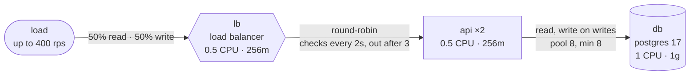

# The slow disk

Level 3 · about 45 minutes · teaches commits waiting on fsync, slow writes holding connections, group commit and the durability trade-off of synchronous_commit

## The story

You run the orders api. Every request reads the customer's recent orders, and half of them also place an order: a write, committed to Postgres. Each of the two api replicas keeps a pool of 8 database connections, opened at start, and a request holds one for each call. Postgres commits the usual way: a commit returns once its changes are flushed to disk.



The load ramps to 400 requests a second, half of them writes, and holds there. At 1:01 the database's disk gets slow for two minutes: every write and every fsync takes 30 ms longer. A noisy neighbour on shared storage, a cloud volume out of burst credits, a failing drive. The database's CPU and memory are fine.

## The question

Before you run anything, write down your answers:

1. What happens to the reads, which never touch the disk?
2. Which component gives out first, and how busy is the database's CPU when it does?
3. If you gave the database twice the CPU, what would happen?

`loadl predict design.yaml` asks questions like these and writes your answers into the `expect` block at the bottom of `design.yaml`, or write them there yourself. The report scores each one against what the run measured. The line already there is an example; the grammar is in the [design file reference](../../skills/loadlore-designer/references/schema.md).

## Run it

```sh
loadl run scenarios/slow-disk/design.yaml
loadl report latest --print | less
```

The run takes about 5 minutes, plus about half a minute the first time to seed the table. It needs 6 CPUs and 4 GB available to Docker, Loadlore's own containers included; on a smaller machine, add `--scale` with the largest value that fits. `loadl run` warns you when the host is too small and suggests one.

The slow disk is real: Postgres's data sits on a device-mapper delay device, and the fault makes every write and flush wait. The first run downloads the tools that set it up, so it needs a network connection.

Stuck? `loadl hint slow-disk` reveals one hint at a time.

## What to try next

When you know why it broke, change one thing and run it again. Write an `expect` line for what you think will happen, then compare the two runs:

```sh
loadl compare <first-run> latest -o compare.md
```

Some directions: what a commit waits for, how many commits can wait at once, and the database's resources. For each, work out how long a connection is held per write while the disk is slow.

`solutions/` has two worked answers with their reports, and `variants/more-db-cpu` is the fix that fits a different problem. They give the game away, so try your own first.
