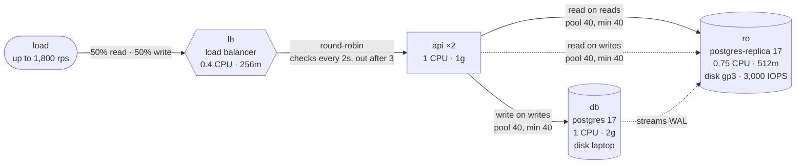

# Stale orders

Level 3 · about 50 minutes · teaches read replicas, replication lag, read-your-writes, and why a replica falls behind its primary

## The story

You run the orders api for an online shop. Last quarter the database got busy, so the team added a read replica and moved the reads to it: customers browsing, and the confirmation page that loads after a customer places an order. Orders still go to the primary. The replica was bought as a smaller instance than the primary, on the same kind of cloud disk as the rest of the fleet.



The primary has 2 GB of memory for a table and index of about 1.1 GB, so its data sits in memory. The replica has 512 MB, on a gp3 cloud volume at its baseline (`disk: { profile: gp3 }`): a millisecond added to every read, write and fsync, and 3,000 reads and 3,000 writes a second.

One thing to know about this lab: the primary's disk isn't modelled. It sits on the Docker host's own disk (`disk: { profile: laptop }`), with no cap and no added wait, because with a modelled disk on every database they slowed each other down on the one disk underneath, which separate cloud volumes don't. Only the replica's disk is modelled, capped for reads and for writes and a millisecond on each, and it writes everything the primary writes. So part of what holds the replica back is a disk the primary doesn't have to share its limits with. In production that's often true too: the primary gets the provisioned volume and the replica the baseline one. The confirmation page loads 200 ms after the order (`after_ms: 200`): the request that places the order has already answered by then.

Today there's a sale. Traffic climbs from 200 to 1,800 requests a second over three minutes, half of them orders. The team wants to know the shop will take it.

## The question

Before you run anything, write down your guesses. Don't work them out: a gut answer is fine, and where the run differs from it is what you'll learn from.

1. At what load does it break, if it does?
2. At the top of the ramp, what share of the confirmation pages show the customer's order?
3. If you added a second replica, what would happen to that share?

Loads depend on your machine: slower cores and disks change where things go wrong, so a guess can miss even when the reasoning behind it is right.

`loadl predict design.yaml` asks questions like these and writes your answers into the `expect` block at the bottom of `design.yaml`, or write them there yourself. The report scores each one against what the run measured. The line already there is an example; the grammar is in the [design file reference](../../skills/loadlore-designer/references/schema.md).

## Run it

```sh
loadl run scenarios/stale-orders/design.yaml
loadl report latest --print | less
```

The run takes about 5 minutes, plus about a minute the first time to seed the 2-million-row table. It needs 8 CPUs and 8 GB available to Docker: the design and Loadlore's own containers add up to 6.05 CPUs (6.9 for two replicas). Leave about 10 GB free on the disk Docker uses. On a smaller machine, add `--scale` with the largest value that fits; `loadl run` warns you when the host is too small and suggests one. The numbers here come from a MacBook Air M4 on mains power.

Stuck? `loadl hint stale-orders` reveals one hint at a time.

## What to try next

When you know why the pages were stale, change one thing and run it again. Write an `expect` line for what you think will happen, such as `stale_read_rate < 1%`, then compare the two runs:

```sh
loadl compare <first-run> latest -o compare.md
```

Some directions: where the confirmation page reads, the replica's resources, and the number of replicas. Before each run, work out how far behind the replica can be before a page 200 ms after an order misses it.

`solutions/` has two worked answers with their reports, and `variants/two-replicas` is a fix that fits a different problem. They give the game away, so try your own first.
