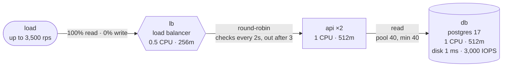

# Statement day

Level 2 · about 40 minutes · teaches the buffer cache, working sets, cache hit rates, and what a cloud disk's IOPS limit does to a database

## The story

You run the statements api for a bank with 5 million customers. Each customer's statement is a row in Postgres, and the statement page reads it by customer id. On a normal day a few hundred thousand busy customers make most of the traffic, their rows stay in the database's memory, and the page is fast.

On the first of the month the bank emails every customer that their statement is ready. The clicks come from everyone, and any one customer is as likely as another.



The database has 512 MB of memory for a table and index of about 2.5 GB. Its data sits on a general-purpose cloud volume at its baseline: each read from the disk takes about a millisecond, and the volume serves at most 3,000 reads a second. The design file's `disk` block says so. The clicks climb from 200 to 3,500 requests a second over three minutes as the email lands.

## The question

Before you run anything, write down your guesses. Don't work them out: a gut answer is fine, and where the run differs from it is what you'll learn from.

1. At what load does it break, if it does?
2. Which component gives out first, and how busy is the database's CPU when it does?
3. If you gave the database twice the CPU, what would happen?

Loads depend on your machine: slower cores break the same design at a lower load, so a guess can miss even when the reasoning behind it is right.

`loadl predict design.yaml` asks questions like these and writes your answers into the `expect` block at the bottom of `design.yaml`, or write them there yourself. The report scores each one against what the run measured. The line already there is an example; the grammar is in the [design file reference](../../skills/loadlore-designer/references/schema.md).

## Run it

```sh
loadl run scenarios/statement-day/design.yaml
loadl report latest --print | less
```

The run takes about 4 minutes, plus about a minute the first time to seed the 5-million-row table. It needs 8 CPUs and 8 GB available to Docker: the design and Loadlore's own containers add up to 5.3 CPUs (6.3 for the bigger database), and `solutions/more-memory` gives the database 4 GB. Leave about 10 GB free on the disk Docker uses. On a smaller machine, add `--scale` with the largest value that fits; `loadl run` warns you when the host is too small and suggests one. Scale shrinks the table and the disk's IOPS with the load, but not the time a read waits. The numbers here come from a MacBook Air M4 on mains power.

Stuck? `loadl hint statement-day` reveals one hint at a time.

## What to try next

When you know why it broke, change one thing and run it again. Write an `expect` line for what you think will happen, then compare the two runs:

```sh
loadl compare <first-run> latest -o compare.md
```

Some directions: the database's memory and `shared_buffers`, the disk's `iops`, and the database's CPU. Before each run, work out how many reads a second reach the disk at the load where it broke.

`solutions/` has two worked answers with their reports, and `variants/bigger-db` is the fix that fits a different problem. They give the game away, so try your own first.
