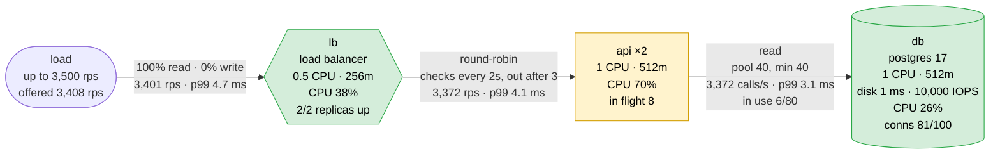
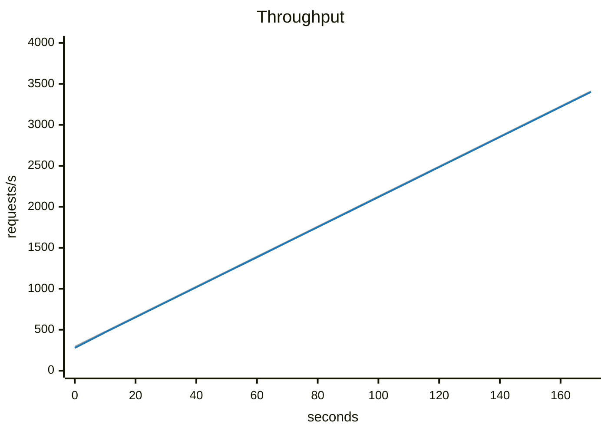
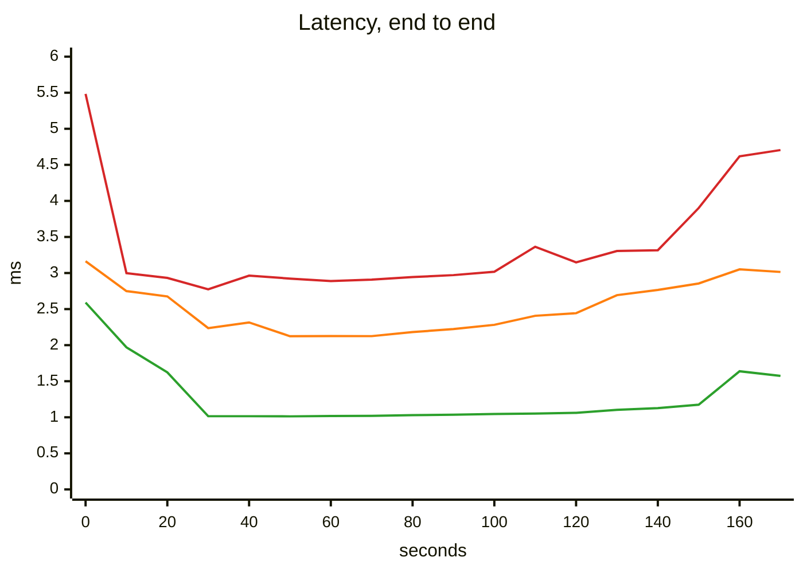
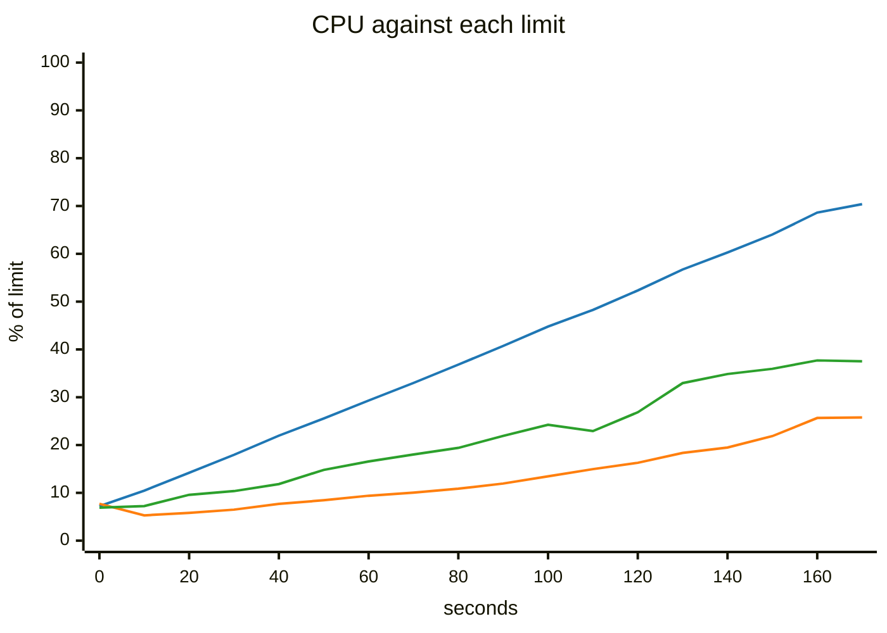

# statement-day-provisioned-iops: run report

_run `statement-day-provisioned-iops-20261115-070620` · completed · 15 Nov 2026 07:06 UTC · scale 1 · seed 1_

## Verdict

**Held.** Held the whole profile: up to 3,500 rps offered, 3,401 rps served at best, worst 10-second p99 5.5 ms, at most 0% errors.

Caveat: at 2:50 the load generator hit its CPU limit and was stalled in 2.1% of its scheduling periods (container_cpu_cfs_throttled_periods_total ÷ container_cpu_cfs_periods_total (cAdvisor)); work caught in a stall waits for the next 100 ms period, which can show up in p99.

<sub>Sources: offered load: the load profile in plan.json (offered arrival rate); served: k6_http_reqs_total{expected_response="true"} (k6: successful responses); p99: k6_http_req_duration_seconds (k6 histogram, end to end); errors: k6_http_reqs_total{expected_response="false"} ÷ k6_http_reqs_total (k6). Windows are 10 seconds; what counts as broken is under [Thresholds](#thresholds).</sub>

## Diagram at 2:50

Measured in the 10-second window from 2:50 to 3:00 (the busiest window: the most successful responses). Nodes are colored by their most saturated resource, CPU against its limit or a connection pool's connections in use: red at 90% or more, amber from 70%, green below.



<sub>Sources: offered from the load profile in plan.json (offered arrival rate); load edge from k6_http_reqs_total (k6: all responses) and k6_http_req_duration_seconds (k6 histogram, end to end); CPU from container_cpu_usage_seconds_total (cAdvisor) ÷ the container's CPU limit; calls/s from loadlore_calls_total (the caller's outbound call attempts) and their p99 from loadlore_call_duration_seconds (the caller's histogram, pool wait included); pools from loadlore_pool_connections{state="in_use"} and loadlore_pool_max_connections and loadlore_pool_pending (callers waiting for a connection); lb traffic from haproxy_backend_http_requests_total (HAProxy), replicas up from haproxy_backend_active_servers (HAProxy), and the lb edge's p99 from loadlore_request_duration_seconds (the service's own histogram); conns from pg_stat_activity_count and pg_settings_max_connections (postgres_exporter).</sub>

## Charts

One point per 10-second window, at the window's start; x is seconds from the start of the load.



<sub>Grey: offered load (the load profile in plan.json (offered arrival rate)). Blue: successful responses (k6_http_reqs_total{expected_response="true"} (k6: successful responses)).</sub>



<sub>Green: p50. Orange: p95. Red: p99 (k6_http_req_duration_seconds (k6 histogram, end to end)).</sub>

```mermaid
---
config:
  themeVariables:
    xyChart:
      backgroundColor: "transparent"
      plotColorPalette: "#d62728"
---
xychart-beta
    title "Errors"
    x-axis "seconds" 0 --> 170
    y-axis "% of requests" 0 --> 1
    line [0, 0, 0, 0, 0, 0, 0, 0, 0, 0, 0, 0, 0, 0, 0, 0, 0, 0]
```

<sub>Failed requests as a share of all responses (k6_http_reqs_total{expected_response="false"} ÷ k6_http_reqs_total (k6)), timeouts included.</sub>



<sub>Blue: api. Orange: db. Green: lb (container_cpu_usage_seconds_total (cAdvisor) ÷ the container's CPU limit, mean over the window).</sub>

## Diagnosis

No diagnosis rule fired. Rules checked: connection pool exhausted, queueing knee (rules version 10; thresholds below).

## Predictions

1 of 1 scored prediction held.

| Prediction | Result | Worst value | Checked over | Notes |
| --- | --- | --- | --- | --- |
| `p99_ms < 100 until load_rps >= 1000` | **held** | 5.5 ms | 0:00 to 0:40, when load_rps >= 1,000 rps first held | source: k6_http_req_duration_seconds (k6 histogram, end to end) |

Loads and request rates depend on this machine: slower cores break the same design at a lower load, so a load guess can miss even when the reasoning behind it was right.

## Assumptions

### From the design

| Field | Value | Basis | Why |
| --- | --- | --- | --- |
| `services.api.behavior.cpu_ms` |  | guessed | a small JSON handler |
| `workload.keys` |  | guessed | every customer got the email, so any one is as likely to click as another |
| `services.db.disk` |  | guessed | a general-purpose cloud volume at its baseline |

3 of these are guessed, not measured: the result depends on them.

### Chosen by Loadlore

| Field | Value | Why |
| --- | --- | --- |
| workload.timeout_ms | 10s | the default; k6 gives up on a request after this long and counts it as failed |
| workload.slo.p99_ms | 500 ms | the default; a break on p99 alone needs p99 at or above this as well as 10x the low-load p99, so latency users would still accept isn't called a break |
| resources.cpu_period_ms | 100 ms for api, db, lb | Docker's default. A container that uses its CPU share early in a period stalls until the next one, which can show up in p99 when a service has a fraction of a CPU |
| services.db.disk | 1 ms per read, 10000 IOPS | set in the design: every read that misses db's memory waits this long, and reads and writes are each capped at this rate, as on a cloud volume (unset values default to about a gp3 volume's: 1 ms, 3000 IOPS) |
| services.lb timeouts | connect 5s, server 60s | HAProxy's own timeouts, with its defaults otherwise. A request already sent to a replica that dies waits for the server timeout (or the load generator's); health checks only stop new requests going there |
| services.api.pools.db.min | 40 | set in the design: each replica opens 40 connections before the load starts and keeps them open |
| services.api.pools.db.hold | call | the default, as pgxpool's: a request takes a connection for each call and hands it back straight away |

### How the run was planned

- Loadlore's own containers get fixed budgets: load generator 1.5 CPU (peak 3500 rps), Toxiproxy 1 CPU (about 7000 proxied calls/s at peak), Prometheus 0.1, cAdvisor 0.1, exporters 0.1 each

## Thresholds

- **Broke:** 2 windows in a row with at least 1.0% of requests failing or successful responses below 90% of the offered rate, or 3 windows in a row with any of those or p99 at least 10x the low-load p99 (the median p99 of windows offered at most 25% of the peak, before errors or a shortfall in 2 windows in a row) and at least the SLO, 500 ms (workload.slo.p99_ms): 500 ms in this run. A shorter episode is shown as a stall in the timeline, not a break.
- **Doubtful:** a break on p99 alone, when the load generator was stalled at its CPU limit in 1.0% or more of its scheduling periods in one of the break's windows and the entry service's own p99 (loadlore_request_duration_seconds (the service's own histogram)) was below the limit in one of them. The verdict stays what it was.
- **Inconclusive:** before the break (or anywhere, if nothing broke), the load generator dropped more than 1.0% of a window's arrivals (more than 5.0% in a window where the system itself failed 1.0% or more of requests; up to that it's a caveat that gives the share), or the load generator or Toxiproxy used 90% or more of its CPU budget, or was stalled at its CPU limit in 5.0% or more of its scheduling periods (from 1.0% it's noted as a caveat). The first 10 s of load are a warm-up and don't count: the load generator starts its VUs and connections open then. A cause is named only with evidence: on a Linux host, the hypervisor giving 2.0% or more of CPU time to other virtual machines (steal), or other programs using 10% or more of the host's CPUs (at least 0.5); inside a VM on this machine, only as a possibility.
- **Toxiproxy stalls:** no new connection accepted on one of Toxiproxy's edges for 1 s or more, where it had accepted 10 a second or more over the 5 s before, then 10 or more accepted within 100 ms with a median spacing under 0.5 ms: connections queued behind one upstream dial, which a real network doesn't do. Up to the end of the break's first window it makes the run inconclusive; after a break the system didn't recover from, it's a doubt on the recovery, and `loadl scenario check` doesn't judge claims that rest on not recovering; in a run that held, or recovered, it's a caveat: a stall only adds failure.
- **Connection pool exhausted:** for two windows in a row, a pool at 95% or more of its size with callers waiting, while the target wasn't busy (busy: its CPU at 80% or more, or its time per call with a connection at least 3x the low-load value and 1 ms above it; CPU throttling alone doesn't count) and the caller's CPU stayed below 90%.
- **Queueing knee:** for 3 windows in a row, p99 at least 3x the low-load p99 and 10 ms above it, with a CPU or pool at 70% or more. When that is a pool whose target was busy in any of those windows, or a service's CPU whose requests spent 50% or more of their time in calls to a busy target, the knee is the target's.
- **Connection storm:** up to the break, a service's pools to a Postgres opening at least 50% of their combined size, and 10 or more connections, in one window, while p99 in that window or the next was at least 10x the low-load p99 and 10 ms above it. New connections are counted by loadlore_pool_connect_seconds (new connections the pools opened, and how long each took), or for runs from before it, from the rise in open connections.
- **Retry storm:** for two windows in a row, a caller that retries sending 1.5x or more of its low-load calls per request to a target, with retries 20% or more of them, while the target failed 1.0% or more of its calls or its p99 was 3x its low-load value.
- **Cold cache:** a cache's share of lookups that miss rising to 5x its level before or more, and to 5.0% of lookups at least, while its callers' reads of the database behind it reach 2x their rate before (counted as at least 1 a second, for a cache warm enough to send none).
- **Working set doesn't fit:** for two windows in a row, a Postgres answering less than 90% of block reads from shared_buffers and reading 100 blocks a second or more from outside them, while p99 was 3x the low-load p99 or more. When Postgres times its reads (track_io_timing, on with a disk block), each block read must also take 3x its low-load time or more, and 1 ms more.
- **Hot rows:** for two windows in a row, 2 or more of a Postgres's backends waiting on locks on average, while a caller's writes to it took 3x their low-load time or more (and 2 ms more). Reads of the same rows may slow too, and the summary says when the database's CPU per request reached 3x its low-load value: the contention burning CPU. A queueing knee on that database's CPU at the same time then points at the rows. Windows with a disk_slow fault on the database don't count.

## Environment

- loadl dev, profile 3m0s, scale 1, seed 1
- Host: 8 CPUs, 9.7 GiB memory, Ubuntu 24.04.4 LTS (aarch64, kernel 6.8.0-117-generic), cgroup v2
- Docker 29.5.2, Compose 5.1.1
- Host speed index 961 (hash 914, memory 980, syscalls 991): one CPU's work against the reference machine's 1000 (MacBook Air M4 (4 performance and 6 efficiency cores), Colima VM with 8 vCPUs). CPU limits are fractions of this host's cores, so a lower index means the design breaks at a lower load
- Cool-down: none needed; the first benchmark (961) was within 5.0% of the run it's compared with (946)
- Host CPU: Docker runs in a VM on this machine, so other programs' use of the CPU can't be seen
- Data: a fresh copy of the cached seeded dataset
- Load generator summary (k6): 332,980 requests, 0 dropped arrivals, 0% failed

<details><summary>Containers and images</summary>

| Container | Image |
| --- | --- |
| loadlore-statement-day-provisioned-iops-20261115-070620-api-0-1 | loadlore/synthetic:dev |
| loadlore-statement-day-provisioned-iops-20261115-070620-api-1-1 | loadlore/synthetic:dev |
| loadlore-statement-day-provisioned-iops-20261115-070620-db-1 | postgres:17.11 |
| loadlore-statement-day-provisioned-iops-20261115-070620-lb-1 | haproxy:3.2.26 |
| loadlore-statement-day-provisioned-iops-20261115-070620-lore-cadvisor-1 | ghcr.io/google/cadvisor:v0.60.6 |
| loadlore-statement-day-provisioned-iops-20261115-070620-lore-k6-1 | grafana/k6:2.3.0 |
| loadlore-statement-day-provisioned-iops-20261115-070620-lore-pgexp-db-1 | quay.io/prometheuscommunity/postgres-exporter:v0.20.1 |
| loadlore-statement-day-provisioned-iops-20261115-070620-lore-prometheus-1 | prom/prometheus:v3.16.0 |
| loadlore-statement-day-provisioned-iops-20261115-070620-lore-toxiproxy-1 | ghcr.io/shopify/toxiproxy:2.13.0 |

</details>

## Per-window data

<details><summary>18 windows of 10 seconds</summary>

| t | offered | served | dropped | errors | p50 | p99 | api CPU | db CPU | db conns | lb CPU | lb up | api→db pool | wait | k6 CPU | Toxiproxy CPU | k6 / Toxiproxy stalled |
| --- | --- | --- | --- | --- | --- | --- | --- | --- | --- | --- | --- | --- | --- | --- | --- | --- |
| 0:00 | 292 | 277 | 0 | 0% | 2.6 ms | 5.5 ms | 7.2% | 7.7% | 81 | 6.9% | 2 | 1/80 | 0.0 ms | 8.4% | 8.6% | 2.0% / 0% |
| 0:10 | 475 | 468 | 0 | 0% | 2.0 ms | 3.0 ms | 10% | 5.3% | 81 | 7.2% | 2 | 2/80 | 0.0 ms | 4.1% | 6.2% | 0% / 0% |
| 0:20 | 658 | 651 | 0 | 0% | 1.6 ms | 2.9 ms | 14% | 5.8% | 81 | 9.6% | 2 | 1/80 | 0.0 ms | 6.2% | 8.4% | 0% / 0% |
| 0:30 | 842 | 835 | 0 | 0% | 1.0 ms | 2.8 ms | 18% | 6.5% | 81 | 10% | 2 | 1/80 +1 | 0.0 ms | 7.0% | 10% | 0% / 0% |
| 0:40 | 1,025 | 1,018 | 0 | 0% | 1.0 ms | 3.0 ms | 22% | 7.7% | 81 | 12% | 2 | 2/80 | 0.0 ms | 7.3% | 13% | 0% / 0% |
| 0:50 | 1,208 | 1,201 | 0 | 0% | 1.0 ms | 2.9 ms | 26% | 8.4% | 81 | 15% | 2 | 2/80 | 0.0 ms | 7.4% | 14% | 0% / 0% |
| 1:00 | 1,392 | 1,384 | 0 | 0% | 1.0 ms | 2.9 ms | 29% | 9.4% | 81 | 17% | 2 | 2/80 | 0.0 ms | 8.8% | 15% | 0% / 0% |
| 1:10 | 1,575 | 1,568 | 0 | 0% | 1.0 ms | 2.9 ms | 33% | 10% | 81 | 18% | 2 | 2/80 | 0.0 ms | 8.9% | 17% | 0% / 0% |
| 1:20 | 1,758 | 1,751 | 0 | 0% | 1.0 ms | 2.9 ms | 37% | 11% | 81 | 19% | 2 | 3/80 | 0.0 ms | 9.5% | 18% | 0% / 0% |
| 1:30 | 1,942 | 1,934 | 0 | 0% | 1.0 ms | 3.0 ms | 41% | 12% | 81 | 22% | 2 | 3/80 | 0.0 ms | 11% | 20% | 0% / 0% |
| 1:40 | 2,125 | 2,118 | 0 | 0% | 1.0 ms | 3.0 ms | 45% | 13% | 81 | 24% | 2 | 2/80 | 0.0 ms | 12% | 23% | 0.7% / 0% |
| 1:50 | 2,308 | 2,301 | 0 | 0% | 1.1 ms | 3.4 ms | 48% | 15% | 81 | 23% | 2 | 5/80 | 0.0 ms | 13% | 24% | 1.3% / 0% |
| 2:00 | 2,492 | 2,485 | 0 | 0% | 1.1 ms | 3.1 ms | 52% | 16% | 81 | 27% | 2 | 4/80 | 0.0 ms | 15% | 27% | 0% / 0% |
| 2:10 | 2,675 | 2,667 | 0 | 0% | 1.1 ms | 3.3 ms | 57% | 18% | 81 | 33% | 2 | 5/80 +1 | 0.0 ms | 16% | 30% | 0% / 0% |
| 2:20 | 2,858 | 2,851 | 0 | 0% | 1.1 ms | 3.3 ms | 60% | 19% | 81 | 35% | 2 | 6/80 | 0.0 ms | 17% | 32% | 0% / 0% |
| 2:30 | 3,042 | 3,034 | 0 | 0% | 1.2 ms | 3.9 ms | 64% | 22% | 81 | 36% | 2 | 4/80 | 0.0 ms | 19% | 34% | 1.0% / 0% |
| 2:40 | 3,225 | 3,218 | 0 | 0% | 1.6 ms | 4.6 ms | 69% | 26% | 81 | 38% | 2 | 6/80 | 0.0 ms | 21% | 38% | 0% / 0% |
| 2:50 | 3,408 | 3,401 | 0 | 0% | 1.6 ms | 4.7 ms | 70% | 26% | 81 | 38% | 2 | 6/80 | 0.0 ms | 21% | 38% | 2.1% / 0% |

Columns: offered is the load profile in plan.json (offered arrival rate); served is k6_http_reqs_total{expected_response="true"} (k6: successful responses); dropped is k6_dropped_iterations_total (k6: arrivals it couldn't start); errors are k6_http_reqs_total{expected_response="false"} ÷ k6_http_reqs_total (k6); p50 and p99 are from k6_http_req_duration_seconds (k6 histogram, end to end); CPU is container_cpu_usage_seconds_total (cAdvisor) ÷ the container's CPU limit, mean over the window; conns are pg_stat_activity_count and pg_settings_max_connections (postgres_exporter); hit rate is from redis_keyspace_hits_total and redis_keyspace_misses_total (redis_exporter); up is haproxy_backend_active_servers (HAProxy); pools are loadlore_pool_connections{state="in_use"} and loadlore_pool_max_connections (peak in use/size, +peak waiting), wait is the mean from loadlore_pool_wait_seconds (time to get a connection); k6 and Toxiproxy CPU are against their budgets.

</details>

## Design file

The exact `design.yaml` this run used:

```yaml
version: 1
name: statement-day-provisioned-iops

# A bank's statements api. On the first of the month the bank emails every
# one of its 5 million customers that their statement is ready, and each
# click opens the statement page, which reads that customer's row. On a
# normal day a few hundred thousand busy customers make most of the
# traffic; today every customer is as likely as any other.

services:
  lb:
    kind: lb
    target: api
    health_check: { interval_ms: 2000, fall: 3, rise: 2 }

  api:
    image: loadlore/synthetic
    replicas: 2
    resources: { cpu: 1, memory: 512m }
    behavior:
      cpu_ms: 0.3
      calls:
        - { target: db, op: read }   # the customer's statement row
      resilience:
        timeout_ms: 2000
    pools:
      db: { size: 40, min: 40 }   # opened at start; 2 replicas x 40 = 80 connections, under max_connections

  db:
    kind: postgres
    version: "17"
    resources: { cpu: 1, memory: 512m }
    config: { max_connections: 100, shared_buffers: 128MB }
    dataset: { rows: 5000000, row_bytes: 512 }   # about 2.5 GB with its index
    disk: { iops: 10000 }   # was {}: 3,000 IOPS, gp3's baseline

workload:
  entry: lb
  profile:
    - ramp: { from: 200, to: 3500, over: 3m }
  mix: { read: 1.0 }
  keys: { distribution: uniform }   # the email went to everyone

assumptions:
  - { field: services.api.behavior.cpu_ms, basis: guessed, why: "a small JSON handler" }
  - { field: workload.keys, basis: guessed, why: "every customer got the email, so any one is as likely to click as another" }
  - { field: services.db.disk, basis: guessed, why: "a general-purpose cloud volume at its baseline" }

# Your predictions, scored in the report. The line here is an example;
# loadl predict design.yaml replaces it with your answers.
expect:
  - p99_ms < 100 until load_rps >= 1000
```
