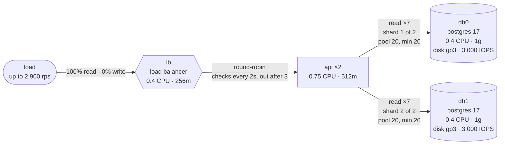

# The viral post

Level 3 · about 45 minutes · teaches sharding by key, why one popular key overloads one shard however many there are, and what takes the load off a hot key

## The story

You run the posts api of a social app. Last year the posts table outgrew one database, so the team split it across two Postgres shards by post id: a post, its comments and its counts live on the shard its id hashes to. Each post page reads seven rows from that shard. Each of the two api replicas keeps a pool of 20 connections to each shard, opened at start. The databases sit on gp3 cloud volumes.

Tonight a celebrity posts something that goes viral. Of a million posts, that one takes six page views in ten.



Traffic climbs from 200 page views a second to 2,900 over three minutes, then stays there for two. Someone on the team says the fix is obvious: more shards.

## The question

Before you run anything, write down your guesses. Don't work them out: a gut answer is fine, and where the run differs from it is what you'll learn from.

1. Which component gives out first?
2. How busy is the other shard when it does?
3. Would twice the shards, four instead of two, take the traffic without breaking? This is the guess the lesson turns on.
4. At what load does it break, if it does? Only a rough guess.

Loads depend on your machine: slower cores break the same design at a lower load, so a guess can miss even when the reasoning behind it is right.

`loadl predict design.yaml` asks these questions and writes your answers into the `expect` block at the bottom of `design.yaml`, or write them there yourself. Your answer to question 3 goes into `variants/twice-the-shards/design.yaml`, this design with four shards and nothing else changed: run that design after this one, and its report scores the guess. The report scores each line against what the run measured. The line already there is an example; the grammar is in the [design file reference](../../skills/loadlore-designer/references/schema.md).

## Run it

```sh
loadl run scenarios/viral-post/design.yaml
loadl report latest --print | less
```

The run takes about 6 minutes. It needs 8 CPUs and 8 GB available to Docker: the design and Loadlore's own containers add up to 4.6 CPUs (5.6 with four shards, 4.9 for the worked answer). On a smaller machine, add `--scale` with the largest value that fits; `loadl run` warns you when the host is too small and suggests one. The numbers here come from a MacBook Air M4 on mains power.

Stuck? `loadl hint viral-post` reveals one hint at a time.

## What to try next

When you know why it broke, change one thing and run it again. Write an `expect` line for what you think will happen, then compare the two runs:

```sh
loadl compare <first-run> latest -o compare.md
```

Some directions: the number of shards, the shards' resources, and where a page view's reads are answered. A call to sharded data names its shards (`shards: [db0, db1]`); the [design file reference](../../skills/loadlore-designer/references/schema.md) has the details, and a Redis service (`kind: redis`) with `op: get` and `on_miss` makes a cache.

`solutions/` has a worked answer with its report; it gives the game away, so try your own first. `variants/twice-the-shards/design.yaml` is the four-shard design that question 3 is about: run it to score your guess, but its README tells you what happens, so read that after.
