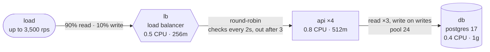

# When do you need to scale your database?

Level 1 · about 45 minutes · teaches saturation, the queueing knee and connection pools

## The story

You run a feed service. Every request returns a page of three items from one Postgres database, and one request in ten also updates an item. Four api replicas sit behind a load balancer. Traffic is growing, and someone asks the question every team gets eventually: how much more can this take, and what gives out first?

You're going to find out by ramping the load from 100 to 3,500 requests per second over five minutes, then holding it for two.



The table has 5 million rows of 512 bytes, and requests pick keys from a zipf distribution, so some items are much more popular than others. Each api replica keeps a pool of up to 24 connections to Postgres.

## The question

Before you run anything, write down your guesses. Don't work them out: a gut answer is fine, and where the run differs from it is what you'll learn from.

1. At what load does it break: requests per second, and minutes into the ramp?
2. Which component gives out first?
3. What does it look like from outside: slow responses, errors, or both?

Loads depend on your machine: slower cores break the same design at a lower load, so a guess can miss even when the reasoning behind it is right.

`loadl predict design.yaml` asks questions like these and writes your answers into the `expect` block at the bottom of `design.yaml`, or write them there yourself. The report scores each one against what the run measured. The two lines already there are examples; the grammar is in the [design file reference](../../skills/loadlore-designer/references/schema.md).

## Run it

```sh
loadl run scenarios/when-to-scale-your-database/design.yaml
loadl report latest --print | less
```

The run takes about 8 minutes, plus about a minute the first time to seed the 5-million-row table.

It needs 8 CPUs and 8 GB available to Docker: the design and Loadlore's own containers (load generator, Toxiproxy, Prometheus, cAdvisor, exporter) add up to 7.4 CPUs (6.9 for the worked solution). On a smaller machine, add `--scale` with the largest value that fits; `loadl run` warns you when the host is too small and suggests one. Scale shrinks CPU, memory, the dataset and the load together, but Loadlore's own containers don't shrink much, and a database with a fraction of a CPU stalls under CPU throttling. Core speed matters too: CPU limits are fractions of your machine's cores, so a slower machine breaks at a lower load. The numbers here come from a MacBook Air M4 on mains power (host speed index 1000; `loadl run` prints yours and warns when it's much lower), and an earlier version of this design broke at 672 rps on an 8-vCPU cloud VM. On a laptop, plug it in and turn off Low Power Mode, which roughly halves the index. This scenario is checked at `--scale 1`; at `--scale 0.25` its Postgres gets 0.1 CPU and breaks at the very start of the ramp instead, which is a different lesson.

Stuck? `loadl hint` reveals one hint at a time.

## What to try next

When you know why it broke, change one thing and run it again. Write a new `expect` line for where you think it will break this time, then compare the two runs:

```sh
loadl compare <first-run> latest -o compare.md
```

Some directions: the database's resources, the work each request asks of it, the pool sizes, or keeping requests away from the database. They don't all help, and finding out which ones don't is part of the lesson.

Scaling the database out isn't one of the options yet: this version of Loadlore doesn't model read replicas or sharding, so a design with one Postgres stays one Postgres.

You may also see a connection storm early in the ramp. [The connection pool trap](../connection-pool-trap/) covers it.

`solutions/` has one worked answer with its report. It gives the game away, so try your own first.
