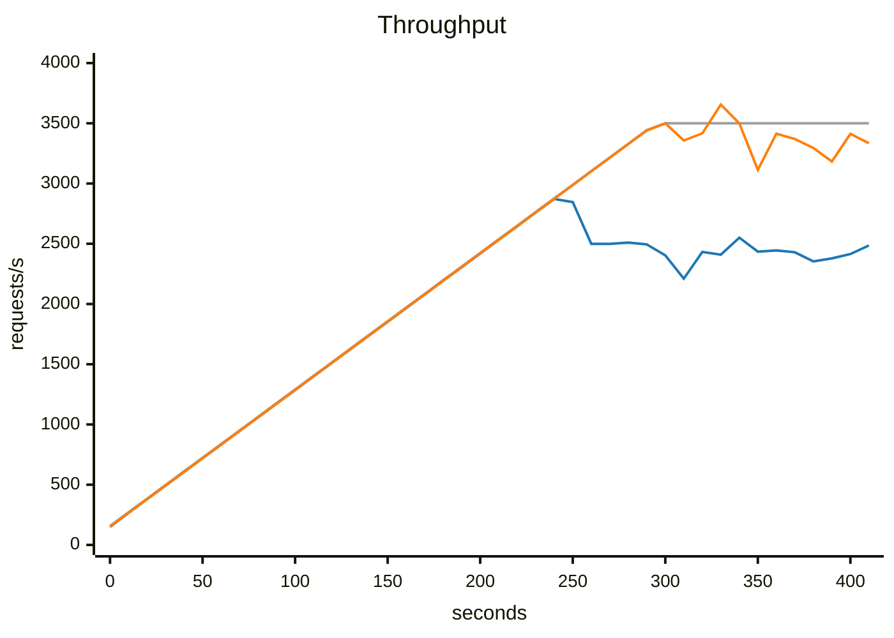
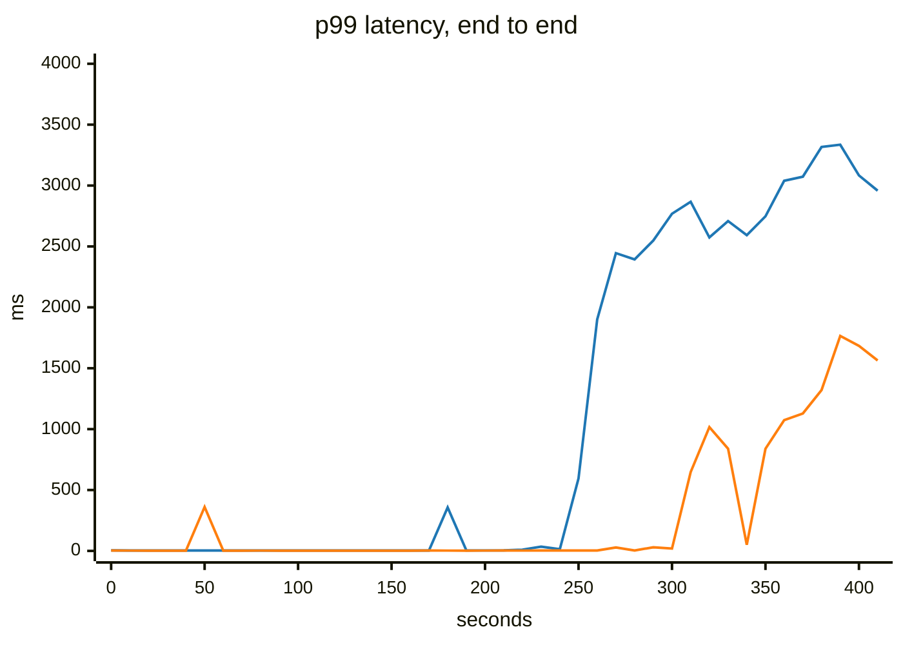

# Compare: when-to-scale-your-database vs when-to-scale-your-database-one-query-per-page

_A: run `when-to-scale-your-database-20261117-212641` · B: run `when-to-scale-your-database-one-query-per-page-20261117-213423`_

| | A | B |
| --- | --- | --- |
| Design | when-to-scale-your-database | when-to-scale-your-database-one-query-per-page |
| Verdict | broke at 4:10 (2,990 rps offered) | broke at 5:10 (3,500 rps offered) |
| Most served | 2,872 rps at 4:00 | 3,656 rps at 5:30 |
| Worst 10-second p99 | 3.34 s | 1.77 s |
| Worst error rate | 0% | 0% |
| Diagnoses | Queueing knee (db CPU) from 3:50 | Queueing knee (db CPU) from 4:50 |
| Predictions held | 2 of 2 | 1 of 2 |
| Peak offered | 3,500 rps | 3,500 rps |
| Scale, seed | 1, 1 | 1, 1 |
| Host | 8 CPUs, 9.7 GiB, Docker 29.5.2 | 8 CPUs, 9.7 GiB, Docker 29.5.2 |
| Data | fresh copy | fresh copy |

<sub>Sources as in each run's report: served from k6_http_reqs_total{expected_response="true"} (k6: successful responses), p99 from k6_http_req_duration_seconds (k6 histogram, end to end), errors from k6_http_reqs_total{expected_response="false"} ÷ k6_http_reqs_total (k6).</sub>

**Before reading the difference:**

- Both are single runs. The same design varies from run to run on one machine, so a small difference may be noise: `loadl run --repeat 3` on each design measures how much on this host.

## Verdicts

**A.** Broke 4:10 into the load, at 2,990 rps offered: p99 reached 595 ms (3.1 ms at low load). Most saturated then: api → db pool 96 of 96 connections in use, waiting on db (CPU 87%, CPU-throttled 16.8 s, 3.5 ms per call with a connection, 0.4 ms at low load). After the break the load generator couldn't send 29% of the arrivals the profile asked for (158,698 arrivals from 4:20; k6_dropped_iterations_total (k6: arrivals it couldn't start)): slow responses held its 4,000 VUs, so served throughput from then on is partly the generator's limit, not only the system's. It hadn't recovered when the load ended.

**B.** Broke 5:10 into the load, at 3,500 rps offered: p99 reached 648 ms (2.5 ms at low load). Most saturated then: api → db pool 92 of 96 connections in use, waiting on db (CPU 84%, CPU-throttled 20.3 s, 8.8 ms per call with a connection, 0.4 ms at low load). After the break the load generator couldn't send 3.1% of the arrivals the profile asked for (10,745 arrivals from 5:20; k6_dropped_iterations_total (k6: arrivals it couldn't start)): slow responses held its 4,000 VUs, so served throughput from then on is partly the generator's limit, not only the system's. It hadn't recovered when the load ended.

## Charts



<sub>Grey: offered (A). Blue: served, A. Orange: served, B (k6_http_reqs_total{expected_response="true"} (k6: successful responses)). Windows without data are drawn at 0.</sub>



<sub>Blue: A. Orange: B (k6_http_req_duration_seconds (k6 histogram, end to end)). Windows without data are drawn at 0.</sub>

<details><summary>Per-window numbers, side by side</summary>

| t | offered A | offered B | served A | served B | p99 A | p99 B | errors A | errors B |
| --- | --- | --- | --- | --- | --- | --- | --- | --- |
| 0:00 | 157 | 157 | 149 | 150 | 4.9 ms | 3.8 ms | 0% | 0% |
| 0:10 | 270 | 270 | 266 | 267 | 3.7 ms | 2.7 ms | 0% | 0% |
| 0:20 | 383 | 383 | 379 | 380 | 3.1 ms | 2.5 ms | 0% | 0% |
| 0:30 | 497 | 497 | 493 | 493 | 3.0 ms | 2.4 ms | 0% | 0% |
| 0:40 | 610 | 610 | 606 | 607 | 3.0 ms | 2.4 ms | 0% | 0% |
| 0:50 | 723 | 723 | 719 | 720 | 3.1 ms | 361 ms | 0% | 0% |
| 1:00 | 837 | 837 | 833 | 833 | 3.0 ms | 2.2 ms | 0% | 0% |
| 1:10 | 950 | 950 | 946 | 947 | 3.0 ms | 2.4 ms | 0% | 0% |
| 1:20 | 1,063 | 1,063 | 1,059 | 1,060 | 3.0 ms | 2.6 ms | 0% | 0% |
| 1:30 | 1,177 | 1,177 | 1,173 | 1,173 | 3.0 ms | 2.3 ms | 0% | 0% |
| 1:40 | 1,290 | 1,290 | 1,286 | 1,287 | 3.0 ms | 2.2 ms | 0% | 0% |
| 1:50 | 1,403 | 1,403 | 1,399 | 1,400 | 3.1 ms | 2.2 ms | 0% | 0% |
| 2:00 | 1,517 | 1,517 | 1,513 | 1,513 | 3.1 ms | 2.2 ms | 0% | 0% |
| 2:10 | 1,630 | 1,630 | 1,626 | 1,627 | 3.3 ms | 2.2 ms | 0% | 0% |
| 2:20 | 1,743 | 1,743 | 1,739 | 1,740 | 3.4 ms | 2.3 ms | 0% | 0% |
| 2:30 | 1,857 | 1,857 | 1,853 | 1,853 | 3.4 ms | 2.4 ms | 0% | 0% |
| 2:40 | 1,970 | 1,970 | 1,966 | 1,967 | 3.4 ms | 2.5 ms | 0% | 0% |
| 2:50 | 2,083 | 2,083 | 2,079 | 2,080 | 3.4 ms | 2.7 ms | 0% | 0% |
| 3:00 | 2,197 | 2,197 | 2,194 | 2,193 | 357 ms | 2.6 ms | 0% | 0% |
| 3:10 | 2,310 | 2,310 | 2,305 | 2,307 | 3.8 ms | 2.5 ms | 0% | 0% |
| 3:20 | 2,423 | 2,423 | 2,419 | 2,420 | 3.9 ms | 2.6 ms | 0% | 0% |
| 3:30 | 2,537 | 2,537 | 2,533 | 2,533 | 4.4 ms | 2.8 ms | 0% | 0% |
| 3:40 | 2,650 | 2,650 | 2,646 | 2,647 | 11 ms | 2.7 ms | 0% | 0% |
| 3:50 | 2,763 | 2,763 | 2,760 | 2,760 | 35 ms | 2.8 ms | 0% | 0% |
| 4:00 | 2,877 | 2,877 | 2,872 | 2,873 | 13 ms | 2.7 ms | 0% | 0% |
| 4:10 | 2,990 | 2,990 | 2,846 | 2,986 | 595 ms | 2.8 ms | 0% | 0% |
| 4:20 | 3,103 | 3,103 | 2,500 | 3,100 | 1.90 s | 3.0 ms | 0% | 0% |
| 4:30 | 3,217 | 3,217 | 2,499 | 3,213 | 2.45 s | 28 ms | 0% | 0% |
| 4:40 | 3,330 | 3,330 | 2,510 | 3,327 | 2.39 s | 3.9 ms | 0% | 0% |
| 4:50 | 3,443 | 3,443 | 2,495 | 3,440 | 2.55 s | 30 ms | 0% | 0% |
| 5:00 | 3,500 | 3,500 | 2,403 | 3,500 | 2.77 s | 20 ms | 0% | 0% |
| 5:10 | 3,500 | 3,500 | 2,210 | 3,357 | 2.87 s | 648 ms | 0% | 0% |
| 5:20 | 3,500 | 3,500 | 2,433 | 3,417 | 2.57 s | 1.02 s | 0% | 0% |
| 5:30 | 3,500 | 3,500 | 2,409 | 3,656 | 2.71 s | 839 ms | 0% | 0% |
| 5:40 | 3,500 | 3,500 | 2,551 | 3,500 | 2.59 s | 50 ms | 0% | 0% |
| 5:50 | 3,500 | 3,500 | 2,435 | 3,114 | 2.75 s | 839 ms | 0% | 0% |
| 6:00 | 3,500 | 3,500 | 2,445 | 3,413 | 3.04 s | 1.07 s | 0% | 0% |
| 6:10 | 3,500 | 3,500 | 2,430 | 3,369 | 3.07 s | 1.13 s | 0% | 0% |
| 6:20 | 3,500 | 3,500 | 2,353 | 3,296 | 3.32 s | 1.32 s | 0% | 0% |
| 6:30 | 3,500 | 3,500 | 2,379 | 3,183 | 3.34 s | 1.77 s | 0% | 0% |
| 6:40 | 3,500 | 3,500 | 2,414 | 3,412 | 3.08 s | 1.68 s | 0% | 0% |
| 6:50 | 3,500 | 3,500 | 2,486 | 3,334 | 2.96 s | 1.56 s | 0% | 0% |

</details>

## Diagnosis

### A

- **Queueing knee (db CPU), from 3:50.** From 3:50, p99 stayed above 13 ms (3.1 ms at low load) with db CPU at 72%. Near saturation requests wait behind each other, so latency grows non-linearly, not in proportion to load.

### B

- **Queueing knee (db CPU), from 4:50.** From 4:50, p99 stayed above 12 ms (2.5 ms at low load) with db CPU at 73%. Near saturation requests wait behind each other, so latency grows non-linearly, not in proportion to load.

## Predictions

| Prediction | A | B |
| --- | --- | --- |
| `break_load_rps within 25% of 3000` | held, worst 2,990 rps at 4:10 | not in this design |
| `errors_load_rps none` | held, worst no failures | not in this design |
| `p99_ms < 300 until load_rps >= 3000` | not in this design | broken, worst 361 ms (broke at 0:50) |
| `error_rate < 1% throughout` | not in this design | held, worst 0% |

## Design changes

```diff
--- A/design.yaml
+++ B/design.yaml
@@ -1,5 +1,5 @@
 version: 1
-name: when-to-scale-your-database
+name: when-to-scale-your-database-one-query-per-page
 
 # A feed service: every request returns a page of three items from Postgres,
 # and one request in ten also updates an item.
@@ -17,7 +17,7 @@
     behavior:
       cpu_ms: 0.5
       calls:
-        - { target: db, op: read,  count: 3 }              # the page's three items, one query each
+        - { target: db, op: read,  query: batch, rows: 3 }  # the page's three items in one query
         - { target: db, op: write, count: 1, when: write }
     pools: { db: { size: 24, min: 24 } }   # opened at start; 4 replicas x 24 = 96 connections, under max_connections
 
@@ -36,8 +36,7 @@
   mix: { read: 0.9, write: 0.1 }
   keys: { distribution: zipf, skew: 1.1, count: 5000000 }
 
-# Your predictions, scored in the report. Replace these with your own
-# before you run it.
+# The starting design's predictions, kept so the two reports compare.
 expect:
-  - break_load_rps within 25% of 3000
-  - errors_load_rps none
+  - p99_ms < 300 until load_rps >= 3000
+  - error_rate < 1% throughout
```
