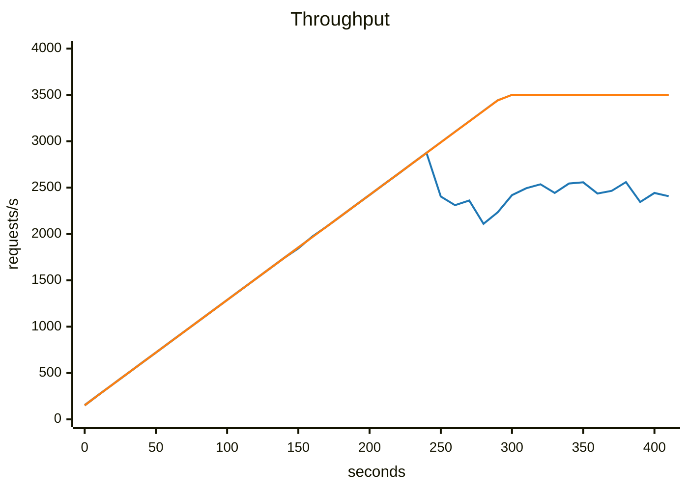
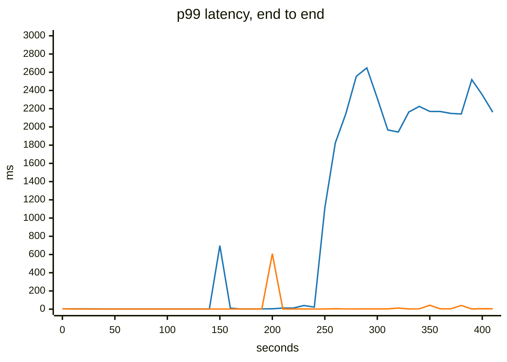

# Compare: when-to-scale-your-database vs when-to-scale-your-database-one-query-per-page

_A: run `when-to-scale-your-database-20261111-160637` · B: run `when-to-scale-your-database-one-query-per-page-20261111-161415`_

| | A | B |
| --- | --- | --- |
| Design | when-to-scale-your-database | when-to-scale-your-database-one-query-per-page |
| Verdict | broke at 4:10 (2,990 rps offered) | held |
| Most served | 2,873 rps at 4:00 | 3,501 rps at 6:20 |
| Worst 10-second p99 | 2.65 s | 608 ms |
| Worst error rate | 0% | 0% |
| Diagnoses | Connection storm (api → db) from 2:30; Queueing knee (db CPU) from 3:50 | Connection storm (api → db) from 3:20 |
| Predictions held | 2 of 2 | 1 of 2 |
| Peak offered | 3,500 rps | 3,500 rps |
| Scale, seed | 1, 1 | 1, 1 |
| Host | 8 CPUs, 9.7 GiB, Docker 29.5.2 | 8 CPUs, 9.7 GiB, Docker 29.5.2 |
| Data | fresh copy | fresh copy |

<sub>Sources as in each run's report: served from k6_http_reqs_total{expected_response="true"} (k6: successful responses), p99 from k6_http_req_duration_seconds (k6 histogram, end to end), errors from k6_http_reqs_total{expected_response="false"} ÷ k6_http_reqs_total (k6).</sub>

**Before reading the difference:**

- Both are single runs. The same design varies from run to run on one machine, so a small difference may be noise: `loadl run --repeat 3` on each design measures how much on this host.

## Verdicts

**A.** Broke 4:10 into the load, at 2,990 rps offered: p99 reached 1.11 s (3.1 ms at low load) and only 2,404 rps succeeded. Most saturated then: db CPU at 99% of its limit. After the break the load generator couldn't send 30% of the arrivals the profile asked for (162,831 arrivals from 4:20; k6_dropped_iterations_total (k6: arrivals it couldn't start)): slow responses held its 4,000 VUs, so served throughput from then on is partly the generator's limit, not only the system's.

**B.** Held the whole profile: up to 3,500 rps offered, 3,501 rps served at best, worst 10-second p99 608 ms, at most 0% errors.

## Charts



<sub>Grey: offered (A). Blue: served, A. Orange: served, B (k6_http_reqs_total{expected_response="true"} (k6: successful responses)). Windows without data are drawn at 0.</sub>



<sub>Blue: A. Orange: B (k6_http_req_duration_seconds (k6 histogram, end to end)). Windows without data are drawn at 0.</sub>

<details><summary>Per-window numbers, side by side</summary>

| t | offered A | offered B | served A | served B | p99 A | p99 B | errors A | errors B |
| --- | --- | --- | --- | --- | --- | --- | --- | --- |
| 0:00 | 157 | 157 | 149 | 151 | 4.6 ms | 4.1 ms | 0% | 0% |
| 0:10 | 270 | 270 | 266 | 267 | 3.8 ms | 2.2 ms | 0% | 0% |
| 0:20 | 383 | 383 | 379 | 380 | 3.1 ms | 1.8 ms | 0% | 0% |
| 0:30 | 497 | 497 | 493 | 494 | 3.2 ms | 1.7 ms | 0% | 0% |
| 0:40 | 610 | 610 | 606 | 607 | 2.6 ms | 1.6 ms | 0% | 0% |
| 0:50 | 723 | 723 | 719 | 720 | 2.7 ms | 1.6 ms | 0% | 0% |
| 1:00 | 837 | 837 | 833 | 833 | 2.8 ms | 1.8 ms | 0% | 0% |
| 1:10 | 950 | 950 | 946 | 947 | 2.7 ms | 1.8 ms | 0% | 0% |
| 1:20 | 1,063 | 1,063 | 1,059 | 1,060 | 2.5 ms | 1.8 ms | 0% | 0% |
| 1:30 | 1,177 | 1,177 | 1,173 | 1,174 | 2.3 ms | 1.7 ms | 0% | 0% |
| 1:40 | 1,290 | 1,290 | 1,286 | 1,287 | 2.7 ms | 1.6 ms | 0% | 0% |
| 1:50 | 1,403 | 1,403 | 1,399 | 1,400 | 2.7 ms | 1.7 ms | 0% | 0% |
| 2:00 | 1,517 | 1,517 | 1,513 | 1,514 | 2.6 ms | 1.6 ms | 0% | 0% |
| 2:10 | 1,630 | 1,630 | 1,626 | 1,627 | 2.4 ms | 1.6 ms | 0% | 0% |
| 2:20 | 1,743 | 1,743 | 1,739 | 1,740 | 2.4 ms | 2.0 ms | 0% | 0% |
| 2:30 | 1,857 | 1,857 | 1,844 | 1,853 | 697 ms | 1.9 ms | 0% | 0% |
| 2:40 | 1,970 | 1,970 | 1,974 | 1,967 | 12 ms | 2.0 ms | 0% | 0% |
| 2:50 | 2,083 | 2,083 | 2,080 | 2,080 | 2.5 ms | 2.3 ms | 0% | 0% |
| 3:00 | 2,197 | 2,197 | 2,193 | 2,194 | 2.5 ms | 2.1 ms | 0% | 0% |
| 3:10 | 2,310 | 2,310 | 2,306 | 2,307 | 2.9 ms | 2.2 ms | 0% | 0% |
| 3:20 | 2,423 | 2,423 | 2,419 | 2,420 | 4.6 ms | 608 ms | 0% | 0% |
| 3:30 | 2,537 | 2,537 | 2,532 | 2,534 | 12 ms | 2.2 ms | 0% | 0% |
| 3:40 | 2,650 | 2,650 | 2,646 | 2,647 | 13 ms | 2.2 ms | 0% | 0% |
| 3:50 | 2,763 | 2,763 | 2,760 | 2,760 | 40 ms | 2.2 ms | 0% | 0% |
| 4:00 | 2,877 | 2,877 | 2,873 | 2,874 | 23 ms | 2.0 ms | 0% | 0% |
| 4:10 | 2,990 | 2,990 | 2,404 | 2,987 | 1.11 s | 2.7 ms | 0% | 0% |
| 4:20 | 3,103 | 3,103 | 2,310 | 3,100 | 1.82 s | 5.0 ms | 0% | 0% |
| 4:30 | 3,217 | 3,217 | 2,361 | 3,214 | 2.14 s | 2.9 ms | 0% | 0% |
| 4:40 | 3,330 | 3,330 | 2,109 | 3,327 | 2.56 s | 2.3 ms | 0% | 0% |
| 4:50 | 3,443 | 3,443 | 2,234 | 3,440 | 2.65 s | 3.8 ms | 0% | 0% |
| 5:00 | 3,500 | 3,500 | 2,419 | 3,500 | 2.31 s | 3.8 ms | 0% | 0% |
| 5:10 | 3,500 | 3,500 | 2,493 | 3,500 | 1.97 s | 3.6 ms | 0% | 0% |
| 5:20 | 3,500 | 3,500 | 2,536 | 3,500 | 1.94 s | 12 ms | 0% | 0% |
| 5:30 | 3,500 | 3,500 | 2,443 | 3,500 | 2.16 s | 2.7 ms | 0% | 0% |
| 5:40 | 3,500 | 3,500 | 2,544 | 3,500 | 2.22 s | 4.0 ms | 0% | 0% |
| 5:50 | 3,500 | 3,500 | 2,557 | 3,500 | 2.17 s | 44 ms | 0% | 0% |
| 6:00 | 3,500 | 3,500 | 2,436 | 3,499 | 2.17 s | 3.2 ms | 0% | 0% |
| 6:10 | 3,500 | 3,500 | 2,465 | 3,500 | 2.15 s | 3.9 ms | 0% | 0% |
| 6:20 | 3,500 | 3,500 | 2,559 | 3,501 | 2.14 s | 41 ms | 0% | 0% |
| 6:30 | 3,500 | 3,500 | 2,345 | 3,500 | 2.52 s | 2.7 ms | 0% | 0% |
| 6:40 | 3,500 | 3,500 | 2,442 | 3,500 | 2.35 s | 5.3 ms | 0% | 0% |
| 6:50 | 3,500 | 3,500 | 2,407 | 3,500 | 2.16 s | 4.6 ms | 0% | 0% |

</details>

## Diagnosis

### A

- **Connection storm (api → db), from 2:30.** At 2:30, api's pools opened 80 connections to db within 10 seconds, at 1,857 rps offered, and p99 reached 697 ms (3.1 ms at low load). The pools open connections only when callers need them, so when a short slowdown leaves requests waiting, every replica opens more at once. Each new Postgres connection starts a server process and authenticates, which takes db's CPU from queries just when it is short of it.
- **Queueing knee (db CPU), from 3:50.** From 3:50, p99 stayed above 13 ms (3.1 ms at low load) with db CPU at 84%. Near saturation requests wait behind each other, so latency grows non-linearly, not in proportion to load.

### B

- **Connection storm (api → db), from 3:20.** At 3:20, api's pools opened 81 connections to db within 10 seconds, at 2,423 rps offered, and p99 reached 608 ms (1.8 ms at low load). The pools open connections only when callers need them, so when a short slowdown leaves requests waiting, every replica opens more at once. Each new Postgres connection starts a server process and authenticates, which takes db's CPU from queries just when it is short of it.

## Predictions

| Prediction | A | B |
| --- | --- | --- |
| `break_load_rps within 25% of 3000` | held, worst 2,990 rps at 4:10 | not in this design |
| `errors_load_rps none` | held, worst no failures | not in this design |
| `p99_ms < 300 until load_rps >= 3000` | not in this design | broken, worst 608 ms (broke at 3:20) |
| `error_rate < 1% throughout` | not in this design | held, worst 0% |

## Design changes

```diff
--- A/design.yaml
+++ B/design.yaml
@@ -1,5 +1,5 @@
 version: 1
-name: when-to-scale-your-database
+name: when-to-scale-your-database-one-query-per-page
 
 # A feed service: every request returns a page of three items from Postgres,
 # and one request in ten also updates an item.
@@ -17,7 +17,7 @@
     behavior:
       cpu_ms: 0.5
       calls:
-        - { target: db, op: read,  count: 3 }              # the page's three items, one query each
+        - { target: db, op: read,  query: batch, rows: 3 }  # the page's three items in one query
         - { target: db, op: write, count: 1, when: write }
     pools: { db: 24 }          # 4 replicas x 24 = 96 connections, under max_connections
 
@@ -36,8 +36,7 @@
   mix: { read: 0.9, write: 0.1 }
   keys: { distribution: zipf, skew: 1.1, count: 5000000 }
 
-# Your predictions, scored in the report. Replace these with your own
-# before you run it.
+# The starting design's predictions, kept so the two reports compare.
 expect:
-  - break_load_rps within 25% of 3000
-  - errors_load_rps none
+  - p99_ms < 300 until load_rps >= 3000
+  - error_rate < 1% throughout
```
