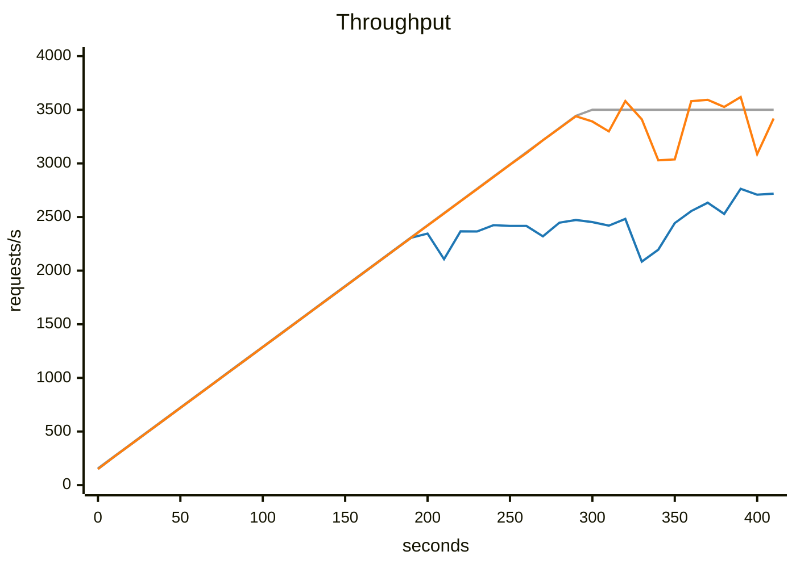
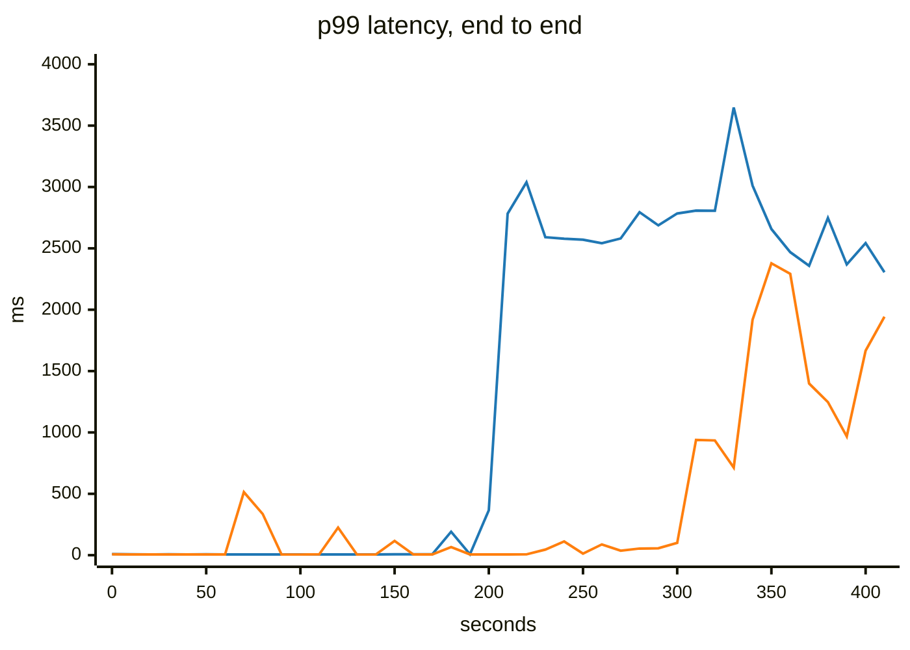

# Compare: when-to-scale-your-database vs when-to-scale-your-database-one-query-per-page

_A: run `when-to-scale-your-database-20261118-071309` · B: run `when-to-scale-your-database-one-query-per-page-20261118-072056`_

| | A | B |
| --- | --- | --- |
| Design | when-to-scale-your-database | when-to-scale-your-database-one-query-per-page |
| Verdict | broke at 3:30 (2,537 rps offered) | broke at 5:10 (3,500 rps offered) |
| Most served | 2,764 rps at 6:30 | 3,619 rps at 6:30 |
| Worst 10-second p99 | 3.65 s | 2.38 s |
| Worst error rate | 0% | <0.1% |
| Diagnoses | Queueing knee (db CPU) from 3:20; Hot rows (api → db) from 4:40 | CPU bursts at the limit (db) from 1:10; Queueing knee (db CPU) from 4:20; Hot rows (api → db) from 5:10 |
| Predictions held | 2 of 2 | 1 of 2 |
| Peak offered | 3,500 rps | 3,500 rps |
| Scale, seed | 1, 1 | 1, 1 |
| Host | 8 CPUs, 9.7 GiB, Docker 29.5.2 | 8 CPUs, 9.7 GiB, Docker 29.5.2 |
| Data | fresh copy | fresh copy |

<sub>Sources as in each run's report: served from k6_http_reqs_total{expected_response="true"} (k6: successful responses), p99 from k6_http_req_duration_seconds (k6 histogram, end to end), errors from k6_http_reqs_total{expected_response="false"} ÷ k6_http_reqs_total (k6).</sub>

**Before reading the difference:**

- Both are single runs. The same design varies from run to run on one machine, so a small difference may be noise: `loadl run --repeat 3` on each design measures how much on this host.

## Verdicts

**A.** Broke 3:30 into the load, at 2,537 rps offered: p99 reached 2.78 s (6.7 ms at low load) and only 2,107 rps succeeded. Most saturated then: api → db pool 96 of 96 connections in use, waiting on db (CPU 100%, CPU-throttled 49.4 s, 14 ms per call with a connection, 0.6 ms at low load). After the break the load generator couldn't send 26% of the arrivals the profile asked for (170,267 arrivals from 3:40; k6_dropped_iterations_total (k6: arrivals it couldn't start)): slow responses held its 4,000 VUs, so served throughput from then on is partly the generator's limit, not only the system's. It hadn't recovered when the load ended.

**B.** Broke 5:10 into the load, at 3,500 rps offered: p99 reached 940 ms (5.7 ms at low load). Most saturated then: db CPU at 100% of its limit. After the break the load generator couldn't send 2.7% of the arrivals the profile asked for (9,452 arrivals from 5:20; k6_dropped_iterations_total (k6: arrivals it couldn't start)): slow responses held its 4,000 VUs, so served throughput from then on is partly the generator's limit, not only the system's. It hadn't recovered when the load ended.

## Charts



<sub>Grey: offered (A). Blue: served, A. Orange: served, B (k6_http_reqs_total{expected_response="true"} (k6: successful responses)). Windows without data are drawn at 0.</sub>



<sub>Blue: A. Orange: B (k6_http_req_duration_seconds (k6 histogram, end to end)). Windows without data are drawn at 0.</sub>

<details><summary>Per-window numbers, side by side</summary>

| t | offered A | offered B | served A | served B | p99 A | p99 B | errors A | errors B |
| --- | --- | --- | --- | --- | --- | --- | --- | --- |
| 0:00 | 157 | 157 | 151 | 150 | 9.3 ms | 7.2 ms | 0% | 0% |
| 0:10 | 270 | 270 | 267 | 267 | 6.7 ms | 5.8 ms | 0% | 0% |
| 0:20 | 383 | 383 | 380 | 380 | 6.5 ms | 5.9 ms | 0% | 0% |
| 0:30 | 497 | 497 | 493 | 493 | 6.9 ms | 5.7 ms | 0% | 0% |
| 0:40 | 610 | 610 | 607 | 606 | 6.5 ms | 5.4 ms | 0% | 0% |
| 0:50 | 723 | 723 | 720 | 720 | 6.9 ms | 5.4 ms | 0% | 0% |
| 1:00 | 837 | 837 | 833 | 833 | 6.2 ms | 5.5 ms | 0% | 0% |
| 1:10 | 950 | 950 | 947 | 947 | 6.2 ms | 514 ms | 0% | 0% |
| 1:20 | 1,063 | 1,063 | 1,060 | 1,060 | 6.3 ms | 336 ms | 0% | 0% |
| 1:30 | 1,177 | 1,177 | 1,173 | 1,173 | 6.4 ms | 5.9 ms | 0% | 0% |
| 1:40 | 1,290 | 1,290 | 1,287 | 1,287 | 6.2 ms | 5.4 ms | 0% | 0% |
| 1:50 | 1,403 | 1,403 | 1,400 | 1,400 | 6.1 ms | 7.0 ms | 0% | 0% |
| 2:00 | 1,517 | 1,517 | 1,513 | 1,513 | 6.4 ms | 225 ms | 0% | 0% |
| 2:10 | 1,630 | 1,630 | 1,626 | 1,627 | 6.2 ms | 5.3 ms | 0% | 0% |
| 2:20 | 1,743 | 1,743 | 1,740 | 1,740 | 6.3 ms | 5.4 ms | 0% | 0% |
| 2:30 | 1,857 | 1,857 | 1,854 | 1,853 | 6.8 ms | 116 ms | 0% | 0% |
| 2:40 | 1,970 | 1,970 | 1,967 | 1,967 | 6.9 ms | 5.7 ms | 0% | 0% |
| 2:50 | 2,083 | 2,083 | 2,080 | 2,080 | 6.8 ms | 5.7 ms | 0% | 0% |
| 3:00 | 2,197 | 2,197 | 2,194 | 2,193 | 191 ms | 66 ms | 0% | 0% |
| 3:10 | 2,310 | 2,310 | 2,306 | 2,307 | 7.5 ms | 6.4 ms | 0% | 0% |
| 3:20 | 2,423 | 2,423 | 2,345 | 2,420 | 366 ms | 6.0 ms | 0% | 0% |
| 3:30 | 2,537 | 2,537 | 2,107 | 2,533 | 2.78 s | 6.4 ms | 0% | 0% |
| 3:40 | 2,650 | 2,650 | 2,367 | 2,647 | 3.04 s | 6.6 ms | 0% | 0% |
| 3:50 | 2,763 | 2,763 | 2,365 | 2,759 | 2.59 s | 46 ms | 0% | 0% |
| 4:00 | 2,877 | 2,877 | 2,424 | 2,873 | 2.58 s | 112 ms | 0% | 0% |
| 4:10 | 2,990 | 2,990 | 2,417 | 2,987 | 2.57 s | 13 ms | 0% | 0% |
| 4:20 | 3,103 | 3,103 | 2,417 | 3,097 | 2.54 s | 88 ms | 0% | 0% |
| 4:30 | 3,217 | 3,217 | 2,320 | 3,216 | 2.58 s | 37 ms | 0% | 0% |
| 4:40 | 3,330 | 3,330 | 2,447 | 3,327 | 2.79 s | 54 ms | 0% | 0% |
| 4:50 | 3,443 | 3,443 | 2,472 | 3,440 | 2.69 s | 56 ms | 0% | 0% |
| 5:00 | 3,500 | 3,500 | 2,453 | 3,391 | 2.78 s | 100 ms | 0% | 0% |
| 5:10 | 3,500 | 3,500 | 2,420 | 3,298 | 2.81 s | 940 ms | 0% | 0% |
| 5:20 | 3,500 | 3,500 | 2,482 | 3,581 | 2.81 s | 935 ms | 0% | 0% |
| 5:30 | 3,500 | 3,500 | 2,084 | 3,411 | 3.65 s | 714 ms | 0% | <0.1% |
| 5:40 | 3,500 | 3,500 | 2,195 | 3,029 | 3.01 s | 1.92 s | 0% | <0.1% |
| 5:50 | 3,500 | 3,500 | 2,443 | 3,037 | 2.66 s | 2.38 s | 0% | <0.1% |
| 6:00 | 3,500 | 3,500 | 2,556 | 3,580 | 2.47 s | 2.29 s | 0% | 0% |
| 6:10 | 3,500 | 3,500 | 2,633 | 3,593 | 2.36 s | 1.40 s | 0% | 0% |
| 6:20 | 3,500 | 3,500 | 2,529 | 3,527 | 2.75 s | 1.25 s | 0% | 0% |
| 6:30 | 3,500 | 3,500 | 2,764 | 3,619 | 2.37 s | 967 ms | 0% | 0% |
| 6:40 | 3,500 | 3,500 | 2,708 | 3,086 | 2.54 s | 1.67 s | 0% | <0.1% |
| 6:50 | 3,500 | 3,500 | 2,717 | 3,418 | 2.31 s | 1.94 s | 0% | 0% |

</details>

## Diagnosis

### A

- **Queueing knee (db CPU), from 3:20.** From 3:20, p99 stayed above 20 ms (6.7 ms at low load) with db CPU at 80%. Near saturation requests wait behind each other, so latency grows non-linearly, not in proportion to load.
- **Hot rows (api → db), from 4:40.** From 4:40, api's writes to db took 148 ms each, 60.0x their 2.5 ms at low load, its reads, many of them of the same rows, slowed to 104 ms from 0.5 ms, and 4.1 backends of db waited on locks. Writes to the same popular rows wait for each other's row locks and go through one at a time. Where hot rows tip over moves from run to run: the queue for a row can stay short and then collapse within seconds, so the same design can break at loads a quarter apart. Judge a fix by whether it takes the writes off the row, not by how much later it breaks.

### B

- **CPU bursts at the limit (db), from 1:10.** At 1:10, db was CPU-throttled for 12.6 s (summed over its threads) in 10 seconds while its average CPU was 37% of its 0.4-CPU limit. Docker enforces the limit as 40 ms of CPU in every 100 ms period: work that came in a burst used up a period's share early and waited for the next one, and requests piled up behind it until the burst cleared.
- **Queueing knee (db CPU), from 4:20.** From 4:20, p99 stayed above 17 ms (5.7 ms at low load) with db CPU at 79%. Near saturation requests wait behind each other, so latency grows non-linearly, not in proportion to load.
- **Hot rows (api → db), from 5:10.** From 5:10, api's writes to db took 307 ms each, 136.3x their 2.3 ms at low load, its reads, many of them of the same rows, slowed to 180 ms from 0.8 ms, and 24.7 backends of db waited on locks. Writes to the same popular rows wait for each other's row locks and go through one at a time. Where hot rows tip over moves from run to run: the queue for a row can stay short and then collapse within seconds, so the same design can break at loads a quarter apart. Judge a fix by whether it takes the writes off the row, not by how much later it breaks.

## Predictions

| Prediction | A | B |
| --- | --- | --- |
| `break_load_rps within 25% of 3000` | held, worst 2,537 rps at 3:30 | not in this design |
| `errors_load_rps none` | held, worst no failures | not in this design |
| `p99_ms < 300 until load_rps >= 3000` | not in this design | broken, worst 514 ms (broke at 1:10) |
| `error_rate < 1% throughout` | not in this design | held, worst <0.1% |

## Design changes

```diff
--- A/design.yaml
+++ B/design.yaml
@@ -1,5 +1,5 @@
 version: 1
-name: when-to-scale-your-database
+name: when-to-scale-your-database-one-query-per-page
 
 # A feed service: every request returns a page of three items from Postgres,
 # and one request in ten also updates an item.
@@ -17,7 +17,7 @@
     behavior:
       cpu_ms: 0.5
       calls:
-        - { target: db, op: read,  count: 3 }              # the page's three items, one query each
+        - { target: db, op: read,  query: batch, rows: 3 }  # the page's three items in one query
         - { target: db, op: write, count: 1, when: write }
     pools: { db: { size: 24, min: 24 } }   # opened at start; 4 replicas x 24 = 96 connections, under max_connections
 
@@ -37,8 +37,7 @@
   mix: { read: 0.9, write: 0.1 }
   keys: { distribution: zipf, skew: 1.1, count: 5000000 }
 
-# Your predictions, scored in the report. Replace these with your own
-# before you run it.
+# The starting design's predictions, kept so the two reports compare.
 expect:
-  - break_load_rps within 25% of 3000
-  - errors_load_rps none
+  - p99_ms < 300 until load_rps >= 3000
+  - error_rate < 1% throughout
```
