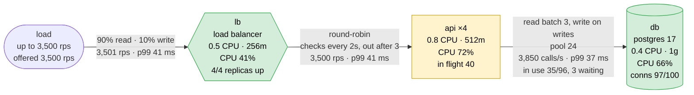
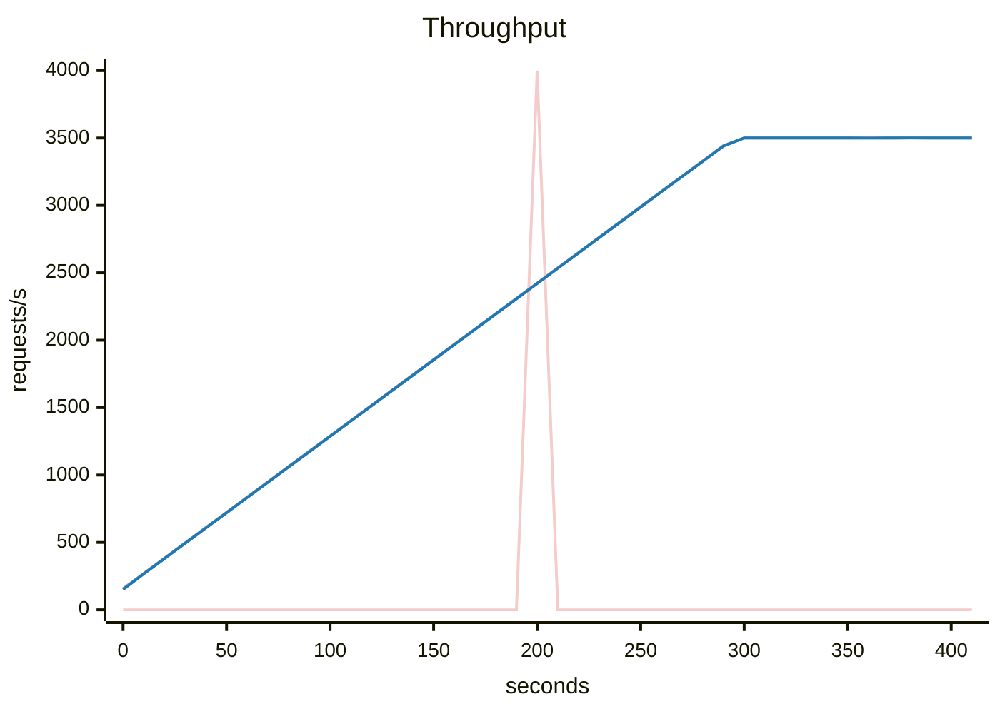
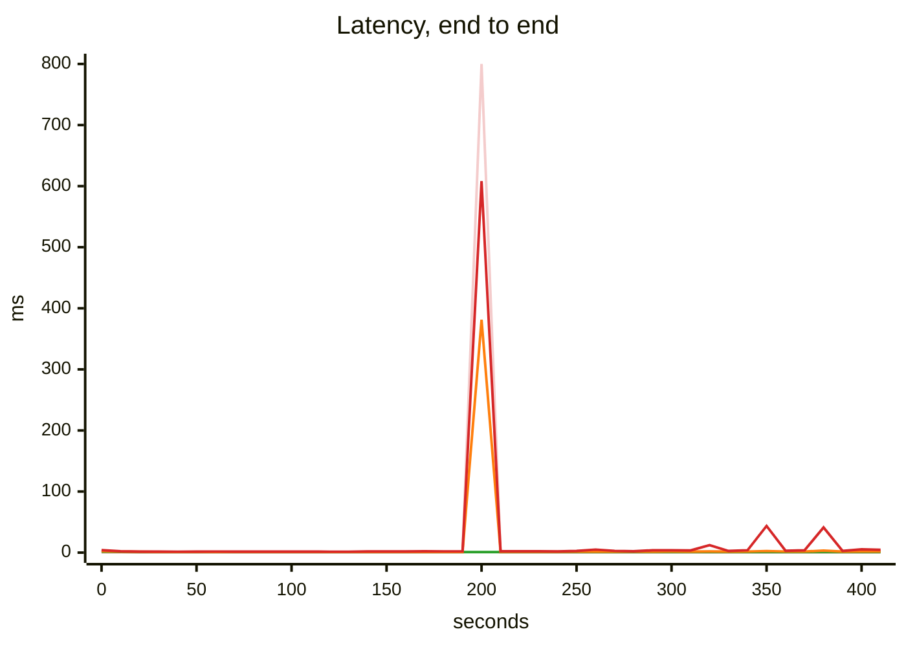
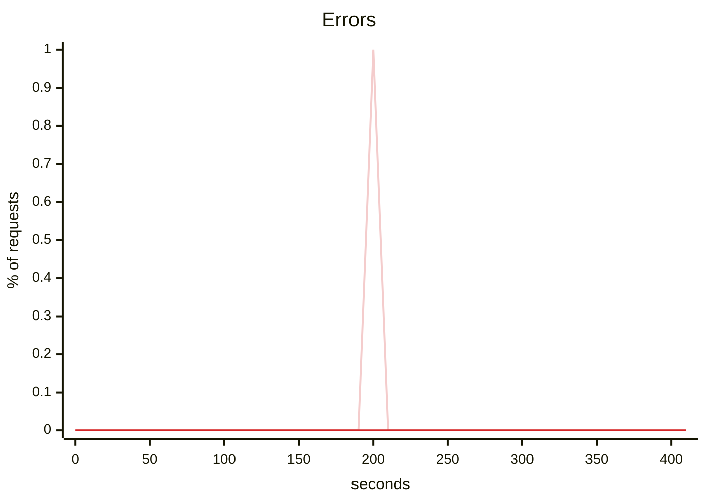
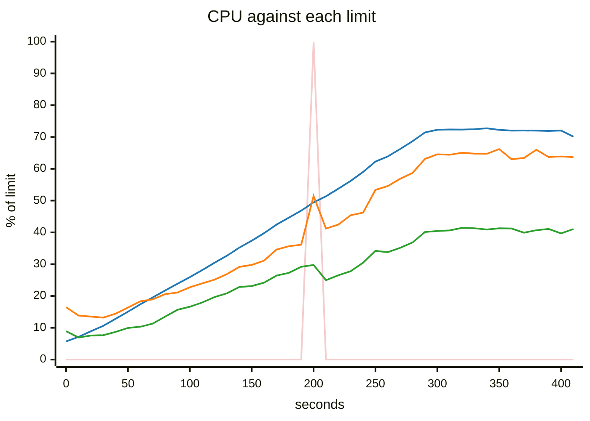

# when-to-scale-your-database-one-query-per-page: run report

_run `when-to-scale-your-database-one-query-per-page-20261111-161415` · completed · 11 Nov 2026 16:14 UTC · scale 1 · seed 1_

## Verdict

**Held.** Held the whole profile: up to 3,500 rps offered, 3,501 rps served at best, worst 10-second p99 608 ms, at most 0% errors.

Caveat: at 4:30 the load generator hit its CPU limit and was stalled in 2.0% of its scheduling periods (container_cpu_cfs_throttled_periods_total ÷ container_cpu_cfs_periods_total (cAdvisor)); work caught in a stall waits for the next 100 ms period, which can show up in p99.

<sub>Sources: offered load: the load profile in plan.json (offered arrival rate); served: k6_http_reqs_total{expected_response="true"} (k6: successful responses); p99: k6_http_req_duration_seconds (k6 histogram, end to end); errors: k6_http_reqs_total{expected_response="false"} ÷ k6_http_reqs_total (k6). Windows are 10 seconds; what counts as broken is under [Thresholds](#thresholds).</sub>

## Diagram at 6:20

Measured in the 10-second window from 6:20 to 6:30 (the busiest window: the most successful responses). Nodes are colored by their most saturated resource, CPU against its limit or a connection pool's connections in use: red at 90% or more, amber from 70%, green below.



<sub>Sources: offered from the load profile in plan.json (offered arrival rate); load edge from k6_http_reqs_total (k6: all responses) and k6_http_req_duration_seconds (k6 histogram, end to end); CPU from container_cpu_usage_seconds_total (cAdvisor) ÷ the container's CPU limit; calls/s from loadlore_calls_total (the caller's outbound call attempts) and their p99 from loadlore_call_duration_seconds (the caller's histogram, pool wait included); pools from loadlore_pool_connections{state="in_use"} and loadlore_pool_max_connections and loadlore_pool_pending (callers waiting for a connection); lb traffic from haproxy_backend_http_requests_total (HAProxy), replicas up from haproxy_backend_active_servers (HAProxy), and the lb edge's p99 from loadlore_request_duration_seconds (the service's own histogram); conns from pg_stat_activity_count and pg_settings_max_connections (postgres_exporter).</sub>

## Charts

One point per 10-second window, at the window's start; x is seconds from the start of the load.



<sub>Grey: offered load (the load profile in plan.json (offered arrival rate)). Blue: successful responses (k6_http_reqs_total{expected_response="true"} (k6: successful responses)). Pink spikes mark 3:20 stall.</sub>



<sub>Green: p50. Orange: p95. Red: p99 (k6_http_req_duration_seconds (k6 histogram, end to end)). Pink spikes mark 3:20 stall.</sub>



<sub>Failed requests as a share of all responses (k6_http_reqs_total{expected_response="false"} ÷ k6_http_reqs_total (k6)), timeouts included. Pink spikes mark 3:20 stall.</sub>



<sub>Blue: api. Orange: db. Green: lb (container_cpu_usage_seconds_total (cAdvisor) ÷ the container's CPU limit, mean over the window). Pink spikes mark 3:20 stall.</sub>

## Diagnosis

### 1. Connection storm (api → db), from 3:20

At 3:20, api's pools opened 81 connections to db within 10 seconds, at 2,423 rps offered, and p99 reached 608 ms (1.8 ms at low load). The pools open connections only when callers need them, so when a short slowdown leaves requests waiting, every replica opens more at once. Each new Postgres connection starts a server process and authenticates, which takes db's CPU from queries just when it is short of it.

Evidence:

- 81 new connections to db from 3:20 to 3:30: from 15 open to 96 of 96 <sub>(loadlore_pool_connect_seconds (new connections the pools opened, and how long each took))</sub>
- p99 608 ms at 3:20, against 1.8 ms at low load <sub>(k6_http_req_duration_seconds (k6 histogram, end to end))</sub>
- each new connection took 407 ms to open at 3:20, against 4.6 ms for the ones opened before <sub>(loadlore_pool_connect_seconds (new connections the pools opened, and how long each took))</sub>
- up to 704 requests waiting for a connection at 3:20 <sub>(loadlore_pool_pending (callers waiting for a connection))</sub>
- db CPU at 51% of its limit at 3:20 <sub>(container_cpu_usage_seconds_total (cAdvisor) ÷ the container's CPU limit)</sub>
- db was CPU-throttled for 10.7 s (summed over its threads) in the window from 3:20, while its average CPU was 51% of its limit: bursts of work hit the 0.4-CPU limit and waited for the next period <sub>(container_cpu_cfs_throttled_seconds_total (cAdvisor))</sub>
- api's calls to db took 5.1 ms each once they had a connection at 3:20, against 0.2 ms at low load <sub>(loadlore_call_duration_seconds minus loadlore_pool_wait_seconds, per call (time with a connection))</sub>

**Try next:** Open the connections before the load arrives: give the pool a minimum (pools: { db: { size: 24, min: 24 } }) and re-run to compare a warm pool with this cold one. PgBouncer in front of db also keeps server connections open.

<sub>Rules version 5. Rules are deterministic and offline; their thresholds are listed below.</sub>

## Predictions

1 of 2 scored predictions held.

| Prediction | Result | Worst value | Checked over | Notes |
| --- | --- | --- | --- | --- |
| `p99_ms < 300 until load_rps >= 3000` | **broken** at 3:20 | 608 ms | 0:00 to 4:20, when load_rps >= 3,000 rps first held | source: k6_http_req_duration_seconds (k6 histogram, end to end) |
| `error_rate < 1% throughout` | **held** | 0% | the whole run | source: k6_http_reqs_total{expected_response="false"} ÷ k6_http_reqs_total (k6) |

## Timeline

| Time | Event |
| --- | --- |
| 3:20 | stall: p99 reached 608 ms (1.8 ms at low load) for 10 s, then recovered; too short to count as a break |

<sub>From events.jsonl: the fault timeline and Docker container events. Stalls are from the per-window numbers below, judged by the thresholds.</sub>

## Assumptions

### From the design

The design lists no assumptions.

### Chosen by Loadlore

| Field | Value | Why |
| --- | --- | --- |
| workload.timeout_ms | 10s | the default; k6 gives up on a request after this long and counts it as failed |
| workload.slo.p99_ms | 500 ms | the default; a break on p99 alone needs p99 at or above this as well as 10x the low-load p99, so latency users would still accept isn't called a break |
| resources.cpu_period_ms | 100 ms for api, db, lb | Docker's default. A container that uses its CPU share early in a period stalls until the next one, which can show up in p99 when a service has a fraction of a CPU |
| services.lb timeouts | connect 5s, server 60s | HAProxy's own timeouts, with its defaults otherwise. A request already sent to a replica that dies waits for the server timeout (or the load generator's); health checks only stop new requests going there |
| services.api.pools.db.min | 0 | the default, as pgxpool's: each replica opens connections only when callers need them, so a pool fills as load rises, and a burst opens many at once |
| services.api.pools.db.hold | call | the default, as pgxpool's: a request takes a connection for each call and hands it back straight away |

### How the run was planned

- Loadlore's own containers get fixed budgets: load generator 1.5 CPU (peak 3500 rps), Toxiproxy 1 CPU (about 7350 proxied calls/s at peak), Prometheus 0.1, cAdvisor 0.1, exporters 0.1 each

## Thresholds

- **Broke:** 2 windows in a row with at least 1.0% of requests failing or successful responses below 90% of the offered rate, or 3 windows in a row with any of those or p99 at least 10x the low-load p99 (the median p99 of windows offered at most 25% of the peak, before errors or a shortfall in 2 windows in a row) and at least the SLO, 500 ms (workload.slo.p99_ms): 500 ms in this run. A shorter episode is shown as a stall in the timeline, not a break.
- **Doubtful:** a break on p99 alone, when the load generator was stalled at its CPU limit in 1.0% or more of its scheduling periods in one of the break's windows and the entry service's own p99 (loadlore_request_duration_seconds (the service's own histogram)) was below the limit in one of them. The verdict stays what it was.
- **Inconclusive:** before the break (or anywhere, if nothing broke), the load generator dropped more than 1.0% of a window's arrivals, or the load generator or Toxiproxy used 90% or more of its CPU budget, or was stalled at its CPU limit in 5.0% or more of its scheduling periods (from 1.0% it's noted as a caveat). The first 10 s of load are a warm-up and don't count: the load generator starts its VUs and connections open then. A cause is named only with evidence: on a Linux host, the hypervisor giving 2.0% or more of CPU time to other virtual machines (steal), or other programs using 10% or more of the host's CPUs (at least 0.5); inside a VM on this machine, only as a possibility.
- **Connection pool exhausted:** for two windows in a row, a pool at 95% or more of its size with callers waiting, while the target wasn't busy (busy: its CPU at 80% or more, or its time per call with a connection at least 3x the low-load value and 1 ms above it; CPU throttling alone doesn't count) and the caller's CPU stayed below 90%.
- **Queueing knee:** for 3 windows in a row, p99 at least 3x the low-load p99 and 10 ms above it, with a CPU or pool at 70% or more. When that is a pool whose target was busy in any of those windows, or a service's CPU whose requests spent 50% or more of their time in calls to a busy target, the knee is the target's.
- **Connection storm:** up to the break, a service's pools to a Postgres opening at least 50% of their combined size, and 10 or more connections, in one window, while p99 in that window or the next was at least 10x the low-load p99 and 10 ms above it. New connections are counted by loadlore_pool_connect_seconds (new connections the pools opened, and how long each took), or for runs from before it, from the rise in open connections.

## Environment

- loadl dev, profile 7m0s, scale 1, seed 1
- Host: 8 CPUs, 9.7 GiB memory, Ubuntu 24.04.4 LTS (aarch64, kernel 6.8.0-117-generic), cgroup v2
- Docker 29.5.2, Compose 5.1.1
- Host speed index 1006 (hash 971, memory 1050, syscalls 998): one CPU's work against the reference machine's 1000 (MacBook Air M4 (4 performance and 6 efficiency cores), Colima VM with 8 vCPUs). CPU limits are fractions of this host's cores, so a lower index means the design breaks at a lower load
- Cool-down: none needed; the first benchmark (1006) was within 5.0% of the run it's compared with (997)
- Host CPU: Docker runs in a VM on this machine, so other programs' use of the CPU can't be seen
- Data: a fresh copy of the cached seeded dataset
- Load generator summary (k6): 959,972 requests, 0 dropped arrivals, 0% failed

<details><summary>Containers and images</summary>

| Container | Image |
| --- | --- |
| loadlore-when-to-scale-your-database-one-query-per-page-20261111-161415-api-0-1 | loadlore/synthetic:dev |
| loadlore-when-to-scale-your-database-one-query-per-page-20261111-161415-api-1-1 | loadlore/synthetic:dev |
| loadlore-when-to-scale-your-database-one-query-per-page-20261111-161415-api-2-1 | loadlore/synthetic:dev |
| loadlore-when-to-scale-your-database-one-query-per-page-20261111-161415-api-3-1 | loadlore/synthetic:dev |
| loadlore-when-to-scale-your-database-one-query-per-page-20261111-161415-db-1 | postgres:17.11 |
| loadlore-when-to-scale-your-database-one-query-per-page-20261111-161415-lb-1 | haproxy:3.2.26 |
| loadlore-when-to-scale-your-database-one-query-per-page-20261111-161415-lore-cadvisor-1 | ghcr.io/google/cadvisor:v0.60.6 |
| loadlore-when-to-scale-your-database-one-query-per-page-20261111-161415-lore-k6-1 | grafana/k6:2.3.0 |
| loadlore-when-to-scale-your-database-one-query-per-page-20261111-161415-lore-pgexp-db-1 | quay.io/prometheuscommunity/postgres-exporter:v0.20.1 |
| loadlore-when-to-scale-your-database-one-query-per-page-20261111-161415-lore-prometheus-1 | prom/prometheus:v3.16.0 |
| loadlore-when-to-scale-your-database-one-query-per-page-20261111-161415-lore-toxiproxy-1 | ghcr.io/shopify/toxiproxy:2.13.0 |

</details>

## Per-window data

<details><summary>42 windows of 10 seconds</summary>

| t | offered | served | dropped | errors | p50 | p99 | api CPU | db CPU | db conns | lb CPU | lb up | api→db pool | wait | k6 CPU | Toxiproxy CPU | k6 / Toxiproxy stalled |
| --- | --- | --- | --- | --- | --- | --- | --- | --- | --- | --- | --- | --- | --- | --- | --- | --- |
| 0:00 | 157 | 151 | 0 | 0% | 1.3 ms | 4.1 ms | 5.7% | 16% | 7 | 8.9% | 4 | 1/96 | 0.0 ms | 7.6% | 9.9% | 1.0% / 0% |
| 0:10 | 270 | 267 | 0 | 0% | 1.0 ms | 2.2 ms | 7.1% | 14% | 7 | 6.9% | 4 | 0/96 | 0.0 ms | 4.8% | 7.1% | 0% / 0% |
| 0:20 | 383 | 380 | 0 | 0% | 0.9 ms | 1.8 ms | 8.9% | 14% | 8 | 7.6% | 4 | 1/96 | 0.0 ms | 5.9% | 7.0% | 0% / 0% |
| 0:30 | 497 | 494 | 0 | 0% | 0.8 ms | 1.7 ms | 11% | 13% | 9 | 7.7% | 4 | 0/96 | 0.0 ms | 5.6% | 7.2% | 0% / 0% |
| 0:40 | 610 | 607 | 0 | 0% | 0.8 ms | 1.6 ms | 13% | 14% | 9 | 8.7% | 4 | 1/96 | 0.0 ms | 5.4% | 8.5% | 0% / 0% |
| 0:50 | 723 | 720 | 0 | 0% | 0.8 ms | 1.6 ms | 15% | 16% | 10 | 10.0% | 4 | 1/96 | 0.0 ms | 6.9% | 9.9% | 0% / 0% |
| 1:00 | 837 | 833 | 0 | 0% | 0.8 ms | 1.8 ms | 17% | 18% | 15 | 10% | 4 | 2/96 | 0.0 ms | 7.4% | 11% | 0% / 0% |
| 1:10 | 950 | 947 | 0 | 0% | 0.8 ms | 1.8 ms | 20% | 19% | 15 | 11% | 4 | 1/96 | 0.0 ms | 7.9% | 12% | 0% / 0% |
| 1:20 | 1,063 | 1,060 | 0 | 0% | 0.8 ms | 1.8 ms | 22% | 21% | 15 | 14% | 4 | 1/96 | 0.0 ms | 8.3% | 13% | 0% / 0% |
| 1:30 | 1,177 | 1,174 | 0 | 0% | 0.8 ms | 1.7 ms | 24% | 21% | 15 | 16% | 4 | 2/96 | 0.0 ms | 8.4% | 15% | 0% / 0% |
| 1:40 | 1,290 | 1,287 | 0 | 0% | 0.8 ms | 1.6 ms | 26% | 23% | 15 | 17% | 4 | 2/96 | 0.0 ms | 8.4% | 16% | 0% / 0% |
| 1:50 | 1,403 | 1,400 | 0 | 0% | 0.8 ms | 1.7 ms | 28% | 24% | 15 | 18% | 4 | 2/96 | 0.0 ms | 9.2% | 17% | 0% / 0% |
| 2:00 | 1,517 | 1,514 | 0 | 0% | 0.8 ms | 1.6 ms | 30% | 25% | 15 | 20% | 4 | 2/96 | 0.0 ms | 10% | 19% | 0% / 0% |
| 2:10 | 1,630 | 1,627 | 0 | 0% | 0.8 ms | 1.6 ms | 33% | 27% | 15 | 21% | 4 | 1/96 | 0.0 ms | 9.9% | 20% | 0% / 0% |
| 2:20 | 1,743 | 1,740 | 0 | 0% | 0.8 ms | 2.0 ms | 35% | 29% | 15 | 23% | 4 | 2/96 | 0.0 ms | 12% | 21% | 0% / 0% |
| 2:30 | 1,857 | 1,853 | 0 | 0% | 0.8 ms | 1.9 ms | 37% | 30% | 15 | 23% | 4 | 2/96 | 0.0 ms | 11% | 22% | 0% / 0% |
| 2:40 | 1,970 | 1,967 | 0 | 0% | 0.8 ms | 2.0 ms | 40% | 31% | 16 | 24% | 4 | 1/96 | 0.0 ms | 13% | 24% | 0% / 0% |
| 2:50 | 2,083 | 2,080 | 0 | 0% | 0.8 ms | 2.3 ms | 42% | 35% | 16 | 26% | 4 | 2/96 | 0.0 ms | 15% | 26% | 0% / 0% |
| 3:00 | 2,197 | 2,194 | 0 | 0% | 0.8 ms | 2.1 ms | 45% | 36% | 16 | 27% | 4 | 2/96 | 0.0 ms | 15% | 27% | 0% / 0% |
| 3:10 | 2,310 | 2,307 | 0 | 0% | 0.8 ms | 2.2 ms | 47% | 36% | 16 | 29% | 4 | 1/96 +1 | 0.0 ms | 16% | 28% | 0% / 0% |
| 3:20 | 2,423 | 2,420 | 0 | 0% | 0.9 ms | 608 ms | 49% | 51% | 97 | 30% | 4 | 92/96 +704 | 37 ms | 17% | 31% | 0% / 0% |
| 3:30 | 2,537 | 2,534 | 0 | 0% | 0.8 ms | 2.2 ms | 51% | 41% | 97 | 25% | 4 | 3/96 | 0.0 ms | 19% | 32% | 0% / 0% |
| 3:40 | 2,650 | 2,647 | 0 | 0% | 0.8 ms | 2.2 ms | 54% | 42% | 97 | 27% | 4 | 2/96 | 0.0 ms | 19% | 34% | 0% / 0% |
| 3:50 | 2,763 | 2,760 | 0 | 0% | 0.9 ms | 2.2 ms | 56% | 45% | 97 | 28% | 4 | 4/96 | 0.0 ms | 20% | 35% | 1.0% / 0% |
| 4:00 | 2,877 | 2,874 | 0 | 0% | 0.9 ms | 2.0 ms | 59% | 46% | 97 | 30% | 4 | 3/96 | 0.0 ms | 21% | 36% | 0% / 0% |
| 4:10 | 2,990 | 2,987 | 0 | 0% | 0.9 ms | 2.7 ms | 62% | 53% | 97 | 34% | 4 | 3/96 | 0.0 ms | 23% | 40% | 1.0% / 0% |
| 4:20 | 3,103 | 3,100 | 0 | 0% | 0.9 ms | 5.0 ms | 64% | 55% | 97 | 34% | 4 | 16/96 +7 | 0.1 ms | 24% | 41% | 2.0% / 0% |
| 4:30 | 3,217 | 3,214 | 0 | 0% | 0.9 ms | 2.9 ms | 66% | 57% | 97 | 35% | 4 | 3/96 | 0.0 ms | 24% | 42% | 2.0% / 0% |
| 4:40 | 3,330 | 3,327 | 0 | 0% | 0.9 ms | 2.3 ms | 69% | 59% | 97 | 37% | 4 | 4/96 | 0.0 ms | 26% | 44% | 1.0% / 0% |
| 4:50 | 3,443 | 3,440 | 0 | 0% | 1.0 ms | 3.8 ms | 71% | 63% | 97 | 40% | 4 | 11/96 | 0.0 ms | 26% | 46% | 0% / 0% |
| 5:00 | 3,500 | 3,500 | 0 | 0% | 1.0 ms | 3.8 ms | 72% | 65% | 97 | 40% | 4 | 3/96 | 0.0 ms | 27% | 46% | 1.0% / 0% |
| 5:10 | 3,500 | 3,500 | 0 | 0% | 1.0 ms | 3.6 ms | 72% | 64% | 97 | 41% | 4 | 3/96 | 0.1 ms | 27% | 46% | 1.8% / 0% |
| 5:20 | 3,500 | 3,500 | 0 | 0% | 1.0 ms | 12 ms | 72% | 65% | 97 | 41% | 4 | 9/96 +3 | 0.1 ms | 27% | 47% | 1.2% / 0% |
| 5:30 | 3,500 | 3,500 | 0 | 0% | 1.0 ms | 2.7 ms | 72% | 65% | 97 | 41% | 4 | 3/96 | 0.0 ms | 27% | 47% | 1.6% / 0% |
| 5:40 | 3,500 | 3,500 | 0 | 0% | 1.0 ms | 4.0 ms | 73% | 65% | 97 | 41% | 4 | 4/96 | 0.0 ms | 28% | 47% | 0.4% / 0% |
| 5:50 | 3,500 | 3,500 | 0 | 0% | 1.0 ms | 44 ms | 72% | 66% | 97 | 41% | 4 | 32/96 +2 | 0.3 ms | 28% | 46% | 1.8% / 0% |
| 6:00 | 3,500 | 3,499 | 0 | 0% | 1.0 ms | 3.2 ms | 72% | 63% | 97 | 41% | 4 | 3/96 | 0.0 ms | 26% | 46% | 1.2% / 0% |
| 6:10 | 3,500 | 3,500 | 0 | 0% | 1.0 ms | 3.9 ms | 72% | 63% | 97 | 40% | 4 | 2/96 | 0.0 ms | 27% | 45% | 1.0% / 0% |
| 6:20 | 3,500 | 3,501 | 0 | 0% | 1.0 ms | 41 ms | 72% | 66% | 97 | 41% | 4 | 35/96 +3 | 0.3 ms | 27% | 45% | 1.0% / 0% |
| 6:30 | 3,500 | 3,500 | 0 | 0% | 1.0 ms | 2.7 ms | 72% | 64% | 97 | 41% | 4 | 3/96 | 0.0 ms | 27% | 46% | 0.8% / 0% |
| 6:40 | 3,500 | 3,500 | 0 | 0% | 1.0 ms | 5.3 ms | 72% | 64% | 97 | 40% | 4 | 14/96 +7 | 0.1 ms | 26% | 45% | 0.2% / 0% |
| 6:50 | 3,500 | 3,500 | 0 | 0% | 1.0 ms | 4.6 ms | 70% | 64% | 97 | 41% | 4 | 3/96 | 0.0 ms | 25% | 45% | 0% / 0% |

Columns: offered is the load profile in plan.json (offered arrival rate); served is k6_http_reqs_total{expected_response="true"} (k6: successful responses); dropped is k6_dropped_iterations_total (k6: arrivals it couldn't start); errors are k6_http_reqs_total{expected_response="false"} ÷ k6_http_reqs_total (k6); p50 and p99 are from k6_http_req_duration_seconds (k6 histogram, end to end); CPU is container_cpu_usage_seconds_total (cAdvisor) ÷ the container's CPU limit, mean over the window; conns are pg_stat_activity_count and pg_settings_max_connections (postgres_exporter); hit rate is from redis_keyspace_hits_total and redis_keyspace_misses_total (redis_exporter); up is haproxy_backend_active_servers (HAProxy); pools are loadlore_pool_connections{state="in_use"} and loadlore_pool_max_connections (peak in use/size, +peak waiting), wait is the mean from loadlore_pool_wait_seconds (time to get a connection); k6 and Toxiproxy CPU are against their budgets.

</details>

## Design file

The exact `design.yaml` this run used:

```yaml
version: 1
name: when-to-scale-your-database-one-query-per-page

# A feed service: every request returns a page of three items from Postgres,
# and one request in ten also updates an item.

services:
  lb:
    kind: lb
    target: api
    health_check: { interval_ms: 2000, fall: 3, rise: 2 }

  api:
    image: loadlore/synthetic
    replicas: 4
    resources: { cpu: 0.8, memory: 512m }
    behavior:
      cpu_ms: 0.5
      calls:
        - { target: db, op: read,  query: batch, rows: 3 }  # the page's three items in one query
        - { target: db, op: write, count: 1, when: write }
    pools: { db: 24 }          # 4 replicas x 24 = 96 connections, under max_connections

  db:
    kind: postgres
    version: "17"
    resources: { cpu: 0.4, memory: 1g }
    config: { max_connections: 100, shared_buffers: 256MB }
    dataset: { rows: 5000000, row_bytes: 512 }

workload:
  entry: lb
  profile:
    - ramp: { from: 100, to: 3500, over: 5m }
    - hold: { rps: 3500, for: 2m }
  mix: { read: 0.9, write: 0.1 }
  keys: { distribution: zipf, skew: 1.1, count: 5000000 }

# The starting design's predictions, kept so the two reports compare.
expect:
  - p99_ms < 300 until load_rps >= 3000
  - error_rate < 1% throughout
```
